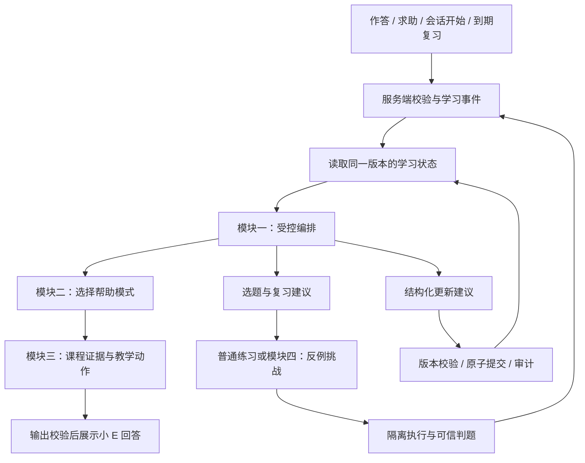

# PLEX 智能化升级：四模块实施方案

> **2026-10-19 最新范围调整**：用户已取消真实教师审核/120 条人工标注、正式质量与容量/成本评测、真实用户招募与试用三项目标。下文相关“暂缓/待完成/试用门槛”保留为历史，不再作为当前交付条件。四个技术模块及工程页面验收继续执行，最新完成标准以[工程验收范围](2026-10-19-engineering-acceptance-scope.md)为准。

日期：2026-10-15。状态：方案已获用户授权，按 P0→P4 实施中。最新证据与未完成事项见[实施记录](2026-10-15-plex-intelligence-implementation-log.md)。

2026-10-18 用户调整执行顺序：先跳过教师评审与基线标注，继续不依赖人工评审的工程联调。真实教师结论、正式质量评测暂缓；待审题不自动发布，合成账号的模拟审核不改称真人审核。原有材料与未验收项保留。

依据：用户提供的四份 PDF、出版方页面，以及当前本地代码。本文明确区分论文事实、PLEX 已有能力和拟新增能力。现有注册、邮件找回、首次入驻问卷与两套主题继续保留。

## 1. 目标与本轮边界

将 PLEX 的个性化从「读取画像后生成回答」推进到「持续记录可信学习证据，选择合适教学动作，再验证学习结果」。先服务现有 Python 课程和学生端，教师端负责查看依据、审核与纠偏。

四模块为：

1. **统一学习状态与受控编排**：借鉴 IntelliCode。
2. **小 E 分模式辅导**：借鉴 CodeAid。
3. **课程证据与教学动作协同的 RAG**：借鉴 KITE。
4. **经执行验证的反例挑战**：借鉴 BugSpotter。

Vue 3、Flask、SQLAlchemy、MySQL/SQLite 和 `KnowledgeService` 继续作为主架构。首版采用明确的事件路由与数据库事务，不迁移到 React/FastAPI/ArangoDB，也不为每个角色强制增加一次大模型调用。LangGraph 可在后续复杂分支需要时通过适配层引入，不能成为第二套学习状态存储。

方案整理阶段仅启动服务、核对原文并保存方案；用户随后已授权按步骤实现四模块。各阶段以实施记录中的实际测试和运行结果验收；基础 HTTP 200 不代表模型、检索和沙箱链路全部可用。

## 2. 论文依据与借鉴边界

| 论文 | 已核实的设计 | 对 PLEX 的借鉴 | 证据边界 |
| --- | --- | --- | --- |
| [IntelliCode，EACL 2026 Demo](https://aclanthology.org/2026.eacl-demo.10/) | 集中、带版本的学习者状态；六类角色提交更新，由编排器统一校验和写入；事件触发流程 | 状态版本、证据关联、单一写入服务、冲突处理 | 主要用模拟学习者验证；BKT-inspired 更新不是已经训练、校准的 BKT/DKT；POMDP 表述不等于部署了学习得到的强化学习策略 |
| [CodeAid，CHI 2024](https://arxiv.org/abs/2401.11314v2) | 功能入口决定输入和输出形态；概念回答、代码解释、修改建议、带逐行说明的伪代码 | 帮助模式、代码行定位、学生对反馈的控制 | 约 700 人课程、12 周部署；正文报告 563 人同意数据分析。使用与反馈证据不能直接证明成绩提升 |
| [KITE，BEA 2026](https://aclanthology.org/2026.bea-1.57/) | 课程文本处理、混合召回、MMR、交叉编码器重排、意图路由、多轮上下文 | 证据选择与教学动作分别建模，统一到实际回答链路 | 回答评估、专家和模拟学生为主；正文主要描述 PDF 文本处理，不能因此宣称已验证完整图文理解 |
| [BugSpotter，SIGCSE TS 2025](https://sigcse2025.sigcse.org/details/sigcse-ts-2025-Papers/49/BugSpotter-Automated-Generation-of-Code-Debugging-Exercises) | 生成错误代码、修正代码与解释；执行测试筛选；学生构造失败输入 | 新增反例挑战题型，结合执行验证和教学审核 | 741 人 C 语言课堂使用预筛题；并非实时生成材料的全面验证，也未证明长期调试能力提升；未发现显著差异不能当成严格等效证明 |

原文定位：IntelliCode §2–3、图 2、附录 B/C；CodeAid §3.1、§4.2、§5.1；KITE §3、图 1、§4；BugSpotter §3.1–3.2、§4.2、§5.5。

特别处理：不直接照搬 IntelliCode 的提示/用时惩罚和 40/50/10 选题比例；不直接复制 KITE 英文材料上的模型与阈值。KITE §3.3 描述最终八个片段，§4.2 又写评估 `top_k=5`，因此 PLEX 应自己固化实验配置，而不是把文中参数当成统一的最优配置。CodeAid 的部分流程在后台生成修正版再转成提示；PLEX 不把后台修正版发送给学生接口。

## 3. 当前代码基线与真正缺口

| 模块 | 已存在 | 本次新增或统一 |
| --- | --- | --- |
| 学习状态 | `StudentProfile`、历史版本、`StudentProfileSuggestion`、诊断记录、连续错题干预、错题复习 | 统一学习事件、按知识点记录的证据与不确定度、跨流程状态版本、受控更新提交 |
| 小 E | 聊天和试炼教练两个入口；试炼端已有代码、报错、测试结果和四档提示 | 共用帮助模式契约、模式对应的结构化输出、题目上下文校验、展示前教学约束检查 |
| RAG | 图谱扩展、向量/BM25、人工权重重排、每文档数量限制、独立教学策略 | 统一所有入口的证据/策略执行，来源定位、缺证据降级、会话连续性、检索消融实验 |
| 生成审核 | 资源流水线、代码检查、审核报告、教师审核、代码执行后端接口 | 反例题专用契约、错误/修正程序差分验证、学生输入判题、不可绕过的发布条件 |

关键代码依据：

- [画像模型](../backend/app/models/student_profile.py)、[画像服务](../backend/app/services/student_profile.py)、[入驻自述写入](../backend/app/services/onboarding.py)。
- [学习闭环](../backend/app/services/learning_cycle.py)、[连续错误干预](../backend/app/services/learning_adaptation.py)、[学习路径](../backend/app/services/learning_path.py)。
- [学习上下文](../backend/app/services/knowledge/learner_context_service.py) 当前仍将 `mastered/learning/weak/...` 状态映射成固定分值；这些不是经统计校准的掌握概率。
- [RAG 编排](../backend/app/services/knowledge/rag_service.py)、[教学策略](../backend/app/services/knowledge/strategy_service.py)、[重排](../backend/app/services/knowledge/rerank_service.py) 已有分层，不能再把「第一次增加意图识别或混合检索」当成本次创新。
- [聊天服务](../backend/app/services/messenger_chat.py) 存在要求不说明课程来源的提示文字；流式路径先发送内容再做最终处理，需要调整。
- [试炼教练组件](../frontend/src/components/trial/TrialAiFloatingBall.vue) 已有上下文与 L1–L4；应升级并兼容，而不是另做一个孤立聊天框。
- [代码执行](../backend/app/services/code_execution.py) 的 `mock` 分支实际调用宿主机 Python；[审核工具](../backend/app/services/resource_audit/code_tools.py) 也存在本地执行路径。超时不等于隔离。
- [通用运行接口](../backend/app/routes/code.py) 接受客户端测试用例；这类自测不能直接成为权威掌握证据。
- [资源服务](../backend/app/services/personalized_resource.py) 有开发/演示放行入口；反例题的执行验证不能被这些路径绕过。

## 4. 共用架构与端到端流程

共用上下文 `TutorContext` 至少包含：当前账号和课程范围、会话、题目及版本、代码快照哈希、可信作答记录、学习状态版本、帮助模式、提示历史、教学约束。账号与课程权限由服务器解析，不能信任请求体传来的身份或权限。

学生每次收到的回答、下一题和复习安排，应能追溯到同一个状态版本和对应证据。业务执行记录保存结构化决策摘要，不要求或展示模型内部思维链。

## 5. 模块一：统一学习状态与受控编排

### 学生看到什么

学习画像增加「最近学习变化」：例如“最近两次循环练习均遗漏末尾元素；建议先检查索引范围”。展示相关题目、日期、已验证事实和仍待确认的判断。教师可查看本班学生的依据、处理待确认建议，学生可更正自述信息。

### 数据与更新规则

保留原八维画像作为自述、偏好和描述信息；新增按课程组织的 `LearnerState`。一个状态对象可以聚合多张表，不把所有历史塞进一个无限增长的 JSON。

| 状态分组 | 首版字段与口径 |
| --- | --- |
| 知识点表现 | `concept_id`、`estimate`、`estimate_method`、独立/辅助成功次数、有效作答数、最近证据时间 |
| 不确定性 | `uncertainty`、`uncertainty_method`、证据覆盖与过期标记；明确是估计的不确定性，不是答案正确率 |
| 误概念 | 类型、候选/已确认/已缓解、证据 ID、确认人、更新时间 |
| 求助 | 模式、提示层级、题目/会话关联、已实际展示的提示记录 |
| 复习 | 复用现有 SM-2 计划和到期时间，保留计划修订来源 |
| 审计 | `state_version`、`policy_version`、`updated_at`、状态变化记录 |

首版采用可解释、可配置的证据累积规则，不宣称训练了知识追踪模型。无可信作答时 `estimate=null`、显示“尚待了解”，而不是把未学习直接当成不会。旧状态映射保留为兼容输出，不当作测验数据回填。

独立完成和依赖提示后完成分别记录，辅助成功作为较弱的独立能力证据；请求提示、答题慢、切出页面本身不降低掌握度。问卷自述只影响起始讲解方式，不产生测验正确次数。误概念从候选开始，达到有版本规则规定的重复证据或经教师确认后再提升状态。

### 编排与事务

拟新增 `learning_events`、`learner_states`、`learner_state_changes`，复用并扩展现有画像建议。事件使用唯一幂等键，如 `(actor, source_type, source_id, event_type, source_version)`。

六类职责映射为评估、画像建议、提示、选题、复习、参与度支持；它们与现有六步资源生成流水线是两类流程。评估判定、选题规则、复习计算优先采用确定性实现；模型负责教学表达或提出待验证的诊断建议。

处理步骤：

1. 业务记录与待处理事件写入同一事务。只接受服务端可验证的作答结果；浏览器本地日志和自带测试结果可供排错，不直接更新掌握度。
2. 工作进程读取事件和状态快照，调用所需模块，得到 `{base_version, proposed_changes, evidence_ids, reason, producer_version}`。
3. 模型调用在事务外执行，避免长时间持锁。
4. `LearnerStateService` 是统一写入入口：校验字段、证据、权限、版本和冲突；短事务提交状态、变化记录和事件完成状态。
5. 版本冲突重新读取并重算；不得把旧增量强行覆盖新状态。矛盾建议保留待确认，不能用“最后返回的模型”作为裁决。
6. 事件任务持久化，带领取租约、次数和失败原因，支持重启恢复。`session_start`、`review_due` 也去重；到期扫描由产品后台工作进程负责。

同一事件最多改变状态一次。既有服务中的 `commit()` 边界要纳入事务改造，避免只更新了画像、却没有记录作答或状态版本。

### 首版验收

并发提交、重复消息、工作进程中断、模型输出非法字段、过期版本和乱序事件均有测试。同一事件不重复增分；每条掌握变化均能追溯到服务器证据；不同班级、不同账号不可互读。连续两次边界错误能同步影响下一次提示、选题理由和复习建议。

## 6. 模块二：小 E 分模式辅导

### 界面与契约

聊天页和代码工作区共用四个入口，保留自由提问：

| 模式 | 自动携带的上下文 | 首版输出 |
| --- | --- | --- |
| 解释这个报错 `explain_error` | 当前代码、最近一次真实报错、题目说明 | 报错含义、可核对的代码位置、一个排查动作 |
| 检查我的思路 `review_approach` | 学生思路、代码或伪代码、题目约束 | 已成立的部分、待核实的条件、一个验证问题 |
| 只提示下一步 `next_step` | 已有尝试、提示记录、当前卡点 | 一个具体下一步，避免再次给相同提示或直接给完整答案 |
| 用伪代码说明 `pseudocode` | 当前题意、学生尝试、允许的帮助级别 | 受控粒度的伪代码与逐行说明；可聚焦局部，不默认给完整算法 |

上下文卡显示正在讨论哪道题、哪次运行，并允许用户移除不相关代码。聊天页没有题目或代码时才请求补充，不能自行猜测。代码行号必须落在当前代码快照内；学生修改代码后，旧行号提示标记为对应旧版本。

统一返回 `TutorResponse`：`mode`、`summary`、`annotations`、`next_step`、`pseudocode_lines`、`follow_up`、`citations`、`policy_result`、`state_version`、`request_id`。只返回模式允许的字段，不把隐藏修正版、隐藏测试、模型完整内部响应混入学生载荷。

### 教学约束与流式展示

模式和提示层级分开：模式定义要做什么，层级定义允许解释多细。现有 L1–L4 保留兼容映射，允许程度由服务端课程/任务策略决定，前端不能通过传 `hint_level=4` 解锁考试答案。

常规练习采用渐进帮助；考试按教师配置关闭或限制。自主学习中的完整讲解可在允许的场景明确开放，不承诺所有场景都永远不给答案。

受限模式先发送“正在核对题目与代码”的阶段消息，完成结构和教学约束校验后再展示正文；不能先把完整代码通过 SSE 发出，再在 `done` 里删掉。首版可完整校验后分段呈现，以换取可靠性。伪代码、自然语言和短代码同样进入泄题评测，不能只用是否出现代码块判断。

一次回答成功展示后才记录求助事件，重试不重复记次数；不把模型生成成功误当成学生已看懂。断网、取消或上下文过期有明确状态，且不触发成绩变化。

主要落点：`MessengerView.vue`、`TrialAiFloatingBall.vue`、`api/agentService.ts`、`messenger_chat.py` 与现有 `/agents/trial-coach`。提取共用辅导服务，两处入口保留各自的 UI。

## 7. 模块三：升级课程 RAG 的证据与教学动作

### 结构调整

沿用 `KnowledgeService.prepare/finalize`，明确输出两部分：

- `EvidencePlan`：原始问题、检索改写、课程范围、概念与先修关系、文档版本、候选证据、去重后的上下文和证据状态。
- `TeachingPlan`：帮助模式、问题意图、当前任务限制、讲解动作、提示粒度、缺证据时如何响应。

小 E、试炼教练、独立 RAG 接口和资源生成共同消费这两个计划，避免各自拼接一套不同的提示。相同证据可以支持直接解释、思路检查、调试定位或过程推演，但不必每次都反问学生。

### 首版检索改动

1. 保留向量/BM25/图谱召回和当前重排作为基线；先建立课程标注查询集，再比较 MMR 和可选交叉编码器的收益。中文与 Python 混合文本单独检查，不直接采用英文论文模型作为默认。
2. 在召回前应用课程、班级、发布状态和资源可见性过滤；教师专属材料、未发布答案不能因为相关而被检索给学生。
3. 增强重复页眉页脚清理，保留章节、代码块、页码和文档版本；使用小样本解析回归，避免清洗掉缩进或重复但有意义的代码。
4. 用语义去冗余补充现有“同文档最多三个片段”；先修缺口触发补充材料或降难度，不阻止学生阅读其主动询问的高级主题。
5. 增加 `algorithm_validation`、`algorithm_trace` 等动作映射；允许用户明确切换帮助方式，分类不确定时不能无限调用模型。
6. 按当前题目保存简短会话状态：已解释内容、已给提示、尚未解决的问题。换题不沿用旧题假设，跨账号不复用。

### 回答与来源

删除聊天中“不要说明来源”的冲突指令，使用学生可读的引用卡：材料名、章节/页码、支持的说明、可访问链接。所有引用 ID 必须来自本次检索，URL 由服务器依据已授权资源构建，模型不能自造来源。

区分 `grounded`、`insufficient_evidence`、`retrieval_unavailable`。无课程依据时说明未找到依据；可提供明确标注的通用概念帮助，但不能声称属于课程结论。题目专属答案和依赖证据的判断维持更严格限制。检索分值不是答案正确概率。

算法执行轨迹优先使用受限执行器产生步骤数据。不能执行时，模型推演必须标明为说明性示例，不把未执行的轨迹当作运行事实。

引用、教学策略和答案检查均在展示前生效；最终文本、流式内容与日志保存的内容保持一致。首版不宣称实现多模态文档理解。

## 8. 模块四：反例挑战关卡

### 学生与教师流程

在试炼中心增加「反例挑战」题型，首版采用 Python、固定函数签名及 JSON 输入，避免让学生把测试表达式作为任意代码提交。

学生看到：题目要求、输入范围、一段有错误的代码、输入框、预期输出与原因说明。提交后得到“输入是否合法、是否暴露错误、实际结果与正确结果是否不同”的反馈；解释不足与没有找到反例分别反馈。

首版重点覆盖循环边界、空输入、重复元素。空输入只有在题目允许的输入范围内才能作为反例，不能用违反题目约束的数据证明程序错误。

### 生成与发布管线

`教师批准的题意/输入约束/测试 → 模型候选 → 结构检查 → 隔离差分执行 → 教学审核 → 教师发布`。

每个候选保存错误代码、修正代码、错误类型、说明、输入契约、测试版本与执行报告。教师可信参考实现及独立测试作为判定依据；不能仅用模型同时生成的修正版和测试互相证明正确。

发布的必要条件：

- 两份程序语法有效，符合函数/输入输出契约；修正版通过独立测试集。
- 错误版在至少一个合法输入上产生不同结果或属于题目明确定义的异常。
- 不存在超时、执行隔离失败、不可重复结果等未解决硬错误。
- 保存可复现的见证输入、运行环境版本、代码/题目/测试哈希。
- 教学审核检查是否单一、清楚的错误，题意是否一致，解释是否准确，难度是否合适。

通过测试只是相对于当前测试集合的验证。对重复元素、空输入等再增加性质测试或变形测试，仍不宣称对所有输入形式化证明正确。

反例题使用独立发布门槛：现有自动放行、批量放行和普通教师批准都不能把执行失败候选直接公开。修改代码或测试后必须重新验证；历史作答绑定旧题目版本。

### 判题与隔离

学生接口只接受挑战 ID/版本、JSON 输入、预期输出与解释，错误程序、修正版、参考实现和隐藏测试由服务器读取。隐藏内容不出现在响应、前端构建、引用或错误堆栈中。

确定性执行判定反例是否成立；模型评价说明是否抓住关键概念，低置信度可由教师复核。模型不可推翻已经记录的执行结果。执行器故障返回可重试状态，不算学生答错；失败不计掌握下降、不扣次数。

所有学生代码、模型候选以及生成的测试统一进入隔离执行适配器。默认无网络、非特权用户、临时工作目录、只读基础镜像，限制 CPU、内存、进程数、输出大小和总墙钟时间，不挂载宿主机项目目录或 `.env`。优先评估现有 Judge0 适配器的隔离部署；E2B 保留可选方案，费用和部署能力未验证前不作为强制依赖。

**真实用户试用前必须关闭宿主机执行回退。隔离环境不可用时禁用执行功能，不能退回本地 `subprocess`。** 这是由当前代码发现的实际前置项，不是仅在说明中加一条安全提示。

首次题库建议准备约 30 道人工审阅的固定版本题，数量是建设目标；先使用已验证题，再做后台批量生成补充，避免学生每次点击都等待模型现场生成。成功构造反例记录为调试/边界分析证据，不直接视为该算法已完全掌握。

## 9. 拟新增接口、数据与兼容

以下为目标契约，实施时与现有 API 统一；端点的实际完成情况见实施记录。

| 接口 | 作用与权限 |
| --- | --- |
| `GET /api/v1/student/learner-state` | 本人状态摘要、版本与证据充分程度 |
| `GET /api/v1/student/learning-evidence` | 分页查看本人可见证据和状态变化 |
| `GET /api/v1/teacher/students/<id>/learner-state` | 仅所教班级学生；敏感自述默认不展开 |
| 扩展 `POST /api/v1/agents/trial-coach` 及聊天请求 | 增加模式、题目版本、代码快照、运行记录引用；旧请求走兼容默认模式 |
| `GET /api/v1/student/counterexample-challenges` | 仅已发布且有访问权限的题目 |
| `GET /api/v1/student/counterexample-challenges/<id>` | 严格使用学生题面视图 |
| `POST /api/v1/student/counterexample-challenges/<id>/attempts` | 幂等提交输入和解释，返回判定/任务状态 |
| `POST /api/v1/teacher/counterexample-generation-tasks` | 授权教师创建后台候选任务，受配额限制 |
| `POST /api/v1/teacher/counterexample-challenges/<id>/review` | 绑定题目版本和验证报告的审核操作 |

事件只由受信任业务服务产生，不公开“随意修改掌握度”的 API。拟新增反例题/版本、验证报告、作答记录；复用资源任务框架和审核展示，但分清硬性执行状态与教学审核意见。

迁移采用新增表/字段，保留现有记录。已有用户可从真实历史作答重建证据，标记 `historical_import`；无法验证来源的本地/客户端记录只做兼容展示。入驻编号、主题、聊天历史、复习计划不重置。经典/漫画与深浅主题均覆盖新增 UI。

新状态服务先影子计算，与旧推荐并行对照；正式启用后通过兼容读取层逐步替换旧的固定分值口径。使用统一功能开关切换读取策略，不能让一个请求混用新旧状态。回退时保留事件和审计数据，不删除已完成的学习记录。

## 10. 实施顺序与每阶段交付

| 阶段 | 工作 | 可验收交付 |
| --- | --- | --- |
| P0：基线与前置条件 | 固化当前认证/入驻改动、课程样本、现有回答/检索基线；明确服务端可信判题；确定隔离执行部署 | 回归清单、样本集、执行适配方案和功能开关 |
| P1：模块一最小闭环 | 事件、版本化状态、统一写入、证据历史；先接正式作答、求助、复习三个事件 | 一次真实作答可追溯地改变状态；重试与重启不会重复更新 |
| P2：模块二与三联调 | 四种帮助模式、共用上下文、可读引用、展示前校验、缺证据处理 | 同题同证据下，不同模式产生合适且可检查的反馈 |
| P3：模块四 | 反例题型、后台生成、隔离差分验证、教师审核、学生判题、学习事件回写 | 三类边界问题的完整挑战流程与首批审阅题库 |
| P4：真实试用准备 | 教师诊断视图、配额、失败重试、成本/延迟观测、两套主题验收、小范围试用 | 可邀请用户的版本、问题清单和真实使用记录 |

优先级：先保证事件与证据可信，再让小 E 的帮助体验可见改善，之后开放反例挑战。四模块共用一套状态、课程权限和执行证据，避免四套功能各自记录不同的学生结论。

每阶段分别提交迁移、API 契约、Vue UI、回归测试和变更说明。先完成阶段验收再扩大开放范围，不能用“全部角色调用了模型”代替验收。

## 11. 测试、评估与真实商业价值

### 工程验收

- **状态**：同一事件重复 100 次只产生一次逻辑更新；并发无丢失；版本冲突可重试；故障恢复后不漏事件；无可信证据保持未知。
- **辅导**：四模式各覆盖正常输入、缺代码、代码已变更、重复求助、跨题、考试限制和越权；受限答案在首次可见内容中也不泄漏；非法行号不展示。
- **RAG**：引用 ID 和文档权限校验通过；断向量库、空检索、冲突材料、旧文档、恶意材料、长代码输入都有明确结果；检索不得写画像。
- **反例**：正确程序、语法错误、无限循环、随机结果、越界输入、伪造预期输出、重复提交均正确处理；执行失败不能发布、不能当作学生错误。
- **平台**：SQLite/MySQL 迁移和回归；新老账号及教师管理员权限；代码和数据不因试用初始化被重置。
- **界面**：四种外观组合、1440/1024/768/390px、键盘、减少动态效果、长代码、移动端行号和引用卡。浏览器不可用时记录未验收，不能以构建代替。

上述精确一致性要求是工程验收标准，不代表模型回答准确率能达到 100%。

### 研究与产品评估

建立教师标注的课程查询/辅导集，建议首批约 120 条，覆盖五类教学意图、缺证据和错误上下文；开发集与冻结测试集分开。反例题额外建立独立参考实现与合法输入集合。数量是拟建设目标，不是已存在数据。

| 目标 | 测量方式 |
| --- | --- |
| 状态确实可靠 | 事件重复/丢失率、冲突率、证据覆盖率、教师纠正率、回放一致性 |
| 检索确有增益 | 同模型和配置下比较直接问模型、现有 RAG、增加意图/状态的 RAG；Recall@K、nDCG、来源支持度与过度拒答 |
| 辅导更实用 | 模式匹配、学生能否执行下一步、重复求助率、独立修复率、泄题率、教师盲评 |
| 材料更可靠 | 候选验证通过率、独立测试发现率、题目重复率、审核耗时、解释纠错率 |
| 具备运营条件 | 首次有效练习完成率、次周复访、教师采用率、每次有效帮助成本、每道发布题成本、P50/P95 延迟、失败率 |

所有模型调用记录实际供应商、模型、提示版本、状态版本、检索配置、耗时与 token；统一使用 `request_id` 关联，不默认保存完整敏感对话副本。缓存必须包含账号/课程范围、题目与材料版本和状态版本。

成本控制从事件路由开始：不让每个请求运行六个模型；常规求助优先一次生成，规则/缓存能完成的步骤不调用模型；生成任务设每人/每班配额、候选数量和重试上限。记录执行器耗时与模型实际用量，成本目标在拿到基线后确定，不编造“低成本”“高并发”结论。

小范围试用建议先招募 20–30 名自愿参与者、持续约两周，作为可用性和故障发现阶段，不能据此宣称显著学习增益。若要证明学习提升，再设计同等难度前后测、对照条件和样本量分析；模型评分需人工抽样复核。

可以面向用户解释的价值：学生获得更贴合当前卡点的帮助；教师看到依据、减少重复定位问题的时间；课程负责人可追踪内容质量与使用成本。这些先作为待验证价值假设，不把论文实验结果直接作为 PLEX 的商业或教学成绩。

## 12. 一个贯穿四模块的验收场景

学生两次遗漏循环末尾元素 → 服务器保存失败用例 → 状态记录“边界理解待巩固”和证据 → 点击“只提示下一步” → 检索课程中的 `range` 上界规则 → 小 E 指向当前代码中循环范围，引用课程片段，不给整段修正版 → 推荐已审阅的边界反例挑战 → 学生提交合法输入，使错误版与可信参考结果不同 → 执行器确认 → 状态记录辅助练习成功并安排复习 → 后续独立完成普通编程题，再增加独立掌握证据。

这条流程跑通、可解释、可重试且可评测，才算四项借鉴真正落到 PLEX。

## 2026-10-18 浏览器补验状态

人工评审按用户要求暂缓。浏览器原入口已恢复，独立合成环境完成部分真实交互与四处缺陷修复；详见[浏览器验收记录](2026-10-18-browser-acceptance.md)。完整外观/异常矩阵、普通新账号流程、真实教师评审和正式用户试用仍未完成。主库与主服务本轮未变更，Python 轨迹主开关保持关闭。

## 2026-10-19 普通新生与作答补验状态

详见[普通新生验收记录](2026-10-19-ordinary-student-acceptance.md)。普通新生入驻、刷新恢复、固定编号及自述/能力证据分离已有实际页面证据；修复问卷排序、无样本统计、编程题入口和失败提交误报通过。前者三项已实际走查，提交反馈修复的真实页面复验待浏览器恢复。完整目标、人工评审暂缓范围及真实试用要求均不变。

## 2026-10-19 浏览器恢复后的继续验收

用户恢复 HTTP 页面后，普通合成新生完成第二次失败、只读代码复盘、反例与额外独立练习，状态到 v10。新增已完成题目复盘入口，修复缓存试炼页面的小 E 悬浮窗跨页面残留。50 项辅导前端回归通过。保留第三题额外文本导致的真实失败，没有改写成绩。

仍发现默认快捷提示检索不足、后续语义审核回退重复且没有展示课程引用，完整流程不能标为通过。详情及可追溯证据见[普通新生补验记录](2026-10-19-ordinary-student-acceptance.md)。教师评审、基线标注继续暂缓；完整主题/异常矩阵和真实试用仍未完成。

## 2026-10-19 默认检索与连续辅导修复

已修复上一轮发现的快捷操作检索稀释与历史回退固定索取尝试结果的问题，并补充固定类别的审核失败诊断。隔离夹具学生在实际浏览器中两轮均经真实模型生成及审核，均有课程引用；第二轮承接已给出的索引推演，提出新的单元素核对。检索阈值与访问约束未变。83 项后端、50 项前端辅导回归及构建通过，主服务已加载修复，指定六张主库表重启前后摘要一致。

详见[修复补验记录](2026-10-19-ordinary-student-acceptance.md)。本次只通过一个合成场景，不代表全部教学质量验收；自动反例推荐、普通新生教师侧追溯、完整外观/异常矩阵与实际试用仍待完成。人工评审和标注继续暂缓，整体目标仍未完成。

## 2026-10-19 反例自动推荐与教师追溯补验

已将共享学习证据连接到反例推荐：当前支持重复循环边界线索，过滤班级权限、固定发布版本、验证报告与已完成挑战，缓存重放重新核验。实际浏览器在独立合成环境完成“下一步提示和引用 → 推荐挑战 → Docker 反例验证 → 教师查看 v6 证据”，普通新生的 v10 十条历史也在教师页面核对。115 项 SQLite 相关回归、14 项 MySQL 推荐测试、51 项前端测试及构建通过。

详细契约、方法区分、截图与源码摘要见[反例推荐说明](2026-10-19-counterexample-recommendations.md)。本次只验证合成场景，既有题目审核仍由夹具模拟；完整主题/异常矩阵、真实教师审核、120 条人工标注和真实试用仍待完成。主服务已加载代码，指定六张主库表重启前后摘要一致，不扩展为整库验证。整体目标保持未完成。
