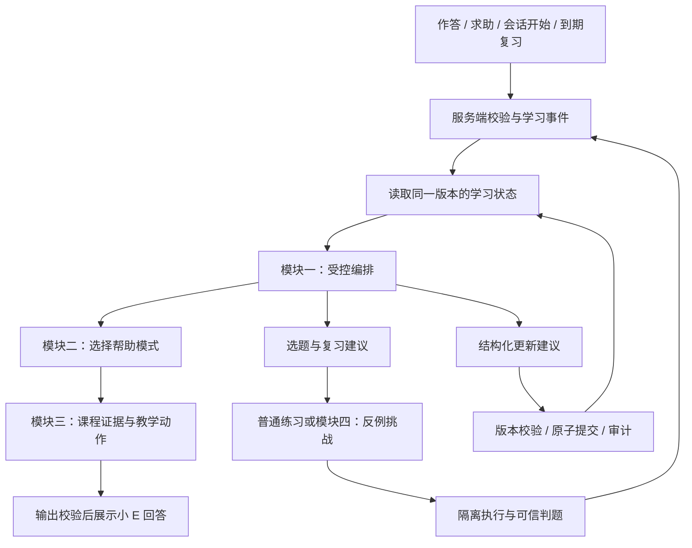

# PLEX 技术更新汇编（2026-10-12 至 2026-10-19）

> 本文将 PLEX 更新期间形成的主题改版、入驻流程、AI 技术方案、实现记录、架构说明、测试和验收/评估文档合并为单一 Markdown，便于交接和查阅。各来源正文完整保留。方案/计划章节表达设计意图；实现日志与验收章节记录实际进度，二者状态不应混为一谈。未注明“通过”的验收项不代表已经完成。

## 内容索引


- [2026-10-12-plex-comic-implementation](#2026-10-12-plex-comic-implementation) — `docs/2026-10-12-plex-comic-implementation.md`
- [2026-10-12-PLEX更新汇总](#2026-10-12-plex更新汇总) — `docs/2026-10-12-PLEX更新汇总.md`
- [2026-10-13-student-visual-themes](#2026-10-13-student-visual-themes) — `docs/2026-10-13-student-visual-themes.md`
- [2026-10-14-auth-trial-readiness](#2026-10-14-auth-trial-readiness) — `docs/2026-10-14-auth-trial-readiness.md`
- [2026-10-14-student-onboarding](#2026-10-14-student-onboarding) — `docs/2026-10-14-student-onboarding.md`
- [2026-10-15-plex-intelligence-four-module-plan](#2026-10-15-plex-intelligence-four-module-plan) — `docs/2026-10-15-plex-intelligence-four-module-plan.md`
- [2026-10-15-plex-intelligence-implementation-log](#2026-10-15-plex-intelligence-implementation-log) — `docs/2026-10-15-plex-intelligence-implementation-log.md`
- [2026-10-16-counterexample-generation](#2026-10-16-counterexample-generation) — `docs/2026-10-16-counterexample-generation.md`
- [2026-10-16-counterexample-properties](#2026-10-16-counterexample-properties) — `docs/2026-10-16-counterexample-properties.md`
- [2026-10-16-counterexample-student-flow](#2026-10-16-counterexample-student-flow) — `docs/2026-10-16-counterexample-student-flow.md`
- [2026-10-16-counterexample-teacher-workbench](#2026-10-16-counterexample-teacher-workbench) — `docs/2026-10-16-counterexample-teacher-workbench.md`
- [2026-10-17-counterexample-catalog](#2026-10-17-counterexample-catalog) — `docs/2026-10-17-counterexample-catalog.md`
- [2026-10-17-messenger-learning-artifacts](#2026-10-17-messenger-learning-artifacts) — `docs/2026-10-17-messenger-learning-artifacts.md`
- [2026-10-17-model-accounting](#2026-10-17-model-accounting) — `docs/2026-10-17-model-accounting.md`
- [2026-10-17-resource-course-evidence](#2026-10-17-resource-course-evidence) — `docs/2026-10-17-resource-course-evidence.md`
- [2026-10-17-resource-learning-context](#2026-10-17-resource-learning-context) — `docs/2026-10-17-resource-learning-context.md`
- [2026-10-17-tutor-runtime-controls](#2026-10-17-tutor-runtime-controls) — `docs/2026-10-17-tutor-runtime-controls.md`
- [2026-10-18-browser-acceptance](#2026-10-18-browser-acceptance) — `docs/2026-10-18-browser-acceptance.md`
- [2026-10-18-classroom-observations](#2026-10-18-classroom-observations) — `docs/2026-10-18-classroom-observations.md`
- [2026-10-18-course-pdf-parsing](#2026-10-18-course-pdf-parsing) — `docs/2026-10-18-course-pdf-parsing.md`
- [2026-10-18-learning-evidence-history](#2026-10-18-learning-evidence-history) — `docs/2026-10-18-learning-evidence-history.md`
- [2026-10-18-model-cost-estimates](#2026-10-18-model-cost-estimates) — `docs/2026-10-18-model-cost-estimates.md`
- [2026-10-18-plex-intelligence-completion-audit](#2026-10-18-plex-intelligence-completion-audit) — `docs/2026-10-18-plex-intelligence-completion-audit.md`
- [2026-10-18-python-execution-traces](#2026-10-18-python-execution-traces) — `docs/2026-10-18-python-execution-traces.md`
- [2026-10-18-rag-runtime-controls](#2026-10-18-rag-runtime-controls) — `docs/2026-10-18-rag-runtime-controls.md`
- [2026-10-18-resource-admission](#2026-10-18-resource-admission) — `docs/2026-10-18-resource-admission.md`
- [2026-10-19-counterexample-lifecycle-acceptance](#2026-10-19-counterexample-lifecycle-acceptance) — `docs/2026-10-19-counterexample-lifecycle-acceptance.md`
- [2026-10-19-counterexample-page-acceptance](#2026-10-19-counterexample-page-acceptance) — `docs/2026-10-19-counterexample-page-acceptance.md`
- [2026-10-19-counterexample-recommendations](#2026-10-19-counterexample-recommendations) — `docs/2026-10-19-counterexample-recommendations.md`
- [2026-10-19-engineering-acceptance-scope](#2026-10-19-engineering-acceptance-scope) — `docs/2026-10-19-engineering-acceptance-scope.md`
- [2026-10-19-messenger-lifecycle-acceptance](#2026-10-19-messenger-lifecycle-acceptance) — `docs/2026-10-19-messenger-lifecycle-acceptance.md`
- [2026-10-19-ordinary-student-acceptance](#2026-10-19-ordinary-student-acceptance) — `docs/2026-10-19-ordinary-student-acceptance.md`
- [2026-10-19-python-trace-page-acceptance](#2026-10-19-python-trace-page-acceptance) — `docs/2026-10-19-python-trace-page-acceptance.md`
- [2026-10-19-resource-page-acceptance](#2026-10-19-resource-page-acceptance) — `docs/2026-10-19-resource-page-acceptance.md`
- [2026-10-19-teacher-evidence-entry](#2026-10-19-teacher-evidence-entry) — `docs/2026-10-19-teacher-evidence-entry.md`
- [2026-10-19-teacher-workbench-ui-acceptance](#2026-10-19-teacher-workbench-ui-acceptance) — `docs/2026-10-19-teacher-workbench-ui-acceptance.md`
- [2026-10-16-retrieval-engineering](#2026-10-16-retrieval-engineering) — `docs/evaluation/2026-10-16-retrieval-engineering.md`
- [2026-10-18-state-availability-evaluation](#2026-10-18-state-availability-evaluation) — `docs/evaluation/2026-10-18-state-availability-evaluation.md`
- [2026-10-18-teacher-baseline-workflow](#2026-10-18-teacher-baseline-workflow) — `docs/evaluation/2026-10-18-teacher-baseline-workflow.md`
- [2026-10-18-three-arm-teacher-evaluation](#2026-10-18-three-arm-teacher-evaluation) — `docs/evaluation/2026-10-18-three-arm-teacher-evaluation.md`

---

## 合并正文


---

## 2026-10-12-plex-comic-implementation

来源文件：`docs/2026-10-12-plex-comic-implementation.md`

<!-- BEGIN SOURCE: docs/2026-10-12-plex-comic-implementation.md -->

# PLEX 深色太空漫画改版验收记录

日期：2026-10-12。依据用户批准的四张效果图实施，前端仍为 Vue 3、Naive UI。

## 实施范围

- 学生导览：小E图标、黄色步骤徽标、青色主按钮、漫画气泡边框。三角色导览统一移除 Driver.js 的按钮文字阴影，并提供键盘焦点描边。
- 探索舱资源看板：等级徽章、分段 XP 条、三格资源分镜，沿用实际账号数值和资源入口。
- 驿站助手：小E欢迎空态、双方带尾角的消息气泡、会话选择页签、描边快捷按钮。保留流式回答、代码块、知识来源与已有交互。
- 学生顶部信息栏：独立通知和主题按钮、通知角标、小E身份卡、等级贴纸和用户菜单。
- 深浅主题共享配色变量；漫画样式限定到上述学生区域。无 API、数据库和业务字段修改。

主要文件：`frontend/src/styles/student-comic.css`、`frontend/src/styles/driver-theme.css`、`frontend/src/assets/xiao-e-comic.svg`，以及四处对应组件与导览 composable。

## 本轮已通过的验证

| 验证项 | 结果 |
|---|---|
| `npm run build` | 生产文案检查、vue-tsc、Vite 构建、包体预算检查通过 |
| `git diff --check` | 通过 |
| 三角色 × 深浅主题导览 | 浏览器计算样式中按钮 `text-shadow` 均为 `none`；非学生端无漫画顶部栏类名 |
| 学生导览流程 | 前进、后退、完成、关闭和菜单重启正常；首步“上一步”禁用；Tab 焦点可见 |
| 资源看板响应式 | 1440、1024、768、390px 下内容未横向溢出；平板自动堆叠，手机资源格保持三列 |
| 聊天响应式 | 四档宽度检查完成；390×844 下消息、代码、引用卡片和输入区未撑宽页面 |
| 会话和菜单 | 创建第二会话、切回第一会话、通知弹层、个人菜单及深浅主题切换正常 |
| 实际聊天 | 在学生演示账号发送 Python 问题，成功显示增量回答、代码块和四条课程来源 |
| 浏览器错误 | 验收页收集的 error 级日志为空 |

悬停时清除阴影由同一 CSS 规则覆盖；本轮未通过自动化鼠标悬停逐角色验收。浏览器缩放快捷键未在内嵌浏览器中生效，因此未将实际浏览器缩放记为通过。没有为 CSS 外观新增重复实现的单元测试。

## 实际页面截图

- [学生导览](design/plex-comic-2026-10-12/screenshots/01-tour-dark.jpg)
- [资源看板与顶部信息栏](design/plex-comic-2026-10-12/screenshots/02-dashboard-dark.jpg)
- [聊天空态](design/plex-comic-2026-10-12/screenshots/03-chat-empty-dark.jpg)
- [真实聊天消息态](design/plex-comic-2026-10-12/screenshots/09-chat-message-dark.jpg)
- [手机聊天](design/plex-comic-2026-10-12/screenshots/05-chat-mobile.jpg)
- [手机资源看板](design/plex-comic-2026-10-12/screenshots/08-dashboard-mobile.jpg)
- [手机导览](design/plex-comic-2026-10-12/screenshots/10-tour-mobile.jpg)

## AI 演示验证与未解决项

已更新 [AI 技术原理与 18 个方向的答辩问答](PLEX-AI技术原理与答辩问答.md)，分别标明实现能力、运行记录和待验证效果。

- 本轮聊天 SSE 的结束事件为 `source=llm_stream`、`rag_used=true`。单次接口报告首字 2235ms，请求约 2875ms；响应未给出供应商与模型名，不能据此证明特定模型已验收。
- 独立知识检索成功（日志 ID 16），命中课程材料，提供图谱关系和重排分解。通道计数为词法 20、图谱 12、向量 0。
- 已查看历史资源任务 `rg_3a943649244d449d8e20` 的六步执行记录，均为 completed；记录完成时间为 2026-08-28，不能当作本轮重新生成的结果。
- 启动时的 Chroma 初始化异常仍未修复。当前请求可以从其他通道取得课程材料，不等于向量链路恢复；答辩前仍需单独处理和复验。
- 没有执行本轮资源重新生成、压力测试、消融实验或真实学习效果实验。

本地入口：前端 `http://localhost:5180`，后端 `http://127.0.0.1:5100`。

<!-- END SOURCE: docs/2026-10-12-plex-comic-implementation.md -->


---

## 2026-10-12-PLEX更新汇总

来源文件：`docs/2026-10-12-PLEX更新汇总.md`

<!-- BEGIN SOURCE: docs/2026-10-12-PLEX更新汇总.md -->

# PLEX 2026-10-12 更新汇总

本页汇总当天完成的 PLEX 界面、技术答辩与线下展示资料，作为 GitHub 中的统一入口。

## 一、深色太空漫画 UI

- [完整 UI 改版提示词](PLEX-深色太空漫画UI改版提示词.md)：可直接复用的实施总提示词、四张效果图的原始提示词、源码位置及验收要求。
- [设计与验收图片档案](design/plex-comic-2026-10-12/README.md)：四张效果图、四张原始参考截图、十张实际页面截图。
- [实现与验证记录](2026-10-12-plex-comic-implementation.md)：新手导航、资源看板、小 E 聊天和顶部信息栏的改动范围与检查结果。

漫画样式限定于学生端指定区域，继续使用 Vue 3、Vite 与 Naive UI；三角色导览按钮均清除文字重影。前端构建检查已通过，具体交互、响应式检查及验证边界见实现记录。

## 二、AI 技术答辩材料

- [PLEX AI 技术原理与答辩问答](PLEX-AI技术原理与答辩问答.md)：可口述的系统原理、18 个方向的技术追问、代码依据、能力边界及演示验证记录。

材料区分真实模型调用、实际检索结果和历史资源流水线记录。Chroma 启动异常与向量召回未通过已明确记录；未完成的消融、压力和学习效果实验没有填写推测指标。

## 三、线下展示与包装

| 材料 | 内容与入口 |
| --- | --- |
| 小 E 探索者收藏卡 v01 | [说明与印刷文件](market-materials/explorer-card-v01/README.md)，保留初版设计及生成提示词。 |
| 小 E 探索者收藏卡 v02 | [清新配色正式资料](market-materials/explorer-card-v02/README.md)，包含正反面原图、61×91 mm 含出血印刷 PDF、提示词、构建脚本和校验结果。 |
| 透明自封袋 | [包装方案](market-materials/clear-self-seal-bag-v01/README.md)，包含包装效果图、60×20 mm 标签图和生成提示词。 |
| PLEX 作品展板 | [80×180 cm X 展架资料](market-materials/exhibition-board-v01/README.md)，包含预览、印刷 PDF、可编辑 SVG、五张插画、二维码、最终文案、生成提示词、排版脚本、验收记录与交付 ZIP。 |

展板的验收记录包含页面尺寸、嵌入字体、最终 PDF 渲染图的二维码解码和插画实际分辨率。制作商需要确认的孔位、出血模板与色彩流程详见各材料说明。

## 四、小 E 坐姿摆件

- [商家制作说明](../hardware-prototypes/xiao-e-seated-figurine-v01/商家制作说明.md)
- [坐姿三视图](../hardware-prototypes/xiao-e-seated-figurine-v01/xiao-e-seated-three-views-v1.png)
- [生成提示词](../hardware-prototypes/xiao-e-seated-figurine-v01/generation-prompt.txt)

本次交付为外观概念与建模沟通材料，未包含可直接生产的 STL、标定尺寸或工程公差。

<!-- END SOURCE: docs/2026-10-12-PLEX更新汇总.md -->


---

## 2026-10-13-student-visual-themes

来源文件：`docs/2026-10-13-student-visual-themes.md`

<!-- BEGIN SOURCE: docs/2026-10-13-student-visual-themes.md -->

# PLEX 学生端双视觉主题

学生端右上角的外观按钮提供两个独立设置：

- 界面风格：**经典太空 / 太空漫画**。
- 明暗模式：**深色 / 浅色 / 跟随系统**。

未选择风格的用户默认使用经典太空。风格保存在浏览器 `plex-visual-style`，明暗继续使用 `plex-color-mode`，两者互不覆盖。风格切换不重新挂载路由、不清空聊天记录或输入草稿、不改变练习与任务状态。

## 实现范围

漫画风包括此次确认的首页横幅、首页四项统计、探索舱试炼场信息牌与双任务入口、资源生成工作台与统计、试炼战绩。继续使用现有真实数据与操作，不固定截图数值。

上一轮的新手导览、探索者资源条、聊天气泡、顶部信息栏也已纳入同一开关；经典风格恢复原容器、头像和空态结构。导航按钮 `text-shadow: none` 修复在两套风格和三种角色中共同保留。

漫画视觉规则统一以 `html[data-plex-style='comic'][data-plex-persona='student']` 为前缀，包含移动端、浅色模式及挂载到 body 的通知/导览。教师端、管理员端、登录页不启用漫画视觉；学生选择仍被记住，返回学生端可恢复。

实现入口：

- `frontend/src/stores/theme.ts`：独立风格状态、持久化及角色门控。
- `frontend/src/components/shared/PlexThemeSwitcher.vue`：两组设置与当前风格标记。
- `frontend/src/styles/student-comic.css`：上一轮四处漫画区域的隔离样式。
- `frontend/src/styles/student-comic-pages.css`：此次五区域样式和轻互动。
- `frontend/src/assets/xiao-e-comic-wave.png`：来自已确认的独立预览页素材。

按钮悬停上移 2px，真实可点击卡片最多上移 3px，按压缩短阴影；首页装饰星在进入或键盘聚焦时闪亮一次。非交互战绩保持静态。`prefers-reduced-motion: reduce` 取消新增位移、过渡和闪亮。

## 验证记录

- 前端 `npm run build`：生产文案、Vue/TypeScript、Vite 构建和资源包预算检查通过。
- 浏览器实际核验首页、资源中心、试炼战绩、试炼场、聊天在 1440、1024、768、390px 下的布局；新增区域未发现横向溢出。聊天气泡尾角会计入元素滚动宽度，文本与代码容器未溢出。
- 经典与漫画互切、浅色独立选择、刷新恢复通过。经典态无漫画变量、首页小E及探索者漫画标记；已有聊天内容和未发送草稿不变。
- 资源选择框可展开，当前选项正常；学生对战/模拟考试入口切换正常。没有发起资源生成、匹配或提交练习。
- 漫画导览正常推进和关闭，普通与禁用按钮的实际 `text-shadow` 均为 `none`。
- 使用项目测试账号检查教师端、管理员端：生效风格均为 `space`、无漫画配色变量，外观入口仅保留原有三种明暗模式；登录页也无漫画配色变量。
- 响应式检查中修正了手机资源工作台的多余留白、试炼场排行榜与任务卡重叠。排行榜使用有限高度的滚动列表，完整内容仍可查看。

截图与检查输出原保存在 `output/plex-dual-theme-verification/`，团队共享副本见 [docs/design/plex-dual-theme-2026-10-13](design/plex-dual-theme-2026-10-13/)。减少动态效果规则已进行代码核验；本轮浏览器未模拟系统的减少动态效果设置。

<!-- END SOURCE: docs/2026-10-13-student-visual-themes.md -->


---

## 2026-10-14-auth-trial-readiness

来源文件：`docs/2026-10-14-auth-trial-readiness.md`

<!-- BEGIN SOURCE: docs/2026-10-14-auth-trial-readiness.md -->

# PLEX 试用准备：账号、邮件找回与知识检索

日期：2026-10-14。正式技术栈仍为 Vue 3 / Flask / SQLAlchemy / JWT，经典与漫画主题仍独立。本次改动围绕真实用户进入系统和账号恢复，不代表已经完成商业上线验收。

## 已实现的账号流程

- 注册分别填写用户名、昵称、真实邮箱、密码与确认密码，不再生成 `@plex.local` 邮箱。用户名 3–30 位，密码 8–128 位并包含字母、数字；公开注册只能创建学生账号。
- 支持用户名或邮箱登录，忽略账号大小写。不存在、错误密码、不可用账号返回统一失败文案。
- 注册、登录、密码找回与重置采用数据库持久化的 IP / 账号固定窗口限流，跨进程共享；返回 429 和 Retry-After。限流键经过 HMAC，不明文保存账号或 IP。反向代理部署需单独配置可信代理，当前仅使用 remote_addr。
- 退出撤销当前登录会话；修改或重置密码提升用户会话版本，使所有旧 Access / Refresh Token 失效。被冻结账号不能继续刷新或使用现有令牌。
- 前端合并同一会话的并发刷新请求；新旧会话切换时避免覆盖新令牌；刷新期间网络中断不清除有效的本地登录状态。
- 密码找回使用 15 分钟一次性随机令牌，数据库仅存令牌哈希；新密码提交后，同批其他重置链接和旧登录状态全部失效。链接令牌放在 URL fragment，页面读取后清除地址栏中的凭证。
- 未配置邮件时，界面明确显示暂未开通。发送接口对不存在邮箱及发送失败使用相同文案；发送失败写入不含凭证的日志。同步 SMTP 的响应时间仍可能区分存在与不存在的邮箱，后续应改为受控邮件队列。
- Google / GitHub 入口只在服务配置完整时展示。OAuth state 绑定浏览器且 10 分钟过期，邮箱必须由供应商验证，不自动按邮箱合并已有账号。新 OAuth 账号使用不可预测的随机密码，旧版本可预测 OAuth 默认密码拒绝用于密码登录。
- 开发启动只创建缺失演示账号，不再覆盖已有密码、状态。
- 发布清单遵守 Git 忽略规则，并排除私有 `.env.*` 配置（保留示例），避免本机邮箱授权码及还原的私有资产混入后续交付清单。

## API 合约增量

统一前缀 `/api/v1`，返回 `{code, message, data}`。

| 方法与路径 | 输入 | 结果 |
|---|---|---|
| GET `/auth/capabilities` | 无 | registration_enabled、password_reset_enabled、support_email、oauth_providers |
| POST `/auth/register` | username、email、real_name、password；role 仅 student | 201，用户信息和令牌 |
| POST `/auth/login` | username（也可填写邮箱）、password | 200，用户信息和令牌；失败 401 |
| POST `/auth/forgot-password` | email | 200，统一提示；未配置邮件 503 |
| POST `/auth/reset-password` | token、password | 200；失效/已用链接 400 |
| POST `/auth/logout` | Access JWT；可选 refresh_token 用于旧客户端兼容 | 撤销当前会话，200 |
| POST `/auth/refresh` | Refresh JWT | 新 Access Token；失效/禁用用户 401 |

新增迁移 `20261014_0016`，创建 auth_session_states、auth_tokens、auth_rate_limits、oauth_identities 四张表，不修改学习记录。已在本机 MySQL 执行 upgrade。部署时先备份数据库，再执行 `python manage.py upgrade` 并检查 Alembic revision 与实际表结构，不能仅凭进程存活判断迁移成功。

## QQ 邮箱开通步骤

1. 用户本人登录 https://mail.qq.com/ ，进入设置中的账号/账号与安全区域，找到 POP3/IMAP/SMTP 服务管理，开启 SMTP。
2. 按 QQ 邮箱提示完成手机验证，生成授权码。使用的是 SMTP 授权码，不是 QQ 登录密码。页面名称以当前 QQ 邮箱为准。
3. 在项目根目录终端运行：

```powershell
.\.venv\Scripts\python.exe backend\scripts\configure_qq_smtp.py
```

脚本询问 QQ/Foxmail 地址和授权码（隐藏输入），通过 `smtp.qq.com:465` SSL 验证 SMTP 登录后，写入 Git 忽略的 `backend/.env.smtp.local`。脚本不发送邮件。不要把授权码贴到聊天、文档、GitHub 或截图。

4. 重启后端，确认 `/api/v1/auth/capabilities` 的 password_reset_enabled 为 true，再由用户用自己的邮箱触发一次找回，检查收信及链接。2026-10-14 已完成 QQ SMTP SSL 登录验证并保存本机配置；22:24（北京时间）已重启后端，后端直连和前端代理均确认密码找回能力启用。本次没有发送邮件，真实邮件投递仍未验收。

`FRONTEND_BASE_URL` 必须是收件人能够打开的站点地址；本机 localhost 链接仅适合本机测试，上线需改为公开 HTTPS 域名。该实现采用 SSL SMTP，465 为 QQ 示例；不能仅把端口改成 587 而继续使用 SMTP_SSL。

## 知识检索修复

现有 Chroma 索引记录了 sysdb 第 10 版迁移，本机原 chromadb 1.1.1 初始化报 Rust 越界异常。先复制索引到忽略目录 `output/chroma-compat/index-copy`，用 chromadb 1.5.9 验证可以打开原有 1380 个向量，再升级本机依赖；原索引未删除。

可选持久化依赖清单：`backend/requirements-knowledge.txt`。默认基础 requirements 仍允许没有 Chroma 的环境使用本地实现。升级 Chroma 前应在副本验证，不应删除 SQLite migrations 记录或把空索引当作修复成功。

升级后实际 `/knowledge/index/status` 返回：8 份文档 READY，460 个当前片段均已嵌入，没有运行中或失败任务；向量库包含历史版本，向量总数不等同于当前片段数。实际 `/rag/retrieve` 对 Python for/range 边界查询返回 3 条重排结果，向量、词法、图谱三路均有召回，knowledge_grounded 为 true。此次是链路可用性核验，不能据此宣称检索准确率或学习效果提升。

## 试用边界与后续优先级

当前可以准备受控的小范围试用。注册邮箱目前只校验格式，尚未实现注册前邮箱所有权验证；历史虚拟邮箱账号需要管理员协助补录真实邮箱。尚未实测 QQ 收信，也未完成公网部署、压力测试和外部 OAuth 供应商端到端验收。

后续优先完成：注册邮箱验证与邀请准入；新学生加入班级与首次学习目标引导；把一次诊断明确关联到推荐练习及完成结果；记录失败、首字时间、回答来源、单次模型成本与用户反馈。在同一模型与题目下分别评估检索质量、教学适配及学习前后测，避免把漂亮界面或模型接入数量当成商业价值证据。

浏览器测试插件缺少运行依赖，桌面窗口读取也返回窗口归属错误，故本轮不能把浏览器交互、移动端排版或收件箱投递标为已验收。已执行的接口测试、构建及运行核验另见验证记录。

## 验证记录

- 认证专项：`python -m pytest tests/test_auth_readiness.py tests/test_auth_oauth.py -q`，21 项通过（包括旧 OAuth 默认密码拒绝、退出撤销、过期/重复使用链接和禁用账号）。
- 前端会话行为：`npm run test:auth`，5 项通过，覆盖并发刷新、账号切换、网络失败、刷新失效和错误密码不触发刷新；已加入 CI。
- 前端：`npm run build` 通过，包括类型检查、生产文案检查、构建和包体预算。
- 后端全量：本轮首次完整运行 220 项，219 项通过，发布清单检查 1 项失败；修复清单文件选择和私有配置排除后，发布检查文件全部 6 项通过。未在修复后重跑整个 220 项套件；不能将首次全量运行写为全部通过。
- 数据库：本机 MySQL upgrade 成功；隔离 SQLite 验证本次迁移升级、重复执行、降级和再升级通过。
- `git diff --check`、仓库现有密钥扫描通过；`.env.smtp.local` 确认被 Git 忽略。
- 运行验证：前端 5180、后端 5100 返回 HTTP 200；实际检索返回 3 条课程片段。QQ SMTP 登录验证已通过；2026-10-14 22:24（北京时间）后端重启成功，后端与前端代理均返回 password_reset_enabled=true。

<!-- END SOURCE: docs/2026-10-14-auth-trial-readiness.md -->


---

## 2026-10-14-student-onboarding

来源文件：`docs/2026-10-14-student-onboarding.md`

<!-- BEGIN SOURCE: docs/2026-10-14-student-onboarding.md -->

# PLEX 首次入驻与账号外观

## 用户流程

新学生账号通过注册、第三方首次注册或管理端代建后，进入独立页面 `/student/onboarding`。流程为「了解你 → 选择外观 → 入驻仪式」。已有学生不自动进入，可在「账号设置 → 个人资料 → 入驻资料」或学习画像页主动编辑。

问卷包含年龄范围、编程基础、从事领域；其他领域说明最多 50 字。前三项必须选择才能提交，也提供不透露/不确定选项。点击「稍后填写」清空草稿、不保存未提交的资料，保留选择的外观。

草稿经过 500ms 防抖保存到服务器，当前标签页另存恢复缓存；网络失败保留草稿并展示重试。完成状态和欢迎确认分开保存：仪式中途关闭后重新进入会恢复欢迎展示，点击「开启探索」才确认。原目标必须是存在的学生路由，默认学生首页。入驻页面不挂载学生布局和新手导航。

仪式约 6 秒，分启航、抵达和徽章三个阶段。随时可跳过动画；减少动态效果偏好下直接展示静态欢迎卡。没有视频和自动声音。

## 状态与编号

`student_onboarding` 每个学生最多一条：

| 字段 | 含义 |
| --- | --- |
| `status` | `pending` 待入驻、`completed` 已提交、`skipped` 已跳过、`exempt` 已有账号免引导 |
| `answers` / `draft` | 已提交答案 / 未完成草稿；年龄仅存这里 |
| `survey_version` / `step` | 问卷版本 1 / 草稿步骤 1 或 2 |
| `adventurer_number` | 唯一且永久固定的入驻编号，已有账号补填不分配 |
| `completed_at` / `welcomed_at` | 入驻完成 / 点击开启探索时间 |

`adventurer_counter` 单行基数为 200，首个成功完成或跳过的账号获得 201。历史基数只是展示编号的起点，不代表实际用户数，也不创建占位用户。账号停用不回收编号。

完成事务按账号加锁、检查状态、保存外观、条件更新待入驻状态、原子递增计数、保存答案与画像历史，最后统一提交。唯一约束防止重复编号；重试返回既有结果；失败全部回滚。MySQL 使用当前读和外观 upsert，避免并发首次保存产生空区间锁冲突；SQLite 通过写事务串行化。迟到的 `draft_only` 草稿不会覆盖已完成或跳过的答案。

## 画像与隐私边界

- 编程基础映射到 `knowledge_foundation`，领域映射到 `major_background`，带 `origin: onboarding`、`source: confirmed` 和「用户自述，未经能力测评」证据。
- 画像历史理由为 `onboarding_survey`。画像服务增加 `commit=False` 支持，由入驻事务统一提交。
- 不确定/不透露不生成虚假的能力描述；将原问卷答案改为未知会清除该问卷来源的旧值，不删除其他来源的证据。
- 年龄不写入学习画像，不进入外部模型提示；本流程不调用外部模型。问卷不改变知识掌握度、解锁条件、练习记录和成绩。

## API 契约

所有响应采用现有 `{code,message,data}` 包装，JWT 校验和账号停用校验沿用现有机制。入驻接口仅学生本人可用，不接受外部 `user_id`。

| 方法与路径 | 请求与结果 |
| --- | --- |
| `GET /api/v1/student/onboarding` | 本人 `onboarding` 摘要、`preferences`、`answers`、`draft`、`step`、`survey_version`、选项字典 `options` |
| `PATCH /api/v1/student/onboarding` | `{answers, step?, preferences?, draft_only?}`；待入驻保存草稿，其他状态编辑答案；自动保存必须传 `draft_only:true` |
| `POST /api/v1/student/onboarding/complete` | `{action:"submit"或"skip", answers, preferences}`；成功返回完整入驻状态；重复完成返回原结果 |
| `POST /api/v1/student/onboarding/acknowledge` | `{}`；幂等设置欢迎已读，返回完整状态 |
| `GET/PATCH /api/v1/users/me/preferences` | 本人外观 `{visual_style:"space"或"comic",color_mode:"dark"或"light"或"auto"}`；所有登录角色可用 |

登录、注册、OAuth 会话和 `/api/v1/users/me` 增加 `onboarding` 与 `preferences`。摘要格式：`{status,adventurer_number,welcome_pending,required}`。`required` 等于仍待入驻或仍待确认欢迎；加载失败不能视为已完成。

答案枚举：

- `age_range`: `under13 / 13_15 / 16_18 / 19_24 / 25_34 / 35plus / private`
- `programming_level`: `none / syntax / exercises / projects / professional / unknown`
- `field`: `student / software / engineering / education / creative / business / other / private`
- `field_detail`: 可选字符串，仅 `field=other` 时保存。

主题与明暗独立：经典为 `space`，漫画为 `comic`。问卷仅展示黑夜/白昼，其余设置保留 `auto`。服务器存账号偏好，本地 `plex-appearance:<id>` 缓存和匿名浏览器偏好分开；登录切换恢复对应账号，登出恢复匿名偏好。已有账号没有服务器偏好时保留原浏览器设置。同步失败有可重试提示。

## 迁移与验证

迁移 `20261014_0017` 位于 `backend/migrations/versions/`，父版本 `20261014_0016`。新增三个表，已有学生回填 `exempt`；已存在入驻记录和计数不会被重置。兼容已通过 `create_all` 创建表的本地环境。部署时先执行 Alembic upgrade，再重启后端；不要清库或重新初始化演示数据。

测试命令（仓库根目录的 `.venv`）：

```powershell
cd backend
../.venv/Scripts/python.exe -m pytest tests/test_onboarding.py tests/test_auth_readiness.py tests/test_auth_oauth.py tests/test_student_profile.py tests/test_teacher_student_trials.py -q
../.venv/Scripts/python.exe scripts/test_onboarding_mysql.py
cd ../frontend
npm run test:auth
npm run build
```

MySQL 验证脚本从本机开发配置获取连接，在独立随机命名的 `plex_onboarding_test_*` 库运行，并清理该临时库；需要创建和删除数据库权限，不打印连接密钥、不修改业务库。测试包括迁移建表/历史回填、并发跨账号及同账号请求、失败回滚、跳过后补填、画像历史、年龄隔离、权限和外观持久化。前端测试执行真实 Vue/Pinia store 与路由守卫，模拟网络失败、会话切换、偏好恢复。

验收边界：浏览器自动化运行组件缺失，无法执行实际点击、截图和 1440/1024/768/390px 的视觉检查。CSS 已提供响应式布局、焦点及减少动态效果适配，但这些浏览器体验仍需人工走查；构建和接口自动测试不能替代视觉验收。

### 本机验证结果

- SQLite 与相关后端回归：37 项通过。
- 独立 MySQL 临时库：10 项通过，包含新表迁移、历史回填与并发编号。
- 前端会话与外观测试：10 项通过；生产文案、类型检查、Vite 构建和包预算通过。
- 本地业务库已升级到 `20261014_0017`，318 个已有学生免自动引导，计数仍为 200；未用真实业务账号消费 201 号。
- 重启后通过 5180 前端代理验证登录、本人入驻状态、`/users/me` 和页面路由，均正常；SMTP 找回能力仍启用。测试会话已退出。
- 浏览器真实交互与视觉验收未完成，原因见上节。

<!-- END SOURCE: docs/2026-10-14-student-onboarding.md -->


---

## 2026-10-15-plex-intelligence-four-module-plan

来源文件：`docs/2026-10-15-plex-intelligence-four-module-plan.md`

<!-- BEGIN SOURCE: docs/2026-10-15-plex-intelligence-four-module-plan.md -->

# PLEX 智能化升级：四模块实施方案

> **2026-10-19 最新范围调整**：用户已取消真实教师审核/120 条人工标注、正式质量与容量/成本评测、真实用户招募与试用三项目标。下文相关“暂缓/待完成/试用门槛”保留为历史，不再作为当前交付条件。四个技术模块及工程页面验收继续执行，最新完成标准以[工程验收范围](2026-10-19-engineering-acceptance-scope.md)为准。

日期：2026-10-15。状态：方案已获用户授权，按 P0→P4 实施中。最新证据与未完成事项见[实施记录](2026-10-15-plex-intelligence-implementation-log.md)。

2026-10-18 用户调整执行顺序：先跳过教师评审与基线标注，继续不依赖人工评审的工程联调。真实教师结论、正式质量评测暂缓；待审题不自动发布，合成账号的模拟审核不改称真人审核。原有材料与未验收项保留。

依据：用户提供的四份 PDF、出版方页面，以及当前本地代码。本文明确区分论文事实、PLEX 已有能力和拟新增能力。现有注册、邮件找回、首次入驻问卷与两套主题继续保留。

## 1. 目标与本轮边界

将 PLEX 的个性化从「读取画像后生成回答」推进到「持续记录可信学习证据，选择合适教学动作，再验证学习结果」。先服务现有 Python 课程和学生端，教师端负责查看依据、审核与纠偏。

四模块为：

1. **统一学习状态与受控编排**：借鉴 IntelliCode。
2. **小 E 分模式辅导**：借鉴 CodeAid。
3. **课程证据与教学动作协同的 RAG**：借鉴 KITE。
4. **经执行验证的反例挑战**：借鉴 BugSpotter。

Vue 3、Flask、SQLAlchemy、MySQL/SQLite 和 `KnowledgeService` 继续作为主架构。首版采用明确的事件路由与数据库事务，不迁移到 React/FastAPI/ArangoDB，也不为每个角色强制增加一次大模型调用。LangGraph 可在后续复杂分支需要时通过适配层引入，不能成为第二套学习状态存储。

方案整理阶段仅启动服务、核对原文并保存方案；用户随后已授权按步骤实现四模块。各阶段以实施记录中的实际测试和运行结果验收；基础 HTTP 200 不代表模型、检索和沙箱链路全部可用。

## 2. 论文依据与借鉴边界

| 论文 | 已核实的设计 | 对 PLEX 的借鉴 | 证据边界 |
| --- | --- | --- | --- |
| [IntelliCode，EACL 2026 Demo](https://aclanthology.org/2026.eacl-demo.10/) | 集中、带版本的学习者状态；六类角色提交更新，由编排器统一校验和写入；事件触发流程 | 状态版本、证据关联、单一写入服务、冲突处理 | 主要用模拟学习者验证；BKT-inspired 更新不是已经训练、校准的 BKT/DKT；POMDP 表述不等于部署了学习得到的强化学习策略 |
| [CodeAid，CHI 2024](https://arxiv.org/abs/2401.11314v2) | 功能入口决定输入和输出形态；概念回答、代码解释、修改建议、带逐行说明的伪代码 | 帮助模式、代码行定位、学生对反馈的控制 | 约 700 人课程、12 周部署；正文报告 563 人同意数据分析。使用与反馈证据不能直接证明成绩提升 |
| [KITE，BEA 2026](https://aclanthology.org/2026.bea-1.57/) | 课程文本处理、混合召回、MMR、交叉编码器重排、意图路由、多轮上下文 | 证据选择与教学动作分别建模，统一到实际回答链路 | 回答评估、专家和模拟学生为主；正文主要描述 PDF 文本处理，不能因此宣称已验证完整图文理解 |
| [BugSpotter，SIGCSE TS 2025](https://sigcse2025.sigcse.org/details/sigcse-ts-2025-Papers/49/BugSpotter-Automated-Generation-of-Code-Debugging-Exercises) | 生成错误代码、修正代码与解释；执行测试筛选；学生构造失败输入 | 新增反例挑战题型，结合执行验证和教学审核 | 741 人 C 语言课堂使用预筛题；并非实时生成材料的全面验证，也未证明长期调试能力提升；未发现显著差异不能当成严格等效证明 |

原文定位：IntelliCode §2–3、图 2、附录 B/C；CodeAid §3.1、§4.2、§5.1；KITE §3、图 1、§4；BugSpotter §3.1–3.2、§4.2、§5.5。

特别处理：不直接照搬 IntelliCode 的提示/用时惩罚和 40/50/10 选题比例；不直接复制 KITE 英文材料上的模型与阈值。KITE §3.3 描述最终八个片段，§4.2 又写评估 `top_k=5`，因此 PLEX 应自己固化实验配置，而不是把文中参数当成统一的最优配置。CodeAid 的部分流程在后台生成修正版再转成提示；PLEX 不把后台修正版发送给学生接口。

## 3. 当前代码基线与真正缺口

| 模块 | 已存在 | 本次新增或统一 |
| --- | --- | --- |
| 学习状态 | `StudentProfile`、历史版本、`StudentProfileSuggestion`、诊断记录、连续错题干预、错题复习 | 统一学习事件、按知识点记录的证据与不确定度、跨流程状态版本、受控更新提交 |
| 小 E | 聊天和试炼教练两个入口；试炼端已有代码、报错、测试结果和四档提示 | 共用帮助模式契约、模式对应的结构化输出、题目上下文校验、展示前教学约束检查 |
| RAG | 图谱扩展、向量/BM25、人工权重重排、每文档数量限制、独立教学策略 | 统一所有入口的证据/策略执行，来源定位、缺证据降级、会话连续性、检索消融实验 |
| 生成审核 | 资源流水线、代码检查、审核报告、教师审核、代码执行后端接口 | 反例题专用契约、错误/修正程序差分验证、学生输入判题、不可绕过的发布条件 |

关键代码依据：

- [画像模型](../backend/app/models/student_profile.py)、[画像服务](../backend/app/services/student_profile.py)、[入驻自述写入](../backend/app/services/onboarding.py)。
- [学习闭环](../backend/app/services/learning_cycle.py)、[连续错误干预](../backend/app/services/learning_adaptation.py)、[学习路径](../backend/app/services/learning_path.py)。
- [学习上下文](../backend/app/services/knowledge/learner_context_service.py) 当前仍将 `mastered/learning/weak/...` 状态映射成固定分值；这些不是经统计校准的掌握概率。
- [RAG 编排](../backend/app/services/knowledge/rag_service.py)、[教学策略](../backend/app/services/knowledge/strategy_service.py)、[重排](../backend/app/services/knowledge/rerank_service.py) 已有分层，不能再把「第一次增加意图识别或混合检索」当成本次创新。
- [聊天服务](../backend/app/services/messenger_chat.py) 存在要求不说明课程来源的提示文字；流式路径先发送内容再做最终处理，需要调整。
- [试炼教练组件](../frontend/src/components/trial/TrialAiFloatingBall.vue) 已有上下文与 L1–L4；应升级并兼容，而不是另做一个孤立聊天框。
- [代码执行](../backend/app/services/code_execution.py) 的 `mock` 分支实际调用宿主机 Python；[审核工具](../backend/app/services/resource_audit/code_tools.py) 也存在本地执行路径。超时不等于隔离。
- [通用运行接口](../backend/app/routes/code.py) 接受客户端测试用例；这类自测不能直接成为权威掌握证据。
- [资源服务](../backend/app/services/personalized_resource.py) 有开发/演示放行入口；反例题的执行验证不能被这些路径绕过。

## 4. 共用架构与端到端流程



共用上下文 `TutorContext` 至少包含：当前账号和课程范围、会话、题目及版本、代码快照哈希、可信作答记录、学习状态版本、帮助模式、提示历史、教学约束。账号与课程权限由服务器解析，不能信任请求体传来的身份或权限。

学生每次收到的回答、下一题和复习安排，应能追溯到同一个状态版本和对应证据。业务执行记录保存结构化决策摘要，不要求或展示模型内部思维链。

## 5. 模块一：统一学习状态与受控编排

### 学生看到什么

学习画像增加「最近学习变化」：例如“最近两次循环练习均遗漏末尾元素；建议先检查索引范围”。展示相关题目、日期、已验证事实和仍待确认的判断。教师可查看本班学生的依据、处理待确认建议，学生可更正自述信息。

### 数据与更新规则

保留原八维画像作为自述、偏好和描述信息；新增按课程组织的 `LearnerState`。一个状态对象可以聚合多张表，不把所有历史塞进一个无限增长的 JSON。

| 状态分组 | 首版字段与口径 |
| --- | --- |
| 知识点表现 | `concept_id`、`estimate`、`estimate_method`、独立/辅助成功次数、有效作答数、最近证据时间 |
| 不确定性 | `uncertainty`、`uncertainty_method`、证据覆盖与过期标记；明确是估计的不确定性，不是答案正确率 |
| 误概念 | 类型、候选/已确认/已缓解、证据 ID、确认人、更新时间 |
| 求助 | 模式、提示层级、题目/会话关联、已实际展示的提示记录 |
| 复习 | 复用现有 SM-2 计划和到期时间，保留计划修订来源 |
| 审计 | `state_version`、`policy_version`、`updated_at`、状态变化记录 |

首版采用可解释、可配置的证据累积规则，不宣称训练了知识追踪模型。无可信作答时 `estimate=null`、显示“尚待了解”，而不是把未学习直接当成不会。旧状态映射保留为兼容输出，不当作测验数据回填。

独立完成和依赖提示后完成分别记录，辅助成功作为较弱的独立能力证据；请求提示、答题慢、切出页面本身不降低掌握度。问卷自述只影响起始讲解方式，不产生测验正确次数。误概念从候选开始，达到有版本规则规定的重复证据或经教师确认后再提升状态。

### 编排与事务

拟新增 `learning_events`、`learner_states`、`learner_state_changes`，复用并扩展现有画像建议。事件使用唯一幂等键，如 `(actor, source_type, source_id, event_type, source_version)`。

六类职责映射为评估、画像建议、提示、选题、复习、参与度支持；它们与现有六步资源生成流水线是两类流程。评估判定、选题规则、复习计算优先采用确定性实现；模型负责教学表达或提出待验证的诊断建议。

处理步骤：

1. 业务记录与待处理事件写入同一事务。只接受服务端可验证的作答结果；浏览器本地日志和自带测试结果可供排错，不直接更新掌握度。
2. 工作进程读取事件和状态快照，调用所需模块，得到 `{base_version, proposed_changes, evidence_ids, reason, producer_version}`。
3. 模型调用在事务外执行，避免长时间持锁。
4. `LearnerStateService` 是统一写入入口：校验字段、证据、权限、版本和冲突；短事务提交状态、变化记录和事件完成状态。
5. 版本冲突重新读取并重算；不得把旧增量强行覆盖新状态。矛盾建议保留待确认，不能用“最后返回的模型”作为裁决。
6. 事件任务持久化，带领取租约、次数和失败原因，支持重启恢复。`session_start`、`review_due` 也去重；到期扫描由产品后台工作进程负责。

同一事件最多改变状态一次。既有服务中的 `commit()` 边界要纳入事务改造，避免只更新了画像、却没有记录作答或状态版本。

### 首版验收

并发提交、重复消息、工作进程中断、模型输出非法字段、过期版本和乱序事件均有测试。同一事件不重复增分；每条掌握变化均能追溯到服务器证据；不同班级、不同账号不可互读。连续两次边界错误能同步影响下一次提示、选题理由和复习建议。

## 6. 模块二：小 E 分模式辅导

### 界面与契约

聊天页和代码工作区共用四个入口，保留自由提问：

| 模式 | 自动携带的上下文 | 首版输出 |
| --- | --- | --- |
| 解释这个报错 `explain_error` | 当前代码、最近一次真实报错、题目说明 | 报错含义、可核对的代码位置、一个排查动作 |
| 检查我的思路 `review_approach` | 学生思路、代码或伪代码、题目约束 | 已成立的部分、待核实的条件、一个验证问题 |
| 只提示下一步 `next_step` | 已有尝试、提示记录、当前卡点 | 一个具体下一步，避免再次给相同提示或直接给完整答案 |
| 用伪代码说明 `pseudocode` | 当前题意、学生尝试、允许的帮助级别 | 受控粒度的伪代码与逐行说明；可聚焦局部，不默认给完整算法 |

上下文卡显示正在讨论哪道题、哪次运行，并允许用户移除不相关代码。聊天页没有题目或代码时才请求补充，不能自行猜测。代码行号必须落在当前代码快照内；学生修改代码后，旧行号提示标记为对应旧版本。

统一返回 `TutorResponse`：`mode`、`summary`、`annotations`、`next_step`、`pseudocode_lines`、`follow_up`、`citations`、`policy_result`、`state_version`、`request_id`。只返回模式允许的字段，不把隐藏修正版、隐藏测试、模型完整内部响应混入学生载荷。

### 教学约束与流式展示

模式和提示层级分开：模式定义要做什么，层级定义允许解释多细。现有 L1–L4 保留兼容映射，允许程度由服务端课程/任务策略决定，前端不能通过传 `hint_level=4` 解锁考试答案。

常规练习采用渐进帮助；考试按教师配置关闭或限制。自主学习中的完整讲解可在允许的场景明确开放，不承诺所有场景都永远不给答案。

受限模式先发送“正在核对题目与代码”的阶段消息，完成结构和教学约束校验后再展示正文；不能先把完整代码通过 SSE 发出，再在 `done` 里删掉。首版可完整校验后分段呈现，以换取可靠性。伪代码、自然语言和短代码同样进入泄题评测，不能只用是否出现代码块判断。

一次回答成功展示后才记录求助事件，重试不重复记次数；不把模型生成成功误当成学生已看懂。断网、取消或上下文过期有明确状态，且不触发成绩变化。

主要落点：`MessengerView.vue`、`TrialAiFloatingBall.vue`、`api/agentService.ts`、`messenger_chat.py` 与现有 `/agents/trial-coach`。提取共用辅导服务，两处入口保留各自的 UI。

## 7. 模块三：升级课程 RAG 的证据与教学动作

### 结构调整

沿用 `KnowledgeService.prepare/finalize`，明确输出两部分：

- `EvidencePlan`：原始问题、检索改写、课程范围、概念与先修关系、文档版本、候选证据、去重后的上下文和证据状态。
- `TeachingPlan`：帮助模式、问题意图、当前任务限制、讲解动作、提示粒度、缺证据时如何响应。

小 E、试炼教练、独立 RAG 接口和资源生成共同消费这两个计划，避免各自拼接一套不同的提示。相同证据可以支持直接解释、思路检查、调试定位或过程推演，但不必每次都反问学生。

### 首版检索改动

1. 保留向量/BM25/图谱召回和当前重排作为基线；先建立课程标注查询集，再比较 MMR 和可选交叉编码器的收益。中文与 Python 混合文本单独检查，不直接采用英文论文模型作为默认。
2. 在召回前应用课程、班级、发布状态和资源可见性过滤；教师专属材料、未发布答案不能因为相关而被检索给学生。
3. 增强重复页眉页脚清理，保留章节、代码块、页码和文档版本；使用小样本解析回归，避免清洗掉缩进或重复但有意义的代码。
4. 用语义去冗余补充现有“同文档最多三个片段”；先修缺口触发补充材料或降难度，不阻止学生阅读其主动询问的高级主题。
5. 增加 `algorithm_validation`、`algorithm_trace` 等动作映射；允许用户明确切换帮助方式，分类不确定时不能无限调用模型。
6. 按当前题目保存简短会话状态：已解释内容、已给提示、尚未解决的问题。换题不沿用旧题假设，跨账号不复用。

### 回答与来源

删除聊天中“不要说明来源”的冲突指令，使用学生可读的引用卡：材料名、章节/页码、支持的说明、可访问链接。所有引用 ID 必须来自本次检索，URL 由服务器依据已授权资源构建，模型不能自造来源。

区分 `grounded`、`insufficient_evidence`、`retrieval_unavailable`。无课程依据时说明未找到依据；可提供明确标注的通用概念帮助，但不能声称属于课程结论。题目专属答案和依赖证据的判断维持更严格限制。检索分值不是答案正确概率。

算法执行轨迹优先使用受限执行器产生步骤数据。不能执行时，模型推演必须标明为说明性示例，不把未执行的轨迹当作运行事实。

引用、教学策略和答案检查均在展示前生效；最终文本、流式内容与日志保存的内容保持一致。首版不宣称实现多模态文档理解。

## 8. 模块四：反例挑战关卡

### 学生与教师流程

在试炼中心增加「反例挑战」题型，首版采用 Python、固定函数签名及 JSON 输入，避免让学生把测试表达式作为任意代码提交。

学生看到：题目要求、输入范围、一段有错误的代码、输入框、预期输出与原因说明。提交后得到“输入是否合法、是否暴露错误、实际结果与正确结果是否不同”的反馈；解释不足与没有找到反例分别反馈。

首版重点覆盖循环边界、空输入、重复元素。空输入只有在题目允许的输入范围内才能作为反例，不能用违反题目约束的数据证明程序错误。

### 生成与发布管线

`教师批准的题意/输入约束/测试 → 模型候选 → 结构检查 → 隔离差分执行 → 教学审核 → 教师发布`。

每个候选保存错误代码、修正代码、错误类型、说明、输入契约、测试版本与执行报告。教师可信参考实现及独立测试作为判定依据；不能仅用模型同时生成的修正版和测试互相证明正确。

发布的必要条件：

- 两份程序语法有效，符合函数/输入输出契约；修正版通过独立测试集。
- 错误版在至少一个合法输入上产生不同结果或属于题目明确定义的异常。
- 不存在超时、执行隔离失败、不可重复结果等未解决硬错误。
- 保存可复现的见证输入、运行环境版本、代码/题目/测试哈希。
- 教学审核检查是否单一、清楚的错误，题意是否一致，解释是否准确，难度是否合适。

通过测试只是相对于当前测试集合的验证。对重复元素、空输入等再增加性质测试或变形测试，仍不宣称对所有输入形式化证明正确。

反例题使用独立发布门槛：现有自动放行、批量放行和普通教师批准都不能把执行失败候选直接公开。修改代码或测试后必须重新验证；历史作答绑定旧题目版本。

### 判题与隔离

学生接口只接受挑战 ID/版本、JSON 输入、预期输出与解释，错误程序、修正版、参考实现和隐藏测试由服务器读取。隐藏内容不出现在响应、前端构建、引用或错误堆栈中。

确定性执行判定反例是否成立；模型评价说明是否抓住关键概念，低置信度可由教师复核。模型不可推翻已经记录的执行结果。执行器故障返回可重试状态，不算学生答错；失败不计掌握下降、不扣次数。

所有学生代码、模型候选以及生成的测试统一进入隔离执行适配器。默认无网络、非特权用户、临时工作目录、只读基础镜像，限制 CPU、内存、进程数、输出大小和总墙钟时间，不挂载宿主机项目目录或 `.env`。优先评估现有 Judge0 适配器的隔离部署；E2B 保留可选方案，费用和部署能力未验证前不作为强制依赖。

**真实用户试用前必须关闭宿主机执行回退。隔离环境不可用时禁用执行功能，不能退回本地 `subprocess`。** 这是由当前代码发现的实际前置项，不是仅在说明中加一条安全提示。

首次题库建议准备约 30 道人工审阅的固定版本题，数量是建设目标；先使用已验证题，再做后台批量生成补充，避免学生每次点击都等待模型现场生成。成功构造反例记录为调试/边界分析证据，不直接视为该算法已完全掌握。

## 9. 拟新增接口、数据与兼容

以下为目标契约，实施时与现有 API 统一；端点的实际完成情况见实施记录。

| 接口 | 作用与权限 |
| --- | --- |
| `GET /api/v1/student/learner-state` | 本人状态摘要、版本与证据充分程度 |
| `GET /api/v1/student/learning-evidence` | 分页查看本人可见证据和状态变化 |
| `GET /api/v1/teacher/students/<id>/learner-state` | 仅所教班级学生；敏感自述默认不展开 |
| 扩展 `POST /api/v1/agents/trial-coach` 及聊天请求 | 增加模式、题目版本、代码快照、运行记录引用；旧请求走兼容默认模式 |
| `GET /api/v1/student/counterexample-challenges` | 仅已发布且有访问权限的题目 |
| `GET /api/v1/student/counterexample-challenges/<id>` | 严格使用学生题面视图 |
| `POST /api/v1/student/counterexample-challenges/<id>/attempts` | 幂等提交输入和解释，返回判定/任务状态 |
| `POST /api/v1/teacher/counterexample-generation-tasks` | 授权教师创建后台候选任务，受配额限制 |
| `POST /api/v1/teacher/counterexample-challenges/<id>/review` | 绑定题目版本和验证报告的审核操作 |

事件只由受信任业务服务产生，不公开“随意修改掌握度”的 API。拟新增反例题/版本、验证报告、作答记录；复用资源任务框架和审核展示，但分清硬性执行状态与教学审核意见。

迁移采用新增表/字段，保留现有记录。已有用户可从真实历史作答重建证据，标记 `historical_import`；无法验证来源的本地/客户端记录只做兼容展示。入驻编号、主题、聊天历史、复习计划不重置。经典/漫画与深浅主题均覆盖新增 UI。

新状态服务先影子计算，与旧推荐并行对照；正式启用后通过兼容读取层逐步替换旧的固定分值口径。使用统一功能开关切换读取策略，不能让一个请求混用新旧状态。回退时保留事件和审计数据，不删除已完成的学习记录。

## 10. 实施顺序与每阶段交付

| 阶段 | 工作 | 可验收交付 |
| --- | --- | --- |
| P0：基线与前置条件 | 固化当前认证/入驻改动、课程样本、现有回答/检索基线；明确服务端可信判题；确定隔离执行部署 | 回归清单、样本集、执行适配方案和功能开关 |
| P1：模块一最小闭环 | 事件、版本化状态、统一写入、证据历史；先接正式作答、求助、复习三个事件 | 一次真实作答可追溯地改变状态；重试与重启不会重复更新 |
| P2：模块二与三联调 | 四种帮助模式、共用上下文、可读引用、展示前校验、缺证据处理 | 同题同证据下，不同模式产生合适且可检查的反馈 |
| P3：模块四 | 反例题型、后台生成、隔离差分验证、教师审核、学生判题、学习事件回写 | 三类边界问题的完整挑战流程与首批审阅题库 |
| P4：真实试用准备 | 教师诊断视图、配额、失败重试、成本/延迟观测、两套主题验收、小范围试用 | 可邀请用户的版本、问题清单和真实使用记录 |

优先级：先保证事件与证据可信，再让小 E 的帮助体验可见改善，之后开放反例挑战。四模块共用一套状态、课程权限和执行证据，避免四套功能各自记录不同的学生结论。

每阶段分别提交迁移、API 契约、Vue UI、回归测试和变更说明。先完成阶段验收再扩大开放范围，不能用“全部角色调用了模型”代替验收。

## 11. 测试、评估与真实商业价值

### 工程验收

- **状态**：同一事件重复 100 次只产生一次逻辑更新；并发无丢失；版本冲突可重试；故障恢复后不漏事件；无可信证据保持未知。
- **辅导**：四模式各覆盖正常输入、缺代码、代码已变更、重复求助、跨题、考试限制和越权；受限答案在首次可见内容中也不泄漏；非法行号不展示。
- **RAG**：引用 ID 和文档权限校验通过；断向量库、空检索、冲突材料、旧文档、恶意材料、长代码输入都有明确结果；检索不得写画像。
- **反例**：正确程序、语法错误、无限循环、随机结果、越界输入、伪造预期输出、重复提交均正确处理；执行失败不能发布、不能当作学生错误。
- **平台**：SQLite/MySQL 迁移和回归；新老账号及教师管理员权限；代码和数据不因试用初始化被重置。
- **界面**：四种外观组合、1440/1024/768/390px、键盘、减少动态效果、长代码、移动端行号和引用卡。浏览器不可用时记录未验收，不能以构建代替。

上述精确一致性要求是工程验收标准，不代表模型回答准确率能达到 100%。

### 研究与产品评估

建立教师标注的课程查询/辅导集，建议首批约 120 条，覆盖五类教学意图、缺证据和错误上下文；开发集与冻结测试集分开。反例题额外建立独立参考实现与合法输入集合。数量是拟建设目标，不是已存在数据。

| 目标 | 测量方式 |
| --- | --- |
| 状态确实可靠 | 事件重复/丢失率、冲突率、证据覆盖率、教师纠正率、回放一致性 |
| 检索确有增益 | 同模型和配置下比较直接问模型、现有 RAG、增加意图/状态的 RAG；Recall@K、nDCG、来源支持度与过度拒答 |
| 辅导更实用 | 模式匹配、学生能否执行下一步、重复求助率、独立修复率、泄题率、教师盲评 |
| 材料更可靠 | 候选验证通过率、独立测试发现率、题目重复率、审核耗时、解释纠错率 |
| 具备运营条件 | 首次有效练习完成率、次周复访、教师采用率、每次有效帮助成本、每道发布题成本、P50/P95 延迟、失败率 |

所有模型调用记录实际供应商、模型、提示版本、状态版本、检索配置、耗时与 token；统一使用 `request_id` 关联，不默认保存完整敏感对话副本。缓存必须包含账号/课程范围、题目与材料版本和状态版本。

成本控制从事件路由开始：不让每个请求运行六个模型；常规求助优先一次生成，规则/缓存能完成的步骤不调用模型；生成任务设每人/每班配额、候选数量和重试上限。记录执行器耗时与模型实际用量，成本目标在拿到基线后确定，不编造“低成本”“高并发”结论。

小范围试用建议先招募 20–30 名自愿参与者、持续约两周，作为可用性和故障发现阶段，不能据此宣称显著学习增益。若要证明学习提升，再设计同等难度前后测、对照条件和样本量分析；模型评分需人工抽样复核。

可以面向用户解释的价值：学生获得更贴合当前卡点的帮助；教师看到依据、减少重复定位问题的时间；课程负责人可追踪内容质量与使用成本。这些先作为待验证价值假设，不把论文实验结果直接作为 PLEX 的商业或教学成绩。

## 12. 一个贯穿四模块的验收场景

学生两次遗漏循环末尾元素 → 服务器保存失败用例 → 状态记录“边界理解待巩固”和证据 → 点击“只提示下一步” → 检索课程中的 `range` 上界规则 → 小 E 指向当前代码中循环范围，引用课程片段，不给整段修正版 → 推荐已审阅的边界反例挑战 → 学生提交合法输入，使错误版与可信参考结果不同 → 执行器确认 → 状态记录辅助练习成功并安排复习 → 后续独立完成普通编程题，再增加独立掌握证据。

这条流程跑通、可解释、可重试且可评测，才算四项借鉴真正落到 PLEX。

## 2026-10-18 浏览器补验状态

人工评审按用户要求暂缓。浏览器原入口已恢复，独立合成环境完成部分真实交互与四处缺陷修复；详见[浏览器验收记录](2026-10-18-browser-acceptance.md)。完整外观/异常矩阵、普通新账号流程、真实教师评审和正式用户试用仍未完成。主库与主服务本轮未变更，Python 轨迹主开关保持关闭。

## 2026-10-19 普通新生与作答补验状态

详见[普通新生验收记录](2026-10-19-ordinary-student-acceptance.md)。普通新生入驻、刷新恢复、固定编号及自述/能力证据分离已有实际页面证据；修复问卷排序、无样本统计、编程题入口和失败提交误报通过。前者三项已实际走查，提交反馈修复的真实页面复验待浏览器恢复。完整目标、人工评审暂缓范围及真实试用要求均不变。


## 2026-10-19 浏览器恢复后的继续验收

用户恢复 HTTP 页面后，普通合成新生完成第二次失败、只读代码复盘、反例与额外独立练习，状态到 v10。新增已完成题目复盘入口，修复缓存试炼页面的小 E 悬浮窗跨页面残留。50 项辅导前端回归通过。保留第三题额外文本导致的真实失败，没有改写成绩。

仍发现默认快捷提示检索不足、后续语义审核回退重复且没有展示课程引用，完整流程不能标为通过。详情及可追溯证据见[普通新生补验记录](2026-10-19-ordinary-student-acceptance.md)。教师评审、基线标注继续暂缓；完整主题/异常矩阵和真实试用仍未完成。

## 2026-10-19 默认检索与连续辅导修复

已修复上一轮发现的快捷操作检索稀释与历史回退固定索取尝试结果的问题，并补充固定类别的审核失败诊断。隔离夹具学生在实际浏览器中两轮均经真实模型生成及审核，均有课程引用；第二轮承接已给出的索引推演，提出新的单元素核对。检索阈值与访问约束未变。83 项后端、50 项前端辅导回归及构建通过，主服务已加载修复，指定六张主库表重启前后摘要一致。

详见[修复补验记录](2026-10-19-ordinary-student-acceptance.md)。本次只通过一个合成场景，不代表全部教学质量验收；自动反例推荐、普通新生教师侧追溯、完整外观/异常矩阵与实际试用仍待完成。人工评审和标注继续暂缓，整体目标仍未完成。

## 2026-10-19 反例自动推荐与教师追溯补验

已将共享学习证据连接到反例推荐：当前支持重复循环边界线索，过滤班级权限、固定发布版本、验证报告与已完成挑战，缓存重放重新核验。实际浏览器在独立合成环境完成“下一步提示和引用 → 推荐挑战 → Docker 反例验证 → 教师查看 v6 证据”，普通新生的 v10 十条历史也在教师页面核对。115 项 SQLite 相关回归、14 项 MySQL 推荐测试、51 项前端测试及构建通过。

详细契约、方法区分、截图与源码摘要见[反例推荐说明](2026-10-19-counterexample-recommendations.md)。本次只验证合成场景，既有题目审核仍由夹具模拟；完整主题/异常矩阵、真实教师审核、120 条人工标注和真实试用仍待完成。主服务已加载代码，指定六张主库表重启前后摘要一致，不扩展为整库验证。整体目标保持未完成。

<!-- END SOURCE: docs/2026-10-15-plex-intelligence-four-module-plan.md -->


---

## 2026-10-15-plex-intelligence-implementation-log

来源文件：`docs/2026-10-15-plex-intelligence-implementation-log.md`

<!-- BEGIN SOURCE: docs/2026-10-15-plex-intelligence-implementation-log.md -->

# PLEX 四模块升级实施记录

总方案：[四模块实施方案](2026-10-15-plex-intelligence-four-module-plan.md)。

## 当前进度

截至 2026-10-18，以下表格表示当前状态；后文按日期保留各阶段当时的验收记录。

| 阶段 | 状态 | 证据与剩余事项 |
| --- | --- | --- |
| P0 隔离执行与判题边界 | 代码及真实执行验收已完成，Docker 已恢复 | Desktop 4.95.0 / Linux Engine 29.8.2；30/30 题库报告匹配，完整题库回归 12 项通过；不回退宿主机 |
| P0 课程与回答基线 | 工程工具已准备；用户要求暂缓教师评审与标注 | 120 条合成候选、0 条教师实审；原包保留，先继续不依赖人工输入的联调，无正式质量实验结论 |
| P1 统一学习状态 | 持久证据、版本、教师纠偏与共享决策主链路已实现 | SQLite/MySQL 事务等回归已验；合成账号真实 HTTP/Docker/模型贯穿已通过，真人与浏览器验收仍待完成 |
| P2 帮助模式与 RAG | 模式/上下文/来源/恢复及资源文档主链路已实现 | 真实 Docker 轨迹 10/10 通过；轨迹开关仍关闭，教师评测与完整浏览器走查未完成 |
| P3 反例挑战 | 生成、隔离验证契约、教师工作台、学生判题已实现 | 最终 30 道均有当前版本执行证据；合成账号真实 HTTP/Docker 提交、重试、材料问题撤下流程通过；30 道均待真实教师审核 |
| P4 真实试用准备 | 配额、取消、重试、用量/估算费用、班级观察已部署 | 20–30 人真实自愿试用、四主题多尺寸键盘走查、实际账单对账和有效帮助评估未完成 |


所有阶段仍属于本次已授权的完整任务；此记录不将目标缩小为执行器改造。

## 2026-10-15：执行前置条件

### 已落地行为

- 移除服务端 `mock` 分支中的宿主机 Python 执行，以及远程执行失败后自动回退本机的路径。
- 新增 Docker 一次性容器适配器。无网络、非 root、根文件系统只读、无宿主机目录挂载、不传宿主机环境变量；限制内存、进程、CPU、墙钟时间与输出量。结束后按服务器生成的容器名清理。
- Judge0 保留为可选远端适配器，并发送明确资源限制；排队、内部故障、连接故障不转换为学生答错。该远端部署尚未做真实集成验收。
- 旧 E2B 适配器使用的调用与输入拼接未达到本次契约，暂不启用；配置为 `e2b` 时明确不可用，不转向宿主机。后续可接入经过独立验收的 E2B 实现。
- 生成资源中的 pytest 也经隔离适配器执行；审核标题只作为展示文本，不能决定本机文件路径。隔离环境不可用被标记为审核安全失败。
- `/code/submit` 需要非空测试集；空预期输出必须严格匹配，数字 `0` 不再变为空字符串。任意结果 ID 不再返回虚构的 Accepted。
- 执行基础设施故障统一返回 HTTP 503、`retryable=true`、`graded=false`。正式题目保留未完成状态，重试仍使用服务器保存的测试，忽略客户端伪造的 `test_cases` 和通过标记。
- `/agents/code-learning-cycle` 的客户端测试仅用于排错，不再据此改动错题和掌握状态。正式作答与持久事件的事务联动属于 P1。
- 工作区停止在 API 失败后自动执行浏览器主线程 Pyodide；失败显示可重试提示。正式提交的通过消息依据服务端结果，不能依据本地自测结果。
- 用时、内存没有测量值时返回 `null`；不再生成伪造的性能数值。

### 本机环境

Docker Desktop 原先因过期 Unix socket 启动失败。仅将两处运行时 socket 目录改名保留，重新创建运行目录后恢复；未重置 Docker、镜像、卷或业务数据库。

已构建 `plex-python-sandbox:1`，本机配置写入 Git 忽略的 `backend/.env.execution.local`。Flask 已重启，5180 前端和 API 代理正常。真实 HTTP `/api/v1/code/run` 返回 Docker Accepted，标准输入输出一致。

浏览器自动化本轮已恢复，可实际打开学生首页；四种主题与新增功能的完整响应式验收将在对应 UI 实施后进行，不能将当前首页可访问当成全部视觉验收。

### 验收记录

本机验收结果：

- `PLEX_TEST_DOCKER=1 python -m pytest tests/test_execution_safety.py tests/test_code_execution.py tests/test_learning_cycle.py tests/test_resource_audit.py -q`：47 项通过，无跳过。
- `python -m pytest tests/test_auth_readiness.py tests/test_auth_oauth.py tests/test_onboarding.py -q`：31 项通过。
- `python -m pytest tests/test_knowledge_layer.py tests/test_course_knowledge.py -q`：20 项通过（现有功能回归，不是教学效果评估）。
- 前端 `npm run test:auth`：10 项通过；`npm run build`：类型检查、生产文案、构建和包预算检查通过。
- 真实运行中的 5100 API：携带当前测试学生的认证，`/code/run` 执行标准输入回显，HTTP 200、backend=docker、Accepted；此自测没有创建正式作答成绩。
- 浏览器：学生首页可见；正式题目提交/故障恢复的端到端浏览器走查留待 P1 完整证据链接入后执行。
- [工程基线清单](evaluation/plex-intelligence-p0-baseline.json) 固化本阶段检索配置与关键代码哈希。尚无教师标注集，不报告 Recall、准确率或学习增益。

原始日志保存在 Git 忽略的 `output/plex-p0-*.log`，不上传本机运行配置、凭据、数据库或个人学习记录。

### 下一步

以正式题目判题为首个可信证据入口，新增持久学习事件与版本化学习状态。同一作答、重试和重复投递只更新一次；再接求助、复习与诊断视图。既有浏览器上传的自测历史保留，但不能直接回填为新状态中的权威测验结果。该旧兼容入口在下述 P1 基础实现中已改为不写入学习结论。

## 2026-10-16：P1 持久证据与统一状态基础

P1 **进行中**，不是四模块全部完成。已实现主事务、事件工作进程、状态只读视图及提示回执；误概念建议/审核、统一选题和复习消费策略仍待实现。

### 已实现

- 五张新表：`learning_events`、`learner_states`、`learner_concept_states`、`learner_state_changes`、`tutor_display_receipts`。迁移 `20261015_0018` 已在本机 MySQL 执行，不回填或伪造历史测验。
- 正式选择题/代码题保存判题事实和待处理事件后一起提交，再运行可选智能体解释。题目/测试版本、代码快照使用哈希引用；学生状态 API 不返回隐藏测试与代码。
- 工作进程使用数据库租约、条件领取、重试退避和失败状态。唯一事件键、唯一变化事件约束、状态版本约束防止重复累加；冲突重新读取并重算；同一事件最多提交一次状态变化。
- 统一写入服务只接受服务器证据派生的结构化提案，拒绝额外字段、伪造证据和过期版本。首版没有开放任意模型写入状态的接口。
- 独立通过与有提示记录后的通过分别累计。未经过服务器正式判题的浏览器自测不再写入错题/画像；旧记录保留但不导入新状态。
- 试炼教练返回服务器提示回执 ID，前端渲染后确认，重复确认不重复记数。正式题目关联经过班级校验。此回执证明客户端确认展示，不证明学生看懂，也无法识别系统外帮助。
- SM-2 自评、画像历史和事件在同一事务提交。新画像描述明确为用户自评，不当成客观能力测验；复习并发写入串行化。既有旧图谱仍为兼容读口径，不宣称已全部替换。
- 登录产生去重会话事件；后台按已有 SM-2 计划扫描到期事件并去重。这两类事件不改变掌握估计。
- 学生画像增加「最近学习变化」，展示版本、可追溯事件、独立/辅助次数、待处理提示和空态。教师 Explorer 档案弹窗复用只读证据面板，后端只允许查看本班学生。
- 新状态默认 `shadow`：积累并展示证据，RAG 保持旧读取策略。另提供 `evidence` 读取开关，同一上下文使用同一来源，不将旧图谱分值混进新估计。

### 验证与已发现并修复的问题

- SQLite 状态与旧错题回归：28 项通过；随后加入上下文与提示回执测试，连同认证、入驻、知识层等共 81 项通过。日志：`output/plex-p1-final-tests.log`。
- 随机独立 MySQL 测试库：首轮最终 19 项通过，包含四工作线程竞争、租约中断恢复、幂等、状态版本、提案拒绝、事务回滚、权限、迁移升降及重复升级。新增上下文与回执测试后，21 项全部通过；另补同账号正式提交并发测试，SQLite 与 MySQL 均通过（各 1 项），两请求只产生一次判题事件。
- MySQL 默认时间精度造成微秒舍入；新表统一为 MySQL `DATETIME(6)`，SQLite 继续 DateTime，避免提示/作答时序被舍入。
- 新状态的版本与概念数据使用同一查询读取，审计展示限制到相同版本，避免读取期间新事件提交造成混合视图。
- 前端 `test:auth` 10 项通过；生产构建、类型检查和包预算通过。教师面板复用相同组件后再次完成生产构建。教师端弹窗尚未进行真实浏览器走查。
- 浏览器实际打开 `/student/me/profile`，刷新证据正常，真实到期记录出现且没有被误计为作答。1440、1024、768、390px 下新面板可读、无页面横向溢出；检查经典/漫画 × 黑夜/白昼，恢复原漫画黑夜设置。修复 Vue scoped `:global` 编译导致漫画描边没有作用于面板的问题。
- 截图位于 `output/plex-p1-evidence-*.jpg`；此轮没有通过真实账号提交试题来制造测试成绩。

### 仍需完成

1. 误概念候选的证据规则、教师确认/纠偏及完整的六类职责消费，不把普通错误直接标为已确认误概念。
2. 下一题、提示与复习建议一致使用同一状态版本；影子状态验证后再切换正式推荐读取。
3. 小 E 四帮助模式、统一证据/教学计划、展示前校验与引用（P2）。当前提示回执接在旧教练输出上，不代表 P2 输出约束已经完成。
4. 反例题版本、可信参考与独立测试、差分执行、教师发布和学生判题（P3）。
5. 试用配额/观测、教师人工标注、试用验收（P4）。没有报告检索收益、教学增益或模型准确率。

## 2026-10-16：P1 误概念审核与共用决策

本节更新上面的阶段性待办，不代表 P2–P4 已完成。

- 新增误概念候选与证据关联表，迁移 `20261016_0019` 已在本机 MySQL 严格升级成功。只根据正式失败执行与具体 Python 语法现象提出候选；当前规则涵盖循环末项与缺少显式终止条件的递归异常。规则具有版本号，不把相似代码形态当成错误原因的证明。
- 相同现象在不同题目中重复出现后，提示、选题和复习进入“先核对”的策略；不自动将候选升级为事实。教师可确认、驳回或重新观察，必须填写说明，版本过期返回 409，重试使用原请求 UUID；权限仅限任课教师。
- 教师审核也经过学习事件与统一提案写入器，审核、状态版本及审计一同提交。教师驳回不会被后续规则覆盖；两道较晚的独立正式练习通过后可暂记为缓解，乱序事件重算，辅助通过不算独立验证。
- 新增 `LearnerDecisionService`：提示、下一题方向和复习动作共享状态版本与证据 ID。学习路径、RAG 学习上下文、小 E 聊天及快捷选题接入；聊天供应商降级仍使用同一次请求的快照，下一题不重新读取另一个版本。
- 未测知识点保留 `null`；图谱不再将未知前置当作未掌握，普通报错不再直接触发误概念纠正。知识点别名在新事件入口归一。学习路径不因演示账号身份给新状态填满掌握度。
- 推荐的旧试题只来自学生所在班级、处于可见状态的试炼。此处是推荐入口的约束；其他旧题库接口的统一权限与隐藏测试视图仍属于 P2 的上下文整合工作。
- `evidence` 模式不将旧画像中 `behavior` 来源的判断当成新测量；保留历史资料，界面明确其与正式证据的区别。字段置信标记不表述为校准概率。
- 本机通过 Git 忽略的 `.env.learning.local` 启用 `LEARNER_STATE_READ_MODE=evidence`；共享默认仍是 `shadow`，等待 P2 对旧教练和其他兼容入口整合后统一切换。
- 学生可查看候选和依据；教师档案新增核对说明与三个审核动作。实际走查后把弹窗改为桌面最大 760px、限高滚动，修复固定深色背景与文字。

### 本轮验证

- SQLite：状态、候选、消费者、路径、知识层、聊天质量及练习题回归 **70 项通过**；随后新增“旧行为画像不作为新测量”测试，消费者文件 **6 项通过**。合计覆盖 71 项不同用例。
- 独立随机 MySQL 库：**42 项通过**，覆盖消费者及教师并发审核、读取快照与并发写入。后续新增的画像排除测试与显式隔离级别有单独补验日志。
- 前端类型检查、生产构建、文案和包预算检查通过；最终 UI 调整后再构建，结果以 `output/plex-p1-consumers-final-build.log` 为准。
- 正式服务健康接口、前端与代理 HTTP 200；真实学生路径接口返回 `state_source=evidence`，无正式作答的 100 个节点为未知，不填 0 分。此检查使用独立请求，版本可随登录事件正常递增。
- 独立 SQLite 验收库：两个预设错误代码实际经 Docker 判题产生候选；浏览器教师填写依据并确认，状态从 v2 到 v3，审计与展示同时更新。未向本地真实学生写入测试成绩。
- 教师面板在 1440/1024/768/390px 下 DOM 宽度检查无横向溢出，实际检查深色、浅色与审核交互。截图 `output/plex-p1-teacher-review-*.jpg` 中明确标有“测试数据”。新学生面板四种外观的完整重复走查留待 P2 联合 UI 验收。
- Docker 重启再次遇到两处过期 Unix socket；保留并重建临时运行目录后引擎恢复为 29.5.3，未重置镜像、卷、业务库。验收服务通过可跟踪的工具会话运行，不使用被自动审批拒绝的组合后台启动命令。

### 接续工作

优先实施 P2：服务器解析正式题目/版本/代码上下文，统一四帮助模式，逐模式输出校验、引用授权、缺证据状态，以及先校验后 SSE 展示。旧试炼教练仍使用旧输出契约，不能把本轮状态整合说成已经完成答案泄露防护。P3 反例挑战、P0 教师标注基线及 P4 试用观测仍在完整任务范围内。

## 2026-10-16：P2 材料授权、引用版本与显示边界

### 已实现

- `knowledge_documents` 增加 `visibility=private/class/public`、`class_id`、`published`。索引 READY 与学生发布分离，教师上传默认私有；教师可发布给本人任教班级，管理员可设置全课程公开。迁移 `20261016_0020` 只将系统所有的内置课程材料设为公开；其他历史上传保留为私有，需核对后发布。重复迁移不会重置已保存的发布设置。
- 三路召回在查询前使用数据库授权的文档/当前版本片段白名单；数据库再次核验返回命中，向量索引中的伪造或过期元数据不能放行。学生范围限当前 Python 课程、已发布且 READY 的公共或本班材料；`teacher_note`、`solution` 片段不进入学生上下文。未授权、空白名单不回退全库。
- 角色和班级来自真实账号，不接受提示或客户端 role 扩权。教师不能读取/修改其他教师私有文档、对其重新索引或审核；教师检索调试只能切换至本人任教班级的学生。文档上传不能伪造 `source=builtin`。
- 引用包含章节、页码、版本和服务端构造的来源 URL。学生打开来源时重新校验当前权限与版本。生成完成后使用独立短事务再次核对引用权限；材料撤回、换版或学生转班后，不显示基于旧材料的正文，也不返回旧引用。
- 小 E SSE 即时发送阶段状态，完整收集正文并完成现有质量/来源/代码策略处理后才发送 delta；中断或超过缓冲限制的候选不显示。最终 delta 拼接与 done.reply 一致。同步聊天与旧试炼教练从同一次 finalize 结果获得正文和引用。
- 教师知识星域增加材料发布面板，管理员文档列表增加相同控件；学生引用卡展示版本并按该版本读取。新发布面板适配明暗模式，窄屏教师材料页标题/筛选区不再挤成单字列。

### 验证

- SQLite 新授权与相关知识层/决策/聊天回归共 **43 项通过**：`output/plex-p2-access-final.log`。新增 16 项覆盖跨班、私有、未发布、错误课程、旧版本、伪造向量结果、教师写权限、预览身份、生成期间撤回/换版/转班、迁移重复执行、SSE 半截输出和校验故障。
- 同 16 项在随机独立 MySQL 测试库全部通过，测试后清理该临时库：`output/plex-p2-access-mysql.log`。本地业务 MySQL 严格升级到 `20261016_0020`，没有失败后 stamp 的回退：`output/plex-p2-access-migration.log`。
- 旧试炼教练与 Agent/RAG 回归 **14 项通过**：`output/plex-p2-coach-regression.log`。该旧测试套件会调用现有可选模型/CrewAI，出现依赖弃用与遥测连接警告；不把这些警告表述为业务失败，也不将此次结果视为可重复的离线模型评测。
- 前端类型检查、生产构建、资源同步与包预算检查通过：`output/plex-p2-access-verified-build.log`。
- 独立 SQLite 验收环境通过真实浏览器执行班级发布、重新加载、撤回与再次发布。同一学生来源请求在发布后 200、撤回后 404；未修改业务库中实际材料的发布状态。1440/1024/768/390px 下新面板无横向溢出，实际查看浅色桌面/手机和深色桌面。截图为 `output/plex-p2-publication-*.jpg`，内容标明验收材料。
- 业务服务真实 SSE 调用完成，`state_version=5`，6 条来源全部带版本且可读，所有 delta 与最终正文一致，无错误事件。单次正文出现 7.172 秒、总耗时 7.328 秒（不是 P95 或并发结论）：`output/plex-p2-live-stream.json`。

### 边界与下一步

本阶段完成的是 P2 的取材授权和显示边界。四种新帮助模式、可信题目/代码/运行引用、逐模式结构与语义泄题验证、课程缺证据的统一口径、会话提示去重及前端入口仍未完成。现有代码块策略不足以验证自然语言/伪代码泄题，不能宣称已彻底防泄题。

保留 P0 人工标注基线、P3 反例挑战和 P4 配额/观测/试用工作。权限白名单目前适合现有课程规模；更多课程需要明确课程注册关系，大量材料需分批过滤/索引优化。教师页既有顶部栏浅色文字对比、知识图谱 HTML 嵌套/ResizeObserver 警告仍列为 P4 整体页面修复项；新面板自身明暗样式已验收。

## 2026-10-16：P2 可信题目上下文与运行引用

### 已实现

- 新增 `TutorContextService` 和学生本人上下文接口。题面、所属班级、开放时间、知识点、允许的帮助层级由服务器解析；正式题目及其题库副本均校验原始试炼权限。客户端上传的题面、通过状态、报错和对话历史不再作为旧教练的权威上下文。
- 题目版本采用带密钥摘要，公开题面或隐藏判题依据改变都会失效；不能通过枚举选择题答案反推版本中的答案。学生上下文不返回隐藏测试、参考程序或答案键。正式判题摘要还要求当前代码与不可变证据事件匹配，旧记录证据缺失时不伪造结论。
- 新增本人 `tutor_code_runs` 记录；代码执行成功返回运行 ID、原始代码哈希与题目版本。仅存有限长度的执行摘要，不存源码、输入、预期值或执行脚本。使用他人记录返回 404，旧代码/其他题目记录返回 409。自测始终标为 `self_test`，不更新成绩或掌握度。
- 新增教师试炼 `tutoring_policy`：自动、关闭、概念帮助、渐进帮助。进行中的非自主/小组任务默认关闭。界面目前提供自动/关闭/渐进，概念限定须等待新模式输出校验接入；旧教练遇到概念限定会拒绝调用。策略只约束绑定本题的教练，不声称全站入口已统一。
- 旧教练在模型调用前解析上下文，结束读事务，生成后用新事务检查题目和权限是否仍有效；失效响应不展示，不发提示回执。浏览器不能通过 L3/L4 提高服务器允许层级。
- 代码工作区记录实际执行的代码快照，编辑、重置、切题和并发返回均不会把旧执行冒充为新代码结果。小 E 显示题目版本和运行引用，可移除代码，旧回复标记对应旧代码；弹窗随窗口尺寸约束位置。
- 修复通过地址直接进入练习时，非响应式题库缓存加载后仍显示“题目不存在”的计算缓存问题。前端本地模板题保留自测，但明确没有服务器题面依据。
- 迁移 `20261016_0021` 已在本地 MySQL 严格升级成功，不重置已有试炼或学习记录。API 契约已同步至 `backend_api_design.md`。

### 验证

- 初次相关后端回归 70 项通过、1 项跳过：`output/plex-p2-context-final.log`。旧教练单独 6 项通过：`output/plex-p2-context-coach.log`。后续加入本地模板兼容、执行状态标注与非对象请求拒绝后，最终上下文 20 项 + 教练 6 项共 **26 项通过**：`output/plex-p2-context-last-tests.log`。
- 随机独立 MySQL 库中上下文 17 项通过；新增本地模板用例再单独通过 1 项。日志 `output/plex-p2-context-mysql-final.log`、`output/plex-p2-context-mysql-local.log`。修正测试夹具开始时间，避免旧 MySQL 秒精度将“现在”舍入到未来；没有放宽生产开放时间校验。
- 前端新增 5 项实际组件逻辑测试，覆盖运行中编辑、切题、重置后重跑、直接链接异步加载、对话保留与视口变化，全部通过：`output/plex-p2-context-frontend-tests.log`。
- 最新生产文案、Vue 类型、构建与包预算检查通过：`output/plex-p2-context-final-build.log`。期间因本机内存不足打包两次失败；内存恢复后完整重跑成功，没有用旧构建代替最新结果。
- 独立 SQLite HTTP 验收通过实际 Docker 执行 `NameError`，随后读取本人上下文、拒绝旧代码（409）、丢弃伪造题面/结果、将 L4 限制至 L2、两次确认同一展示回执：`output/plex-p2-context-live.json`。此流程的教练生成显式使用离线规则，不能当作真实模型质量评测。没有向业务学生账号写入测试成绩。
- Docker Desktop 重启时再次遇到两个过期套接字导致引擎崩溃。确认引擎停止后，保留并重建 `Docker/run` 与仅含 `engine.sock` 的临时运行目录；镜像、卷和业务库未重置。引擎恢复 29.5.3，最终实际执行链路通过；前序 503 明确为基础设施失败，没有记成学生错误。
- 浏览器在独立 SQLite 验收库中完成教师关闭辅导、保存草稿、重新打开确认的操作。随后学生页面实测遇到连接中断；恢复连接时当前错误页被浏览器 URL 安全策略拒绝。学生运行/上下文卡、四主题、1440/1024/768/390px 的实际页面验收尚未完成，逻辑测试不能替代它。

### 后续范围

继续 P2 四帮助模式、统一 `TutorResponse`、教学动作与检索分离、逐模式结构/语义校验、会话连续性与请求去重。`trial-feedback`、`code-hint`、自由聊天和旧练习题视图仍需统一收口。本阶段不宣称已有完整的防泄题机制，也不报告教学收益。

P3 反例挑战与 P4 试用配额、观测、人工标注及完整验收继续保留在任务中。

## 2026-10-16：P2 四种帮助模式、会话与展示前审核

### 本步实现

- 新增 `/student/tutor/ask` 与统一 `TutorResponse`。四种模式分别为报错解释、思路检查、下一步、局部伪代码；保留聊天页自由提问入口。代码工作区与聊天页共用类型和回答组件，聊天页可附带代码、通过已有隔离执行器自测后绑定运行引用。
- 教学动作由 `TeachingPlan` 根据显式模式、任务权限与一次学习状态快照决定。课程证据由 `KnowledgeService.tutor_evidence` 单独准备，只向模型提供已授权且当前版本的片段；不让旧 RAG 提示策略覆盖用户明确选择的模式。缺证据、检索故障、需补上下文分别显示，不伪装课程结论。
- 报错模式需要与当前代码匹配的本人运行记录；思路检查不能把按钮标题当作学生思路。缺输入时直接请求补充，不调用模型。概念限定模式去除题面、代码和运行细节，只保留概念方向，并拒绝逐行定位；教师页面增加该选项。
- 模型先生成 JSON，校验模式字段、长度、行号、引用白名单、局部伪代码范围和重复提示；再单独调用语义审核，检查直接答案、完整自然语言解法、短伪代码泄题、无依据判断与引用支持关系。审核不可用、非法或拒绝时丢弃整个候选，不保存或显示其片段，改为固定的通用核对提示。
- 新接口同步返回经过校验的完整结果。没有把模型草稿逐字推给学生；不是把旧 SSE 的结束消息当成补救校验。提示卡分别呈现解释、代码行定位、一个下一步、局部伪代码及可访问引用，继续区分经典/漫画样式。
- 新增 `tutor_sessions/tutor_turns`（迁移 `20261016_0022`）。请求 UUID 与输入摘要绑定，相同请求只保存一次结果和回执；会话绑定本人和题目版本。双层 120 秒租约限制同会话并发，过期工作不能覆盖重试结果。模型调用时不持有业务事务，完成状态与回执一起提交。
- 下一轮只使用最近六条已确认展示且材料仍有效的历史。缓存结果和历史恢复均检查所有使用材料的版本/权限，不只检查模型明确引用的材料。`GET /student/tutor/turns/<id>` 只允许本人恢复已完成且仍可访问的记录。
- 聊天浏览器缓存只保存记录编号，重新进入时经过服务端核验恢复正文；恢复中不另建辅导会话。切换聊天、账号或离开页面后旧请求不再写入新界面。代码编辑后的历史反馈标明对应旧代码，重试使用原 UUID 与代码快照。
- 页面可见且回答显示后确认回执；隐藏窗口收到结果时不提前计次，重新显示后补确认。缺上下文和未产生合格针对性反馈的通用回退不发回执。回执仍表示前端确认展示，不能证明学生理解。

### 验证证据

- 新模式首轮 SQLite **21 项通过**；连同可信上下文、材料授权、旧教练回归 **63 项通过**：`output/plex-p2-modes-regression.log`。新增非法模式、按钮标题空思路、恢复权限检查后，最终模式文件 **26 项通过**：`output/plex-p2-modes-final-tests.log`。
- 随机独立 MySQL 库最终模式文件 **26 项通过**，覆盖并发领取、过期工作、回执幂等、材料撤回和会话读取：`output/plex-p2-modes-mysql-final.log`。本地 MySQL 严格升级到 `20261016_0022`：`output/plex-p2-modes-migration.log`。
- 前端真实组件脚本逻辑 **7 项通过**，新增断网后原请求重试、旧代码标注、会话/账号切换隔离、服务端记录恢复及恢复期间发送约束：`output/plex-p2-modes-frontend.log`。最新生产文案、Vue 类型、构建和包预算通过：`output/plex-p2-modes-final-build.log`。
- 独立 SQLite HTTP 环境使用实际 Docker 运行与真实已配置模型，对四种模式各请求一次：报错解释、下一步、伪代码返回 `llm_reviewed`；思路检查的候选被语义审核拒绝，返回固定安全提示。单次耗时 2.259–2.824 秒，不代表 P95 或并发能力。该验收库没有课程材料，因此四次均如实标为 `insufficient_evidence`；这不是新接口真实检索质量评测：`output/plex-p2-modes-live.json`。
- 语义审核使用另一轮模型调用，不是独立训练的正确性证明。模拟审核返回值的单测用于验证拒绝路径，不能替代教师标注的泄题/教学适配评估。本轮没有声称模型审核能够彻底防止泄题。
- 浏览器实测沿用上一节的未验收状态：工具连接错误页遭 URL 安全策略拒绝，没有采用其他浏览器通道绕过。新模式的实际点击、四主题与四尺寸视觉走查尚未完成；组件测试与构建不是页面验收替代品。

### 接续事项

继续统一旧 `trial-feedback/code-hint`、自由聊天、独立 RAG 与资源生成的教学计划与权限口径；补充算法验证/推演动作、材料清洗与去冗余及课程评测。代码工作区目前在当前组件会话中续接历史，跨页面重开时开启新会话；聊天页已支持记录恢复。需完善请求取消、限额、延迟/失败观测和完整 UI 验收。

P0 教师标注基线、P3 反例挑战与 P4 小范围真实试用均未完成，继续按完整方案推进。

## 2026-10-16：P2 旧学生辅导入口兼容

### 实现

- 新增 `TutorCompatibility`，将旧试炼教练、代码提示、试炼反馈及学生调用的单题诊断映射至四模式服务。保留旧展示字段，同时返回完整 `TutorResponse`。旧三智能体/讯飞代码注释生成不再由这些学生路由直接调用；管理员演示的诊断仍保留。
- 兼容层只转换问题引用、代码、本人运行编号、显式问题与提示层级；丢弃浏览器伪造题面、通过结论、报错、其他账号编号和历史。错误解释需要真实运行记录；错误/旧题目引用、教师禁用和角色限制在生成前拒绝，生成后仍执行现有权限复核。
- 没有 UUID 的旧请求使用账号、接口、输入和当前题目版本的带密钥摘要生成稳定编号，重复请求复用结果及回执；新调用方使用 UUID 开启新一轮。来源失效仍按统一服务拒绝读取，不能用兼容返回字段泄露未通过审核的候选。
- 不伪造诊断置信度或掌握状态。兼容输出的 `confidence=null`；代码提示原样返回学生源码，提示独立展示，避免把模型多行文本作为注释写回代码。删除前端 404 后自行生成代码提示的回退。
- 工作区旧“请小E看看”按钮改用统一思路检查和回答卡，带代码快照及匹配运行引用；支持原请求重试。切题、切账号、重置和组件卸载使迟到回复失效；编辑代码后标记旧回复；隐藏页面/隐藏题目面板不提前确认展示。

### 验证

- SQLite：兼容入口、旧反馈/教练、可信上下文、新模式及学习状态相关回归共 **92 项通过**：`output/plex-p2-compat-tests.log`。
- 随机独立 MySQL 数据库：16 项兼容用例加 2 项回执/生成中撤权回归，共 **18 项通过**；测试库由脚本清理：`output/plex-p2-compat-mysql.log`。本轮无数据库结构变更。
- 前端实际组件脚本测试 **9 项通过**，新增工作区的代码/运行绑定、断网重试、切题/账号/重置迟到回复及可见性回执：`output/plex-p2-compat-frontend.log`。生产文案、Vue 类型、构建与包预算全部通过：`output/plex-p2-compat-build.log`。
- 兼容测试使用可控模型候选和审核返回值，检验流程边界，不构成真实模型准确率评测。本轮没有重复计入上一轮真实模型调用的质量结果，也没有绕过浏览器安全策略进行页面操作；新界面四主题/四尺寸实际验收仍未完成。

### 后续

下一步继续自由聊天与 `/agent/*` 更早期接口、`/agents/code-learning-cycle`、独立 RAG 和资源生成的整合，保持成长/路径等已有学习功能。算法验证/推演、清洗与去冗余、课程检索评测、配额/观测仍在 P2/P4 范围。P0 人工基线、P3 反例挑战和 P4 真实试用继续推进，整体任务未完成。

## 2026-10-16：P2 自由聊天、教学动作与流式连接

### 实现

- 自由聊天同步与 SSE 入口统一进入 `TutorService`，与四个帮助按钮共用可信上下文、本人会话、课程证据、结构/语义审核、版本复核和展示回执。旧客户端传入的历史不进入模型；正式前端发送 UUID，断网重试使用同一编号和代码快照。
- 新增有界规则意图路由，区分概念解释、思路验证、说明性算法推演、学情查询和澄清。概念问题可直接解释并展示短示例，不强制每次反问；推演明确标注“尚未由执行器逐步验证”。这些规则尚未经过教师标注集的意图准确率评测。
- 成长、薄弱点、下一题与复习路线继续可用，基于本人正式记录、同一次学习状态快照和已有推荐服务，不让模型编造统计或学习增益。规则学情与澄清的 `conversation` 回执支持历史恢复，但不追加求助学习事件。
- 前端自由聊天支持附代码/本人运行引用、统一回答卡和服务端记录恢复；缓存只存回答编号，包括尚未收到完成事件的流。切换账号/会话及卸载时取消客户端流，迟到结果不覆盖新界面；传输失败不另发匿名同步生成。服务端已开始的工作仍可完成，取消不等于上游模型停止或费用回退。
- 展示前完成审核，之后才把同一回答分段发送；没有将未经审核的草稿发给学生。删除旧自由聊天独立提示词与客户端历史路径，材料历史依赖按片段与版本去重，避免多轮对话反复扩大依赖列表。
- 真实 HTTP 走查发现 SSE 完成后复用连接的下一次请求超时：应用强制 `Connection: keep-alive` 与 Werkzeug 的关闭连接响应冲突。删除应用层该头，由 WSGI 服务/代理决定连接寿命；增加真实套接字回归覆盖“流结束后复用会话继续 POST”。不是通过延长超时掩盖问题。

### 验证

- SQLite 聊天、旧接口兼容、知识权限、学习决策、四模式与状态相关回归 **108 项通过**：`output/plex-p2-free-regression.log`。覆盖拒绝候选不进入流、生成中撤回材料、伪造历史、会话越权、重复请求、历史依赖去重和学情回执不计求助。
- 随机独立 MySQL 库 **23 项通过**：`output/plex-p2-free-mysql.log`；本轮没有新增迁移。流式连接与原流协议专项 **6 项通过**：`output/plex-p2-free-transport.log`。
- 前端组件脚本测试 **11 项通过**：`output/plex-p2-free-frontend.log`；最新生产文案、Vue 类型、构建和包预算检查通过：`output/plex-p2-free-final-build.log`。这些不是浏览器渲染验收。
- 独立 SQLite HTTP 环境使用真实已配置模型完成概念、验证、推演三种回答，均为 `llm_reviewed`；学情查询返回规则事实，零作答时明确证据不足。三次完整自然语言问法的课程检索被判为不足，回答如实标为通用帮助。结果见 `output/plex-p2-free-live.json`，没有写业务学生成绩。
- 同一合成课程材料下，短查询“for 循环 range 停止值”返回 `grounded` 和两条引用；两条均按版本读取 200，同 UUID 的同步重试与 SSE 最终结果一致：`output/plex-p2-free-live-sources.log`。该验收采用内存向量后端与本地哈希嵌入，不能当成生产 Chroma 或语义嵌入的质量评测。
- 五次样例完成 SSE 及同步重试共耗时 0.047–2.855 秒，属于单次样例观察，不是首字/P95、并发或成本结论。最初连接超时有失败日志，修复后重新完成上述检查，没有用失败前的部分输出算验收通过。
- 浏览器连接错误页的 URL 安全策略阻止仍未解除，没有使用其他通道绕过。新回答卡与自由聊天四主题/1440、1024、768、390px 实际走查仍未完成。

### 下一步与边界

当前确有“短关键词能取到材料、较长自然语言却被判不足”的检索问题。下一步用固定查询集检查查询清洗、原查询证据分与去冗余，不以简单降低置信阈值换取通过。说明性推演尚无逐步执行轨迹，不宣称为真实运行验证。

更早期 `/agent/*`、`/agents/code-learning-cycle`、独立 RAG、显式知识图/文档工具和资源生成仍需统一教学与权限口径；配额、取消传播、实际用量/耗时观测继续保留。P0 教师标注基线、P3 反例挑战和 P4 真实试用尚未完成，四模块整体目标保持进行中。

## 2026-10-16：P2 长问句取材、重复证据与可复现检索对照

### 实现与取舍

- 新增保守查询清理，去除独立礼貌/回答格式分句，保留原始问题供理解与生成。否定、数字、操作符、引号与代码块不会被清理替换；“举一个递归错误的例子”这种技术请求不会当作空格式要求删除。难度识别改用清理后的问题，“举简单例子”不再使高级主题只取入门材料。
- 修正小语料的词法覆盖评分：BM25 的公共词 IDF 接近零不代表课程证据无价值。覆盖率改用 `1 + IDF`，未知词仍保留在分母；BM25 排名公式、0.42 判定阈值和图谱扩展不充当原问题证据的规则不变。保留原始/清理后覆盖分用于内部审查，不向学生暴露分值。
- 默认跨文档去除精确重复正文；统一 CRLF/LF，保留缩进、字符串空格与操作符。置信支持数按正文分组，每组取最强支持，避免转载把一份材料变成多份证据。文档授权与版本过滤仍先于召回，撤回的副本不能重新进入结果。
- 实现可选 MMR，使用已有当前版本向量，无向量时使用词项重合度，不新增嵌入请求。工程对照显示当前哈希向量下部分排名退化，因此默认关闭 MMR，保留精确去重。没有将哈希相似度表述为语义理解能力。
- 新增 24 条开发回归查询、12 个材料条目及独立 SQLite 评测脚本，覆盖五组功能开关、权限拒绝、未知主题、带关键词的无关问题、复制材料和小语料。材料绑定仓库真实课程概念，并验证不存在错误概念 ID。

### 验证

- SQLite 相关回归 **95 项通过**：`output/plex-p2-retrieval-final-tests.log`。最后调整证据组聚合与难度识别后，专项文件 **16 项通过**：`output/plex-p2-retrieval-last-tests.log`。覆盖共用取材代码及聊天/模式/权限回归，没有将单测计数相加作为不同用例总数。
- 随机独立 MySQL 库 **15 项通过**：`output/plex-p2-retrieval-final-mysql.log`；之后新增的纯规则难度用例在上述 SQLite 专项中验证，本轮无表结构与数据库迁移。
- 24 条合成开发样本：默认配置有依据查询 16/16 判为可取材，关闭改动对照为 12/16；8 条无依据/无权限查询两组均未误判，前三条精确重复比例由 0.1667 降至 0。Recall@3 改善，但 nDCG@3 与 MRR@3 略降，已保留逐题结果并记录取舍；不是全面排序提升或真实课程准确率结论。
- 对照详情、完整配置、哈希、复现命令及限制见 `docs/evaluation/2026-10-16-retrieval-engineering.md`、`output/plex-retrieval-engineering-v1.json`。这些是开发代理编写且调试时已查看的样本，不是教师盲标或冻结研究测试集；P0 的人工基线仍未完成。
- 独立三段材料、无课程图谱的 HTTP 环境先复现长问句失败，再验证修复：真实模型返回 `llm_reviewed/grounded`、两条版本化引用均可读，同 UUID 同步重试与 SSE 最终结果相同。单次 3.872 秒，不代表 P95；失败和成功分别保留在 `output/plex-p2-retrieval-live-initial.log`、`output/plex-p2-retrieval-live.log`。
- 本轮只改后端检索与文档，没有声称重做前端构建或通过浏览器视觉验收。既有浏览器 URL 安全策略阻止仍不绕过，四主题/四尺寸实际页面验收继续待完成。

### 后续范围

查询清理不等于课程文档解析清洗：重复页眉页脚、代码缩进/页码/章节保留仍要用真实课程解析样本验证。MMR、可选交叉编码器需教师标注集比较后决定是否开放。更早期辅导接口、独立 RAG 与资源生成的整合继续保留；接续完成 P3 反例挑战和 P4 配额、观测及试用。整体目标未完成。


## 2026-10-16：P2 早期学生接口与真实自测闭环

### 本步实现

- 将五个早期学生助手入口接入统一 `TutorService`，以 JWT 身份读取本人学习事实。过滤客户端伪造历史、诊断、成绩与用户编号，解析题库/正式题目引用并校验权限；旧返回字段只投影已经审核的结果，不夹带原候选或伪造置信分。
- 学生独立 RAG 采用课程依据必需策略：没有证据不调用模型猜测；生成与语义审核通过但无有效引用仍不作为课程回答。保留教师/管理员原调试行为。普通聊天可提供标明性质的通用帮助，不能据此误称所有入口采取同一种拒答策略。
- 旧 `code-learning-cycle` 从固定循环示例、微修复模板及客户端偏好推断，改为真实隔离自测和统一审核反馈。先占用请求再执行，执行后复核题目权限，再取材/生成/审核。通过自测不更新正式成绩、掌握度或误概念状态。
- 记录有界运行结果、实际耗时与最终反馈；同 UUID 正常重试和并发只产生一次运行/结果。租约失效或进程中途崩溃不保证执行 exactly-once，重试仍只能在隔离器内发生；基础设施故障不记成学生错误。
- 前端补齐兼容 API 请求编号、超时和空值类型；旧学习闭环面板改为实际用例输出及统一回答卡，不再强制解引用不存在的演示图。它目前没有正式页面调用入口；保留兼容组件不等于已经增加学生可见的新功能。样式采用现有经典/漫画、深浅主题变量。

### 验证

- 早期接口初次专项 18 项通过：`output/plex-p2-legacy-student-tests.log`。隔离执行、辅导模式、闭环和兼容助手合计 **59 项通过**：`output/plex-p2-legacy-cycle-tests.log`；相关 RAG、材料权限、旧教练及自由聊天回归 **70 项通过**：`output/plex-p2-legacy-regression.log`。
- 随机独立 MySQL 数据库中早期接口与闭环 **26 项通过**：`output/plex-p2-legacy-mysql.log`，包括并发请求、故障重试、教师关闭题目、拒绝模型草稿与本人结果恢复。没有新增表或迁移。后续补充非法 `run_mode` 类型校验后，SQLite 自测/闭环 **15 项通过**：`output/plex-p2-legacy-cycle-final.log`；未把各次重复运行数量相加。
- 独立 SQLite HTTP 验收使用真实 Docker 29.5.3 执行与实际配置模型：自测样例输出 2，反馈通过审核；同请求重试完整数据一致，记录读取恢复同一回复。自测缺少赋值主题课程材料，明确标记通用帮助，没有借循环材料伪装证据。
- 同环境学生 RAG 对循环问题返回 `llm_reviewed`、两条版本化课程引用，来源读取 200；同 UUID 重试相同。两条流程观察耗时分别 4.160 秒与 3.390 秒，含各自重试/恢复检查，不是 P95 或学习效果指标。验收采用三段合成公开材料、内存向量库和哈希嵌入，不能当成生产 Chroma 质量评测。证据：`output/plex-p2-legacy-live.json`、`output/plex-p2-legacy-live.log`。
- 构建先发现旧面板未处理空演示资源，已按实际结果契约修正。最终生产文案、Vue 类型、构建与包预算检查全部通过：`output/plex-p2-legacy-final-build.log`。相关 diff 空白检查通过。
- 浏览器 URL 安全策略阻止仍未绕过；四主题、四尺寸及新回答交互的真实浏览器验收继续未完成，构建/组件检查不能替代。

### 后续范围

资源生成、显式知识图/文档工具仍需与共享状态和教学策略整合；说明性算法推演尚非执行轨迹。P0 教师人工标注基线、P3 反例挑战、P4 配额/取消/实际用量观测和真实试用继续推进，整体目标保持进行中。

本步收尾：本地后端已加载最新代码并重启（父进程 62968）；`5100/api/v1/health` 与前端 `5180` 均返回 200，闭环接口未登录返回 401。主服务健康响应不能替代上述独立环境真实模型/执行测试；本轮没有向真实学生写入验收作答，也没有 Git 提交或推送。


## 2026-10-16：P3 反例挑战的版本、差分验证与发布门槛

### 本步实现

- 新增独立的教师题意/测试基准、挑战、不可覆盖版本及验证报告四张表。教师先确认参考实现、合法输入输出契约与 3–24 个独立预期测试，再提交错误版/修正版候选；候选不能把自己生成的预期结果直接当作权威答案。记录来源核对说明，但不把填写说明等同于基准已被证明正确。
- 首版 `solve(data)` 支持有界整数/整数数组和整数/数组/布尔输出，适配循环边界、空输入、重复元素三个范围。静态 AST 检查限定教学函数语法，所有实际执行仍由隔离适配器完成；不在宿主机 eval/exec 用户程序。
- 三份程序各执行两次，参考与修正版须符合教师独立测试，错误版至少存在一个合法差分。未声明异常、超时、内存/输出限制、不可重复结果及运行环境变化都阻止发布。运行容器只拿到当前程序和输入，拿不到其他实现或预期答案。
- 报告保存见证反例、题意/测试/代码/契约哈希、执行脚本版本/哈希、Python 版本及 Docker 镜像内容 ID。通过报告只表示当前有限测试通过，不是程序的全域正确性证明。Docker 运行结果补充镜像内容 ID，不改既有隔离限制或宿主机回退规则。
- 教师创建、版本更新、验证、审核接口以及学生只读列表/详情已注册。发布须当前版本最新通过报告和四项教学审核确认；管理员同样受硬门槛约束。重新验证或修改版本即撤下发布，不允许旧报告为新版本放行。学生响应不含参考/修正版、隐藏测试或见证输入。
- 请求 UUID、条件更新和 120 秒租约覆盖重复请求、并发验证、失效工作与恢复；代码执行期间不持有数据库事务。修改版本中的旧任务记录为 superseded，基础设施失败为 unavailable，可重试且不产生学生错误或学习事件。

### 验证证据

- 第一轮 SQLite **28 项通过**：`output/plex-p3-gates-tests.log`；随机独立 MySQL 库 **28 项通过**，含迁移 downgrade/upgrade/重复 upgrade：`output/plex-p3-gates-mysql.log`。
- 增加租约过期旧工作不能覆盖恢复结果的用例后，连同原执行安全/代码执行回归 **68 项通过**：`output/plex-p3-gates-regression.log`。此次显式开启真实 Docker 安全测试，实际检查无网络、无宿主环境/挂载、只读根、CPU/内存/输出限制及镜像 ID。新增租约用例另在 MySQL **1 项通过**：`output/plex-p3-gates-lease-mysql.log`。
- 真实 Docker 差分验证：循环边界、空输入、重复元素三类开发题分别发现 3、1、2 个合法见证；无限循环候选以 execution_timeout 拒绝。Python 3.12.15，三份程序镜像内容 ID 一致。结果 `output/plex-p3-sandbox-acceptance.json`、`output/plex-p3-gates-live.log`；复现 `backend/scripts/check_counterexample_sandbox.py`。这些是开发者编写的合成验收题，不是已完成的教师审阅题库，也没有声称模型自动生成了它们。
- 独立 SQLite HTTP 环境配合实际 Docker 跑通基准创建、候选创建、隔离验证、教师接口发布及学生读取；创建/验证重试结果一致，学生响应无隐藏材料，创建新版本后读取恢复 404。报告包含各项哈希和真实运行元数据：`output/plex-p3-gates-http.json`、`output/plex-p3-gates-http.log`。人工审核勾选由验收脚本模拟，不能当成真实教师教学评价。
- 本地 MySQL 严格迁移从 `20261016_0022` 升至 `20261016_0023`，四表已检查：`output/plex-p3-gates-migration.log`；未运行重置或 seed。最后增加中文代码字节上限、跨班读取和管理员不能强制放行用例，结果见本步收尾。
- 本轮未修改前端，未重复声称前端构建或浏览器视觉验收通过。既有浏览器 URL 安全策略阻止仍不绕过。

### 继续实施

本次只完成 P3 的内容验证与发布基础。下一步是学生 JSON 反例提交、实际判题/解释评价、幂等作答与学习事件回写，再接教师/学生 Vue 页面和后台模型生成。教师独立基准、首批人工审阅约 30 道题、性质/变形测试、自动教学审核和配额仍需完成。P2 资源/文档工具整合、人工标注基线与 P4 真实试用仍在总体任务内；不能把本步当作反例挑战已完整开放。

本步收尾：最终反例专项 **29 项通过**（`output/plex-p3-gates-final-tests.log`）；随后收紧撤回动作的版本条件，相关发布/版本回归 **2 项通过**（`output/plex-p3-gates-review-final.log`）。本地后端已加载 P3 API 并重启，父进程 62356；后端健康与前端均 200，新学生反例列表未登录为 401。八个新增 Python 文件语法/空白检查通过，新增接口仍需后续 Vue 页面与学生作答闭环；没有把开发验收题写入业务班级或自动发布。

## 2026-10-16：P3 学生反例、解释核对与实践证据

### 本步完成

- 学生试炼场新增「反例实验室」，可查看本班正式发布题目、输入 JSON 反例/预期输出/原因说明，恢复本人当前版本最近 20 条提交。经典与漫画样式继续独立，深浅色使用现有主题；没有自动创建或发布演示题。
- 新增本人提交、历史/详情、教师详情与解释审核接口。输入/版本/班级均由服务端核验；同请求重试、并发与过期恢复有独立记录，不重复写学习事件。执行期间不占数据库事务，结束时再次复核发布和班级条件。
- 对本次输入分别在隔离器中运行三份程序各两次，分开记录「是否发现差异」与「预期是否正确」。参考/修正版不一致等材料问题会暂停题目并标为不计作答；修订必须把仍合法的问题输入加入独立基准测试，旧版本不能重新放行。
- 模型只审核原因说明，严格结构/原文引用校验后返回固定反馈；不确定时等待教师核对。教师解释修订采用版本比较和幂等 UUID，保留原模型审计，不改变执行事实。模型没有取得参考/修正代码或隐藏测试。
- 共享状态单独保存反例实践次数与成功次数，成功后安排一天后的独立迁移练习提醒，后续正式独立答对可解除。没有将反例实践计入正式掌握估计、成绩、积分或误概念；间隔仍为待验证工程规则。
- 前端只缓存按账号隔离的请求编号，答案从本人接口恢复；断网重试保持同编号和原快照。切换账号、切题及卸载取消客户端请求，迟到回复不覆盖当前页面；未恢复的旧请求阻止另发新提交。不能把客户端取消当成服务器执行已停止。
- 新增迁移 `20261016_0024`，含作答/解释审核表与实践状态字段。本机 MySQL 已严格升级，未运行重置或 seed。

### 验证

- SQLite 状态、决策、反例回归 **74 项通过**：`output/plex-p3-attempts-regression.log`。增加历史读取后两份反例测试 **46 项通过**：`output/plex-p3-attempts-final-tests.log`。最后补同班隐私与修复基准场景后，作答专项 **18 项通过**：`output/plex-p3-attempts-last-tests.log`。
- 随机独立 MySQL 库反例 **46 项通过**：`output/plex-p3-attempts-mysql.log`；最后补充场景另 **2 项通过**：`output/plex-p3-attempts-ownership-mysql.log`。包括两次迁移的依赖顺序、重复升级、并发/失效租约；测试库由脚本清理。各批计数有重复，未累加作为独立测试总数。
- 实际前端会话逻辑 **7 项通过**：`output/plex-p3-attempts-frontend.log`，覆盖网络重试、刷新恢复、无法恢复时不重复提交、切题/账号/卸载迟到响应、题目撤回后问题结果恢复。生产文案、Vue 类型、构建和包预算检查通过：`output/plex-p3-attempts-build.log`。
- 临时 SQLite + 真实 HTTP + Docker + DeepSeek 完成学生提交/重试/恢复、教师审核更新、材料异常撤回。Python 3.12.15、镜像内容 ID 与发布记录一致；模型返回 `supported`，仅代表这一合成样例的辅助核对。记录 `output/plex-p3-attempts-live.json`；可用 `backend/scripts/check_counterexample_attempts.py --real-model` 复现。
- 单次学生执行约 **5.468 秒**，解释调用约 **1.207 秒**、模型报告 **416 tokens**。这是样例观测，不是 P95、并发、成本或教学效果结果。验收使用开发者合成题和脚本模拟教师审核，未向业务学生写成绩。
- 本机前端 `5180`、后端 `5100/api/v1/health` 均 200，数据库 healthy，学生新列表未登录 401，Vite 新页面模块可编译返回 200。当前前端进程 68596、后端父进程 68536。健康接口不替代以上实际执行/模型测试。
- 浏览器 URL 安全策略阻止仍不绕过。四主题与 1440/1024/768/390px 实际排版、键盘及浏览器交互验收尚未完成。

### 后续范围

下一步继续教师出题/解释审核工作台、受独立基准约束的后台模型候选生成、自动教学审核及首批约 30 道真实教师审阅题，再补性质/变形测试。P2 资源生成/文档工具整合、真实执行轨迹，P0 教师标注基线，P4 配额/取消传播/用量观测与试用仍未完成。整体四模块目标继续进行；本轮没有 Git 提交或推送。

学生操作与复现说明：`docs/2026-10-16-counterexample-student-flow.md`；API 契约已同步 `backend_api_design.md`。

## 2026-10-16：P3 教师反例工作台与历史核对

### 实现

- 新增 `/teacher/counterexamples`，从教师试炼中枢进入。在班级范围内完成结构化题意/知识点/输入输出范围、独立参考与 JSON 测试、错误/修正程序和教学说明的保存、隔离验证、逐项教学审核、发布与撤回。数据和执行复用现有反例服务，没有建立另一套评分链路。
- 题目、版本、学生作答新增分页读取接口，每页 20 条；教师只看本人创建且仍可管理班级的题目，管理员仍需指定班级。基准可按编号恢复，旧版本保持只读，改版后能查看旧程序与独立测试。
- 教师作答详情绑定提交时的题面和代码，新增最近 20 条解释审核历史。学生转班或删除后原班列表/详情均不可见。教师核对只能追加解释意见，执行事实及学习事件不因审核改变。
- 保存中断保持原基准/版本/挑战 UUID 与提交快照，禁止把后改表单混入旧请求；前端按账号/班级仅缓存记录编号。部分保存的基准可以恢复，未保存表单仍需用户先点击保存。切换班级/账号、离开页面取消客户端连接并丢弃迟到响应；服务端已开始的工作可能继续。
- 发布按钮只在当前版本、当前报告执行通过、四项人工检查与说明齐全时启用，后端硬门槛保持生效。历史页、编辑中、材料问题及未通过验证均不能直接发布。标签通过 Naive UI `inputProps` 绑定到真实输入元素，代码与长 JSON 可横向滚动。
- 新页面沿用教师现有深浅主题，学生端经典/漫画门控保持独立。本轮没有新迁移；CI 加入 `npm run test:counterexample`。

### 验证

- 初次工作台/学生作答回归 **21 项通过**：`output/plex-p3-workbench-tests.log`。最后所有反例专项 **50 项通过**：`output/plex-p3-workbench-final-tests.log`，含历史快照、版本不可覆盖、同班隐私和已删除学生不可读。
- 随机独立 MySQL 库反例 **50 项通过**：`output/plex-p3-workbench-mysql.log`；补充删除账号限制后工作台专项 **3 项通过**：`output/plex-p3-workbench-final-mysql.log`。没有把重复执行计数相加，测试库由脚本清理。
- 实际前端控制器/表单与学生会话共 **15 项通过**：`output/plex-p3-workbench-frontend.log`。覆盖基准未确认不保存、数据约束、保存失败复用原 UUID/输入、班级切换后不继续旧创建、已完成验证可重新执行、历史只读及教师意见幂等重试。最新构建、类型、生产文案与包预算通过：`output/plex-p3-workbench-final-build.log`。
- 临时 SQLite + 实际 HTTP + Docker 检查基准恢复、班级列表、版本读取、学生作答、教师审核历史与修订后旧版冻结，结果 `output/plex-p3-workbench-live.json`。实际三份程序均为 Python 3.12.15/同一镜像内容 ID，材料异常会撤回且不写错误学习事件；本轮不调用外部解释模型、不把脚本模拟审核说成教师真实审阅。
- 主后端已加载新接口并重启，父进程 **65452**；后端健康、前端及 Vite 新页面模块返回 200，未登录的教师列表返回 401。源码保留既有 CRLF 文件的换行格式，按 `cr-at-eol` 检查 diff 无额外空白错误。
- 浏览器此前的 URL 安全策略阻止未绕过。教师表单实际键盘、响应式/深浅排版与学生四主题的浏览器验收仍未完成；构建、脚本和 HTTP 不替代视觉验收。

### 接下来

继续后台模型候选生成，将教师独立基准传给受限生成任务，经过结构/隔离执行/自动教学审核后等待教师发布；补充性质/变形检查与约 30 道真实教师审阅题。P0 教师标注基线、P2 资源/文档与真实算法执行轨迹、P4 配额/取消/观测和小范围试用仍在完整目标内。没有 Git 提交或推送，整体目标保持进行中。

操作说明：`docs/2026-10-16-counterexample-teacher-workbench.md`；新增 API 已同步 `backend_api_design.md`。


## 2026-10-16：P3 持久化后台候选生成与自动教学审核

### 实现

- 教师工作台新增「确认基准，让小 E 生成候选」。冻结题意、输入输出约束、独立参考和测试后，模型只返回错误程序、修正程序、错误类型与解释，不能改写预期答案。教师既可手工建题，也可从后台候选进入同一审核闭环。
- 新增持久化任务和模型调用表、迁移 `20261016_0025`、任务创建/分页/详情/取消/恢复接口。默认每教师活跃任务最多 2 个，滚动 24 小时新任务最多 10 个；创建按教师行串行化检查额度，同 UUID 重试不重复计额。每任务最多三轮领取，恢复使用原候选/验证编号及 `expected_attempts`，避免旧请求再次触发。
- 抽取共用资源执行池，保留每进程两个资源工作线程；后台分派通过数据库租约和条件更新防重复领取。每阶段外部调用不持有事务，结束时再次检查权限、班级、基准、版本和租约。取消及过期工作者不能推进任务，已发出请求的用量仍可能产生并保留调用记录。
- 结构化生成禁额外字段、重复 JSON 键、不合法程序及错误类型；复用三份程序各执行两次的 Docker/Judge0 验证。模型教学审核必须检查单一错误、题意、解释及难度，并引用候选解释原文；不确定和无效输出不放行。机器通过后仍等待四项教师审核和说明，发布绑定同一清单与执行报告，不允许自动发布。
- 生成记录保存策略版本、输入哈希、实际模型/供应商、Token、耗时和原始回复。取消后迟到的调用审计保留，但结果不再接纳。未返回调用显示完成/用量未知；不是零成本。学生接口不暴露参考程序、隐藏测试、审核或调用记录。
- 通用模型的 Markdown 清理可能修改乘法表达式，新增结构化代码模式保留原文。开发环境 SQL 参数日志改为默认关闭、显式配置开启，避免持续轮询刷屏及私有题目进入常规日志。
- 前端按账号/班级仅缓存恢复编号和错误类型，失败重试沿用冻结快照，刷新读取已有任务。支持阶段状态、调用用量、取消、恢复、打开候选、人工修订；切换账号/班级或卸载后丢弃迟到结果。轮询不会自动生成或发布。

### 验证

- SQLite 反例全量 65 项通过：`output/plex-p3-generation-sqlite.log`。随后增加执行期间取消、教学服务故障阶段恢复/三轮上限两项，并连同原资源生成回归共 27 项通过：`output/plex-p3-generation-final-backend.log`。
- 随机临时 MySQL 库反例 65 项通过：`output/plex-p3-generation-mysql.log`；新增两项在 MySQL 也通过：`output/plex-p3-generation-final-mysql.log`。覆盖迁移降级/重复升级、并发额度、同 UUID 幂等和过期租约。迁移测试同步按新依赖顺序降级，没有把新增外键导致的旧测试失败当成产品迁移通过。
- 前端真实控制器/表单逻辑 24 项通过：`output/plex-p3-generation-frontend.log`，包括原学生/教师流程、任务恢复、账号切换、取消、列表故障不重复创建、旧选中任务不抢占未确认请求，以及模型审核与报告绑定的发布门槛。最新类型检查、文案检查、构建及包预算通过：`output/plex-p3-generation-build.log`。
- 临时 SQLite + 实际 HTTP + 共用资源线程池 + Docker + DeepSeek 完整生成通过：`output/plex-p3-generation-live.json`。模型均为 `deepseek-chat`，生成 921 Token、审核 1842 Token；完整单次约 10.3 秒。先验证未发布学生不可读，再由脚本模拟教师发布，确认学生返回剔除私有数据。不是课堂效果或高并发指标，也不计入真实教师审阅题库。
- 主库通过严格 Alembic 升级到 `20261016_0025`，未执行 reset、seed 或失败后强制 stamp。后端已重启，新接口未登录返回 401，健康与前端页面返回 200。
- 浏览器此前的 URL 安全策略限制仍未绕过。真实排版、键盘交互、多尺寸和主题视觉验收仍未完成。没有 Git 提交/推送，整体四模块目标仍在推进。

### 接下来

继续补充反例题的性质/变形检查和教师真实审阅材料；P0 教师标注评测基线、P2 资源与文档工具及真实算法执行轨迹、P4 端到端取消/观测和真实小范围试用仍保留在完整范围内。后台生成的完成不替代上述验收。

操作与配置：`docs/2026-10-16-counterexample-generation.md`；API 已同步 `backend_api_design.md`。


## 2026-10-16：P3 有界边界输入与教师声明性质检查

### 实现

- 基准增加可选 `verification`：教师明确选择边界检查、五种可适用性质，并填写依据。性质包括重排不变、重复不变、追加零不变、重复拼接可加、结果来自输入。不会按错误类型或模型回复自动推断；普通求和误选重复不变会被拒绝通过。
- 合法空数组须先有独立预期测试。输入计划只从冻结契约/测试/性质生成，固定顺序且去重；补充边界最多 16 个、每性质最多四组、总输入上限 64。越界变换不执行，无可用关系在保存基准时拒绝，不能把检查 0 次标为通过。
- 参考和修正程序都要通过声明的性质，两者在补充输入上也必须一致。错误版允许违反性质，但继续受隔离、确定性、输出及差异门槛约束。参考程序提供的补充对照不是新增人工标注答案，也不能排除两份程序共同错误。
- 复用原隔离适配器，每程序重复两次；按最多 24 个输入/60,000 字节分批，核对批间运行环境。宿主机不执行候选代码。遇到硬失败提前停止，报告区分计划输入数与实际完成性质数。
- 验证器 `differential-properties-v2` 保存策略/计划哈希、补充范围、失败关系、失败输入及来源；差异见证保留总数并最多展示八个。新配置参与基准、版本清单和验证哈希，变更后必须新建版本重新验证。
- 未使用新配置的原基准仍保持 `counterexample-v1` 与内容哈希；启用时为 `counterexample-v2`。旧发布不自动改写或撤回，无新增数据库迁移。学生接口不增加验证配置、参考/修正程序、隐藏测试或私有报告。
- 教师表单新增补充验证设置、依据说明、未通过输入和关系见证、复现标识。新题默认开启边界检查但没有预选语义性质；旧题保留原口径。生成基准遭明确 400 拒绝时解除恢复锁定，让教师直接修正，而不产生后台任务；不确定网络故障仍保持原请求和快照。
- 后台生成与教学审核提示更新为 v2，明确补充性质由教师确认、错误版可以违反性质、有限检查不代表全输入证明，继续复用同一验证与人工发布门槛。

### 验证

- 新增性质专项 18 项通过，包含旧哈希兼容、无效/重复/不适用配置、无独立空值预期、可复现计划、五种性质、同错参考、过拟合样例、大输入分批和发布权限。SQLite 全部反例回归 **85 项通过**：`output/plex-p3-properties-sqlite.log`。
- 随机临时 MySQL 库同样 **85 项通过**：`output/plex-p3-properties-mysql.log`。没有将两种数据库或重复运行的数量相加，测试库清理完成。
- 前端真实表单/控制器测试 **27 项通过**：`output/plex-p3-properties-frontend.log`；最新类型、文案、构建和包预算通过：`output/plex-p3-properties-build.log`。包括旧题恢复不自动升级、性质克隆不修改源对象、空值预期与输出类型限制，以及服务器拒绝配置后的编辑恢复。
- 真实 Docker 五个材料场景：三类合格题通过；针对原样例的过拟合修正版因补充输入不一致被拦截；共同错误的参考/修正程序因重排性质被拦截。各场景的冻结程序、完整输入计划、哈希和报告见 `output/plex-p3-properties-live.json`。计划覆盖 20–28 个输入；不当作课堂评测结果。
- 临时 SQLite + 实际 HTTP + 真实 DeepSeek/Docker 的后台生成检查通过，记录 `output/plex-p3-properties-generation-live.json`。求和样例计划 28 个输入，参考/修正共完成 24 组性质关系，模型生成 1079 Token、教学审核 2624 Token，单次完整观察约 16.5 秒。脚本先验证未发布学生不可读，再模拟人工批准；不是实际教师审阅，也不计入目标题库数量。
- 确认主库没有活跃资源/候选任务后重启后端，父进程 **69420**。健康与前端教师页面返回 200，未登录生成接口返回 401，无候选队列启动错误。主库版本仍为 `20261016_0025`，无数据重置、Git 提交或推送。
- 浏览器既有 URL 安全策略限制仍未绕过；四主题、多尺寸、键盘与长内容实机验收尚未完成，构建与 HTTP 不能替代。

### 接下来

准备首批固定版本、可复现的待审反例材料及教师审阅入口，真实教师审核后才能计入约 30 道目标题库。P0 教师标注基线、P2 资源/文档工具及真实执行轨迹、P4 端到端取消与观测、小范围用户试用仍在完整目标内。

补充验证说明：`docs/2026-10-16-counterexample-properties.md`；API 与工作台/后台生成说明已同步。


## 2026-10-17：P3 固定待审草稿库与人工审核材料

### 实现

- 准备循环边界、空输入、重复元素各 10 道固定草稿，不同任务共 30 道。包含显式独立预期、参考/修正/错误程序、合法范围、课程知识点、教学说明及适用性质；使用 AI 待审来源，未填写真实教师审核结论。
- 教师工作台增加按类型浏览和载入草稿。载入仅编辑当前表单，不创建或发布题目；所有审核项清空。学生题目标题只描述任务，不直接揭示错误位置。
- 新增教师专用列表/详情，严格限定 JWT 角色和班级管理权限；客户端只能引用固定编号与摘要。开发验证摘要过期或缺失时不显示为当前证据。
- 保存的不可变题目版本增加来源 JSON，区分原样使用和改编。修订继承来源，幂等重试不能替换来源；格式错误的空值对象等被拒绝。来源和开发报告不跳过当前版本执行验证及四项人工发布审核。
- 前端按账号/班级仅缓存恢复编号及来源摘要；未保存代码不缓存，断网重试沿用冻结快照，班级切换忽略迟到响应。来源草稿已有固定候选，不同时发起另一条模型候选生成。
- 新增目录构建、隔离验证及 Markdown 审核包导出工具。目录生成不执行程序推导答案；验证中断可显式 `--resume`，只保留目录/题目摘要及验证器匹配的已通过记录。审核包拒绝覆盖已有文件，保留实际审核笔记。
- 严格 Alembic 将主 MySQL 升级至 `20261017_0026`，新增可空 `source_template` 列，没有自动导入业务题目、重置数据或修改已有发布。API 与操作说明已同步。

### 验证与当前限制

- 教师目录/权限/来源、原发布门槛及迁移：SQLite 初次相关 43 项通过（`output/plex-p3-catalog-sqlite.log`）。来源严格校验后的最新目录功能检查 11 项通过、1 项完整执行证据检查未运行（`output/plex-p3-catalog-final-api-sqlite.log`）。
- MySQL 临时独立数据库反例回归 96 项通过（`output/plex-p3-catalog-mysql.log`），随后新增非法空来源的专项 1 项通过（`output/plex-p3-catalog-final-source-mysql.log`）；这些分别记录，不把重复测试相加为最终全量结果。
- 前端表单、学生/教师会话及后台任务共 31 项通过（`output/plex-p3-catalog-frontend.log`）；类型、文案、构建及包预算通过（`output/plex-p3-catalog-build.log`）。
- 最终中性标题目录摘要 `c93cbc48fc9c3cf39c3e24e0a85d048d8ec0e1ea900bb9a2740cad5a784e49a4`：真实 Docker 已完成 L01–L10 共 10 道，其余 E01–E10、D01–D10 共 20 道仍待复验。不得将此前旧标题版的完整执行与最终版混为一谈。当前完整题库证据检查所需的 30 份报告尚未满足。
- 实际中断为 Docker `startup_timeout`，随后引擎状态查询也无响应。常规重启未成功；Docker Desktop 启动日志指向运行时 `dockerInference` 通信端点无法访问。恢复清理操作被自动审批拦截，仅返回 `blocked by policy`，没有绕过，也没有进行恢复出厂设置或删除镜像/数据库。Docker 执行功能当前不可用，继续返回可重试故障，不计学生答错、不自动发布。
- 主后端和前端已启动；实际健康、页面返回 200，未登录目录 401；使用已有教师账号进行只读 HTTP 检查，目录 30 项和单题详情均 200，全部仍为待人工审核，未创建业务题目。记录见 `output/plex-p3-catalog-http.json`。
- 浏览器既有 URL 安全限制未绕过，实际主题、多尺寸、键盘、长内容视觉验收仍未完成。没有 Git 提交或推送，四模块总目标保持进行中。

### 后续

Docker 恢复后先运行 `check_counterexample_catalog.py --resume` 补齐最终目录的 20 道验证，再运行完整目录证据检查并重新导出新的审核材料文件。30 道草稿均须真实教师审核后才计入审阅题库。审核包：`docs/evaluation/counterexample-catalog-v1-review-pack.md`；操作说明：`docs/2026-10-17-counterexample-catalog.md`。

P0 教师标注基线、P2 资源/文档工具及真实算法轨迹、P4 端到端取消/观测与小范围试用仍未完成；Docker 故障不构成整个目标停止推进的理由，后续可继续独立模块工作。


## 2026-10-17：P2 资源生成的固定学习上下文

### 实现

- 修复创建时记录画像版本、执行时另读画像的错配。新任务在同一 SQLite/MySQL 读取事务中固定账号/班级、画像版本、学习状态及策略版本，保存专用上下文和语义摘要；六步流水线不再重新读取活画像。
- evidence 模式读取统一 LearnerState 和 LearnerDecision，排除旧画像行为推断。shadow 模式保持原资料路径并明确不读取证据状态；没有作答记录仍未知。只读捕获不创建画像、不写掌握度、不产生作答事件，年龄基本资料和原始画像证据不传给生成模型。
- 画像解释、知识提炼、教学设计、资源生成和路径建议使用同一 learning_guidance。规则回退采用统一练习建议；模型生成的 bundle 学习依据被服务端值覆盖，不能自报其他状态版本。执行摘要只保留依据摘要/状态版本/资料版本及教学建议，不暴露完整历史。
- 失败重试复用原上下文、教学目标/阶段/风格和真实 API 要求，避免步骤摘要覆盖后丢失选项。无幂等键的近期复用纳入学习上下文摘要；显式幂等键仍返回原任务。请求体中的上下文不作为可信输入。
- 任务执行核对上下文摘要与本人、知识点、类型和资料版本。步骤间及保存前用新的短事务检查账号、角色、班级；停用或转班后停止任务，要求新建。修复 MySQL 同步任务结束后调用方仍读到旧 pending 快照的问题。
- 新增迁移 20261017_0027，为资源任务添加可空 context_snapshot/context_hash。已完成历史任务不回填；旧待执行任务标记 legacy_execution 并绑定实际读取的资料版本。主库已严格升级，无 reset/seed/stamp 回退。
- 学生资源页显示本次学习建议，并说明新练习之后可重新生成。继续沿用现有主题容器；流水线契约为 resource-pipeline-v3，固定上下文策略为 resource-learning-context-v1。

### 验证

- 最终 SQLite 相关回归 46 项通过：output/plex-p2-resource-context-sqlite.log。包含既有资源 API/智能体与学习状态测试，以及排队期间状态/画像变更、未知状态、原依据重试、模式隔离、客户端伪造、跨账号、停用/转班、摘要失配、模型伪造版本、历史兼容和重复迁移。
- 临时独立 MySQL 库专项 14 项通过：output/plex-p2-resource-context-mysql.log。验证完毕后测试库清理完成。没有将两种数据库的计数相加。
- 前端类型检查、生产文案、构建和包预算通过：output/plex-p2-resource-context-build.log。未为静态展示添加只重复实现的样式测试。
- 确认主库无活跃资源/候选任务后完成迁移。发现旧 5100/5180 服务已停止，重新启动后端父进程 20888、前端 38476；保留另一个项目的 5173 进程。健康、学生资源页和本人任务列表返回 200，列表 20 项均包含学习依据摘要字段且不包含原始上下文；本机配置为 evidence。只读 HTTP 记录：output/plex-p2-resource-context-http.json。
- 当前新增专项使用合成学习证据与测试配置/规则回退验证工程行为，未将其表述为真实课堂效果或新的模型质量评测。浏览器视觉/键盘/多尺寸验收仍受既有工具限制，未绕过。

### 继续推进的范围

本轮完成资源任务的学习依据一致性，尚未完成资源/文档工具的统一 RAG。下一步将固定 learner_state 传给 KnowledgeService 的授权检索，保留材料版本/来源，并在生成后复核访问与引用；不能把目前固定课程片段提炼说成已完成新检索链路。真实算法执行轨迹、P0 教师标注评测、P4 用量/取消/试用继续在总目标内。

Docker 当前未运行；前轮最终题库 10/30 完成复验，剩余 20 道及全部真实教师审核仍待完成，没有重试被策略禁止的清理操作。无 Git 提交或推送，整体四模块目标保持进行中。

操作与边界：docs/2026-10-17-resource-learning-context.md；API 已同步 backend_api_design.md。


## 2026-10-17：P2 资源生成接入课程 RAG 与来源撤回

### 实现

- 生产知识检索步骤改用 KnowledgeService.prepare，携带任务冻结的 profile/state/mode，经混合召回、重排及上下文选择返回原文；取消该路径无身份的图谱补充取材。检索证据与教学动作分别传递，不从当前全局配置或活画像补读能力状态。
- 教学设计和资源生成均收到同一批课程片段、前置缺口及学习建议。服务端固定包级来源，模型不能替换引用。检索不足明确 builtin_only，检索异常停止任务；不把来源存在表述为逐句正确性。
- 新增课程证据策略 resource-course-evidence-v1、来源清单与摘要；迁移 20261017_0028 新增任务 evidence_manifest。历史不补造记录；客户端拿不到原始清单/正文哈希/完整学习上下文。
- 新事务复核账号、当前材料 ACL/版本/正文哈希；生成后、保存前、后续读取及审核/推荐使用相同门槛。失效任务隐藏正文、步骤输出、审核报告，提示重新生成。批量和开发放行不绕过，教师需同时有材料权限。
- 课程材料参与的音视频暂保留文字稿，避免无法撤回的公开静态媒体链接；未来需补账号鉴权的下载/媒体存储。已经发送到浏览器或下载的副本不能远程收回，文档明确此边界。
- 学生资源页显示课程证据状态和引用版本，沿用现有两套主题容器。
- 真实运行发现首选模型接口 HTTP 401，原客户端只报告 llm_bundle_invalid。资源调用新增安全错误类别，按已配置的首选/OpenAI/星火尝试；记录实际成功后端与模型，不新增密钥、不冒充本地模板成功。其他默认 JSON 调用仍保留失败返回空值约定。

### 验证

- SQLite 相关回归最终 63 项通过（output/plex-p2-course-sqlite.log）；最后移除正文内部生成元数据的输出专项另行 1 项通过（output/plex-p2-course-final-payload.log），不把重复测试相加。
- MySQL 临时独立库课程证据专项 12 项通过、296 项未选中（output/plex-p2-course-mysql.log）。包括生成期间外部事务撤回、后续失效读取、模式/画像冻结、迁移重复执行。新增供应商错误与备用选择在后续 SQLite 回归中验证，未宣称再次进行 MySQL 全量。
- 前端类型、文案、生产构建与包预算通过（output/plex-p2-course-build.log）。没有增加复述静态样式的测试；浏览器实际四主题/多尺寸/键盘仍受既有 URL 安全限制，未绕过。
- 两次早期真实生成失败记录保留（output/plex-p2-course-live.json、output/plex-p2-course-live-diagnostic.json）；独立最小调用确认首选模型 HTTP 401 / authentication_error，未改写密钥。
- 最终临时独立 SQLite + 真正文档索引/本地向量/BM25/图谱 + 实际 HTTP/模型链路通过（output/plex-p2-course-live-final.json）。使用合成课程材料、无真实学习记录；首选 401 后 OpenAI gpt-4o-mini 完成生成，来源 1 条，观测 27589ms；随后撤回课程资料，任务返回 unavailable，正文/步骤/审核报告隐藏。未把此观测表述为并发能力、Chroma/Docker 健康或真实教学收益；代码执行明确禁用。
- 主库确认无活跃资源/候选任务后，严格升级至 20261017_0028；无重置、补种或失败后 stamp。最终后端父进程 33684，前端保留 38476；健康、资源页面及本人任务列表均 HTTP 200，20 项历史任务包含可空 course_evidence 字段，无原始清单。只读记录 output/plex-p2-course-http.json。

### 后续仍在目标内

继续 P2 文档工具的统一证据接入；真实算法执行轨迹仍受 Docker 不可用影响。最终中性标题反例目录保留 10/30 执行完成、20 道待复验；30 道均需真实教师审核。P0 真实教师标注基线、P4 端到端取消/用量/观测及 20–30 人试用尚未完成。不复试被策略禁止的 Docker 清理，也不伪造评审/用户数据。未进行 Git 提交或推送，整体目标继续进行。

操作及限制详见 docs/2026-10-17-resource-course-evidence.md；API 说明已更新。


## 2026-10-17：P2 小 E 显式文档与知识图接入统一辅导

### 实现

- 两个现有工具改为调用 TutorService，新增内部 learning_document / knowledge_graph 动作，策略 tutor-modes-3；普通四模式入口不扩为自由工具调用。生成前固定画像、LearnerState 与模式，将授权检索证据和教学动作分开传给模型，再做结构与语义审核。
- 文档输出 3–5 个章节，知识图输出受限节点和关系，由服务器排版 Markdown/Mermaid；引用必须来自检索结果，不能使用题目、图节点或虚构材料编号。没有足够课程依据、模型失败、结构或审核失败均标记未生成；去掉模板假成功和无鉴权图像外链。
- 复用 TutorSession/TutorTurn，不增加迁移。相同请求去重、租约和本人读取；生成前后以及恢复/下载均复核当前题目与全部来源权限、版本和正文哈希。新来源摘要不返回客户端；旧无摘要记录维持原版本校验。
- 产物生成与下载不建立提示回执或学习证据。前端缓存只保留新产物请求编号，重新可见与下载先核验；取消浏览器等待、会话/账号切换丢弃晚到数据，多次恢复的旧响应不能覆盖新拒绝。保留旧无编号产物，明确已经下载的副本无法撤回。移除假流式和虚构阶段耗时。
- 模型 JSON 返回保留乘号与幂运算符，避免沿用聊天格式清理改变程序含义；服务器普通文本转义阻止裸域名被自动变成链接。输入错误模式的列表/字典返回 400，避免 unhashable 异常。

### 验证

- SQLite 辅导/上下文/兼容/工具回归 118 项通过：output/plex-p2-artifacts-sqlite.log。最终渲染与 JSON 运算符修改后的工具/知识层/反例生成回归 51 项通过：output/plex-p2-artifacts-final-sqlite.log；两组有重叠，不相加。
- 临时独立 MySQL 库 18 项通过、310 项未选中：output/plex-p2-artifacts-mysql.log，测试库已清理。覆盖同请求重试、跨账号、正式题目禁用、生成中来源撤回、后续撤回/换版/正文变化、固定画像与模式、缺证据、结构/语义拒绝和模型值保真。
- 前端 16 项行为测试通过：output/plex-p2-artifacts-frontend.log。生产文案、类型、构建和包预算通过：output/plex-p2-artifacts-build.log。没有声称浏览器视觉/键盘/四主题/响应式走查通过，既有工具限制未绕过。
- 真实 HTTP、索引、检索、模型生成与审核最终通过：output/plex-p2-artifacts-live-preserved.json。独立 SQLite 合成资料，本地哈希向量/BM25/图谱；DeepSeek deepseek-chat 的 4 次调用分别生成及审核文档、知识图，各引用 1 条课程来源，观察耗时 4872ms / 3587ms；重试与恢复没有额外模型调用，撤回后均 409。没有使用真实学生数据，不算教师审核或课堂收益。
- 初次知识图伪造引用被拦截，保留 output/plex-p2-artifacts-live.json；补充 ID 复制约束后通过。中途保留 JSON 参数实现错误导致的失败记录为 output/plex-p2-artifacts-live-verified.json，修复后重新完成上述最终测试；未掩盖失败为成功。
- 主库无活跃资源/候选/辅导租约后重启后端，父进程 47352、监听 45472；前端 38476 保持运行，另一个项目 5173 不受影响。健康/前端 200、未登录产物读取 401、不存在本人记录 404，主库仍为 20261017_0028，无迁移或验收业务写入：output/plex-p2-artifacts-http.json。

### 后续仍在目标内

资源生成与显式学习工具的课程证据接入已完成本阶段实现；P2 真实算法执行轨迹仍需可用沙箱。Docker 当前不可用，固定反例目录 10/30 完成真实复验，剩余 20 道和全部真实教师审核待完成，不重试被策略禁止的清理。P0 教师标注基线、P4 端到端取消/用量/配额/观测及真实 20–30 人试用继续推进；不伪造用户或效果指标。未进行本轮 Git 提交或推送，总目标保持进行中。

操作及限制：docs/2026-10-17-messenger-learning-artifacts.md；API 已同步 backend_api_design.md。


## 2026-10-17：P4 辅导取消、请求额度与实际模型用量

### 实现

- TutorService 的统一入口新增数据库控制：每账号/全局并发、UTC 日请求额度、同编号尝试上限。默认 80 次/日、账号 2 并发、全局 8 并发、每编号 3 次尝试，属于可配置试用初值，不是实测最优值。相同完成请求重放不增加调用或额度，失败重试计尝试。
- 新增按账号绑定的取消凭据，支持取消先于生成到达、重复取消及跨进程持久化。生成/取消/发布使用一致短锁顺序；阶段检查与最终事务禁止取消后的发布和回执。已完成先于取消时明确 cancelled=false，不撤销既有学习记录。
- 取消不假装撤回供应商已收到的 HTTP 调用；当前调用容量保留到返回，仍记录实际 token，阻止后续模型步骤。进程异常由租约失效排除容量，旧工作者失去发布权。客户端网络失败不宣称取消成功。
- 增加不含正文的实际模型账本：请求/尝试、阶段、实际 provider/model、提示策略/状态版本、检索配置摘要、耗时、供应商 tokens、安全错误类别。未知 tokens 保持 null，汇总注明未知次数；成本保持 not_priced，不编造金额。生成传输成功不等于教学审核通过。
- 学生 API 增加本人 POST /student/tutor/turns/:request_id/cancel 与 GET /student/tutor/usage。SSE 连接建立后的限制或取消通过 error 事件返回，正文不会提前发出。账本口径 scope=tutor，未把其他模型流水线冒充纳入全站统计。
- 驿站助手、试炼悬浮小 E、代码工作区增加取消入口；驿站可查看用量。确认取消后晚到响应不会发布到 UI/缓存或发送学习回执，完成优先与取消失败有明确提示。补充试炼悬浮小 E 的账号变化监听，防止同题切换账号后展示旧结果。
- 迁移 20261017_0029 新增锁、请求尝试、取消凭据、模型记录四张表；不回填虚构历史，不修改旧学习/聊天/入驻数据。

### 验证

- SQLite 取消/额度/上下文/聊天组 53 项通过；最终扩展模式/产物/兼容/学习闭环回归 97 项通过：output/plex-p4-runtime-sqlite.log、output/plex-p4-runtime-regression.log。与早期 44 项有重叠，不累加独立数量。
- 临时独立 MySQL 库 16 项通过、323 项未选中：output/plex-p4-runtime-mysql.log。包括五个并发领取受同账号上限约束、跨账号全局容量、旧租约、重试上限、取消时保留在途容量、迁移重复执行和用户保留。测试库已清理。
- 前端 21 项组件异步行为测试通过：output/plex-p4-runtime-frontend.log；覆盖确认取消/失败/完成优先、晚到 SSE、文档取消、工作区不写成绩、跨账号取消及用量回传隔离；既有悬浮教练测试增加同题账号变化。生产文案、类型、构建、包预算及 diff 空白检查通过：output/plex-p4-runtime-build.log。仍未做受工具限制的浏览器视觉验收。
- 真实 HTTP/模型与数据库记账通过：output/plex-p4-runtime-live.json。隔离 SQLite、合成课程资料、本地检索；一次文档完成、一次模型已开始后取消。DeepSeek deepseek-chat 共 3 次真实调用，供应商报告 1829/1842/2032 tokens，总计 5703；取消后的请求和重试均 409，没有后续审核、正文、回执或学习事件。实际调用耗时 4025/1184/4953ms，不是系统性能或收益指标。
- 主库无活动任务后严格迁移到 20261017_0029 并重启后端，父进程 44656、监听 20628，前端 38476 保持运行。健康/页面/本人用量 200、未登录 401、非法取消编号 400。没有主库业务测试写入：output/plex-p4-runtime-http.json。

### 后续仍在目标内

继续将资源流水线、独立 RAG 与教师反例生成纳入统一用量/配额和运营视图，并补成本价格口径、失败恢复与真实试用验收。P0 真实教师标注基线、30 道真实教师审阅、20–30 人试用与浏览器四主题多尺寸走查尚未完成。Docker 仍不可用，真实轨迹与最终反例目录剩余 20 道执行复验待环境恢复；不重试被策略禁止的清理。未进行 Git 提交或推送，整体目标仍在推进。

操作与 API：docs/2026-10-17-tutor-runtime-controls.md；backend_api_design.md 已同步。


## 2026-10-17：P4 跨入口模型账本与用量面板

### 实现

- 统一观测 actual HTTP 文本模型尝试，接入 tutor、资源流水线、教师/管理员独立 RAG、教师反例出题。生成/审核/备用/连接超时重试分别记录；逻辑辅导观测不重复计次。学生 RAG 继续归入 tutor。
- 账本新增可信 class_id、系统提示 hash、班级时间索引，迁移 20261017_0030；保留实际响应模型名、tokens、状态、耗时，未知 null、不回填旧班级或成本。资源使用冻结状态与班级；教师无状态版本记 0，明确不是掌握度。
- 读取超时和连接重置不再自动重复收费 POST，只对连接建立超时有限重试；已有显式备用流程分别记账。流式结束/提前关闭/错误分别保存，不把未知用量当零。
- 新增 GET /ai/usage、GET /teacher/classes/:class_id/ai-usage；SQL 聚合，JWT 本人或当前班级管理者访问。班级仅包含明确绑定任务，不将历史/未绑定问答强行归班。
- 学生资源页与教师知识页新增可展开用量，显示统计范围、未知次数、周期结束时间、尚未核算费用。账号/班级变化、并发刷新和卸载隔离旧数据；默认收起，不新增定时请求。

### 验证

- SQLite 相关回归 72 项通过；教师无版本修复后账本专项最终 15 项通过，不累计重叠数量。output/plex-p4-accounting-regression.log、output/plex-p4-accounting-final.log。
- 临时 MySQL 专项 15 项通过/338 项未选中；最终状态版本 2 项补测通过/352 项未选中，包含重复用例。事务快照读取问题修正于测试，独立短事务记账没有改成主业务事务。output/plex-p4-accounting-mysql-final.log、output/plex-p4-accounting-mysql-rag.log。
- 前端行为测试 24 项通过（新增用量 3、原辅导 21），类型/生产文案/构建/包预算通过，diff 空白通过。output/plex-p4-accounting-frontend.log、output/plex-p4-accounting-build.log。
- 真实合成资料 + 本地索引/BM25/图谱 + HTTP/外部模型最终通过：资源 6 次调用、8017 已报告 tokens、1 次未知，含首选 DeepSeek 401 和 OpenAI 备用成功；教师 RAG 1 次、968 tokens，响应报告 deepseek-flash。本人/班级汇总及 403 越权、资料撤回隐藏通过。output/plex-p4-accounting-live-final.json。初次真实验收暴露教师状态版本 null 导致账本写入阻止模型、回退摘录，已修复并保留初始诊断；没有将失败标记为通过。
- 主库无活动任务后严格升级 0030 并重启，父进程 39964/监听 47972，前端 38476 保留。健康、页面、本人/教师班级用量 200，匿名 401，学生班级用量 403；无主库业务验收写入。output/plex-p4-accounting-http.json。

### 仍需继续

账本覆盖不等于全站统一配额或已核算费用：嵌入/语音/图像/视频和未接入旧入口不包含，其他流水线/班级配额与价格口径仍需推进。P0 真实教师标注基线、30 道真实教师审核、20–30 人试用及浏览器四主题/多尺寸/键盘走查仍待完成。Docker 不可用，真实轨迹及剩余 20 道目录复验待恢复，没有重试被策略拒绝的清理。未提交或推送 Git，整体目标保持进行中。

说明与 API：docs/2026-10-17-model-accounting.md、backend_api_design.md。


## 2026-10-18：P4 资源接纳额度、幂等恢复与班级候选容量

### 实现

- 资源创建从进程内锁改为数据库短锁，原始请求编号优先于强制生成和近期缓存；相同账号/编号重放不创建新任务，不再次调用模型，正文变化返回 409。本人/班级 UTC 日额度、本人/班级/全局 pending+running 容量和任务行同事务提交。
- 资源失败重试形成单一后继链，默认包含首次最多 3 次；重复 retry 返回已有后继。保留原画像/状态/课程配置，新增后继占当日额度。拒绝外部 retry_of，返回 retry_remaining 并在达到上限后关闭 recoverable。
- 队列提交失败保留已接纳任务编号并返回 failed；10 分钟无进度任务恢复为失败。阶段、资源保存和完成写入前确认任务仍运行，阻止恢复后的旧工作者发布。恢复结果不因新任务被额度拒绝而回滚。
- 教师反例出题追加班级滚动 24 小时与全局队列上限，创建/重试用数据库短锁，保持原请求重放/预期次数与取消语义。
- 前端资源提交自动保留账号隔离的请求摘要/随机编号，覆盖网络断开、5xx、刷新恢复；成功后清除，4xx 未接纳拒绝可清除。修复另一标签页确认后旧内存仍复用编号的问题，阻止账号切换后的旧创建结果展示。用量面板展示资源剩余次数与未结束任务数。
- 迁移 20261018_0031 增加资源 class_id/retry_root_id/request_body_hash 及索引，历史空值不回填；配置同步 .env.example，API 同步 backend_api_design.md。

### 验证

- SQLite 资源/反例相关回归 63 项通过；扩展并发/班级专项组 28 项通过，均为有重叠的测试。最后恢复事务与内存 SQLite 回归见 output/plex-p4-admission-sqlite-final.log。
- 临时独立 MySQL 最终 12 项通过、354 项未选中，覆盖不同请求争抢额度、同编号并发、跨学生班级额度、重试上限、队列失败、过期工作者、恢复事务、权限与迁移重复。output/plex-p4-admission-mysql-final.log。
- 前端行为测试 27 项通过（新增提交恢复 3 项），类型/文案/构建/包预算通过。output/plex-p4-admission-frontend-final.log、output/plex-p4-admission-build-final.log。
- 真实合成资料/本地检索/HTTP/模型验收：资源生成后同编号重放返回原任务，模型调用数不增加；1 次试验额度耗尽后新编号 429。资源记录 6 次物理尝试、8173 已报告 tokens、1 次未知，教师 RAG 与撤回来源检查通过。output/plex-p4-admission-live.json。没有主库测试业务写入，不代表课堂效果或压力测试。
- 本轮开始时服务器进程已不在运行；主库无活动任务，严格升级 0031 后启动后端父进程 46012/监听 16164、前端 37388（5180）。健康、资源页面/列表、本人/班级资源额度 200；匿名 401、学生班级请求 403。output/plex-p4-admission-http.json。

### 待推进

继续独立教师/管理员 RAG 的接纳与幂等恢复，补费用口径和真实试用准备。P0 教师标注基线、30 道教师审核、20–30 人试用、浏览器四主题/多尺寸/键盘走查未完成。Docker 执行仍未恢复，最终反例目录 20 道待复验及实际算法轨迹继续待验收；没有重试被禁止的清理。未进行 Git 提交或推送，总目标仍在进行。

操作与限制：docs/2026-10-18-resource-admission.md。


## 2026-10-18：P4 独立课程 RAG 的接纳额度与请求恢复

### 实现

- 教师/管理员独立 `/rag/query` 通过数据库短锁核验本人、请求 UUID、有效正文摘要和额度；同编号完成重放不增加模型调用。处理中返回 409，失败/过期同编号重试计额度，默认本人 UTC 日 40、个人有效处理租约 2、全局 8、包含首次最多 3 次，租约 300 秒。
- 新增 GET `/rag/requests/:request_id`（本人恢复，绝不触发生成）、GET `/rag/usage`（本人课程问答额度）。学生继续用原 TutorService，未将教师问答强行归入任教班级。
- 保存课程材料编号、版本和完整正文摘要；生成前后、发布、恢复均复核当前身份/权限和材料内容。管理员 debug 的未入选候选也保护。资料变更后返回 409/sources_changed，旧正文不返回；过期旧工作者不能覆盖新尝试。
- 实际模型账本使用请求编号和真实尝试租约；规则/抽取式回复仅计接纳，不伪造模型调用。旧远端调用在租约过期后可能仍执行/收费，不宣称外部 exactly-once。
- 管理员面板新增恢复入口，前端只存账号隔离的摘要和不透明编号；网络/5xx/处理中冲突保留编号，确认成功或终止性失效后结束本地提交身份。本人用量新增 RAG 额度。账号/角色切换、卸载与重复点击均有结果隔离，恢复与日志加载互不阻塞。
- 迁移 20261018_0032 新增请求/尝试表及索引，无历史回填；API、配置与说明同步。

### 验证

- 最终 SQLite 相关回归 78 项通过：output/plex-p4-rag-regression-final.log。覆盖原课程检索/权限、模型账本、旧学生入口及新增运行控制；前次 78 项是重复运行，不相加。
- 临时 MySQL 15 项通过、364 项未选中：output/plex-p4-rag-mysql.log；含并发去重、不同编号额度争抢、全局容量、失败上限、来源/角色改变、过期工作者、重复迁移与原账本状态版本。
- 前端用量/提交/恢复面板行为 14 项、原辅导行为 21 项，合计 35 项通过；类型、文案、生产构建、包预算通过：output/plex-p4-rag-frontend-final.log、output/plex-p4-rag-build-final.log。diff 空白检查通过。
- 隔离 SQLite + 合成课程 + 本地哈希向量/BM25/图谱 + 实际 HTTP/外部模型通过：一次 DeepSeek 调用，响应 deepseek-flash，报告 1002 tokens；POST 重放和 GET 恢复不增模型调用，额度耗尽 429，来源撤回 409 且隐藏正文。output/plex-p4-rag-live.json。不代表课堂学习效果、费用或吞吐量。
- 主库无活动任务/模型调用后严格从 0031 升级 0032，后端父进程 48892/监听 48708；前端 37388（5180）保留。健康、页面、教师/管理员额度、账本 200；匿名 401、学生 403、不存在请求 404。output/plex-p4-rag-http.json。没有主库业务测试写入。

### 仍在目标内

继续费用价格口径与真实试用准备，以及剩余未覆盖运行边界。P0 真实教师标注基线、最终反例目录剩余 20 道真实执行复验、30 道真实教师审核、20–30 人试用尚未完成。Docker 与浏览器工具仍受此前环境/策略限制，真实算法轨迹和四主题/多尺寸/键盘视觉走查未标记通过；未重试被拒绝的清理或浏览器绕行。未提交或推送 Git，完整目标仍在进行。

说明：docs/2026-10-18-rag-runtime-controls.md。当前后端日志 output/server-backend-rag.log、output/server-backend-rag-error.log，前端日志沿用原文件。


## 2026-10-18：P4 公开价格快照与可解释的费用估算

### 实现

- 在每次实际文本模型 HTTP 尝试开始时冻结已验证价格表，完成时按实际响应模型、官方接口主机、服务档位和输入/输出/缓存用量匹配。不按请求别名或模型名称推测代理价格。
- 价格文件带版本/哈希、来源、核对时间和有效期。当前核对 DeepSeek Flash 官方峰谷范围，以及 OpenAI GPT-4o Mini 官方标准文本单价；记录本地核对时刻 2026-10-18T08:48:06Z，内置复核截止 2026-10-25T00:00:00Z。不是供应商改价时间承诺。
- 已知缓存按实际拆分计价；缓存拆分未知但输入/输出完整时给保守区间。思考 tokens 不重复计入输出。未知/冲突用量、失败/中断、未支持项目、渠道不匹配、过期/重叠/损坏价格均保留未估算状态，不变成零费用。
- 新增数据库可空价格/缓存/区间/快照字段，迁移 20261018_0033，历史不补价。SQL 按原本人/班级范围和币种/工作流聚合；没有汇率转换或实付账单推断。
- 原 AI 用量接口新增 cost_estimate；cost 仍 null、invoice_verified=false。前端显示部分覆盖和未知原因，保留微小非零金额，注明平台成本而非用户应付费用。沿用主题变量。
- 服务器可用 AI_MODEL_RATE_CARD_FILE 指定价格文件；check_model_rates.py 仅校验格式/有效期，不请求模型。价格失效不会阻断教学功能。

### 验证

- SQLite 成本/账本专项 41 项通过，后续覆盖 RAG/辅导运行控制/资源接纳的相关回归 77 项通过，日志 output/plex-p4-pricing-tests.log、output/plex-p4-pricing-regression.log。最后价格重叠与非法服务档位补充后成本专项 27 项通过：output/plex-p4-pricing-final.log。测试存在重叠，不累加。
- 临时独立 MySQL 成本与原账本 41 项通过、364 项未选中：output/plex-p4-pricing-mysql.log；迁移重复/历史空值、真实模型名、冻结价格、并发身份、跨用户/班级与多币种均覆盖。
- 前端行为和费用 SSR 展示 17 项通过；类型、文案、构建、包预算和 diff 空白检查通过：output/plex-p4-pricing-frontend.log、output/plex-p4-pricing-build.log。SSR 不是浏览器视觉验收。
- 隔离 SQLite、合成课程、实际 HTTP/DeepSeek 调用通过：响应 deepseek-flash，970 tokens，公开价格估算 USD 0.000250602–0.000501204。脚本独立核对公式/价格快照/API 聚合，重放恢复不增调用或估算金额，配额和撤回仍正常：output/plex-p4-pricing-live.json。未做供应商账单对账，不代表每次有效帮助成本或真实课堂价值。
- 主库无活动资源/候选/tutor/RAG 租约或模型调用后严格升级 0033，并重启后端父进程 49032/监听 48980；前端 37388（5180）保持。健康、页面、学生/教师/管理员本人用量、教师班级用量 200；匿名 401、学生班级访问 403，费用契约符合：output/plex-p4-pricing-http.json。未写主库业务测试记录。

### 后续与边界

继续试用观测和延迟口径，将生成成功、帮助已展示、后续独立练习结果区分；真实有效帮助分母和账单对账尚不存在，不能用生成次数替代。P0 教师标注基线、目录剩余 20 道执行复验、30 道真实教师审核、20–30 人试用及浏览器四主题多尺寸键盘验收仍待完成。Docker/浏览器既有限制保持，未重试被拒绝的清理或绕行。未提交或推送 Git，完整目标仍在进行。

说明和来源：docs/2026-10-18-model-cost-estimates.md；API、.env.example 已同步。当前后端日志 output/server-backend-pricing.log、output/server-backend-pricing-error.log。


## 2026-10-18：P4 班级辅导、后续练习与延迟观察

### 实现

- 教师知识星域新增按需展开的当前班级观察，支持最近 7/14/30 天。账号、角色、班级、窗口切换及卸载都会失效旧结果；网络失败显示重试，不伪造零次使用。
- 新辅导会话从服务端正式题目冻结班级、题号和知识点；正式判题事件在原事务内冻结班级/试炼。迁移 20261018_0034 仅加可空字段与索引，旧记录不回填，转班不把历史重新归属。
- 仅当前有效本班学生的明确班级正式任务纳入；聚合区分已接纳请求、完成/失败/取消/过期、可计数帮助、展示回执、正式判题。一般聊天、自测、复习自评不混入。
- 后续观察按学生/知识点去重，取窗口中纳入请求的首次帮助展示后七天内、另一题的首次无平台提示正式判题。第一次失败后不改选后来的通过；无后续结果区分观察期未满和已到期，两者均不算失败。不声称课外无帮助或因果学习提升。
- 分别提供请求从首次接纳到完成、已结束尝试、物理模型调用的 P50/P95 与有效/缺失样本。成功/失败模型分别列出，未结束记录不虚构耗时；不是首字或浏览器端到端性能数据。
- 新增只读 GET /teacher/classes/:class_id/learning-observations，教师本人任教权限、严格窗口参数与数据量上限；超限 422 不返回截断统计。返回聚合不返回个人身份、题目、提问、回答、代码或回执编号；没有新增模型调用。

### 验证

- SQLite 新增专项 13 项通过，随后包含原学习事件、辅导上下文、运行控制与教学模式回归共 92 项通过：output/plex-p4-observations-tests.log、output/plex-p4-observations-regression.log。测试有重叠，不相加。
- 临时独立 MySQL 13 项通过、406 项未选中：output/plex-p4-observations-mysql.log。覆盖实际辅导/判题写入范围、七天观察去重/首次结果、缺失窗口、旧记录/转班/停用/角色、延迟分母、权限、上限与迁移重复。
- 前端用量/恢复/费用及观察行为 22 项通过：output/plex-p4-observations-frontend.log。第一次构建发现两处括号文案不符合仓库检查，已改写后类型、文案、生产构建、包预算通过：output/plex-p4-observations-build.log。没有以构建代替真实浏览器视觉验收。
- 主库无活动任务/有效辅导或 RAG 租约/模型调用后严格升级 0034；重启后端父进程 24208、监听进程 40432，前端 37388（5180）保持。
- 实际 HTTP 只读验收：健康、教师页面、教师 7/14/30 天观察 200；匿名 401、学生/越权 403、非法窗口 400；统计恒等式/空延迟契约通过，主库事件/辅导/回执/模型/正式作答记录数前后不变。output/plex-p4-observations-http.json。

### 后续与边界

这提供工程观测入口，不是已经招募真实用户或证明有效帮助。P0 真实教师标注基线、反例目录剩余 20 道真实执行复验、30 道真实教师审核、20–30 人自愿试用仍未完成。Docker 执行及浏览器四主题/多尺寸/键盘走查仍受既有限制，未重试被拒绝的清理或访问绕行。价格账单对账与有效帮助成本还需真实分母。未提交或推送 Git，完整目标仍在进行。

数据口径与接口说明：docs/2026-10-18-classroom-observations.md；backend_api_design.md 已同步。当前后端日志 output/server-backend-observations.log、output/server-backend-observations-error.log。


## 2026-10-18：P0 教师基线候选包与人工标注契约

### 交付

- 新增 prepare_teacher_baseline.py，生成 20 个课程知识点共 120 条合成待审候选：五类意图各 20 条，缺课程依据/上下文冲突各 10 条。调试题给出具体目标，错误代码与推演片段均不冒充已执行验证。
- 相同知识点/案例家族所有变体位于同一拟分组，目前开发 96、测试候选 24；禁止同概念跨组或完全重复问句。仍存在模板相近问题，材料明确不宣称语义无泄漏或真实课堂代表性，正式分组待教师确认。
- 提供可读审核包、cases.json、空课程材料 corpus.json、全部标签为空的 reviews.json 与填写说明。没有从主库提取学生数据，没有填写评审者、正确答案或人工等级。
- 新增离线校验/冻结工具：验证候选与材料的版本/摘要、逐题人工字段、审阅时间、相关性等级、预期教学动作及两组覆盖；接受与拒绝都保留，未处理或缺覆盖不允许冻结。
- 冻结文件包含完整输入和 SHA-256，不覆盖已有文件；报告路径不能覆盖标注输入或冻结文件。工具只能验证教师自述声明和文件完整性，不能认证真人身份或证明标注正确。
- 更新实施记录顶部已过时的总进度表，保留后文历史验收事实；没有把新增工具当成完成真实人工评测。

### 验证与文件

- 首轮新工具 26 项测试通过；完善非法字段与报告覆盖保护后，连同原检索回归最终 47 项通过：output/plex-p0-teacher-baseline-tests.log、output/plex-p0-teacher-baseline-regression.log。前后有重叠，不累加。
- 实际生成包：output/plex-teacher-baseline-v1/；案例摘要 3514e0a9b41a24a0014ec165c5d6fc806a3f4e67da4071bc5336c83798e1b142。校验退出码 2，0 已审、120 待审、ready_to_freeze=false，符合当前真实状态。
- 提供压缩包 output/plex-teacher-baseline-v1-review-pack.zip，7 个文件及逐文件摘要；解压完整性和摘要均校验通过：output/plex-p0-teacher-baseline-package-check.json。全部是候选及空模板，没有凭据或真实学生信息。
- 只读 docker version 检查返回 server_unavailable：output/plex-p0-teacher-baseline-docker-state.json。没有重启/清理 Docker，没有绕过既有自动审批拦截；浏览器访问限制未绕过。
- 本轮只增加离线工程工具/材料，无业务 API、数据库或前端变更，不需要重启服务或重复前端构建。未调用外部模型，未在主库创建学习记录，未提交或推送 Git。

### 仍需完成

已询问用户能否安排真实 Python 教师参与标注，尚未收到安排信息。准备包不是教师金标准：需要实际材料、人工判断、冻结后的评测运行与真实回答盲评；现有检索工程脚本仍使用自己的合成回归集，不能把它的指标改名为正式教师基线成绩。真实教师题库审核、20–30 人试用、浏览器验收、Docker 恢复后的最终目录/算法轨迹及账单对账仍在完整目标内。

填写与使用说明：docs/evaluation/2026-10-18-teacher-baseline-workflow.md。


## 2026-10-18：P1 学习证据分页与面板请求隔离

### 实现

- 逐项核对总方案时发现，原学习状态仅返回最近 20 条变化，拟定的 learning-evidence 接口尚不存在。本轮补齐 GET /student/learning-evidence 及教师本班学生对应只读入口。
- 页大小默认 20、最大 50；按状态版本进行 keyset 分页，固定同一 state ID 与 snapshot_version。新事件进入后返回 latest_version 提示刷新，不插入正在展开的旧版本序列。
- 游标签名绑定读者、目标学生、角色、状态/版本/边界，有效期一小时；每页重新检查有效账号、角色与当前班级，越权 403、无效参数/签名 400、状态冲突 409、过期 410。成功响应 no-store。
- 状态快照与分页共用字段白名单，每条增加真实 producer_version 对应的 policy_version；标题/概念/范围有类型和长度限制，不直接回传 payload/changes、隐藏答案/测试、代码或模型回答。
- 学生资料、教师 Explorer 档案增加更早证据与重试，保持当前展示版本。首个历史请求失败仍显示原快照最近记录，后续失败保留已读记录和游标；重复页去重。
- 修复旧面板缺少账号/角色/目标学生切换和卸载隔离的问题，迟到状态、历史和审核结果不覆盖新对象；审核重试保留同一请求编号，成功后重新加载新版本历史。
- 复用现有索引，无迁移、数据库重置或模型调用；现有经典/漫画深浅主题保持独立。

### 验证

- SQLite 初始分页专项 20 项通过：output/plex-p1-history-tests.log；补充非法签名内容/停用检查后，与原状态、教师纠偏、共用决策和资源固定状态回归合计 78 项通过：output/plex-p1-history-regression.log。
- 最后将重放测试修正为比较相同记录与签名内边界，而非可能随签发秒数变化的游标字符串；专项再验 1 项通过：output/plex-p1-history-replay-final.log。原通过测试与最终专项不累计成不同功能数。
- 临时 MySQL 相关 43 项通过、397 项未选中：output/plex-p1-history-mysql.log。新记录到达时完整翻页、同事件重复 100 次只产生一条变化、事务边界、权限/当前班级、签名、空历史与旧功能均覆盖。
- 前端新增 8 项行为通过，与原辅导行为合计 29 项通过；类型、文案、生产构建、包预算通过：output/plex-p1-history-frontend-tests.log、output/plex-p1-history-frontend.log、output/plex-p1-history-build.log。diff 空白检查通过。
- 主库无活动资源/反例/tutor/RAG/学习事件租约或模型调用后重启后端父进程 50028、监听 3448；前端 37388（5180）保留，主库版本仍为 0034，无本轮迁移。
- 实际 HTTP：健康、资料页、学生和任课教师历史 200；利用现有记录检查实际游标重放通过；匿名 401、角色/越权 403、非法游标/页大小 400、未来版本 409；白名单和 no-store 符合。检查前后事件、状态变化、辅导、回执、模型调用、正式作答记录数量不变：output/plex-p1-history-http.json。

### 待完成边界

补齐的是原方案的历史读取入口与前端可靠性，不是完整目标完成。教师基线仍为 120 条待审、0 条人工标注，未收到教师安排；最终反例目录还有 20 道执行复验及 30 道人工审核，真实算法轨迹、20–30 人试用、完整浏览器验收与账单对账仍待完成。Docker/浏览器既有限制未绕过；未提交或推送 Git。

接口与操作：docs/2026-10-18-learning-evidence-history.md；backend_api_design.md 已同步。当前日志 output/server-backend-history.log、output/server-backend-history-error.log。


## 2026-10-18：PDF 清理与引用页码补齐

方案第 7 节的文档清洗缺口已补齐：[规则与验收](2026-10-18-course-pdf-parsing.md)。仅在重复、位置、间隔均满足条件时清理页边信息，保护代码、标题和重复正文；保留单页内代码的几何缩进、可见空行以及更长代码围栏。跨页切分继承章节但不合并不同页，空白页和短页尾不改变引用页码。解析记录随成功索引版本保存，不修改原 PDF，也不自动重建已有课程文档。

70 项 PDF/索引/检索/权限回归通过，追加空行保护后 3 项布局回归通过；临时 MySQL 综合用例通过。MySQL 实测发现并修正同步索引读到旧 PENDING 快照的问题。四篇附带论文共 47 页可解析且页码覆盖齐全，保守规则未删除其内容；不代表双栏顺序、图片、跨页程序或所有正文均已人工验证。

本轮无数据库迁移、前端主题变化、业务测试记录或 Git 提交。真实教师评测、Docker 执行环境、完整浏览器走查与学生试用仍是完整目标的未完成事项。


## 2026-10-18：教师冻结集接入三方案运行与回答评分

新增 `backend/scripts/evaluate_teacher_baseline.py` 与 `check_teacher_answers.py`，操作见[三方案评测说明](evaluation/2026-10-18-three-arm-teacher-evaluation.md)。原合成检索回归脚本保持独立，不改名充当教师基线。

运行器只接收经校验的教师冻结文件，使用新建临时 SQLite、内存向量库、本地哈希 Embedding、批准课程文本及虚拟账号；没有主库用户/聊天导出，没有宿主机代码执行。比较直接问固定模型、当前课程 RAG、真实 MessengerTutoring/TutorService 链路。三方案生成配置一致；小 E 额外审核单独计数。模型实际标识缺失/变化、预算用尽、代码变化或中断都记录为不完整；网络失败不从分母中悄悄消失，用户可见的请求拒答保留供教师评价。

生成材料隐藏方案/模型名称并打乱顺序，保留离线课程引用；私有方案映射另存。全部回答评分初始为空；输入/回答/来源摘要、教师声明、时间、分值、漏评与对照完整性经过校验后才汇总。只报告有明确定义的序数分和分母，不声称工具认证真人、完成严格双盲、实现因果推断或测得学习增益。

66 项评测/教师输入/评分回归通过，最后补充公开拒答的保留逻辑后 5 项针对性回归通过。所有测试评审声明和分数都只存在于 pytest 临时夹具。实际待审包再次验证为 0 已审/120 待审；未冻结输入被拒绝，未创建评测目录，原 cases/corpus/reviews 摘要不变，本轮付费模型调用为 0。证据：`output/plex-p0-teacher-evaluation-regression.log`、`output/plex-p0-teacher-evaluation-final.log`、`output/plex-p0-teacher-evaluation-readiness.json`。

当前基线没有学习历史，因此运行器覆盖新用户场景，不能证明状态个性化增益，也不是历史代码回放或无图谱的普通向量 RAG。真实教师标注、正式付费模型对照、带学习历史的状态消融、隔离执行恢复、浏览器与课堂试用仍未完成。本轮只新增离线工具和说明，无迁移、服务重启、业务 API/界面修改或 Git 提交。


## 2026-10-18：受限 Python 逐行轨迹与默认关闭的试炼入口

补齐方案第 7 节的真实轨迹工程接口，详见 [Python 逐行执行轨迹](2026-10-18-python-execution-traces.md)。服务端 AST 子集校验后，只将服务器包装器交给现有 Docker 适配器；宿主机仅解析/编译检查，不执行学生代码。记录执行前快照、停止时变量、异常、有限输出，使用随机 nonce、代码/输入摘要与实际容器镜像 SHA 核对来源。

本人学生 API 与既有 TutorCodeRun 绑定题目、版本、代码和身份；运行期间权限变化会拒绝保存。自测不写正式成绩或学习事件。向模型发送最多 10 条节选，保留完整的最多 80 条记录；执行快照与模型推演分开显示，审核策略升级为 tutor-modes-4，要求讲解符合输入和快照且不将省略步骤视为已验证。

试炼区增加独立轨迹面板，允许标准输入，不自动执行、不绑定隐藏测试。账号、题目、代码、输入变化或卸载后丢弃迟到结果。经典/漫画继续使用独立样式，文字通过 Vue 插值显示。开关关闭时不显示正式轨迹入口。

验证：

- SQLite 轨迹/上下文/辅导/聊天/隔离回归 157 项通过，1 项需要显式开启的真实 Docker 集成测试跳过；日志 output/plex-python-trace-regression.log。
- 临时 MySQL 的 58 项轨迹契约测试通过，463 项无关用例未选择；没有写入主业务库，日志 output/plex-python-trace-mysql.log。
- 前端辅导与轨迹请求测试 40 项通过；生产文案、vue-tsc、Vite 构建及包预算通过，日志 output/plex-python-trace-frontend-tests.log、output/plex-python-trace-build.log。
- 生成/审核规则统一到 tutor-modes-4 后，106 项轨迹/模式/聊天回归通过；日志 output/plex-python-trace-policy-final.log。
- 新的真实 Docker 验收脚本在执行前发现引擎不可用，completed_cases=0、verified=false；保持 CODE_TRACE_ENABLED=false。单元测试的 mock 报告不属于真实执行证据。
- 后端重启后 /api/v1/health code=0、5180 HTTP 200；真实新接口匿名 401、教师 403、学生在关闭开关时 503/graded=false，运行记录数没有变化。output/plex-python-trace-live-smoke.json。

本阶段无需数据库迁移，主库仍为 20261018_0034；未上传 Git。真实容器内语义、四主题/尺寸/键盘浏览器验收、教师标注、完整四模块贯穿和学生试用仍未完成，不能据本次契约测试关闭总目标。当前服务日志 output/server-backend-trace-final.log、output/server-backend-trace-final-error.log。


## 2026-10-18：完整目标审计与 100 次事件重试验收

本轮逐项核对原方案，新增 [完成度审计与剩余验收](2026-10-18-plex-intelligence-completion-audit.md)。它将工程实现、契约回归、真实执行、人工评审、浏览器和课堂证据分别列明，不把已通过的局部测试替代完整目标。

重新校验教师输入：120 条候选、0 条已审、0 名声明评审者，输入摘要不变；无法冻结。重新核对最终题库：L01–L10 的原始报告摘要匹配当前内容，20 道缺报告；主库绑定草稿来源的版本/审核/发布记录均为 0。完整题库测试真实运行失败，断言为 10 != 30；保留原门槛，不降低断言或伪造执行结果。机器记录 output/plex-intelligence-completion-audit-20261018.json；失败日志 output/plex-intelligence-audit-catalog-gate.log。

原重复事件测试只包含两次，未直接覆盖方案要求的 100 次。本轮新增 test_hundred_committed_retries_after_projection_change_state_once：先完成首个事件投影，再跨 100 个独立数据库会话提交重试并消费，最终要求一条事件、一条变化、状态版本 1、独立作答次数 1。与回滚、并发、租约恢复相关的 4 项 SQLite 和 4 项临时 MySQL 测试均通过；日志 output/plex-intelligence-audit-state.log、output/plex-intelligence-audit-state-mysql.log。

主库版本仍为 20261018_0034，前后端健康检查正常，Docker Linux 引擎仍不可用，轨迹开关 false。已向用户请求在本机恢复 Docker；先前自动审批拒绝恢复操作，原因仅返回 blocked by policy。本轮只改测试和说明，无生产功能改动、迁移、服务重启、付费模型调用或 Git 提交。教师标注问题仍待回复，不重复催问。完整目标继续保留。


## 2026-10-18：审核历史的状态可见／屏蔽成对评测

补齐冷启动三方案无法验证状态作用的工具缺口，操作见 [状态可见／屏蔽评测](evaluation/2026-10-18-state-availability-evaluation.md)。新增 teacher_state_history.py 的空表、校验、冻结和隔离回放；evaluate_teacher_baseline.py 通过 --history-frozen 选择新协议，未传该参数仍为原三方案冷启动。

两边在新建临时 SQLite 内回放同一份审核历史，保持实际小 E 模式、模型、参数、课程、配置、新会话和空偏好一致；仅向 TutorService 提供的状态快照在未知与回放结果之间变化。使用现有 LearnerStateService 投影，固定 as_of 判断过期和复习，不注入任意掌握分值。支持作答结果声明、提示展示和复习计划，本版不评估误概念确认/反例状态/自述画像的单独效应。回放标明不是新真实判题，不执行代码，不读写主库。

来源区分教师审核的假设情境与声明的脱敏观察，后者需要事件级依据摘要、许可记录引用和审核声明。工具不认证真人或来源真实性。历史分组和来源不能跨开发/测试集，同一来源不能重复计数或对应矛盾事实；时间必须早于冻结提问时点。审核意见和 expected_adjustment 不进入模型，评分包的两边均显示同一份历史上下文。

成对输出沿用模型固定、真实物理调用上限、配置/实现摘要、失败保留和不可变输出。会额外读取记录或重新捕获状态的模式不能进入这次状态比较，明确记录不完整。评分工具兼容两种协议；只有完整配对且全部人工评分，才给出可见减屏蔽的描述性分差、分母/N-A 和历史组数，不给显著性、因果状态效果或学习增益结论。

98 项历史/三方案/教师输入/回答评分联合回归通过；补充来源重复与矛盾校验后，33 项状态评测回归通过。全部评审声明、历史和分数只存在于 pytest 临时夹具。实际未审核基线运行准备/比较命令均被拒绝，未创建草稿或运行目录、未更改原教师输入，外部模型调用为 0。证据：output/plex-state-ablation-regression.log、output/plex-state-ablation-final.log、output/plex-state-ablation-readiness.json。

本轮无生产 API/页面变更、数据库迁移、服务重启或 Git 提交。当前仍没有教师冻结基线、真实历史审核包、正式对照结果；题库 20 道执行补验、Docker 轨迹、浏览器、贯穿场景和学生试用仍未完成。

## 2026-10-18：Docker 恢复后的实际执行与报告核对

在用户授权的可回退磁盘迁移后，通过官方签名 Docker Desktop 安装器原位升级至 4.95.0，Linux Engine 29.8.2 恢复。未重启 Windows，未重置镜像、卷或业务库，也未重试被审批拒绝的端点删除操作。隔离镜像仍为 plex-python-sandbox:1，SHA 为 `sha256:ac3df9d2d7237428e8799570805e1f1a36bcb28854216e37946f99c28e23a3ae`，Python 3.12.15。

- 最终反例目录补验完成：L01–L10 保留 10 份摘要一致的既有报告，E01–E10、D01–D10 新执行 20 份，30/30 通过。原始、紧凑报告与当前题意/候选摘要一致，均含实际 Docker 环境与差异见证。旧 10 份报告另存 before-recovery 文件，未改写原结果。
- 10 项 Python 轨迹真实执行全部通过，报告实现摘要与当前源码一致。运行服务开关仍 false；浏览器走查尚缺，不能自动开放。
- 完整 `tests/test_counterexample_catalog.py -q`：12 passed，包括原先失败的固定 30 道证据门槛；未降低断言。旧失败日志保留。
- `check_counterexample_attempts.py` 使用临时 SQLite、合成师生、实际本地 HTTP 和 Docker，验证反例成立、预期输出、幂等重试、历史恢复、审核不改执行事实、缺陷材料撤下且不计分、教师列表与历史、旧版本固定。反例事件恰为 1，ability_estimate=null。教师批准是模拟操作，外部模型关闭，解释结果 needs_teacher；不将其写成真实教学审核或 §12 完成。
- 再核教师基线仍为 0 已审 / 120 待审 / 0 声明评审者，无法冻结；cases/corpus/reviews 摘要未变。导出[完整开发证据教师待审包](evaluation/counterexample-catalog-v1-review-pack-20261018-recovered.md)，旧包和人工笔记不覆盖，新增包所有人工栏目留空。

当前证据：`output/plex-p3-catalog-validation.json`、`output/plex-python-trace-sandbox-20261018-recovered.json`、`output/plex-p3-attempts-recovered-20261018.json`、`output/plex-catalog-recovered-regression-20261018.log`。逐份摘要与当前版本的核对清单：`output/plex-docker-recovery-acceptance-20261018.json`；教师状态：`output/plex-teacher-baseline-recovery-status-20261018.json`。

本轮只更新开发验证数据、导出待审包及说明；无生产 API/页面修改、主库写入、迁移、服务重启、外部模型调用或 Git 提交。真实教师审阅与正式质量实验、浏览器四主题多尺寸走查、§12 真人贯穿流程和真实试用仍未完成。完整目标继续保留。

## 2026-10-18：按用户要求暂缓人工评审，完成合成账号四模块贯穿

用户明确要求先跳过教师评审与基线标注。本轮转向独立工程验收，不改写任何待审结论；正式教师质量实验和真实用户试用仍待后续安排。

新增 `backend/scripts/check_four_module_flow.py`：临时 SQLite、合成班级与三个正式题目、独立本地词法/哈希向量索引、真实 Docker、真实本地 HTTP 与真实模型。仅本轮测试进程允许小 E 生成和审核各调用一次模型；业务服务、主库和运行中的轨迹开关未改动。输出文件拒绝覆盖，失败报告保留。

联调暴露并修复旧 CrewAI 路径不遵守测试禁外呼开关的问题：`agents/crew.py::backend_name` 在探测或启动 CrewAI 前复用 LLM 客户端的测试开关。默认测试走规则后端；显式允许模型的测试与生产选择逻辑保持原规则。新增 4 项针对性用例，连同既有 8 项 Agent/RAG 回归，共 12 项通过；日志 `output/plex-crew-test-isolation-final-20261018.log`。

最终报告 `output/plex-four-module-flow-20261018-05.json` 的四个阶段全部通过，当前实现文件摘要复核一致：

1. 两道程序均在 Docker 正常运行、产生实际错误输出（3/0 与 1/0），形成两个正式失败事件及同一候选误概念。提示、选题和复习决策共享状态版本 2。
2. 小 E 使用 DeepSeek 的 deepseek-chat 完成生成与语义审核，返回下一步提示和实际可访问的课程引用；相同请求返回相同结果。回答生成时状态仍为 2；脚本模拟展示确认并重复发送，只增加一次提示事件，版本为 3。
3. 合成反例经真实隔离验证，脚本显式模拟教师批准；学生输入 [2,3] 与预期 5 成立。重复提交和历史读取一致，只形成一条反例事件，版本为 4，独立作答次数与估计值不变，产生后续迁移安排。解释仍可待教师复核。
4. 另一题的独立加权求和输出 8/5，通过正式判题，独立成功数增加到 1，版本为 5，取消已满足的迁移练习到期项；教师接口读到同一版本。五条事件均有来源与已消费状态。

成功这次明确记录 2 次模型调用、合计 3303 tokens。这里只记录该次接口返回用量，不将其当作整个调试过程费用或实际账单。引用材料是合成课程文本；教师批准与显示回执是脚本模拟，不能据此认定教师审阅、用户读懂、浏览器操作或学习增益。当前无新增真人评测结论。

失败的 01–04 报告与日志保留：前两次检索依据不足；03 出现语义审核拒绝并返回规则提示；04 暴露验收夹具把 input 写成 stdin 的问题。最终修正输入字段，并核对运行状态、实际错误输出和独立成功输出，不能用 EOF 等运行异常冒充边界错误。没有降低检索阈值或关闭答案审核来获取通过；前几次不能计作完整贯穿成功。长问题在本地哈希 Embedding 下的检索适配性仍需后续真实课程评测。

本轮无生产 API/页面新增、主库迁移、Git 提交或推送。浏览器此前工具访问限制仍未恢复，本轮未绕行，也不将 HTTP 联调记为页面验收。

## 2026-10-18：浏览器恢复、真实交互补验及四处数据口径修复

原 IAB 入口恢复。使用独立 SQLite/5101/5181 合成环境，实际操作小 E 自测、下一步提示与引用、反例提交与刷新恢复、10 步逐行轨迹、教师证据弹窗。浏览器展示回执真实入库，五条事件全部处理至 v5；不把自由聊天的无绑定提示猜测归属到某个知识点。测试没有污染主库，教师审核仍由夹具明确模拟，真实人工评审按用户要求暂缓。

修复正式判题传错题字段遗漏、成长档案等级推算百分比与七学域截断、班级管理详情缺少学习证据、教师星域页固定增长和伪修复率。后端 11 项、前端 42 项回归与构建通过。完整代码/接口变化、截图、真实模型账本、尺寸记录与未完成项见[浏览器验收记录](2026-10-18-browser-acceptance.md)。既有 HTTP 贯穿报告保留为当时版本证据，本轮后续代码修改以后者回归与浏览器记录为准，不宣称旧报告摘要仍覆盖新改动。

## 2026-10-19 普通新生流程与提交反馈

- 独立普通新账号完成入驻、草稿/欢迎刷新恢复与资料编辑，编号保持 201，自述修改保留画像历史，八个学域最初均未知。
- 修复问卷选项排序、无作答正确率/无样本图表、首页编程题漏传题型和入口；实际浏览器正式作答由 Docker 判定失败，保留唯一事件与 loop-for 证据。
- 修复手动提交一律触发通过事件的问题，区分提交与通过，并处理换账号、换题、改码后的迟到结果及重复点击。后端相关 14 项、会话 10 项、辅导相关最终 48 项及构建通过。
- 验收服务支持带备份的原夹具接续，避免重建用户与学习记录；中断后恢复服务与 Docker，主库指定六表内容摘要相同。
- 浏览器错误页接入被协议安全策略拒绝，已请求用户手动恢复页面。提交反馈修复的浏览器复验及完整矩阵仍待完成；不绕过访问限制。证据与剩余项见[详细记录](2026-10-19-ordinary-student-acceptance.md)。


## 2026-10-19 浏览器恢复后的继续验收

用户恢复 HTTP 页面后，普通合成新生完成第二次失败、只读代码复盘、反例与额外独立练习，状态到 v10。新增已完成题目复盘入口，修复缓存试炼页面的小 E 悬浮窗跨页面残留。50 项辅导前端回归通过。保留第三题额外文本导致的真实失败，没有改写成绩。

仍发现默认快捷提示检索不足、后续语义审核回退重复且没有展示课程引用，完整流程不能标为通过。详情及可追溯证据见[普通新生补验记录](2026-10-19-ordinary-student-acceptance.md)。教师评审、基线标注继续暂缓；完整主题/异常矩阵和真实试用仍未完成。

## 2026-10-19 默认检索与连续辅导修复

已修复上一轮发现的快捷操作检索稀释与历史回退固定索取尝试结果的问题，并补充固定类别的审核失败诊断。隔离夹具学生在实际浏览器中两轮均经真实模型生成及审核，均有课程引用；第二轮承接已给出的索引推演，提出新的单元素核对。检索阈值与访问约束未变。83 项后端、50 项前端辅导回归及构建通过，主服务已加载修复，指定六张主库表重启前后摘要一致。

详见[修复补验记录](2026-10-19-ordinary-student-acceptance.md)。本次只通过一个合成场景，不代表全部教学质量验收；自动反例推荐、普通新生教师侧追溯、完整外观/异常矩阵与实际试用仍待完成。人工评审和标注继续暂缓，整体目标仍未完成。

## 2026-10-19 反例自动推荐与教师追溯补验

已将共享学习证据连接到反例推荐：当前支持重复循环边界线索，过滤班级权限、固定发布版本、验证报告与已完成挑战，缓存重放重新核验。实际浏览器在独立合成环境完成“下一步提示和引用 → 推荐挑战 → Docker 反例验证 → 教师查看 v6 证据”，普通新生的 v10 十条历史也在教师页面核对。115 项 SQLite 相关回归、14 项 MySQL 推荐测试、51 项前端测试及构建通过。

详细契约、方法区分、截图与源码摘要见[反例推荐说明](2026-10-19-counterexample-recommendations.md)。本次只验证合成场景，既有题目审核仍由夹具模拟；完整主题/异常矩阵、真实教师审核、120 条人工标注和真实试用仍待完成。主服务已加载代码，指定六张主库表重启前后摘要一致，不扩展为整库验证。整体目标保持未完成。

## 2026-10-19：用户取消三类非工程交付目标

用户明确取消进度清单第 2、3、4 项：真实教师审核与人工基线标注、正式质量/容量/成本评测、真实用户招募与试用。后续只按保留的工程功能、页面主题尺寸和异常场景完成标准收尾，见[最新范围](2026-10-19-engineering-acceptance-scope.md)。不再因上述取消项维持待办或阻塞；历史材料状态与工程审核/权限功能保持事实记录。

## 2026-10-19：教师星域直达证据与双明暗布局

完成星域学生按钮直达资料/证据，复用当前账号班级总览；关闭清理编号、刷新恢复、缓存页面离开隐藏，并防止资料历史迟到响应串到其他学生。55 项前端辅导相关测试及构建通过。独立浏览器核验学生 4 的 v10 与学生 5 的 v6，Enter/Escape/Tab 焦点，经典深浅各四尺寸。详见[本轮验收](2026-10-19-teacher-evidence-entry.md)。取消的三类非工程目标不再列为待办；剩余工作按[最新范围](2026-10-19-engineering-acceptance-scope.md)继续完成页面与异常矩阵。

## 2026-10-19：反例页四外观与失效入口

实际浏览器检查学生反例挑战四种外观及 1440/1024/768/390px，发现经典浅色共用顶部栏使用白字并修复为主题文字变量。保留原始失败记录，经典浅色四尺寸和漫画两种颜色复验通过；前端构建通过。刷新恢复证据 #24、历史读取、无效 JSON/类型拦截、旧版本警告及不存在题目的重试/返回已走查。独立合成账号作答与反例事件各保持 1 条；未新增有效作答或模型执行。

证据、范围边界和剩余浏览器场景见[反例页验收](2026-10-19-counterexample-page-acceptance.md)。未修改主库或进行 Git 提交/推送；取消目标不再阻塞当前工程收尾。

## 2026-10-19：教师工作台的数据隔离与页面补验

修复换题后历史请求失败留下旧列表、换学生解释读取失败留下旧人详情、放弃编辑残留错误及焦点丢失。另修复教师浅色班级选择框文字对比度、手机筛选栏边距，并限制工作台宽度，避免长执行报告撑宽后被外层裁剪。新增 3 项回归，反例相关前端测试 34 项及最终构建通过。

实际浏览器完成深浅主题四尺寸的长表单及展开报告、学生记录切换、必填校验、取消编辑与焦点返回。原题保持版本 1 和原发布，三条合成提交未改；未提交教师意见、保存修订或进行模型/执行调用。方法、失败截图与最终复验见[教师工作台页面验收](2026-10-19-teacher-workbench-ui-acceptance.md)。当前只继续剩余工程验收，不恢复已取消的人工评审、正式实验和真人试用目标。

## 2026-10-19：反例撤回与重新开放补验

独立合成环境通过实际浏览器撤回和重新开放原题；撤回时学生旧链接无表单、列表不含题目，直接 HTTP 的旧结果读取、重复提交和新请求均被拒绝。重新开放同版本/同报告后，通过历史入口恢复原证据 #24，原三条作答及三条反例事件不变。另验证学生教师路由拦截、服务端角色拒绝及同班他人记录拒绝。

修正缓存结果不可访问时的误导文案，增加 Vue 会话回归，35 项反例前端测试与构建通过。保留操作前 QA 备份和分方法证据；合成审核说明不代表真实教师评审，不将取消目标重新纳入待办。范围、已验证行为及未验证边界见[发布生命周期验收](2026-10-19-counterexample-lifecycle-acceptance.md)。无主库写入、模型/执行调用或 Git 提交推送。

## 2026-10-19：Python 轨迹四外观与异常恢复

在独立合成环境完成轨迹页面四外观/四尺寸、长变量、键盘滚动、不支持语法、输入字节限制、除零与修正输入重试、改码失效。修复嵌套编程区重复边距、手机工具栏换行和浅色轨迹底色；为现有题目淡入增加减少动态效果 CSS 规则，但未进行操作系统偏好的实际切换。55 项前端辅导回归及构建通过。

五条真实 Docker 自测均只存为运行证据，学生学习事件及反例提交计数未增加，原试卷仍已答 2/3。源码、当前最终矩阵与历史失败截图、方法限制见[轨迹页面验收](2026-10-19-python-trace-page-acceptance.md)。主环境开关保持关闭，无主库写入、模型调用或 Git 提交推送。整体目标按剩余工程页面和异常验收继续执行。


## 2026-10-19：资源任务恢复、生成格式与页面主题

资源页新增会话生命周期控制，避免离开/换账号后迟到响应覆盖页面；返回重新核验资源权限并继续观察正在运行的任务，创建响应不确定时只读历史。用量面板增加缓存页面退出保护。实际合成生成暴露代码字符串被逐字符拆分的问题，已按单个代码块保留换行缩进，并取消缺失复杂度的默认 O(1)。QA 显式异步派发消除 TestingConfig 同步请求等待，实际备用模型任务完成。

四外观/四尺寸及手机资料弹窗键盘关闭返回已验，修复白昼正文底色、标签换行等问题。53 项后端、33 项前端回归与构建通过；合成正式作答/反例/提示事件未新增，重新登录新增 1 条会话开始事件。主服务与 QA 重启前无活动任务，主库六张保护表哈希一致。详见[资源页验收](2026-10-19-resource-page-acceptance.md)，其余工程矩阵继续完成，不恢复已取消目标。

<!-- END SOURCE: docs/2026-10-15-plex-intelligence-implementation-log.md -->


---

## 2026-10-16-counterexample-generation

来源文件：`docs/2026-10-16-counterexample-generation.md`

<!-- BEGIN SOURCE: docs/2026-10-16-counterexample-generation.md -->

# 反例挑战：后台候选生成与受控发布

## 教师操作

进入 `/teacher/counterexamples`，选择班级并点击「新建反例题」。填写题意、知识点、输入输出契约、独立参考实现、至少三个独立预期测试和基准来源说明。选择错误类型，确认已核对独立基准后，点击「确认基准，让小 E 生成候选」。使用模型生成时无需先填写两份候选程序和错误解释。

后台按「程序生成 → 隔离执行验证 → 教学审核」处理，任务列表显示当前阶段。页面关闭不取消任务；重新进入同一账号和班级可从任务列表读取。模型生成成功不代表发布成功：点击「打开候选与审核」，检查程序、执行见证和模型意见，完成四项人工核对及说明后才可向学生开放。

未通过的候选可以打开并修订为新的人工版本，重新执行验证和人工审核。模型候选的原始版本和审核记录不会被覆盖。生成任务不能替换已有挑战；原有题目的修订继续通过版本功能完成，避免后台任务覆盖教师正在编辑的版本。

网络中断时点击「恢复原生成请求」或读取任务状态，客户端复用原任务编号和已确认的基准。不把新修改内容混入不确定的旧请求。本地只缓存按账号、班级隔离的记录编号与错误类型，不缓存参考程序、测试或候选内容。若第一次基准保存根本没有到达服务器，恢复会报告基准不存在；确认任务列表后可解除本地恢复锁定、重新编辑提交。

「取消后续处理」只作用于等待或执行中的任务。取消会阻止后续阶段及发布；已经发出的模型请求或正在进行的一轮执行验证可能继续结束并产生用量。取消过程中返回的模型结果保留在调用记录中，但不会被接纳为新候选或通过意见。因进程中断未返回的调用标为完成情况及用量未知。

## 数据与执行

- `counterexample_generation_tasks` 保存独立基准哈希、请求 UUID、错误类型、固定挑战/验证编号、候选版本、阶段、状态、租约、恢复次数和阶段审核。
- `counterexample_generation_calls` 为每次模型调用保存开始/完成时间、实际供应商和型号、返回的 Token 用量、输入哈希、提示策略版本和原始回复。仅有权限的教师/管理员可读取；学生 DTO 不含这些内容。
- 新迁移为 `20261016_0025`。使用 SQLAlchemy 条件更新、唯一约束及 MySQL 微秒时间戳；同时支持 SQLite。任务创建按教师用户行串行化检查额度，避免多个请求同时穿过计数检查。
- 复用资源流水线的每进程两个工作线程，通过数据库任务队列分派。多个进程通过租约与条件更新争抢任务；工作线程重启后恢复尚未完成的阶段，不重建已保存的候选。
- 默认每教师最多两个等待/执行任务，最近 24 小时最多创建十个任务。取消、拒绝、失败不退还创建额度。同请求 UUID 重试不重复计额。每任务最多三轮领取/恢复；失败恢复使用 `expected_attempts` 避免旧请求再次触发新一轮。
- 任务阶段租约 180 秒；模型生成预算 60 秒、教学审核 40 秒；执行验证继续使用既有 120 秒租约。外部调用不持有数据库事务。不同阶段结束后重新核验任务租约、教师权限、班级、冻结基准及当前候选版本。
- 任务状态为 `queued/running/ready/rejected/failed/cancelled`。`ready` 只表示机器检查通过、等待教师最终审核。服务故障为可恢复 `failed`；内容不合法、执行不通过或教学意见不确定为 `rejected`，需要人工查看和修订。权限或版本变化不会作为原任务自动重试。

配置项写在 `backend/.env.example`：

```text
COUNTEREXAMPLE_GENERATION_WORKER_ENABLED=true
COUNTEREXAMPLE_GENERATION_ACTIVE_LIMIT=2
COUNTEREXAMPLE_GENERATION_DAILY_LIMIT=10
```

现有模型供应商环境配置继续复用；不新增密钥文件。模型生成采用保留原始字符的结构化代码模式，避免通用 Markdown 星号清理改变乘法表达式。

## 发布门槛

1. 生成模型只能返回 `buggy_code/fixed_code/bug_kind/explanation`，不能提交新的测试或预期结果。严格 JSON 禁止重复键、非有限数字和额外字段；候选再经过既有 AST 白名单及大小检查。
2. 参考/修正/错误三份程序分别隔离执行两次；参考及修正程序须符合教师预期，错误程序须产生至少一个有效差异。仍只证明声明测试上的性质，不保证全部合法输入正确。
3. 教学模型审查单一错误、题意一致性、解释正确性和难度，必须返回完整布尔检查与候选解释的真实原文引用。意见不确定、格式无效或没有依据均不能视为通过。
4. 自动教学审核绑定候选清单哈希和执行报告编号。模型版本只有任务为 `ready`、对应当前执行报告且机器意见为 `pass` 时才能进入最终发布；管理员同样不能绕过。
5. 教师仍须逐项确认并填写说明。自动生成、执行通过、模型通过、恢复任务都不会自动发布。人工修订创建新版本后重新走其独立验证与教师审核，旧模型意见不沿用。

## 验收边界

开发验收脚本 `backend/scripts/check_counterexample_generation.py --real-model` 在临时 SQLite、随机回环端口、实际模型和 Docker 中运行，不写业务班级或学生记录。脚本模拟教师发布只用于验证权限和门槛，不计为真实教师审阅题库。

本轮实测生成与教学审核供应商均为 DeepSeek、型号 `deepseek-chat`；生成记录 921 Token，审核记录 1842 Token。完整一次验收约 10.3 秒，是单个合成任务的观察值，不是吞吐、P95 或教学效果指标。详情见 `output/plex-p3-generation-live.json`。

边界与性质/变形检查现已接入，见 [补充验证说明](2026-10-16-counterexample-properties.md)。浏览器此前受 URL 安全策略限制，未绕过。页面布局、键盘操作和深浅主题实机检查仍待完成。真实教师审阅题库、课堂试用及学习效果评价也不因本功能完成而视为完成。

<!-- END SOURCE: docs/2026-10-16-counterexample-generation.md -->


---

## 2026-10-16-counterexample-properties

来源文件：`docs/2026-10-16-counterexample-properties.md`

<!-- BEGIN SOURCE: docs/2026-10-16-counterexample-properties.md -->

# 反例题的边界、性质与变形检查

## 使用方式

教师在 `/teacher/counterexamples` 新建题目时，默认启用「补充验证」。先填写独立参考、3–24 个独立预期测试和补充验证依据；整数数组允许为空时，独立测试必须包含 `[]` 及其预期结果。可以只启用边界输入，不选择任何语义性质。

性质必须符合题意，由教师明确选择。不会从模型候选、错误类型或知识点名称自动推断；模型也不能改写这些设置。若性质与参考实现冲突，应检查题意、参考实现或性质选择，不能直接把失败记录批准为通过。

| 可选性质 | 检查关系 | 适用例子与边界 |
|---|---|---|
| 重排不变 | 对选定数组反转或循环移位，输出保持相同 | 求和、最大值、不同数值之和；不适合返回首元素或顺序敏感任务。 |
| 重复不变 | 加入已有元素或重复整段数组，输出保持相同 | 不同数值之和、最大值；普通求和不满足。 |
| 追加零不变 | 在末尾增加 `0`，输出保持相同 | 普通求和；最大值题在全负输入上不适用。 |
| 重复拼接可加 | 数组重复一遍，整数输出等于原输出的两倍 | 普通求和；不同数值之和不适用。 |
| 结果来自输入 | 非空数组的整数输出是输入中的元素 | 最大值、最小值等；空数组行为由独立测试确认。 |

这些关系只检查参考程序和修正程序。错误程序本来就可能违反性质；它仍须满足运行/输出约束，并在至少一个合法输入上产生有效差异。

## 检查依据与边界

边界输入只根据已声明的输入契约生成，不读取候选输出来编造预期答案。整数覆盖上下界及合法的 `0/-1/1`；数组覆盖合法的空、短、最小/最大长度、极值、重复值和混合值。边界候选去重后最多 16 个。

新增边界与变形输入的“对照结果”来自独立参考实现，系统检查修正程序与它是否一致。这不是新增的人工标注答案；两份程序可能犯同样的错误，因此还需要独立预期测试和教师确认的性质。

输入计划固定顺序、去重，不使用随机数。基础输入不递归生成下一轮关系；每项性质最多四组非重复关系，总输入上限 64。越界变换不执行，没有任何可用关系的性质在保存基准时就拒绝，不能显示为“检查 0 次但通过”。有限样本通过不等于对全部输入的形式化证明，也不是学习成绩或掌握度。

所有程序继续在隔离适配器中执行，每份程序重复两次，核对运行环境和确定性。每批最多 24 个输入，序列化输入控制在 60,000 字节内，使符合输出契约的数据也留在适配器 64 KiB 输出上限以内。分批间也核对运行环境；宿主机只生成 JSON 和比较结果，不执行用户程序。

## 版本与报告

- 新基准中的 `verification` 使用策略 `bounded-properties-v1`，包含 `boundary_checks/properties/rationale`。属性顺序规范化后纳入基准哈希、候选清单及报告哈希。
- 包含该字段的规范化基准使用 `counterexample-v2`。未包含该字段的旧基准继续保持 `counterexample-v1` 和原内容哈希；不自动重写、撤回或升级已发布题。
- 教师读取旧题时补充验证默认保持关闭；如启用或修改性质，须保存新基准和新版本，重新验证与审核。
- 验证器版本为 `differential-properties-v2`。旧基准报告范围仍为 `declared_tests_only`；启用补充验证后为 `declared_and_bounded_checks`。
- `coverage` 保存计划哈希、独立/边界/变形输入数量、实际完成的性质检查数及至多四个失败关系见证。计划规模不是实际完成量；遇到失败会提前停止，没列出的检查不代表通过。
- `failure_detail` 保存首先发现的程序、输入来源、输入、实际结果及对照结果。差异见证区分 `teacher_test/boundary/metamorphic`，保存总数，最多展示八个见证。
- 只有所有硬检查通过，候选才进入后续自动教学审核及人工发布门槛。失败不能由普通审批或管理员越过。学生接口仍不返回 `verification`、隐藏测试、正确程序或教师检查报告。

## 实际验证

`backend/scripts/check_counterexample_properties.py` 使用真实 Docker 执行，不调用模型。开发合成夹具中，循环边界、空输入、重复元素三类合格材料通过；只针对原样例正确的修正版被补充输入拦截，两份同样错误的“正确程序”被重排性质拦截。程序与完整输入计划保存在 `output/plex-p3-properties-live.json`，可以按计划哈希复现。不是实际教师审阅题库。

`backend/scripts/check_counterexample_generation.py --real-model --properties` 在临时 SQLite 与回环 HTTP 中验证后台生成、真实 Docker、自动教学审核和发布门槛。一次合成求和任务覆盖 28 个不同输入、24 组关系检查，DeepSeek 生成与审核均返回记录，完成约 16.5 秒；这是单任务观察值，不是性能保证。脚本模拟教师发布不算真实审核或课堂试用。记录见 `output/plex-p3-properties-generation-live.json`。

真实教师审阅题库、课堂试用、四种主题和多尺寸浏览器验收仍需继续完成。本轮未绕过既有浏览器 URL 安全策略限制。

<!-- END SOURCE: docs/2026-10-16-counterexample-properties.md -->


---

## 2026-10-16-counterexample-student-flow

来源文件：`docs/2026-10-16-counterexample-student-flow.md`

<!-- BEGIN SOURCE: docs/2026-10-16-counterexample-student-flow.md -->

# 反例挑战：学生作答与解释核对

本轮属于四模块智能化改造的 P3 接续。学生可在「试炼关卡 → 反例实验室」查看本班已发布题目，提交测试输入、自己推算的正确输出与原因说明。正式数据中没有自动发布开发验收题。

## 使用流程

1. 教师在「试炼中枢 → 反例工作台」建立题意、输入输出范围、参考实现与独立预期测试，提交错误版和修正版；通过隔离验证并完成教学审核后发布。
2. 学生阅读错误代码，输入合法 JSON 数据与预期输出，说明这组数据为什么能触发错误。
3. 执行器分别核对三份程序，界面分别展示是否找到差异、预期输出是否一致，以及这一个输入对应的输出。
4. 有效反例且预期正确时，小 E 核对学生解释。模型不确定或暂不可用时提示教师核对；教师可在反例工作台追加解释意见，不改变实际执行结果。
5. 本人最近 20 条当前版本提交可恢复；断网重试保留原请求编号和输入。页面只缓存编号，账号切换或切题会取消客户端请求并丢弃迟到响应。

当新输入暴露参考版与修正版不一致等材料问题时，系统暂停该版本。学生不会因此被记为答错；教师须把仍合法的问题输入加入独立测试，再提交修订版验证。

## 学习证据的含义

反例成功表示“本次输入确实揭示差异，且预期输出与参考/修正程序一致”。它不证明算法在所有输入上正确，也不等于学生已掌握整个知识点。

实践次数与成功次数单独保存。正式掌握估计、测验成绩、积分和误概念计数不受它直接影响。成功后安排一天后的独立迁移练习提醒，后续同知识点独立正式答对可以解除。这个间隔是可调整的工程规则，还没有教学效果实验支持。

## 实现位置

- 后端：`backend/app/services/counterexample_attempt.py`、`counterexample_explanation.py`。
- 状态：`backend/app/services/learner_state.py`、`learner_decision.py`。
- API：`backend/app/routes/counterexample.py`，契约见仓库 `backend_api_design.md`。
- 前端：`frontend/src/views/StudentCounterexampleView.vue`、`frontend/src/composables/useCounterexampleAttempt.ts`。
- 迁移：`backend/migrations/versions/20261016_0024_counterexample_attempts.py`。

两套样式保持独立：经典沿用现有 Naive UI 深浅色变量；漫画只在 `data-plex-style="comic"` 下增加分镜边框和硬阴影，没有修改经典主题的全局样式。

## 验证与复现

在 `backend/` 下：

```powershell
../.venv/Scripts/python.exe -m pytest tests/test_counterexample_attempts.py tests/test_counterexample_gates.py tests/test_learner_state.py tests/test_learning_decisions.py -q
../.venv/Scripts/python.exe scripts/test_learner_state_mysql.py -k counterexample
../.venv/Scripts/python.exe scripts/check_counterexample_attempts.py --real-model
```

前两条使用测试数据；MySQL 脚本只创建和清理随机命名的独立测试库。第三条使用临时 SQLite、真实 Docker 和本机已配置模型，需本机执行器可用；`--real-model` 会产生一次解释核对调用，可省略以只验收执行流程。脚本模拟的教师审核不代表真实教师质量审阅。

在 `frontend/` 下：

```powershell
npm run test:counterexample
npm run build
```

本轮证据：

- SQLite 状态、决策、反例相关回归 74 项通过：`output/plex-p3-attempts-regression.log`。其后补充历史接口，反例两文件 46 项通过：`output/plex-p3-attempts-final-tests.log`；最后新增同班隐私和修复基准检查，作答专项 18 项通过：`output/plex-p3-attempts-last-tests.log`。
- 随机独立 MySQL 库 46 项通过：`output/plex-p3-attempts-mysql.log`；后补同班隐私/修复回归 2 项通过：`output/plex-p3-attempts-ownership-mysql.log`。计数存在重复，不累加为独立用例数量。
- 实际 Vue 会话逻辑测试 7 项通过：`output/plex-p3-attempts-frontend.log`；生产文案、类型、构建与包预算检查通过：`output/plex-p3-attempts-build.log`。
- 真实 HTTP + Docker + DeepSeek 验收：`output/plex-p3-attempts-live.json`。本次输入 `[2,3]` 的错误输出为 2、参考/修正输出为 5；原请求重试和恢复一致；教师解释更新不改变执行事实。另一个三元素输入暴露合成题修正版问题，题目自动暂停且没有新增作答事件。
- 真实执行采用 Python 3.12.15，镜像内容 ID 与发布基准一致。单次学生执行约 5.468 秒、解释核对约 1.207 秒，模型报告总用量 416 tokens；仅为该样例观测，不是 P95、成本或准确率结论。
- 本机 MySQL 从 `20261016_0023` 严格迁移到 `20261016_0024`，未重置学习数据或运行 seed：`output/plex-p3-attempts-migration.log`。

## 尚未完成

浏览器工具此前被 URL 安全策略阻止，本轮没有绕过。四种主题与 1440/1024/768/390px 的实际浏览器排版、键盘和交互验收仍待完成；脚本测试及构建不能替代视觉验收。

教师出题/解释审核页面已接入，使用与恢复规则见 `2026-10-16-counterexample-teacher-workbench.md`。后台模型候选生成、自动教学审核、首批约 30 道真实教师审阅题和性质/变形测试仍在 P3 后续范围。配额、取消向执行层传播、正式用量观测和真实试用属于 P4；不能将本轮学生闭环当作四模块全部完成。

<!-- END SOURCE: docs/2026-10-16-counterexample-student-flow.md -->


---

## 2026-10-16-counterexample-teacher-workbench

来源文件：`docs/2026-10-16-counterexample-teacher-workbench.md`

<!-- BEGIN SOURCE: docs/2026-10-16-counterexample-teacher-workbench.md -->

# 教师反例工作台

> 2026-10-19 更新：真实教师审阅目标已按用户要求取消，当前以[工程范围](2026-10-19-engineering-acceptance-scope.md)为准。最新真实页面与交互检查见[工作台补验记录](2026-10-19-teacher-workbench-ui-acceptance.md)；下文的早期浏览器限制和后续人工审阅计划是历史状态。

入口：教师端「试炼中枢 → 反例工作台」，路径 `/teacher/counterexamples`。班级使用教师页面顶部的选择器，教师只能管理自己创建且属于所教班级的题目。

## 建题与发布

1. 点击「新建反例题」，填写标题、知识点和正确行为。把空输入、重复元素等约定写在题意里。
2. 分别设置输入、输出类型和数值范围。首版输入为整数或整数数组，输出还支持布尔值。数组长度最多 128；明确允许空数组时，把最少元素设为 0。
3. 填写 `def solve(data)` 参考实现，以及 3–24 组独立 JSON 测试。预期输出需要按题意独立核对，不能仅相信模型给出的程序和答案。
4. 可以填写错误程序、修正程序、错误类型与说明，确认基准后保存手工候选；也可以只选择错误类型，点击「确认基准，让小 E 生成候选」。后台任务完成结构检查、隔离验证和自动教学审核。两种方式都不会自动发布。
5. 运行隔离验证。查看错误输入见证、输出差异和运行依据。未通过时，修订为新版本再验证；没有绕过执行检查的发布按钮。
6. 执行通过后，逐项确认错误清楚、题意一致、解释准确、难度合适，填写审核说明，再点击「审核完成，向本班开放」。

经典教师端沿用现有主题变量适配深浅模式；没有把学生漫画样式改成教师默认外观。学生端仍保留经典/漫画两套独立风格。

## 修改、撤回和恢复

- 修改已保存内容时，新建版本，旧版本继续保留。保存修订版或开始新一轮验证会撤回原发布，学生暂时不能再提交。
- 「题目版本」可以读取历史题意、程序、测试与报告。历史页不能直接验证或发布；需要回到当前版本操作。
- 学生输入暴露材料问题后，题目会暂停。工作台展示问题输入；仍在新契约范围内的输入必须纳入新基准测试。
- 网络中断后，优先读取最新状态；重试保存/验证会保持原请求编号和内容。缓存按账号和班级隔离，仅保存记录编号。
- 已保存基准但候选尚未完成时，刷新可以找回基准，重新补齐程序。未点击保存的编辑不会跨刷新或班级切换保留，请先保存。已有版本不会因放弃未保存编辑而删除。

## 核对学生解释

在题目下方查看当前班级学生的提交，包含历史题目版本。进入记录后，工作台展示提交时的题意、错误代码、学生输入/预期/说明、执行事实和已有解释评价。

教师可以支持解释或要求补充，必须填写具体原因。意见追加保存，最近 20 条历史可见；不能改写执行结果或重复增加学习事件。学生转班或账号删除后，原班教师无法继续读取该记录。

## 已验证与待完成

- SQLite 反例专项 50 项通过：`output/plex-p3-workbench-final-tests.log`。
- 随机独立 MySQL 库 50 项通过：`output/plex-p3-workbench-mysql.log`。补充删除账号访问限制后，工作台专项 3 项通过：`output/plex-p3-workbench-final-mysql.log`。不把重复运行数量相加。
- 前端实际会话/表单逻辑 15 项通过，覆盖原学生页面与新增教师保存、恢复、班级切换、版本只读、审核重试：`output/plex-p3-workbench-frontend.log`。构建、类型、生产文案及包预算通过：`output/plex-p3-workbench-final-build.log`。CI 增加 `npm run test:counterexample`。
- 真实 HTTP 与 Docker 已验证基准恢复、列表、发布、学生作答、教师解释历史、题目修订与旧版本冻结：`output/plex-p3-workbench-live.json`。使用临时 SQLite 和合成题，审核操作由脚本模拟，不代表真实教师审阅；本次没有调用外部解释模型，沿用上一阶段已验证的调用链。
- 本轮没有新增数据库迁移，没有向业务班级自动发布测试题，没有 Git 提交或推送。

浏览器工具此前被 URL 安全策略阻止，本轮未绕过。页面真实排版、键盘与不同尺寸验收仍待完成；模块编译和脚本测试不能替代视觉检查。

后台模型候选生成和自动教学审核现已接入，操作及新增验收见 [候选生成说明](2026-10-16-counterexample-generation.md)。新增 [边界与性质检查](2026-10-16-counterexample-properties.md)，需教师在题意基准中确认。约 30 道真实教师审阅题仍在 P3 后续范围。这个工作台提供教师操作闭环，不代表四模块全部完成。

<!-- END SOURCE: docs/2026-10-16-counterexample-teacher-workbench.md -->


---

## 2026-10-17-counterexample-catalog

来源文件：`docs/2026-10-17-counterexample-catalog.md`

<!-- BEGIN SOURCE: docs/2026-10-17-counterexample-catalog.md -->

# 固定反例草稿库与教师审核

教师进入 `/teacher/counterexamples`，选择班级后点击「浏览待审草稿」。循环边界、空输入和重复元素各 10 道，合计 30 道。标题仅描述任务；错误原因、修正程序、独立参考及隐藏测试只在教师工作台中提供。

所有材料均为 **AI 辅助编写、待真实教师审核**。开发时的 Docker 验证检查程序、有限测试和声明性质，不证明所有输入正确，也不代表已有人类教师认可题意、难度或教学效果。

## 使用与发布

1. 按错误类型浏览，载入一份草稿。这个动作只填入当前编辑器，不写数据库、不发布。
2. 独立核对题意、输入输出范围、参考实现和测试预期，确认补充性质确实适用。按班级情况修改并保存。
3. 在当前环境运行隔离执行验证。固定草稿附带的开发报告不能替代当前题目版本的报告。
4. 核对错误是否单一清楚、题意是否一致、解释是否准确、难度是否合适，填写教师说明后发布。学生只看到已发布题面与错误程序。

载入时不会勾选任何审核项。修改后保留来源，旧版本保持不变。刷新可恢复已经保存的独立基准；尚未保存的候选内容不缓存，需重新填写。保存结果不确定时重试沿用原请求编号、原内容及来源，切换班级或账号后丢弃迟到回复。

完整人工审核资料见 [首批反例草稿审核材料](evaluation/counterexample-catalog-v1-review-pack.md)。其中包含正确程序和测试，属于教师材料。审核栏全部留空，须由实际审核人填写；文档笔记不会自动写入产品的发布记录。

## 固定内容与可追溯性

- `backend/app/data/counterexample_catalog_v1.json` 保存固定目录版本、30 份完整基准与候选、每题修订号及内容摘要。
- `backend/app/data/counterexample_catalog_v1_validation.json` 保存与目录及各题摘要绑定的开发验证摘要、时间、验证器、镜像和输入范围。版本或摘要不匹配的记录不会显示为当前证据。
- 每份保存的题目版本新增 `source_template`：`id/revision/content_hash`。未修改内容为 `origin=catalog_draft`，改编为 `catalog_adapted`，普通手工题继续为 `teacher_submitted`。这些来源标签不代表教师审核结论。
- 修订时未传来源则继承原版本来源；同一幂等编号不能改成其他来源。服务端核对目录摘要，不信任客户端传来的审核状态。
- 迁移 `20261017_0026` 仅增加可空 JSON 列，不导入题目、不重置数据、不修改已有发布状态。兼容 SQLite/MySQL。
- 目录读取使用 JWT、teacher/admin 角色及班级管理权限。文件路径固定，不由请求拼接；学生接口不提供目录或正确程序。

## 复现与维护

在 `backend/` 下使用已安装依赖的 Python：

```powershell
../.venv/Scripts/python.exe scripts/build_counterexample_catalog.py
../.venv/Scripts/python.exe scripts/check_counterexample_catalog.py
../.venv/Scripts/python.exe scripts/export_counterexample_review_pack.py --output ../output/counterexample-review-pack-fresh.md
```

第一步从明确列出的题意、程序和预期值生成目录，不运行程序推导答案。第二步使用真实 Docker，逐题运行三份程序、重复执行及补充性质检查，输出完整报告到 `output/plex-p3-catalog-validation.json`，并更新可共享的摘要。若执行环境中断，可给第二步加 `--resume`，只沿用目录摘要、各题摘要和验证器均一致的已通过记录，继续剩余题目；不匹配时拒绝恢复。第三步按同一摘要导出审核材料，已有目标文件会拒绝覆盖，以免丢失人工笔记。均不调用模型、不创建业务用户或题目，也不发布内容。

改动固定草稿后须重新生成目录、运行验证并更新审核材料；旧保存题目继续保留自身的不可变基准和版本。未来发布新的目录版本时应保留旧目录查询能力，避免旧来源失去解析依据。

## 验收边界

相关后端权限、来源幂等、迁移和发布门槛、前端表单与恢复逻辑由自动化测试覆盖。实际教师逐题审阅、课堂试用以及主题/多尺寸/键盘的浏览器走查仍是独立验收项。此前浏览器工具的 URL 安全限制未绕过，HTTP 可达与构建通过不替代视觉验收。


## 2026-10-17 当前执行记录

最终目录已完成 L01–L10 的真实 Docker 复验；E01–E10 和 D01–D10 共 20 道尚未完成。Docker Desktop 启动故障及本机恢复操作被策略拦截，详见实施记录。已有 10 份报告与当前摘要一致，其余 20 份不会显示为“开发执行已通过”。所有 30 道仍待真实教师审核。Docker 恢复后使用 `--resume` 补验，再向新文件导出完整审核包；不要覆盖已有人工笔记。

<!-- END SOURCE: docs/2026-10-17-counterexample-catalog.md -->


---

## 2026-10-17-messenger-learning-artifacts

来源文件：`docs/2026-10-17-messenger-learning-artifacts.md`

<!-- BEGIN SOURCE: docs/2026-10-17-messenger-learning-artifacts.md -->

# 小 E 学习文档与知识图的统一辅导链路

## 使用与行为

在学生端“驿站助手”输入编程学习主题，通过加号菜单选择“生成文档”或“生成知识图”。两个工具复用 TutorService，按照授权课程检索、结构生成、教学审核、来源复核的顺序执行。文档输出章节；知识图输出节点和关系，由服务器生成 Mermaid，模型不能提交脚本、点击命令或任意图表语法。

新工具使用任务开始时固定的学习画像与 LearnerState，记录来源模式及版本。画像只提供已有白名单维度，年龄不作为新增模型输入。生成文档或下载本身不表示学生看懂了内容，不写入提示展示回执、掌握度或学习行为证据。普通聊天的四种帮助入口保持原来的职责。

有课程依据且结构、引用、教学审核均通过才返回成功；证据不足、模型异常、伪造引用、审核不通过均明确显示“学习材料暂未生成”。不使用本地示例模板伪装生成成功。考试禁用或仅概念辅导的限制同样生效，调用方不能自带课程来源或放宽策略。

## 记录、撤回与下载

复用私有 TutorSession/TutorTurn，无新增数据库表或迁移；现有主库版本为 20261017_0028。新增 learning_document / knowledge_graph 两种内部动作，策略版本为 tutor-modes-3，普通 `/tutor/ask` 不开放这两个模式。

相同 request_id 和原始请求返回既有结果，不重复调用模型；同一编号更换参数返回 409。既有请求租约处理并发与失败恢复。恢复和下载通过本人接口取回，跨账号返回 404。发布前及后续读取检查账号、题目权限、全部输入课程依赖的权限、版本与正文哈希；材料撤回、换版或原版本正文被改写均拒绝返回旧正文。旧记录没有哈希时保留原有版本校验，不伪造历史摘要。

前端的新产物缓存仅保留私有请求编号和类型。恢复或页面重新可见时清除旧显示并重新核对；下载前再次读取服务器，不直接下载浏览器缓存。会话或账号切换取消浏览器等待并丢弃晚到结果；同一页面的重试保持原主题与请求编号。并发恢复有递增检查编号，较旧响应不能覆盖较新的拒绝结果。移除假流式逐字展示与虚构的阶段耗时。

没有服务器编号的旧版产物仍按原有方式保留，不批量清空用户聊天。已经显示、复制或下载到用户设备的内容无法远程撤回。浏览器取消等待也不等于服务端模型请求已取消；端到端取消仍属后续 P4。

## 接口

学生 JWT 与本人权限必需，统一 `{code,message,data}`。

- `POST /api/v1/student/messenger/tools/learning-document`
- `POST /api/v1/student/messenger/tools/knowledge-graph`
- `GET /api/v1/student/messenger/tools/artifacts/<request_id>`

POST 推荐 `{topic, request_id}`，主题 2–500 字。兼容旧 `message` 别名；两者同时存在必须相同。可选可信题目上下文 `session_id/question_ref/formal_question_id/question_version/code/run_id`；额外字段拒绝，题目与执行记录仍由服务器验证。旧客户端缺少编号时由服务器生成，重试去重需要客户端保留原编号。

返回增加 `artifact_id/request_id/session_id/kind/status/title/markdown/mermaid/knowledge/evidence_status/evidence_notice/policy_result/learning_context`。保留旧 topic/backend 字段；illustration 为空，不创建无鉴权的公开插图。来源 DTO 不包含全文哈希、检索分数或原始学习档案；版本和受保护的来源入口保留。`knowledge.latency_ms` 是实际本次检索、生成与审核耗时，不是首字时间或并发性能指标。

## 验证记录

- SQLite 辅导、上下文、兼容及工具回归：118 项通过，output/plex-p2-artifacts-sqlite.log。
- 最后补充 JSON 运算符保留与普通文本转义后的 SQLite 工具/知识层/反例生成回归 51 项通过（output/plex-p2-artifacts-final-sqlite.log）；与上面的 118 项有交集，不合计为独立测试数量。
- 临时独立 MySQL 库专项 18 项通过、310 项未选中（output/plex-p2-artifacts-mysql.log），测试库清理完成。
- 前端实际组件异步行为测试：16 项通过，output/plex-p2-artifacts-frontend.log，覆盖同请求重试、账号/会话切换、恢复竞态、下载拒绝、缓存与账号隔离。
- 前端类型检查、生产文案、构建及包预算通过：output/plex-p2-artifacts-build.log。
- 最终真实 HTTP 与模型记录：output/plex-p2-artifacts-live-preserved.json。临时独立 SQLite、合成课程资料、真实本地索引/BM25/图谱检索；DeepSeek deepseek-chat 分别完成文档与知识图生成及审核，共 4 次调用。文档观测 4872ms、知识图 3587ms，各有 1 条课程来源。相同请求重试和恢复一致、不增加模型调用；撤回后两个 GET 均返回 409。
- 最初知识图的伪造引用被拒绝，记录保留在 output/plex-p2-artifacts-live.json；补充逐字复制 chunk_id、区分文档/图节点 ID 的生成约束。中途格式保留参数的实现错误曾导致模型不可用，已修复并重测，不将失败记录算作成功。
- 结构化 JSON 保留乘号与幂运算符，不沿用普通聊天的星号格式清理。服务端对普通文本做 Markdown 转义，包括防止裸域名被前端自动转成链接；只有服务端排版与来源控件创建结构。

以上是工程与单次真实链路验证，不是模型正确率、课堂效果、并发指标、Chroma 或 Docker 验收。浏览器实际视觉、四种主题组合、多尺寸及键盘验收继续受既有 URL 安全限制，未绕过。

## 本地服务

确认资源任务、候选任务及有效租约辅导任务均为零后重启后端，父进程 47352，监听进程 45472；前端 38476 保持运行。前端 5180/后端 5100 均可访问；健康与页面 HTTP 200，工具未登录 401，本人不存在记录 404。主库仍为 20261017_0028，无迁移、重置、补种或验收数据写入。只读记录：output/plex-p2-artifacts-http.json。

## 后续

P2 真实执行轨迹、P0 教师标注基线、P4 端到端取消、用量、配额与真实试用仍未完成。Docker 当前不可用；最终反例目录仅 10/30 完成真实执行复验，其余 20 道与全部真实教师审核仍待完成。没有本轮 Git 提交或推送。

<!-- END SOURCE: docs/2026-10-17-messenger-learning-artifacts.md -->


---

## 2026-10-17-model-accounting

来源文件：`docs/2026-10-17-model-accounting.md`

<!-- BEGIN SOURCE: docs/2026-10-17-model-accounting.md -->

# 跨入口文本模型调用账本与用量视图

## 已接入范围

本阶段将小 E 辅导、学习资源流水线、教师/管理员独立 RAG、教师反例出题接入同一份模型调用账本。学生 `/rag/query` 已委托 TutorService，仍归入 tutor，避免重复计次。资源检索及规则步骤没有调用模型时不计模型次数。

这份汇总不是全站所有 AI 成本。向量嵌入、语音、图像、视频、尚未接入的旧调用及反例学生解释审核不在本次范围内。已有 TutorService 额度/取消和反例生成限额保持原规则；本次没有将资源、独立 RAG 或班级总量增加为新的统一额度限制。

## 记账口径

- 每一次实际文本模型 HTTP 尝试单独建记录，包括首选、备用供应商与连接失败后的重试。原来的逻辑生成/审核观测不会再重复增加同一次传输记录。非 HTTP 辅导适配器仍可报告元数据，未报告标记为 unreported。
- 在发请求之前持久化 processing，返回或失败后独立短事务补齐；不持有学习状态事务等待外部网络。进程中断留下未结束记录，不猜测是否已经计费。
- 保存请求/尝试/阶段、账号、可信班级范围、策略版本、状态版本、检索配置摘要、系统提示摘要、实际供应商、响应报告的模型名、耗时及 token 用量。未保存提示正文、代码、回复、课程全文、密钥或请求地址。响应模型名可能与配置别名不同，以原始响应报告为准。
- 教师没有学生状态版本时记为 0，含义是没有版本；不是掌握度为零。资源使用创建时冻结的学习状态和班级，不从当前画像补读。
- 只有供应商报告的非负整数 token 才计入已报告总量；缺失/非法值为 null。失败调用也可能有用量。unknown_usage_calls 明示未知部分，货币 cost=null / cost_status=not_priced，不将未知用量等同免费。
- 流式逐帧观察模型与 usage，收到 `[DONE]` 才记录传输完成；提前关闭为 interrupted，供应商错误或读取异常为 failed。账本兼容层不会强制所有供应商启用 usage 扩展，未返回仍为未知。传输完成不代表教学审核通过或最终答案已经展示。
- POST 遇到读取超时或连接重置时不再自动重发，因为上游可能已经接收并收费；只保留连接建立超时的有限重试，每次都记账。现有明确备用供应商流程仍可执行，并保留每次记录。

## 接口及页面

| 接口 | 范围 |
|---|---|
| GET `/api/v1/ai/usage` | JWT 本人；学生、教师、管理员均不能指定另一个账号 |
| GET `/api/v1/teacher/classes/:class_id/ai-usage` | 当前可管理班级的教师或管理员，重新检查归属 |
| GET `/api/v1/student/tutor/usage` | 原辅导额度视图保持 tutor 范围，不并入其他流水线 |

统一汇总返回 scope=connected_text_models、audience=self/class、class_id、UTC period_start/reset_at、totals 及 workflows(tutor/resource/rag/counterexample)。每组包含 calls、reported_total_tokens、unknown_usage_calls、failed_calls、unfinished_calls。SQL 按索引过滤后聚合，不加载全部调用正文或记录到应用内存。

班级汇总只包含创建任务时已绑定该班的资源与反例出题。未绑定班级的辅导、问答和旧记录不追溯归班，也不因学生转班而转移历史成本。接口不返回学生逐人明细或提示内容。

学生资源页新增“我的 AI 用量”；教师知识页提供本人及当前班级用量。默认收起，展开或手动刷新时读取。切换账号、班级、离开页面及并发刷新均使旧请求失效；加载失败显示重试，不伪装为零用量。沿用当前主题变量，不合并经典与漫画样式。

## 数据迁移

`20261017_0030` 为 ai_model_calls 增加可空 class_id、prompt_hash 和班级/时间索引。历史数据保持 null，不回填不存在的班级或提示摘要；不更改学习记录、聊天历史和入驻编号。升级函数可重复执行，SQLite/MySQL 均有专项验证。

## 验证与边界

- SQLite 相关回归 72 项通过；随后补充“教师无状态版本”的修复，最终账本专项 15 项通过。两组有重复，不累加为独立测试数。日志：output/plex-p4-accounting-regression.log、output/plex-p4-accounting-final.log。
- MySQL 独立临时库 15 项通过、338 项未选中；最终无版本场景补测 2 项通过、352 项未选中（output/plex-p4-accounting-mysql-rag.log），与前组有重叠。迁移重复、历史 null 保留、并发身份隔离、当前班级归属与跨账号拒绝均包含在专项中。测试中使用新事务读取独立记账事务，避免把旧 REPEATABLE READ 快照误判为丢账。
- 前端 24 项异步行为测试通过，含新增用量组件 3 项与辅导既有 21 项。类型、生产文案、构建及包预算通过。日志：output/plex-p4-accounting-frontend.log、output/plex-p4-accounting-build.log。
- 真实 HTTP/模型验证在隔离 SQLite 和合成课程资料中执行，禁用代码执行，未改主库业务数据。最终资源任务 6 次实际调用（首选 DeepSeek 401，OpenAI 备用成功），已报告 8017 tokens、1 次未知；独立教师 RAG 1 次成功、968 tokens，响应报告模型 deepseek-flash。本人/班级汇总、学生访问班级汇总 403、资料撤回后正文隐藏均通过。证据：output/plex-p4-accounting-live-final.json。
- 最初真实验证发现教师状态版本为 null 导致账本写入失败、RAG 回退摘录，已修复并保留初始失败与诊断记录，未当作成功验收。

这些观测不是压力测试、账单核对或教学效果证明。货币定价、更多入口的配额、真实教师标注/审核及用户试用仍待完成。浏览器视觉、四主题、多尺寸与键盘验收仍受既有工具限制，没有用脚本测试代替浏览器走查。未重试被策略禁止的 Docker 清理，未进行 Git 提交或推送。


## 本地服务验收

主库无活动资源、候选、有效辅导租约后严格迁移到 20261017_0030，未 reset/seed 或失败后 stamp。后端父进程 39964、监听进程 47972；前端 38476 继续在 5180 运行，另一个项目的 5173 未操作。健康、前端、本人/教师班级用量均 200，未登录 401，学生访问班级用量 403。只读验收记录 output/plex-p4-accounting-http.json，没有制造主库模型调用或学习事件。


## 后续进展（2026-10-18）

资源和独立课程 RAG 配额已分别实现，见对应运行控制说明；公开价格快照与金额区间现已接入，见 [模型调用成本估算](2026-10-18-model-cost-estimates.md)。旧记录仍不补价；账单核对、真实效果分母和用户试用尚未完成。

<!-- END SOURCE: docs/2026-10-17-model-accounting.md -->


---

## 2026-10-17-resource-course-evidence

来源文件：`docs/2026-10-17-resource-course-evidence.md`

<!-- BEGIN SOURCE: docs/2026-10-17-resource-course-evidence.md -->

# 资源生成的课程证据与撤回控制

## 行为

资源任务继续使用创建时固定的资料和 LearnerState。生产流水线的知识检索步骤现在调用 KnowledgeService.prepare，完成词法、向量、图谱召回及重排/上下文选择，不再把固定片段提炼或无身份的图谱取材当作学生课程检索。

检索是证据选择，教学设计是教学动作选择。原文片段、前置知识缺口与学习建议分别传入教学设计和资源生成提示；前置缺口不强制锁关。年龄、完整画像证据和原始作答历史不发送给资源模型。

- evidence 模式使用任务快照内的状态版本；shadow 模式只用任务固定的自述资料，不临时读取旧图谱掌握度。排队期间更换全局模式或修改画像不会改变这次检索上下文。
- 检索片段仅取实际进入上下文的来源，每片段最多 2200 字，总计最多 9000 字；仍受原 RAG 上下文选择预算限制。
- 来源记录文档、片段、版本及内容摘要哈希。学生显示来源标题、章节、版本和短摘录；不返回内部内容哈希、完整任务快照或向量分数。
- `retrieved` 表示课程片段进入了生成依据，不表示模型每句话都得到来源支持。`builtin_only` 明确表示检索证据不足，仅使用内置课程材料。检索抛错会使任务失败，不伪装成正常检索。
- 模型不能指定或替换资源的可信引用。服务端为同一资源包绑定全部输入来源；这属于包级溯源，不是句级蕴含验证。

## 权限与持久化

新增迁移 `20261017_0028`：资源任务可空 `evidence_manifest`。旧任务保持空值，不补造历史证据。学习上下文策略仍为 `resource-learning-context-v1`，课程证据策略为 `resource-course-evidence-v1`。

课程资料仍按当前账号、角色、班级、发布状态、索引状态和文档版本授权。生成步骤之间、模型返回后、审核保存前，用独立短事务复核。读取任务、资源、审核报告及推荐也检查来源；教师审核还需具备自己的材料访问权限。撤回、转班、版本变化、片段停用/类型变化和未升版本的正文变化均会使派生资源不可读取。任务返回 `course_evidence.status=unavailable`，不返回资源正文、执行输出或审核报告；开发环境和批量审核不能绕过。

原材料已下载或已经显示在浏览器中的副本不能被远程收回。访问检查保证后续 API 读取的边界，不能承诺任意撤回与响应发出的时刻完全原子化。

课程来源参与的音视频暂保留文本稿，不生成公开静态媒体链接（`media_status=source_protected`）。完整媒体需要支持账号鉴权与撤回的存储/下载入口，不能把公开 URL 隐藏就当作已经撤回文件。

失败重试保留原学习上下文，但重新取得当时仍可访问的材料，并形成新任务的证据清单；不复用已经失效的来源。

## 模型故障处理

真实验收暴露当前首选接口认证失败。资源生成现在依次尝试已配置的首选 OpenAI 兼容通道、独立 OpenAI 通道、星火；相同配置不重复请求。记录实际成功的模型与后端，以及安全的失败类别。没有新增密钥，也没有把本地模板当作真实模型成功。

`chat_json` 新增内部 `raise_on_error` 选项，资源生成使用严格错误类别（如 `llm_http_401`、超时、JSON 无效、输出截断）。默认调用仍保持原有失败返回空值约定。错误类别不包含响应正文、请求头或密钥。若要求真实 API，全部通道失败仍返回失败。

## 验证与操作

- SQLite：课程权限/证据、资源快照、原资源 API、学习决策及审核回归，结果见 `output/plex-p2-course-sqlite.log`。
- MySQL：独立临时数据库专项，见 `output/plex-p2-course-mysql.log`；不使用主库作测试库。
- 前端：构建、类型、文案与包预算，见 `output/plex-p2-course-build.log`。
- 主库严格 Alembic 升级至 0028，没有 reset、seed 或失败后 stamp。只读 HTTP 记录在 `output/plex-p2-course-http.json`。
- `backend/scripts/check_resource_course_evidence.py --real-model` 在 output 下建立临时独立 SQLite、文档与本地索引，使用合成课程和测试账号，实际调用模型与 HTTP，再撤回材料检查返回。只保存不含凭据的报告，临时数据结束后清理。真实运行使用本地哈希向量与 BM25/图谱，并非生产 Chroma 可用性或课堂学习效果验收。
- 浏览器视觉、键盘、四主题、多尺寸走查仍未完成；没有绕过此前的工具 URL 安全限制。

真实模型最终结果与运行状态以实施日志最新条目为准。P2 文档工具/算法执行轨迹、P0 教师标注与人工审阅、P4 端到端观测/取消/用户试用仍在完整目标内。

<!-- END SOURCE: docs/2026-10-17-resource-course-evidence.md -->


---

## 2026-10-17-resource-learning-context

来源文件：`docs/2026-10-17-resource-learning-context.md`

<!-- BEGIN SOURCE: docs/2026-10-17-resource-learning-context.md -->

# 资源生成使用同一版本的学习依据

本次修复任务记录与实际生成依据不一致的问题：原流程在创建时保存画像版本，执行时重新读取画像。任务排队期间若资料或学习状态变化，记录中的版本可能不对应生成使用的资料；步骤摘要被覆盖后，失败重试也可能丢失原先选择的学习阶段。

## 现在的行为

创建资源任务时，服务器在同一读取事务中取得画像和学习状态，保存一份固定上下文。六步流水线、生成内容与失败重试都使用这份上下文。新的练习证据不会修改已创建任务；用户再次发起新生成时才读取新状态。

上下文包含本人身份与班级范围、资料版本、知识点、请求资源类型、学习目标/阶段/风格、是否要求真实模型、学习状态读取模式及其版本。`evidence` 模式还保存学习状态及统一决策服务给出的提示、练习和复习建议；`shadow` 模式只保留原资料路径，不混入证据模式的判断。

画像仅从八个既有字段读取。在证据模式下排除旧的 `source=behavior` 推断；问卷年龄等基本资料不在本次读取范围。读取不创建画像、不更新掌握度、不产生作答事件，也不以用户自述补造测试结果。

## 各步骤如何使用

- 画像解释、知识提炼、教学设计和路径建议接收同一份服务端 `learning_guidance`。基础未知时要求先了解思路，不能把自述、求助次数或旧推断当成测验成绩。
- 资源生成提示使用同一教学建议；模型返回的 `analysis.learning_guidance` 会被服务端原值覆盖，模型不能自报另一份学习状态版本。
- 规则回退的练习安排也使用统一建议，不要求每次必须多调用一个模型。
- 六步执行记录保存同一上下文摘要、读取模式、状态版本及资料版本，不复制完整历史和原始画像证据。
- 学生资源页显示本次学习建议，并说明资源保留生成时依据；用户可以在完成新练习后重新生成。

本次完成的是**资源任务的学习依据一致性**。资源链路的课程证据检索、来源版本与权限复核仍需继续接入统一 KnowledgeService；没有把现有固定片段提炼表述为已经完成的新 RAG 链路。

## 恢复、权限与历史数据

保存的上下文带摘要，执行前核对本人、知识点、资源类型和资料版本；内容与摘要不一致时任务失败，不继续调用模型。每个步骤开始前、保存资源前重新读取当前账号和班级权限；账号停用、角色或班级变化会停止任务，需重新创建。

失败重试创建新的任务记录并保留 `retry_of`，同时复用原上下文、真实 API 要求和教学选项。请求体中的 `context_snapshot/learning_context` 不作为可信来源。显式客户端幂等键继续返回原任务；无幂等键的近期复用指纹包含学习上下文摘要，状态变化不会误复用旧生成结果。捕获时间不进入语义摘要，未变化的请求可以复用。

迁移 `20261017_0027` 为 `resource_generation_tasks` 增加可空 `context_snapshot/context_hash`，不重置用户、任务或资源。旧已完成任务返回 `learning_context=null`，不补造历史依据；旧待执行任务在执行时首次绑定，标记 `origin=legacy_execution`，并更新为实际读取的资料版本。新任务标记 `origin=task_created`。

MySQL 同步执行结束后会结束调用方的旧读取事务，再读取工作者已提交的结果，避免接口仍返回旧的 `pending` 状态。异步任务仍通过正常轮询读取后续状态。

## 接口与验证

路径保持现有 `/api/v1/student/resource-generation/tasks`、详情及 `/retry`。新增只读 `learning_context` 摘要，不返回原始 `context_snapshot`、误概念历史、完整作答历史或画像证据。流水线契约升级为 `resource-pipeline-v3`，上下文策略为 `resource-learning-context-v1`。

回归覆盖排队后资料/状态变化、原上下文重试、读取模式切换、未知状态、客户端伪造、跨账号访问、停用/转班、内容摘要失配、模型伪造状态版本、旧任务兼容及 SQLite/MySQL 重复迁移。实际模型质量、完整课程 RAG、浏览器四主题与多尺寸验收属于后续工作；自动化和构建不替代这些验收。

<!-- END SOURCE: docs/2026-10-17-resource-learning-context.md -->


---

## 2026-10-17-tutor-runtime-controls

来源文件：`docs/2026-10-17-tutor-runtime-controls.md`

<!-- BEGIN SOURCE: docs/2026-10-17-tutor-runtime-controls.md -->

# 小 E 辅导请求的取消、额度与用量

## 当前范围

本阶段覆盖 TutorService：四种辅导模式、自由聊天、学习文档、知识图及已接入该服务的学生端兼容入口。新增停止按钮位于驿站助手、试炼悬浮小 E 和代码工作区反馈区。驿站助手可查看本人当前周期请求数、剩余额度、模型调用数、已报告 tokens 与未知用量次数。

这是 P4 的辅导入口实现，不代表全站模型调用已经统一。资源流水线、独立 RAG、教师后台反例生成的统一额度/成本视图仍需后续接入；反例生成已有自己的取消与调用记录。本阶段没有将它们合并成虚假的全站汇总。

## 取消语义

新增本人 POST `/api/v1/student/tutor/turns/<request_id>/cancel`。同一接口处理普通辅导、聊天及两种产物；客户端请求编号必须为 UUID，身份从 JWT 取得。跨账号已有请求返回 404。

- 尚未收到生成请求时，记录绑定账号的取消凭据；之后到达的同编号请求也不执行。另一个账号不能通过抢先提交某 UUID 取消他人的将来请求。
- 正在处理时，保存 cancelled 状态，释放会话租约；各阶段和发布事务检查取消及租约，不再进行后续审核、不发布正文、不发放展示回执，不记录学习成绩或掌握度变化。同编号重复提交保持取消，重新提问需新编号。
- 已经完成的请求先于取消生效时，返回 `{status:complete,cancelled:false}`，不撤销既有回答或真实学习事件。前端明确提示已完成，不冒充成功取消。
- 已发出的外部模型请求可能继续执行或收费，当前供应商接口没有可验证的远端撤销能力。调用返回后仍保存实际用量，返回期间的容量不提前释放；下一次模型调用或结果发布会被阻止。不能把此功能称为“退费”或“强制终止供应商计算”。
- 取消接口失败时界面不显示取消成功。确认取消后丢弃晚到的 HTTP/SSE 内容，取消中的请求不得触发展示回执。切换账号/会话会隔离旧结果；仅关闭页面或取消浏览器网络等待并不自动承诺服务器取消。

生成、取消和发布使用同一个短时数据库锁顺序；模型调用不持有这些数据库锁。取消凭据持久化，跨进程和重启仍有效。

## 额度与实际用量

迁移 `20261017_0029` 新增 ai_runtime_locks、tutor_request_attempts、tutor_request_cancellations、ai_model_calls，不修改原始学习/聊天/入驻数据，不回填不存在的历史用量。

以下是可配置的试用初始限制，尚未经容量压测优化：

| 配置 | 默认值 | 口径 |
|---|---:|---|
| TUTOR_DAILY_REQUEST_LIMIT | 80 | 每账号每 UTC 日接纳的请求尝试数，含失败/取消和规则回答 |
| TUTOR_USER_CONCURRENCY | 2 | 同账号未结束且租约有效的尝试 |
| TUTOR_GLOBAL_CONCURRENCY | 8 | 辅导入口全实例共享并发上限 |
| TUTOR_REQUEST_ATTEMPT_LIMIT | 3 | 同编号最多尝试 3 次，含第一次 |

完成请求的相同编号重放不额外计次数，也不重新调用模型。失败重试消耗新的尝试，防止借用同一编号无限请求模型。达到限制时 JSON 返回 429；SSE 已连接时返回含 status=429 的 error 事件，不输出答案。过期租约不再占容量，旧工作者也失去发布权限。UTC 周期由接口返回准确恢复时间，界面换算本地时间。

模型账本按 request_id/attempt_id 关联，区分 generation/review，记录实际供应商和模型、提示策略版本、状态版本、检索配置摘要、开始/结束、耗时、供应商 tokens 和安全错误类别。不额外保存完整提示、回复、代码、课程正文、密钥或地址。生成传输成功和教学审核通过是不同状态，可通过同编号辅导记录核对最终 policy_result。

缺少用量返回、异常中断或不支持观测的供应商记录为未知，tokens 为 null。用户汇总中的 reported_total_tokens 只加已报告值，unknown_usage_calls 明示未报告数量，不将缺失当成免费。进程中断时保留尚未完成的调用记录，不能自行估算已扣费数量。货币成本暂为 null / not_priced，后续配置价格并核验账单后才能估算；没有填写推测金额。

GET `/api/v1/student/tutor/usage` 仅返回本人辅导汇总，无他人数据或提示正文。账本中的 P50/P95 是当前周期已返回模型调用的观测分位数，不是端到端响应时间、首字时间或系统吞吐承诺。少量样本不能推断性能。

## 本地服务

主库确认无活动资源、候选或有效租约辅导任务后严格升级到 20261017_0029，无 reset、seed 或失败后 stamp。后端父进程 44656、监听进程 20628；前端 38476 保持运行。健康、页面、本人用量 GET 均 200；无登录用量 401，非法取消编号 400。没有为主库验收制造学习记录或模型任务：output/plex-p4-runtime-http.json。

## 验收

- 初始模式与工具回归 44 项通过；取消/额度/上下文/聊天相关 SQLite 53 项通过。最终扩展 SQLite 回归 97 项通过（output/plex-p4-runtime-regression.log），覆盖旧兼容入口与学习闭环；不累计重复用例。
- 临时独立 MySQL 库 16 项通过、323 项未选中，涵盖并发额度、取消竞态和新迁移重复执行：output/plex-p4-runtime-mysql.log。
- 前端 21 项实际组件脚本测试通过：output/plex-p4-runtime-frontend.log。确认取消后晚到内容被丢弃、取消失败不冒充成功、完成优先、账号切换隔离、文档取消及工作区不新增判题/展示回执。
- 前端生产文案、类型、构建与包预算通过：output/plex-p4-runtime-build.log；额外检查 diff 空白错误通过。
- 真实模型/HTTP 验收：output/plex-p4-runtime-live.json。隔离 SQLite + 合成课程资料 + 本地索引/BM25/图谱；一次文档完成，一次在 DeepSeek 已开始生成时取消。共 3 次 deepseek-chat 调用，供应商报告 1829、1842、2032 tokens，共 5703；取消后的生成及重试均 409，没有审核调用、正文、展示回执或学习事件。实际用量汇总保留了被取消调用。观测耗时为 4025/1184/4953ms，仅为此验收样本。

浏览器视觉、四种主题组合、多尺寸、键盘验收仍受此前工具限制，本次没有绕过，也没有将组件脚本测试或构建当成浏览器走查。没有操作被禁止的 Docker 清理；真实执行轨迹与剩余反例验证继续待可用沙箱。


后续更新：资源、教师/管理员独立 RAG 与教师反例出题的文本模型账本和本人/班级用量视图已接入，见 [跨入口账本说明](2026-10-17-model-accounting.md)。原 `/student/tutor/usage` 仍仅统计 tutor；其他入口的统一额度和货币成本尚未完成。

<!-- END SOURCE: docs/2026-10-17-tutor-runtime-controls.md -->


---

## 2026-10-18-browser-acceptance

来源文件：`docs/2026-10-18-browser-acceptance.md`

<!-- BEGIN SOURCE: docs/2026-10-18-browser-acceptance.md -->

# PLEX 四模块浏览器验收：2026-10-18

本次由 Codex 实际操作本机 IAB 浏览器，使用独立前端 5181、独立后端 5101 与 SQLite 合成数据。原入口 5180 已恢复可访问；此前浏览器工具限制不再是当前阻塞。没有写入主业务库，没有重启主服务，没有提交或推送 Git。

用户要求暂缓的教师评审与基线标注仍保留待审；本记录不是课堂试用或教学质量评估。

## 环境与证据

- 启动夹具：`backend/scripts/serve_browser_acceptance.py`，要求新目录，拒绝覆盖已有数据库。服务返回 `X-Plex-Environment: synthetic-browser-acceptance`，仅绑定本机。
- 首轮数据：`output/plex-browser-acceptance-20261018/`；发现缺陷后保留原目录，用 `output/plex-browser-acceptance-20261018-02/` 重新初始化。后者包含 `ready.json`、`layout-observations.json` 与 `runtime-evidence.json`。
- 截图集中保存在 `output/plex-browser-acceptance-20261018/screenshots/`。`teacher-evidence-v5-final.jpg`、`teacher-real-kpis-final.jpg` 是页面布局稳定后另行保存的最终截图。批量切换尺寸的截图有浏览器捕获延迟，不能仅据其文件名推定实际像素尺寸；响应式结论同时依据 DOM 视口与边界记录。
- 使用合成班级、合成课程材料和内置测试师生账号。内置测试学生有演示用途的通关显示，因此本轮不验收普通学生的解锁规则。题目发布审核由夹具明确模拟，没有代替教师完成待审目录。
- 仅 QA 启用真实 Docker 逐行轨迹；主服务 `CODE_TRACE_ENABLED` 未改动。仅 QA 允许模型调用。实际辅导账本为 DeepSeek / `deepseek-flash`，生成和审核各一次，合计 3192 tokens。这个数字仅指账本中的两次 tutor 调用，不代表反例解释、教师建议或全程实际账单。

## 已实际走通

1. 新夹具的两道循环代码在 Docker 中输出错误结果，学生画像显示独立通过 0/2、循环边界候选及对应题目和证据。成长档案正确显示 `for 与 range` 的错题与题干。
2. 小 E 选择“只提示下一步”，粘贴五行求和代码，点击运行后显示服务器自测输出 `3`。发送问题得到审核后的索引核对提示，没有给出完整修正代码；引用按钮打开真实课程文本。
3. 浏览器展示回答后自动形成唯一提示展示回执。该自由聊天没有绑定正式题目，回执 concept_id 为 null，不猜测归属、不增加循环知识点的提示计数；仍记录一次全局展示事件。
4. 反例挑战输入 `[2, 3]`、预期 `5` 和原因说明。页面显示错误输出 `2`、参考输出 `5`，解释建议单列。刷新仍恢复同一条记录，数据库只有一个反例事件。
5. 在代码编辑器粘贴循环求和代码，点击逐行轨迹，显示 10 条 Python 3.12.15 执行前快照，最终 `total = 6`、标准输出 `6`。更改代码后旧轨迹从 DOM 移除。执行与轨迹记录的后端均为 Docker，没有增加正式作答次数。
6. 退出学生账号后登录教师账号，主题恢复教师自己的深色设置。班级管理点击学生姓名后显示同一 v5 学习状态、两次失败、提示展示、反例实践与次日迁移安排。未操作确认/驳回。
7. 只读核对独立 SQLite：5 个事件全部 done，正式独立作答仍为 2 次、成功 0 次，反例 1/1。浏览器自测和反例没有抬高正式作答统计。

## 页面检查范围

| 页面/控件 | 已检查 | 尚未覆盖 |
| --- | --- | --- |
| 小 E 回答、引用、附带代码 | 经典/漫画 × 深/浅 × 1440/1024/768/390；页面无持续横向溢出；真实引用可打开；帮助按钮 Tab 焦点清晰 | 每种模式的模型输出质量、断网/取消的全部组合、减少动态偏好、长代码极限 |
| 逐行轨迹 | 经典浅色四种宽度；真实快照、输出、修改代码后失效 | 其他三种外观的逐项交互、浏览器中全部语法边界 |
| 教师证据弹窗 | 经典深色四种宽度；弹窗在视口内，窄屏宽 358px；真实 v5 记录 | 浅色、分页大数据、教师纠偏提交（人工评审已暂缓） |
| 成长档案 | 1440px 的未知项、覆盖数、循环估计与题目标签 | 四外观完整矩阵 |
| 新手导览 | 学生经典深色按钮计算样式 `text-shadow: none`、关闭 | 三角色全部焦点/悬停/禁用状态 |

经典浅色第一次 768px 检测出现短暂溢出，定位为退出动画中的下拉菜单仍保留旧坐标；等待菜单退出后 scrollWidth=768，保留原始检测及复查记录，未把短暂结果改写成初次通过。代码编辑器的普通 fill 不适用 Monaco EditContext，使用受支持的键盘/粘贴完成；后续焦点异常也通过当前 AX 焦点与原生按键恢复，没有绕用 CDP 或隐藏状态。

## 本轮发现并修复

- 正式编程判题向错题服务传了 `title/topic`，缺少所需 `question_title/knowledge_key/cases`，导致循环错题回退到统计与去重，丢失题干并错误归类运行异常。现按服务契约传递真实题目和执行结果；不批量重写历史错题。
- 成长档案原来按等级填技能百分比，且只取七个学域。证据模式现读取一次版本快照，八个学域全部显示；没有正式作答则 percent=null，显示“尚待了解”。有数据时展示已观测知识点的估计均值、覆盖数与正式作答次数，明确不是整域掌握概率。shadow/legacy 模式仍保留兼容统计。
- 班级管理的学生详情是另一套弹窗，遗漏已有 LearnerEvidencePanel。补入按学生 ID 挂载的面板，关闭时卸载，弹窗最大宽度调整为 680px。
- 星域页原来用活跃度加常数推算修复/试炼率，并写死 +6%/+4%/+3%。现改用接口已有的今日委托完成率、今日复习学生数、干预完成率；无工单明确显示“暂无工单”，无数据不造趋势线。

## 接口兼容与回归

`GET /api/v1/student/archive-insights` 新增 `state_source`、`state_version`。证据模式中 `skills[].percent` 可为 null，增加 `observed_concepts`、`total_concepts`、`formal_attempts`；前端契约已同步。没有数据库迁移。旧模式仍返回数值，学域列表改为完整八项。

- 后端：`test_growth_evidence.py`、`test_learning_decisions.py`、`test_assignments.py`、`test_student_progress.py`，11 passed。日志 `output/plex-growth-evidence-regression-20261018.log`。
- 前端：`npm run test:tutor`，42 passed，含教师统计缺数据与独立字段回归。日志 `output/plex-browser-fixes-final-tutor-20261018.log`。
- 构建：`npm run build` 通过，包括文案、vue-tsc、Vite 与产物检查。最终日志 `output/plex-browser-fixes-kpi-build-20261018.log`。
- 未完成项继续保留：完整页面/主题/异常矩阵、普通新账号全流程、真实教师评审、正式质量对照、真实用户试用与学习效果。当前不宣称全部验收完成或可商业上线。

<!-- END SOURCE: docs/2026-10-18-browser-acceptance.md -->


---

## 2026-10-18-classroom-observations

来源文件：`docs/2026-10-18-classroom-observations.md`

<!-- BEGIN SOURCE: docs/2026-10-18-classroom-observations.md -->

# 班级辅导与后续练习观察

这是 P4 试用观测的工程实现，不是已完成的课堂试验。策略版本 `classroom-observation-v1`；新增教师「知识星域」中的「当前班级 · 学习与辅导观察」。按需加载，支持最近 7、14、30 天。当前没有真实试用样本、因果学习增益或每次有效帮助成本的结论。

## 数据范围和权限

- GET `/api/v1/teacher/classes/:class_id/learning-observations?days=14`，仅当前有效的本班教师；匿名 401，学生及其他教师 403。没有通过查询参数读取其他账号资料的入口。
- 统计当前仍在该班的有效学生，以及辅导发生时明确绑定本班的正式题目请求。普通聊天、题库本地题、自测、复习自评和历史未绑定记录不回填。
- 新 TutorSession 从服务端正式题目和试炼读取并冻结 `class_id/formal_question_id/concept_id`；迁移 `20261018_0034` 新增可空字段与班级/创建时间索引。旧会话保持 null，即使继续产生新轮次也不猜测其历史范围。
- 新正式判题事件在原业务事务中记录 `class_id/trial_id`；旧事件不修改。事件仍通过原唯一键去重。掌握度投影算法没有因统计而改变。
- 转班后，旧会话/事件不会改归新班；旧班看板也排除已经离开的学生。停用、角色变更同样影响当前范围。这是面向当前教学的滚动观察，不是固定招募队列的长期研究报表。
- 返回聚合数字，不返回学生身份、题目文本、代码、提问、回答、回执编号或模型供应商地址。查询不加载 TutorTurn.question/response、代码内容或价格快照。

## 三层证据

1. **请求已接纳/完成**：统计窗口内首次创建的 TutorTurn。重复 HTTP 重放同编号不增加请求；重试仍是同一请求，下方尝试次数独立增加。完成可能是规则回复、上下文补充或模型回答，不等于帮助已有效。
2. **可计数帮助/展示确认**：只计完成请求的服务端回执，且回执属于相同学生、正式题目；一般会话回执 mode=conversation 排除。展示时间须在完成之后、读取时刻之前；同回执去重。页面回执只能说明客户端报告已展示，不能证明阅读或理解。
3. **正式判题**：仅 `submission_graded/trial_question_progress/source_version=1`，要求服务端判题范围、布尔正确/辅助字段、发生时班级匹配。统计不依赖异步画像投影已经消费事件，不把工作者暂时延迟当成没有作答。浏览器自测和复习自评不在分母中。

窗口按 UTC 滚动时长计算 `[as_of - days, as_of)`；`as_of` 返回带 Z 的时间，页面本地化显示。请求是按首次接纳时间纳入的队列，随后展示可以在窗口内；首次接纳早于窗口的请求及其展示不纳入本次辅导组。正式判题单独按发生时间纳入相同窗口。

## 七天后续观察算法

- 从纳入的已展示帮助中，按「学生、知识点」合并；取最早展示时间和对应正式题号作为观察起点。同知识点重复提示不增加观察组。
- 只找起点之后、起点加七天以内的**另一道题**，知识点相同，且 `assisted=false` 的正式判题。取时间最早的那条；同一时间以事件编号排序。不能在第一次失败后改选后来的成功。
- `assisted=false` 的含义仍是「正式作答之前没有该题的平台展示回执」。它不排除其他题提示、同学帮助或站外模型，不能称为无任何帮助的独立能力证明。
- 有结果时分「首次通过/首次未通过」；无结果且未满七天为 `window_open`；满七天仍没有为 `window_closed_without_observation`。二者都不是答错，也不把新近加入、观察不足者当成失败。
- `exposures = observed + window_open + window_closed_without_observation`，`observed = first_correct + first_incorrect`。没有样本时返回真实 0 次，不能生成通过率或提升率。
- 同一学生不同知识点分别观察；不把展示量、生成量或上述关联量命名为「有效帮助」。未实施随机对照、难度匹配或研究队列，因此不产生因果结论。

## 延迟口径

每项都包含有效样本数、耗时缺失数、P50/P95。分位采用 nearest-rank；没有有效样本为 null，页面显示「暂无样本」。负耗时或缺失时间不变成零。

| 字段 | 范围 |
| --- | --- |
| `completed_request` | 完成请求从第一次接纳到完成的墙钟时间，含中间重试/等待；不含接纳前的鉴权/解析或浏览器渲染 |
| `finished_attempt` | 有结束记录的服务端尝试，含失败、取消；重试各计一次 |
| `finished_model_call` | 已结束的物理文本模型调用，含生成、审核、备用、失败；从账本 elapsed_ms 读取 |
| `model_by_status` | 按成功、失败、中断拆分物理模型延迟，避免失败快速返回掩盖成功调用耗时 |

未结束尝试/模型调用单列，不能用读取时刻补成一次已完成时长。模型成功返回不代表教学审核通过。这些不是首字延迟、完整浏览器端到端延迟、压测或 SLA。账本和尝试与请求编号、账号同时匹配，不按当前成员关系重新归属其他任务调用。

## 运行和边界

- SQLite/MySQL 共用查询与迁移，没有数据库专属分位函数。读取有上限：请求 10,000，事件 10,000，尝试 30,000，物理调用 100,000；超限 422，提示缩短窗口，绝不截断后展示不完整指标。事件上限包含当前学生该时段的候选正式事件，随后再过滤冻结班级。
- 整个观察是只读的，GET 不触发模型、重放事件、创建回执或写入成绩。没有额外保存聊天内容或新建模拟用户。
- 前端在班级、账号、角色、窗口切换与卸载时失效旧结果；断网显示重试，不把失败请求画成「0 次」。沿用两套主题现有变量，窄屏表格可以横向滚动，控件带键盘焦点。
- 后续真实试用还需独立制定自愿参加、固定队列、使用反馈和退出流程，并记录教师评估。当前班级活跃人数不是已招募的 20–30 名试用者。
- 供应商账单对账、每次有效帮助成本、正式浏览器四主题/多尺寸/键盘走查仍待完成；不能用通过构建或聚合接口代替这些验收。

本轮测试和部署结果见实施记录；SQLite/MySQL 使用隔离测试库的合成证据，不计入主库课堂结果。

<!-- END SOURCE: docs/2026-10-18-classroom-observations.md -->


---

## 2026-10-18-course-pdf-parsing

来源文件：`docs/2026-10-18-course-pdf-parsing.md`

<!-- BEGIN SOURCE: docs/2026-10-18-course-pdf-parsing.md -->

# 课程 PDF 清理、代码与页码追踪

对应四模块方案第 7 节“重复页眉页脚清理”。2026-10-18 实施；未引入新模型、API、数据库迁移或前端样式变化。

## 生效范围

新上传 PDF 和教师主动重新索引的 PDF 使用新解析规则。已有 READY 文档不会自动重建，原始上传文件不会改写。索引成功时保留原有文档元数据，并将解析器、清理策略、删除行数、涉及页数与对应索引版本保存到 `KnowledgeDocument.meta.parsing`。

可选知识依赖 `backend/requirements-knowledge.txt` 增加 `pdfplumber==0.11.10`。本机已安装该版本；缺少 pdfplumber 时继续使用 pypdfium2 提取文本，并明确标记 `retained_without_geometry`，不猜测页眉页脚。扫描件没有可提取文本时仍明确报错提示 OCR，不生成虚构正文。

## 清理与切分规则

- 只考虑页面最外侧的一行：位于上下 5% 且不超过 36pt 的窄边带，与相邻正文至少间隔 12pt。
- 相同边缘内容须出现于至少 3 页且覆盖至少 60% 的物理页；同一段文字若也出现在正文，全部保留。
- 页码需要满足相同的重复门槛，并与物理页保持一致的编号偏移；固定的数字、乱序数字不会仅凭位于页脚就删除。
- 常见代码符号、语句、等宽字体、加粗/放大标题、编号章节受到保护。规则优先保留不确定内容，不追求删除所有页边信息。
- 采用 PDF 布局坐标保留相对水平间距。可识别的等宽文本被包装为代码块，代码中的空行与反引号保留；代码包含三反引号时使用更长围栏，切分器按围栏长度配对。
- 在代码块外遇到物理页标记时结束当前页片段，继续继承章节和概念契约；短片段不得跨页合并，短页尾内容也不得丢弃。空白页之后仍保留原始物理页号。
- Markdown 原有代码中的 `<!-- page:... -->` 是字面内容，不被当成真实页码。

PDF 布局抽取依据 [pdfplumber 官方说明](https://github.com/jsvine/pdfplumber#extracting-text)。几何间距不是原始源代码，不能承诺完整恢复跨页程序、比例字体代码、复杂双栏顺序、图片或扫描内容；抽取出的代码不会执行，也没有因此获得“可运行”或“教师审核通过”标记。讲义进入教学使用前仍需检查解析预览。

## 同步索引的 MySQL 修复

同步索引在内层应用会话完成写入后，外层可能仍保有 MySQL REPEATABLE READ 的旧读快照，导致返回 PENDING。现在结束外层已提交后的只读事务，再查询最终结果。SQLite/MySQL 均验证了首次索引、版本递增、页码保存和失败后保留旧版本及其解析记录。

## 验收记录

- PDF、切分、检索、权限回归：70 项通过；随后补充空行保护并运行 3 项相关布局回归，通过。
- 独立临时 MySQL 数据库：索引/重索引/故障回退综合用例通过。主业务数据库未写入测试课程或测试作答。
- 真实三页合成 PDF：6 行重复页眉页脚被清理；章节、1–3 页、完整缩进代码保留。已渲染并目视检查第一页，原文件和抽取结果保存在 `output/plex-p2-pdf-cleanup/`。
- 用户提供的四篇论文：10 / 10 / 20 / 7 页均可解析，片段覆盖所有有文本的页；均未命中保守删除门槛，删除行数为 0。该项只证明文件可解析和页码覆盖，不代表正文顺序或图表理解已人工逐页验收。
- 验收日志：`output/plex-p2-pdf-cleanup-regression.log`、`output/plex-p2-pdf-cleanup-mysql.log`、`output/plex-p2-pdf-layout-final.log`、`output/plex-p2-pdf-cleanup/attached-pdf-smoke.json`。
- 部署前直接检查主库的辅导、RAG、物理模型调用、资源生成、反例生成/判题及索引任务，活动数均为 0。后端已重启，5100 健康接口 code=0，5180 前端 HTTP 200；记录见 `output/plex-p2-pdf-cleanup/runtime.json`。

这组结果属于工程回归，不代替 120 条教师标注基线、模型教学质量盲评、隔离执行验收或真实学生试用。完整目标仍未完成。

<!-- END SOURCE: docs/2026-10-18-course-pdf-parsing.md -->


---

## 2026-10-18-learning-evidence-history

来源文件：`docs/2026-10-18-learning-evidence-history.md`

<!-- BEGIN SOURCE: docs/2026-10-18-learning-evidence-history.md -->

# 学习证据历史分页

补齐总方案中的 `GET /student/learning-evidence`。此前「最近学习变化」只有状态快照内的最近 20 条；现在可继续查看更早的已处理记录，学生个人资料和教师 Explorer 档案使用同一面板。

## 接口

- `GET /api/v1/student/learning-evidence`：仅当前有效学生本人，不接受通过 user_id 指定其他账号。
- `GET /api/v1/teacher/students/:student_id/learning-evidence`：仅当前有效任课教师，目标仍为其当前班级的学生；保留对班内冻结学生的只读核对能力，已删除账号不可读。每页重新检查当前角色与班级归属，转班后旧教师不能凭翻页凭据继续访问。
- 统一 JSON envelope，成功响应 `Cache-Control: no-store`。GET 不触发模型、不消费学习事件、不写入判题、回执或状态。

| 参数 | 规则 |
| --- | --- |
| limit | 默认 20，整数 1–50 |
| snapshot_version | 首次请求可选，固定至当前面板已经展示的状态版本；不大于当前版本，0 表示尚无已处理历史 |
| cursor | 后续请求使用上页 next_cursor；不能与 snapshot_version 同时传入 |

首次未传 snapshot_version 时读取当前版本。后续按「同一 state ID、版本不超过固定版本、版本小于上页最后一条」查询，每页多读一条判断是否还有记录；不使用 offset，也不扫描完整历史后再切片。既有 `(state_id, version)` 唯一索引支持查询，本轮无需数据库迁移。

返回：course、snapshot_version、latest_version、items、has_more、next_cursor、limit。最新版本增加时，当前翻页继续固定旧版本；页面提示刷新。只有刷新证据才开始新的版本序列，不将新增记录插入已经展开的列表。

items 含 event_id、version、kind、reason、policy_version、concept_id、question_title、question_id、evidence_scope、occurred_at、processed_at。每条 policy_version 来自实际状态变更的 producer_version。排序依据提交的状态版本，而非事件发生时间；迟到证据可能对应更早的 occurred_at。

没有状态或版本为 0 时，items 为空、has_more=false、next_cursor=null。待处理/失败事件继续由状态快照的提示展示，不伪造成已经写入状态的历史项。

## 权限、完整性与内容范围

- 游标由 Flask 已有密钥签名，绑定读者、目标学生、角色、状态 ID、固定版本及翻页边界。游标是可解码的签名参数，不是加密秘密；其持有者仍需当前 JWT 与实时权限。
- 每枚游标有效期一小时，签名错误或参数不合法 400，过期 410，固定版本超出当前状态或状态被重建 409；这些情况均提示刷新。跨账号/跨角色或任课关系失效 403，匿名 401。
- 单次读取使用独立一致性事务，SQLite 显式 BEGIN，MySQL REPEATABLE READ；状态版本和该页数据来自同一读取视图。每页结束即关闭，不持有跨 HTTP 请求事务。
- 状态快照与分页接口共用白名单序列化；不直接返回 event.payload、change.changes、代码、隐藏测试、答案键、模型回答、内容摘要或教师私有说明。标题最多 120 字，概念 80 字，只接收正确类型；未知字段不传播到客户端。
- 当前教师对当前学生的历史学习记录权限沿用原学习状态接口；此接口不是按历史班级归属汇总的分析接口，后者仍使用独立的班级观察范围。

## 页面行为

先加载原学习状态，随后按相同版本读取第一页历史。历史接口临时失败时仍显示快照中最近 20 条，并允许重试；继续翻页失败保留此前记录和原游标，不把未知历史当成空。

「查看更早证据」有请求中的状态与重复点击保护。重复页不会重复加入相同事件。完成当前版本所有记录后显示说明，而不是继续发起空页请求；有新版本时提示刷新。

学生、账号、角色切换会清空旧历史、审核草稿和本地重试编号。迟到的状态/分页/审核响应不能覆盖新面板；卸载后同样忽略。审核请求已经发送并由服务器完成时仍可能生效，这是原授权操作的结果，前端只阻止其污染新学生的展示，不宣称撤销服务器事务。

教师审核网络失败后，同一学生、误概念版本、动作和说明复用原请求编号；审核成功后以返回的新学习状态重新读取历史，不把旧翻页结果拼接到新状态。

继续沿用经典/漫画和深浅主题变量及现有 Naive UI 控件。本轮行为测试与构建不能替代真实浏览器的四主题、多尺寸和键盘验收；浏览器限制仍未解除。

## 验证

专项覆盖连续翻页期间新事件写入、版本固定、重试、变更页大小、空历史、待处理/失败事件、同事件重复 100 次、敏感字段白名单、当前角色/班级、签名/过期/非法边界、只读计数；前端覆盖迟到响应、切换、审核恢复和断网。

完整测试和部署结果见四模块实施记录，测试使用独立数据库，没有往主库制造学习成绩。本功能补齐的是可追溯历史入口，不代表四模块的人工评测和试用工作已经全部完成。

<!-- END SOURCE: docs/2026-10-18-learning-evidence-history.md -->


---

## 2026-10-18-model-cost-estimates

来源文件：`docs/2026-10-18-model-cost-estimates.md`

<!-- BEGIN SOURCE: docs/2026-10-18-model-cost-estimates.md -->

# 文本模型调用成本估算与价格维护

## 用户看到什么

学生资源页、教师知识页、管理员检索测试的“AI 用量”增加费用估算。显示已估算/未估算调用数、各币种金额或区间，以及未估算原因。金额属于平台模型调用成本，不是用户应付费用；缺失用量、失败/中断、旧记录、未知模型或渠道都不会被计作免费。

经典与漫画主题仍用各自变量。页面以十进制字符串展示，保留低于一分的非零金额，不将其四舍五入成 0.00。不同币种不相加、不换算。不加载或返回对话正文、密钥或用户逐人消费明细。

## 已核对的公开价格

核对时间为 2026-10-18，价格单位均为每百万 tokens。这里只是公开单价，不含赠金、税费、协议折扣、代理加价及基础设施费用。

| 官方接口与响应模型 | 未缓存输入 | 缓存输入 | 输出 | 币种 |
|---|---:|---:|---:|---|
| api.deepseek.com / deepseek-flash | 0.15–0.30 | 0.003–0.006 | 0.60–1.20 | USD |
| api.openai.com / gpt-4o-mini、gpt-4o-mini-2024-07-18 | 0.15 | 0.075 | 0.60 | USD |

DeepSeek 发布峰谷价格及适用时段；本实现保留其上下界，不推测节假日或供应商最终计费时刻，也不把请求别名 deepseek-chat 自动当成已报告的响应模型。[DeepSeek 价格来源](https://api-docs.deepseek.com/quick_start/pricing/)

OpenAI 条目仅覆盖上述模型的标准文本调用与已核实的模型快照；其他模型、服务档位、缓存写入等项目需要独立核对，不能套用此行。[OpenAI 模型价格来源](https://developers.openai.com/api/docs/models/gpt-4o-mini)

内置价格文件：`backend/app/data/model_rates_v1.json`。`verified_at`/`effective_from` 是本地核对并启用时间，**不是声称供应商从该时刻改价**。本版复核截止为 `2026-10-25T00:00:00Z`，到期后新调用不再套用过期价格，已有快照保持不变。有效期是本系统的维护窗口，并不保证供应商在窗口内不改价。

## 计算方法与未知信息

每次实际文本模型 HTTP 尝试开始时读取并冻结价格表，结束时以响应报告的实际模型、可信接口主机、默认服务档位和用量匹配。输入、输出分别计价，缓存输入是输入的一部分，思考 tokens 已包含在输出数量中，不重复相加。DeepSeek 的缓存命中/未命中字段和 OpenAI 兼容 cached_tokens 会核对一致性。[DeepSeek 用量字段](https://api-docs.deepseek.com/api/create-chat-completion/)

已知缓存数量时，对每个价格边界使用：

`金额 = ((输入 − 缓存命中) × 未缓存输入单价 + 缓存命中 × 缓存单价 + 输出 × 输出单价) / 1,000,000`

缓存拆分未返回、但输入和输出完整时，下界按全部输入命中缓存，上界按全部未命中缓存，保存 `cache_split=unknown_bounded`；不将缓存缺失默认为零。输入或输出缺失、total 不一致、负数/布尔值计数、缓存字段冲突，则不计算金额。

只有支持的纯文本 Chat Completions、成功结束且模型已报告的调用可估算。带工具、非文本内容、预测输出、音频、独立缓存写入、其他服务档位与其他端点保持未估算。失败/取消/流中断可能已产生费用，但没有账单核对依据时不推断为零。代理或同名模型必须与明确核对的接口主机匹配，不能拿官方价格冒充代理收费。

金额以 Decimal 运算，单次记录保存 NUMERIC(20,10)；下界向下、上界向上保留 10 位，避免舍入把范围缩窄。聚合按币种和工作流分别进行，保留未估算次数与原因。它不是账户余额、实际发票金额或付费结算系统。

## 数据与接口

迁移 `20261018_0033` 为 `ai_model_calls` 新增可空字段：

- cached_input_tokens；cost_status；cost_currency；cost_min/cost_max；price_snapshot。
- 快照包含条目编号、版本/哈希、来源、有效期、价格区间、实际匹配模型及缓存口径。
- 历史字段保留 null，不用今天的价格补算过去，也不回填不存在的用量。
- 账本仍不保存提示/回答/密钥。价格文件读取或校验失败仅使本次费用未知，不阻断模型调用。

现有 GET `/api/v1/ai/usage` 与 GET `/api/v1/teacher/classes/:class_id/ai-usage` 保留本人/当前班级权限，新增 `cost_estimate`：

- status：no_calls / unpriced / partial / estimated。estimated 代表所记录调用均具备估算，可包含价格区间，不代表实际账单金额。
- basis=published_rates_estimate、invoice_verified=false、estimated_calls、unpriced_calls。
- by_currency：currency、min/max（十进制字符串）、calls、range_calls。
- unpriced_reasons：原因与次数；by_workflow：各工作流同口径统计。

原 `cost` 仍为 null（没有已核对实付金额），`cost_status` 为 estimate_available 或 not_priced。没有调用时不生成虚假的 USD 0 账单。原 `/student/tutor/usage` 继续只展示其既有配额/调用统计，统一金额见 `/ai/usage`。

## 如何维护价格

1. 打开供应商官方价格页及实际账号合同，核对接口、**响应模型名**、服务档位、币种、缓存与输出计费方式。第三方代理不得直接复制官方渠道条目。
2. 更新条目 id、card version、核对时间和新的有效区间；保持旧已记录快照不动。单次调用开始前捕获表版本，文件在调用期间变更也不影响它。
3. 使用后端命令验证，不会请求供应商或产生费用：

   ```powershell
   ../.venv/Scripts/python.exe scripts/check_model_rates.py
   ```

4. 可通过 `AI_MODEL_RATE_CARD_FILE` 指定服务器管理的 JSON 文件（建议绝对路径）；默认使用内置文件。自定义表应保留需要的所有条目，文件变更影响后续调用，不需重启。不得通过业务 HTTP 请求传入价格。配置损坏、价格条目重叠、缺失或过期时不回退到猜测价格。
5. 自定义文件用 `scripts/check_model_rates.py --file <path>` 检查。当前校验器仅覆盖本方案的“输入/缓存输入/输出”价格模型；要增加复杂服务档位或其他计费项目，应先扩展契约和测试。

`check_model_rates.py` 返回非零代表无有效条目、过期或校验失败。核验窗口届满须重新查看价格；不是把 valid_until 机械延后就完成复核。

## 验证与限制

- SQLite 成本/账本专项 41 项通过；成本、原账本、RAG、辅导运行控制、资源接纳相关回归 77 项通过：`output/plex-p4-pricing-tests.log`、`output/plex-p4-pricing-regression.log`。最后价格重叠与非法档位补测见 `output/plex-p4-pricing-final.log`；这些重复测试不累加。
- 临时独立 MySQL 成本/账本专项 41 项通过、364 项未选中，含迁移重复、历史空值、并发身份和币种/班级汇总：`output/plex-p4-pricing-mysql.log`。
- 前端行为与费用组件 SSR 展示 17 项通过，构建、类型、生产文案和包预算通过：`output/plex-p4-pricing-frontend.log`、`output/plex-p4-pricing-build.log`。SSR 验证不能替代浏览器视觉走查。
- 实际 HTTP/外部模型在隔离 SQLite 与合成课程中验收：DeepSeek Flash 报告 970 tokens，估算 USD 0.000250602–0.000501204。脚本独立核对公式、价格来源/哈希及 API 汇总，重放/恢复不增加调用或估算金额；仍复核配额与来源撤回。记录：`output/plex-p4-pricing-live.json`。
- 重现：后端执行 `../.venv/Scripts/python.exe scripts/check_rag_runtime.py --real-model --verify-pricing --output ../output/plex-p4-pricing-live.json`。该命令会进行真实付费 API 调用，但仅使用隔离合成资料；未匹配价格或价目表过期时验收失败，不伪装成已核算。

尚未做供应商账单对账，没有计算“每次有效帮助成本”或“每道已发布题成本”，因为其分母还需要实际效果/采用数据。真实教师标注、目录执行复验、教师审核与用户试用继续按完整方案推进；浏览器视觉验收仍未完成。

主库无活动请求后严格升级至 20261018_0033 并重启后端；健康、前端、本人/班级费用契约及 401/403 权限检查通过，见 `output/plex-p4-pricing-http.json`。没有主库业务测试写入。

<!-- END SOURCE: docs/2026-10-18-model-cost-estimates.md -->


---

## 2026-10-18-plex-intelligence-completion-audit

来源文件：`docs/2026-10-18-plex-intelligence-completion-audit.md`

<!-- BEGIN SOURCE: docs/2026-10-18-plex-intelligence-completion-audit.md -->

# PLEX 四模块完成度审计与剩余验收

> **2026-10-19 最新范围调整**：用户已取消真实教师审核/120 条人工标注、正式质量与容量/成本评测、真实用户招募与试用三项目标。下文相关“暂缓/待完成/试用门槛”保留为历史，不再作为当前交付条件。四个技术模块及工程页面验收继续执行，最新完成标准以[工程验收范围](2026-10-19-engineering-acceptance-scope.md)为准。

审计依据：[获准实施的总方案](2026-10-15-plex-intelligence-four-module-plan.md)。这是对完整目标的核对，不将目标改为“代码构建通过”或“部分 API 可用”。截至 2026-10-18，**完整目标未完成，尚无满足总方案的试用就绪证据**。

首次审计的主库聚合快照与失败记录保存在 `output/plex-intelligence-completion-audit-20261018.json`。Docker 恢复后的最新执行与摘要核对记录为 `output/plex-docker-recovery-acceptance-20261018.json`；下表已同步补验结果。此前主库统计未在本轮重复查询，不能视为实时统计。恢复补验阶段只在临时 SQLite 使用合成账号和模拟审核，未写主业务库、未调用外部模型；之后的四模块贯穿另有真实模型调用记录，见下段。教师填写的材料未改写。

用户于 2026-10-18 指示先跳过教师评审与基线标注；这些项目现为暂缓，不再作为当前工程联调的前置任务。新增真实 HTTP/Docker/模型的合成贯穿报告 `output/plex-four-module-flow-20261018-05.json` 已通过，仍不替代真人使用或浏览器验收。

## 当前可以证实的事实

| 检查对象 | 本轮证据 | 结论及边界 |
| --- | --- | --- |
| 服务 | 5180 HTTP 200；5100 `/api/v1/health` HTTP 200、code=0 | 前后端存活；不是模型、检索和执行全链路健康证明 |
| 数据库 | 主库 Alembic 版本 `20261018_0034` | 没有为本轮审计变更业务表；版本号本身不替代迁移与数据保留测试 |
| 隔离执行 | Docker Desktop 4.95.0、Linux Engine 29.8.2；限制容器运行成功 | 官方原位升级后恢复，未重启 Windows；继续仅在隔离容器执行 |
| Python 轨迹 | 新报告 `plex-python-trace-sandbox-20261018-recovered.json` 为 verified=true、10/10；实现文件摘要匹配 | 有真实容器语义验收，运行开关仍为 false；浏览器已验证真实 10 步轨迹、输出及改码失效；完整矩阵未完成 |
| 120 条教师基线 | 结构有效，reviewed=0、pending=120、reviewers=0、ready_to_freeze=false | 仍是合成候选，不是教师金标准；原始输入文件摘要未变化 |
| 30 道反例草稿 | 目录摘要 `c93cbc48fc9c3cf39c3e24e0a85d048d8ec0e1ea900bb9a2740cad5a784e49a4`；30 份报告与当前题意、候选及紧凑报告摘要匹配 | 30/30 通过；L01–L10 保留 10 份匹配报告，E01–E10、D01–D10 新执行 20 份；均仍待教师审核 |
| 真实题库审核/发布 | 首次审计主库中绑定草稿来源的版本、审核、已审核发布版本均为 0；当前草稿仍全部 pending | 前述主库数字为历史快照；本轮未发布题目，开发执行不等于真实教师审核 |
| 完整题库测试 | `tests/test_counterexample_catalog.py`：12 passed，包括固定 30 道报告门槛 | 原有 10 != 30 失败已解决；保留旧失败日志，未降低断言或跳过 |

## 按总方案核对工程要求

“有实现/契约测试”只描述工程层证据；涉及真实执行、模型质量、浏览器或课堂使用的要求仍单列为待验收。

| 总方案要求 | 当前对应实现与检查 | 判定及下一步 |
| --- | --- | --- |
| §1、§3：沿用 Vue/Flask/SQLAlchemy/KnowledgeService，保留认证、入驻、两套主题 | 正式源码仍在 frontend、backend；前端构建及既有认证/入驻测试见实施记录 | 栈未迁移；这不代替新增 UI 的四主题实测 |
| §4：受信任账号、题目版本、代码哈希、本人运行记录、状态版本 | `tutor_context.py`、`test_tutor_context.py`；上一轮相关回归通过 | 已有本人/跨班/过期上下文检查；§12 的完整真人操作链仍未走通 |
| §5：无证据保持未知，自述不当作测验 | `learner_state.py`、`test_learner_state.py::test_empty_is_unknown_not_zero`、`test_learning_decisions.py::test_legacy_behavior_profile_is_not_new_measurement` | 有工程证据；不把 estimate/uncertainty 解释成校准概率 |
| §5：独立与辅助成功分开，求助/慢作答不直接降分 | `test_assisted_and_independent_evidence_distinct`、展示回执相关测试 | 有契约覆盖；真实学生行为是否被准确采集仍需试用核对 |
| §5：误概念候选、教师确认/驳回、后续缓解与审计 | `test_learner_misconceptions.py` 的并发审核、失败回滚、独立成功、乱序、辅助成功和越权用例 | 有合成事务与权限覆盖；没有据此获得实际诊断准确率 |
| §5、§11：同一事件重复 100 次仅改变一次状态 | 原测试只重复两次；本轮新增 `test_hundred_committed_retries_after_projection_change_state_once` | 初次投影后跨 100 个重新建立的数据库会话重试；要求始终一个事件、一次变化、状态版本 1 |
| §5：业务与事件同事务，版本冲突、并发、租约恢复、乱序与非法建议 | `test_learner_state.py` 中 atomic/rollback/parallel/lease/out_of_order/proposals；本轮运行恢复与并发相关用例 | 有工程回归；不能把租约模拟等同于全部部署故障演练 |
| §5：复习计划/到期事件去重、统一证据、教师看依据 | due_scanner/review tests；`learning_evidence.py` 的分页、签名游标、本人/任课教师权限 | 已有工程实现；四模块实际同版本追溯仍需 §12 验收 |
| §6：四种模式、上下文不足、旧代码、换题、重试、考试权限、行号 | `test_tutoring_modes.py`、`test_tutor_context.py`、`frontend/scripts/test-tutor-context.mjs` | 结构、权限及异步会话回归已有证据；教学适配与泄题率须教师评分 |
| §6–7：审核后才发布 SSE/最终回答；不回退原始未审文本 | `test_knowledge_access.py` 的 stream 与 validation_failure 用例；`test_messenger_tutoring.py` | 工程路径有测试；不是“模型永不泄题”的保证 |
| §7：清理 PDF、代码缩进、页码/版本、来源权限、去冗余和先修缺口 | `test_pdf_cleanup.py`、`test_knowledge_access.py`、`test_retrieval_quality.py`；四份论文页码检查见 PDF 说明 | 解析与检索契约有证据；真实课程检索质量、矛盾材料上的教学判断仍需标注与评测 |
| §7：缺证据、检索故障、旧文档、恶意材料、长问题/代码 | 上述检索/来源测试及模式审核测试 | 技术分支有覆盖；不能将模拟审核器结果当作实际模型判断能力 |
| §7：真实逐行轨迹、不能执行时明确示例 | `python_trace.py`、`PythonTracePanel/View.vue`；既有契约回归及新增 Docker 10/10 语义检查 | 真实执行已验证所列子集案例；不扩展为任意 Python 正确性，主开关仍关闭；浏览器基础流程已补验，完整矩阵待完成 |
| §8：受控生成、可信参考/独立测试、差分/性质验证、版本摘要 | counterexample 生成、验证、properties、catalog 服务及对应测试；当前 30 道均有匹配 Docker 报告 | 20 道缺报告已补齐；有限测试不证明全输入正确，30 道均仍待真实教学审核 |
| §8：硬门槛不能被批量批准/教师批准绕过，改版重新验证 | `test_counterexample_gates.py`、`test_counterexample_catalog.py::test_template_provenance_does_not_bypass_validation_or_manual_review` | 自动化门槛有测试；30 道的真实教学审核尚未完成 |
| §8：学生只提交 JSON 输入/预期/解释，隔离故障可重试且不计错 | 既有回归；新增临时 SQLite、真实 HTTP/Docker 学生提交：重试相同、历史恢复、旧版本固定、材料缺陷撤下且不计分均通过 | 使用合成账号、模拟教师批准、关闭外部模型；这是执行集成证据，不能替代 §12 真人流程与模型说明审核 |
| §8：反例成功与解释审核分开，后续独立练习再增加独立证据 | attempts 服务、`test_formal_followup_clears_practice_due_without_challenge_mastery_inflation` | 工程规则已有覆盖；需真实贯穿演示核对 UI 与证据关联 |
| §9：本人/教师接口、迁移、保留历史、统一新旧状态开关 | API 文档、各阶段 SQLite/MySQL 迁移测试；主库处于 0034 | 不重置账号、入驻、主题、聊天或复习；回退保留证据的运维演练仍需按发布环境执行 |
| §10–11：配额、租约、取消、重试、物理模型调用账本和费用估算 | tutor/resource/rag runtime、model_accounting/pricing、pilot_observability 及相关测试 | 可观测机制已实现；价格估算不是实际账单，完成请求不是有效帮助 |
| §11：四主题、四宽度、键盘、减少动态、长代码与引用 | Vue 构建与异步状态测试已通过 | 浏览器已部分补验，见下表及专项记录；完整异常/主题矩阵仍待补验 |
| §11：教师基线、检索/回答评测、状态消融 | 冻结/运行/评分工具已具备；120 条仍待人工审阅 | 三方案保持冷启动口径；另有审核历史的状态可见／屏蔽协议，尚无真实历史包、消融实验或正式质量结果 |
| §11：真实可用性与商业价值 | 班级观察、实际模型用量与估算费用接口 | 20–30 名自愿试用者、约两周记录、教师采用、次周复访、有效帮助成本和账单对账均未完成 |
| §12：贯穿四模块的真实链路 | 新增合成账号实际 HTTP/Docker/DeepSeek 贯穿：两次真实边界错误、共享决策、下一步提示及可访问引用、模拟展示回执、反例与幂等重试、后续独立成功；状态版本 2→3→4→5 | 工程联调通过；教师批准与展示确认由脚本模拟，真人链路仍未验收，浏览器已部分补验（见下文）；人工评审按用户要求暂缓 |

此表没有宣称全部测试套件通过。完整题库文件现为 12 项通过；旧失败记录保留为历史。新增合成 HTTP 流程记录 1 条反例证据，ability_estimate=null；解释返回 needs_teacher，未伪称模型已审。每项结果只支持对应覆盖范围。

## 恢复后已完成与下一步

1. Docker Linux 引擎已恢复。保留此前被拒绝操作的记录；本次通过官方签名安装器原位升级解决，没有重试被拒绝的端点删除操作，也没有重启 Windows。现有隔离镜像身份为 `sha256:ac3df9d2d7237428e8799570805e1f1a36bcb28854216e37946f99c28e23a3ae`。
2. 最终目录 `check_counterexample_catalog.py --resume` 已完成：30 道通过，其中 10 道原报告匹配保留、20 道新执行。完整 `tests/test_counterexample_catalog.py -q` 为 12 项通过。
3. `check_python_trace_sandbox.py` 已完成 10 项真实验收，另存 recovered 报告；实现摘要与当前源码匹配。旧失败报告不覆盖。只有浏览器走查也通过，才考虑启用 `CODE_TRACE_ENABLED`。
4. `check_counterexample_attempts.py` 已在临时 SQLite 完成真实 HTTP/Docker 合成验收，未传 `--real-model`；9 项流程断言通过。模拟教师操作不构成人工审核。
5. 下一步由教师独立审阅题库，在工作台绑定班级、题目版本、执行报告完成教学审核。修改题目后重新验证；准备实际已审材料及批准课程文本，完成基线标注。
6. 已补合成账号的 §12 工程联调，见 `check_four_module_flow.py` 与 `output/plex-four-module-flow-20261018-05.json`。浏览器清单与真人操作尚未完成；教师步骤按用户要求暂缓，不能由脚本代填。

恢复验收文件：`output/plex-p3-catalog-validation.json`、`output/plex-python-trace-sandbox-20261018-recovered.json`、`output/plex-p3-attempts-recovered-20261018.json`；摘要核对总表为 `output/plex-docker-recovery-acceptance-20261018.json`。

## 教师与试用材料交接

- 120 条标注包：`output/plex-teacher-baseline-v1-review-pack.zip`；填写说明见[教师基线流程](evaluation/2026-10-18-teacher-baseline-workflow.md)。课程文本尚未由教师提供/批准，标注值不得由 AI 自动补成已审。
- 30 道反例的教师资料：[包含 30 份开发执行记录的待审草稿包](evaluation/counterexample-catalog-v1-review-pack-20261018-recovered.md)。含修正实现和隐藏测试，仅供教师；不要放入学生页面或对外学生资料。
- 教师冻结输入通过后，再按[三方案评测说明](evaluation/2026-10-18-three-arm-teacher-evaluation.md)运行受预算限制的对照，并让教师填写盲评副本。不能根据目录存在或模型调用成功宣布质量评测完成。
- 试用负责人仍需确认真实自愿参与者、起止日期和退出方式。用匿名编号记录参与、实际使用、卡点和人工反馈；没有真实参与者时不生成模拟人数或留存率。
- 首次有效练习、次周复访、教师采用及每次有效帮助成本需要先确定真实队列、分母与人工有效性判据。已有班级请求量与后续判题观察不直接替代这些指标，不作因果学习增益结论。

## 浏览器验收记录（本轮已部分补验）

2026-10-18 已恢复浏览器访问，并在独立合成环境完成实际操作。下表只标记聊天页四主题布局；不是整格所有业务场景通过。详细过程、修复、截图与剩余项见[浏览器验收记录](2026-10-18-browser-acceptance.md)。

| 外观组合 | 1440px | 1024px | 768px | 390px |
| --- | --- | --- | --- | --- |
| 经典＋黑夜 | 聊天布局已检 | 聊天布局已检 | 聊天布局已检 | 聊天布局已检 |
| 经典＋白昼 | 聊天布局已检 | 聊天布局已检 | 聊天布局已检 | 聊天布局已检 |
| 漫画＋黑夜 | 聊天布局已检 | 聊天布局已检 | 聊天布局已检 | 聊天布局已检 |
| 漫画＋白昼 | 聊天布局已检 | 聊天布局已检 | 聊天布局已检 | 聊天布局已检 |

每个组合检查：学习证据分页与老师纠偏、四种帮助入口与引用卡、换题/换账号和旧代码标记、取消/断网/重试、反例草稿审核及学生输入、配额/用量/班级观察、长代码与行号、轨迹表格。键盘 Tab/Shift+Tab/Enter/Escape、焦点返回、减少动态效果另记录；教师材料和其他账号内容不能出现在学生页面。测试场景使用明确的开发账号，不能污染真实试用统计。

## §12 贯穿验收的必留证据

依次记录实际产生的标识，不预填“通过”：

1. 同一学生两道循环边界题的服务端失败判题和事件 ID；对应失败证据不能来自浏览器自测。
2. 消费后的学习状态版本、候选误概念及证据列表；提示、选题理由和复习建议使用同一冻结版本。
3. “只提示下一步”的 request/session/receipt，来源文档及 chunk/version，首次可见内容不含完整修正版。
4. 真实教师审核并发布的边界反例 challenge/revision/report；当前用户和班级可访问。
5. 合法输入、预期与说明的幂等请求；实际隔离执行结果、说明审核分别保存；断网重试不产生重复证据。
6. 反例后的辅助证据、复习/迁移建议，以及另一道题的后续正式独立成功；状态版本单调增加且不把一次挑战等同完全掌握。
7. 关闭/刷新页面恢复、重复提交、运行环境故障和权限撤回各有明确表现；教师能追溯上述记录，学生看不到隐藏测试/修正实现。

达到这些条件后才重新做完成审计。代码、测试、文档和演示证据分别归档，保留失败项与缺失分母。

## 本轮浏览器补验与修复

独立 5181/5101 环境中，小 E 运行记录→真实模型提示→引用弹窗→展示回执、反例提交与刷新恢复、真实 Python 轨迹、教师 v5 证据详情已实际操作。修复错题知识点/题干丢失、成长档案等级伪百分比、教师常用详情漏接证据面板，以及星域固定增长率。11 项后端、42 项前端相关测试及构建通过。主库/主服务未改动，主轨迹开关保持关闭；人工评审仍暂缓。详见[本轮记录](2026-10-18-browser-acceptance.md)，不据此宣称真人贯穿、全部浏览器矩阵或商业试用完成。

## 2026-10-19 普通账号补验

新增[普通新生验收记录](2026-10-19-ordinary-student-acceptance.md)：普通注册后的入驻必填校验、草稿恢复、编号 201 的欢迎恢复及确认、后续资料修改不重编号、无测量保持未知，已用独立环境实际操作。首页编程题遗漏题型/不可提交的问题已修复并走到实际 Docker 正式失败作答；手动失败提交误报通过也已修复，后者目前有异步回归证据，浏览器复验待恢复。后端 14 项、认证会话 10 项、最终辅导相关 48 项及前端构建通过。

中断后已恢复四个服务与 Docker。主库启动前后所列六张表内容摘要一致；不能扩展为整库验证。浏览器接入现被错误页的协议安全策略阻断，已请求用户手动打开普通页面，未绕过。完整矩阵、普通账号后续贯穿、真人教师审核与试用均仍未完成；整体结论保持未完成。


## 2026-10-19 浏览器恢复后的继续验收

用户恢复 HTTP 页面后，普通合成新生完成第二次失败、只读代码复盘、反例与额外独立练习，状态到 v10。新增已完成题目复盘入口，修复缓存试炼页面的小 E 悬浮窗跨页面残留。50 项辅导前端回归通过。保留第三题额外文本导致的真实失败，没有改写成绩。

仍发现默认快捷提示检索不足、后续语义审核回退重复且没有展示课程引用，完整流程不能标为通过。详情及可追溯证据见[普通新生补验记录](2026-10-19-ordinary-student-acceptance.md)。教师评审、基线标注继续暂缓；完整主题/异常矩阵和真实试用仍未完成。

## 2026-10-19 默认检索与连续辅导修复

已修复上一轮发现的快捷操作检索稀释与历史回退固定索取尝试结果的问题，并补充固定类别的审核失败诊断。隔离夹具学生在实际浏览器中两轮均经真实模型生成及审核，均有课程引用；第二轮承接已给出的索引推演，提出新的单元素核对。检索阈值与访问约束未变。83 项后端、50 项前端辅导回归及构建通过，主服务已加载修复，指定六张主库表重启前后摘要一致。

详见[修复补验记录](2026-10-19-ordinary-student-acceptance.md)。本次只通过一个合成场景，不代表全部教学质量验收；自动反例推荐、普通新生教师侧追溯、完整外观/异常矩阵与实际试用仍待完成。人工评审和标注继续暂缓，整体目标仍未完成。

## 2026-10-19 反例自动推荐与教师追溯补验

已将共享学习证据连接到反例推荐：当前支持重复循环边界线索，过滤班级权限、固定发布版本、验证报告与已完成挑战，缓存重放重新核验。实际浏览器在独立合成环境完成“下一步提示和引用 → 推荐挑战 → Docker 反例验证 → 教师查看 v6 证据”，普通新生的 v10 十条历史也在教师页面核对。115 项 SQLite 相关回归、14 项 MySQL 推荐测试、51 项前端测试及构建通过。

详细契约、方法区分、截图与源码摘要见[反例推荐说明](2026-10-19-counterexample-recommendations.md)。本次只验证合成场景，既有题目审核仍由夹具模拟；完整主题/异常矩阵、真实教师审核、120 条人工标注和真实试用仍待完成。主服务已加载代码，指定六张主库表重启前后摘要一致，不扩展为整库验证。整体目标保持未完成。

## 2026-10-19：教师星域直达证据与双明暗布局

完成星域学生按钮直达资料/证据，复用当前账号班级总览；关闭清理编号、刷新恢复、缓存页面离开隐藏，并防止资料历史迟到响应串到其他学生。55 项前端辅导相关测试及构建通过。独立浏览器核验学生 4 的 v10 与学生 5 的 v6，Enter/Escape/Tab 焦点，经典深浅各四尺寸。详见[本轮验收](2026-10-19-teacher-evidence-entry.md)。取消的三类非工程目标不再列为待办；剩余工作按[最新范围](2026-10-19-engineering-acceptance-scope.md)继续完成页面与异常矩阵。

<!-- END SOURCE: docs/2026-10-18-plex-intelligence-completion-audit.md -->


---

## 2026-10-18-python-execution-traces

来源文件：`docs/2026-10-18-python-execution-traces.md`

<!-- BEGIN SOURCE: docs/2026-10-18-python-execution-traces.md -->

# Python 逐行执行轨迹

> 2026-10-19 状态更新：独立合成环境已完成真实 Docker 浏览器走查及四外观/四尺寸，并修复手机布局与浅色对比，见[最新页面验收](2026-10-19-python-trace-page-acceptance.md)。下文“等待浏览器走查”保留为原阶段记录；主环境轨迹开关仍关闭。

本阶段落实四模块方案中 KITE 对照的“执行证据与教学动作分开”部分。它记录学生短程序的一次实际自测，供学生和小 E 对照；不据此宣称算法普遍正确、题目通过或学生已经掌握。

## 实现与边界

- 新增 `POST /api/v1/code/trace`，只接受本人有效学生 JWT。输入为 `code`、可选 `stdin`、`language` 和既有题目引用/版本字段。拒绝浏览器传入的运行报告、通过标记、其他账号等额外字段。
- 使用现有 Docker 执行适配器，沿用无网络、非 root、只读根文件系统、资源限制、短生命周期容器等设置。不在 Flask 进程或宿主机执行学生代码；Judge0 暂不开放这一轨迹契约。
- Python 子集允许赋值、条件、循环、基础集合及明确列出的内置函数。拒绝导入、属性访问、用户函数/类、推导式、动态调用、双下划线名称和覆盖内置函数。AST 限制用于防止修改或访问轨迹器，不能替代容器隔离。
- 代码最多 12 KiB、200 行、1,000 AST 节点；标准输入最多 4 KiB。每次最多记录 80 个行事件，每条快照至多 6 个变量，限制嵌套层级、预览长度与整体大小，循环引用显示为预览标记。输出最多 4 KiB。
- `sys.settrace` 在容器内记录**该行执行前**的变量快照；另给出停止时的变量。遇到运行时异常、80 步上限或输出上限时保留已经完成的有限记录；容器被终止而无法得到完整报告时不编造轨迹。
- 服务端核对随机 nonce、规范化代码 SHA-256、固定协议字段、行号、类型和大小。返回实际容器镜像 SHA、Python 版本、原始/规范化代码哈希以及输入哈希。nonce 不对外返回、不入库。
- 记录保存在既有 `TutorCodeRun`，`execution_kind=trace`、`evidence_scope=self_test`；无需迁移。引用必须属于本人且匹配代码、题目及题目版本，执行前后复核权限。不创建正式成绩、学习事件或掌握度更新。

## 与小 E、前端的连接

试炼代码区增加独立“查看逐行轨迹”面板和可选标准输入。开启开关后才展示；不会自动执行、不附带题目的隐藏测试或自动判题。账号、题目、代码、输入变化或页面卸载使未返回的结果失效。

小 E 接收已有本人运行记录。向模型发送的轨迹最多保留前 8 条和后 2 条，明确总数及省略数；数据库保留完整的有限记录。`algorithm_trace` 回答的 `execution_trace` 由服务端填入，模型不能生成该字段。模型推演说明与执行快照分别展示，即使运行记录存在，也不将模型全部讲解标为已验证。没有真实记录时继续标注为说明性推演。

面板使用当前主题的颜色，漫画样式仅在 `data-plex-style=comic` 下改变边框。代码和值使用 Vue 文本插值，支持换行、键盘焦点及滚动区域，没有持续动画。

## 接口补充

`GET /api/v1/code/languages` 的 `data.execution.trace` 返回 `enabled`、`backend_supported`、`policy`、上限、支持范围和 `execution_health_verified=false`。这是配置声明，不探测或保证引擎在线。

`POST /api/v1/code/trace` 成功返回已有 `run_id/code_hash/question_version`，以及 `trace_status=recorded|sandbox_limit`、`trace`、`graded=false`、`evidence_scope=self_test`。`trace` 包括 `steps[{line,variables:{values,omitted}}]`、`final_variables`、`outcome`、`completed`、`last_line`、标准输入输出、错误类型/消息和运行来源信息。

未授权 401、非学生 403、输入不合法 400、题目/权限变更 409、关闭开关或隔离执行故障 503。503 不创建运行记录；重试不视为一次正式作答。语法/子集校验失败要求调整代码或改用普通运行。

## 启用条件与当前状态

`CODE_TRACE_ENABLED=false` 为默认值。2026-10-18 Docker 恢复后，**10 项真实容器执行验收全部通过；运行开关仍保持关闭，等待浏览器走查**。这仅验证所列 Python 子集案例，不代表任意程序或全部界面已验收。

在引擎及现有隔离镜像可用的环境中，从 `backend/` 执行：

```powershell
../.venv/Scripts/python.exe scripts/check_python_trace_sandbox.py --output ../output/python-trace-acceptance-new.json
```

脚本只使用 10 个人工编写的合成小程序，在 Docker 内检查赋值前快照、循环边界、空集合、标准输入、字典、全角规范化、循环引用、报错、步数限制和输出限制。它不访问业务数据库，不启动/重置 Docker，不执行宿主机回退，不改变运行服务的开关，也不覆盖已有验收文件。只有报告 `verified=true`、10 项实际通过，且浏览器走查通过，才应为受控试用开启本机配置；关闭开关可以停止新轨迹请求，历史本人记录仍可查看。

契约测试中的执行器为 mock，不能当作真实运行验收。SQLite/MySQL 检查记录持久化、归属、代码/题目版本、不产生学习副作用；前端脚本检查异步结果不会进入其他账号/题目。四主题、多尺寸、键盘及真实轨迹的浏览器走查仍待完成。

首次失败输出 `output/plex-python-trace-sandbox-20261018.json` 保留为历史。恢复后的新报告为 `output/plex-python-trace-sandbox-20261018-recovered.json`：`verified=true`，10 个案例全部通过；检查了行前快照、循环边界、空集合、标准输入、字典、全角规范化、循环引用、运行异常、80 步上限和输出上限。报告记录 Docker 镜像 SHA 与 Python 3.12.15；三份执行实现文件的摘要已与当前源码复核一致。总核对记录为 `output/plex-docker-recovery-acceptance-20261018.json`。未在主库创建记录，也未自动打开运行服务开关。

<!-- END SOURCE: docs/2026-10-18-python-execution-traces.md -->


---

## 2026-10-18-rag-runtime-controls

来源文件：`docs/2026-10-18-rag-runtime-controls.md`

<!-- BEGIN SOURCE: docs/2026-10-18-rag-runtime-controls.md -->

# 独立课程 RAG 的接纳、恢复与来源复核

## 范围

教师和管理员通过 `/api/v1/rag/query` 发起的独立课程问答纳入数据库额度与请求恢复。学生入口仍委托原 TutorService，使用原有额度、会话和教学约束。`/rag/retrieve` 仅检索，以及向量嵌入、语音、图像、视频和未接入的旧功能，不计入本次问答接纳规则。

课程问答没有明确绑定班级，因此只设本人和全局容量，不将教师问答强行归入任教班级。模型账本继续记录实际文本模型 HTTP 尝试；这里的额度不是 token、货币余额或实测吞吐量。

## 接纳与恢复

| 配置 | 默认 | 口径 |
|---|---:|---|
| RAG_DAILY_REQUEST_LIMIT | 40 | 每账号每 UTC 日接纳的尝试，包含失败和重试 |
| RAG_USER_CONCURRENCY | 2 | 本人仍持有效租约的处理请求 |
| RAG_GLOBAL_CONCURRENCY | 8 | 所有独立课程问答的有效处理租约 |
| RAG_REQUEST_ATTEMPT_LIMIT | 3 | 同一请求编号包含首次在内的最大尝试数 |

这些是初始运行配置，未经过真实试用或压力测试调优。UTC 日界为北京时间 08:00；接口提供带 Z 的 period_start/reset_at，页面按浏览器本地时间显示。

客户端提交 UUID `request_id`；旧客户端省略时由服务端创建，但网络中断前未收到编号就无法可靠恢复该次旧请求。数据库短锁串行完成本人身份核验、编号去重、额度检查和尝试创建；不在锁内运行检索或模型。

- 同账号、同编号、同有效请求正文：完成后返回原结果，不增加额度或模型调用。场景、有效上下文、历史、管理员 debug/use_llm 都参与内容摘要。
- 同编号改正文或策略版本改变：409；其他账号无权读取或占用已有编号：404。
- 同编号正在处理：409，reason=request_in_progress；不自动重发模型。
- 失败或过期：可携带同编号及原正文显式重试，计入当天额度与尝试上限。
- 租约为 300 秒。旧工作者在生成前、生成后及完成写入时核验租约；被替换后不能覆盖新尝试。只读恢复会显示 expired，下一次显式重试领取新租约，不依赖后台定时器。
- 达到日额度、个人/全局容量或尝试上限返回 429。规则回复、拒答和抽取式回退也占一次已接纳尝试，模型账本则按实际是否调用记录。

已经发送到供应商的请求不能保证撤销；崩溃或租约过期后，旧远端请求可能仍执行或收费。因此是有期限的接纳容量和防重复发布，不能宣称跨崩溃的外部调用 exactly-once。生成失败不保存原始异常文本，只留错误类别；供应商的既有抽取式回退仍明确标记 generation_mode，不假称模型生成成功。

## 来源与权限

请求结果保存在仅本人可读的服务端记录中，包含回答和可选管理员调试信息；这与不保存正文的模型用量账本是两类数据。未将正文、提问或历史写入浏览器存储。

保存材料的 chunk_id/document_id/version 和完整内容 SHA-256。生成前、生成后、发布及每次恢复均核验当前活跃账号、实际角色、课程文档权限、索引状态、片段版本与内容摘要。管理员 debug 中未入选但仍展示的候选也纳入复核。相同版本正文变化、来源撤回或角色改变，旧结果不返回；必须重新提问。来源参考字段不向前端暴露内部哈希。

权限沿用 KnowledgeAccessService：教师可以访问自己上传的资料，管理员可以访问管理范围内资料；“取消向学生发布”不等于撤销上传教师自己的权限。测试使用他人公开资料改为私有，另验证版本、正文与索引状态改变。

迁移 `20261018_0032` 新增 `rag_requests`、`rag_request_attempts` 及索引，兼容 MySQL/SQLite；重复迁移保留用户与既有记录，不伪造历史请求或使用次数。完成结果不会因为日额度用尽而无法恢复，但来源和身份复核仍执行。

## 接口

全部返回 `{code,message,data}`，需 JWT。

| 方法 | 路径 | 行为 |
|---|---|---|
| POST | `/api/v1/rag/query` | 教师/管理员支持 request_id；原问答字段和安全 DTO 保持兼容 |
| GET | `/api/v1/rag/requests/:request_id` | 仅本人教师/管理员；返回 request_id、status、attempts_remaining、answer |
| GET | `/api/v1/rag/usage` | 仅本人教师/管理员；返回 UTC 周期、request_limit/used/remaining、active_requests、concurrency_limit、attempt_limit |

恢复的 status 为 processing / complete / failed / expired；非完成状态 answer=null，GET 从不触发生成。完成状态 answer 为原问答 DTO，debug 仅原请求开启调试且当前仍为管理员时返回。请求错误 `data.reason` 可为 invalid_request、not_found、access_changed、request_conflict、request_in_progress、capacity_reached、daily_limit、attempt_limit、lease_expired、sources_changed。错误响应没有缓存正文。

## 前端

管理员检索测试面板增加“恢复上次问答”。刷新后保留本人最后一个不透明请求编号，点击后仅 GET 读取；失败/处理中状态有明确提示。同内容发送在网络或 5xx 不确定时保留编号，处理中 409 和容量/日额度拒绝也保留；收到成功或终止性内容/来源错误后结束该本地提交身份。不同账号分别缓存，账号/角色切换和卸载丢弃迟到结果。

本人 AI 用量面板对教师和管理员展示独立课程问答额度，班级视图不继承本人问答额度。沿用现有主题变量，无新动画或新主题。浏览器禁用存储时，仅保障当前页面内编号复用；不同标签页同时发起的全新操作不能承诺识别为同一意图，服务端额度仍生效。

## 验证记录

- SQLite 相关回归最终 78 项通过，见 `output/plex-p4-rag-regression-final.log`。前次同组结果不累加。
- 临时 MySQL：15 项通过、364 项未选中，`output/plex-p4-rag-mysql.log`；含并发去重、不同编号容量争抢、全局容量、重试、来源/角色改变、过期工作者和重复迁移。
- 前端行为 35 项通过（用量/恢复 14、原辅导 21），构建与包预算通过：`output/plex-p4-rag-frontend-final.log`、`output/plex-p4-rag-build-final.log`。API 编号恢复、额度范围、账号切换和恢复面板均以真实模块脚本运行；不等同于浏览器视觉验收。
- `backend/scripts/check_rag_runtime.py --real-model` 使用隔离 SQLite、合成课程、本地哈希向量/BM25/图谱和实际 HTTP；一次 DeepSeek 调用，响应模型 deepseek-flash，报告 1002 tokens。POST 重放与 GET 恢复不新增模型调用，额度耗尽 429，撤回来源 409 且正文不返回。记录为 `output/plex-p4-rag-live.json`，未写主库学习/聊天记录。

上述是工程运行验收，不代表真实课堂效果、费用金额或系统并发性能。浏览器视觉/四主题/尺寸/键盘验收仍受既有浏览器工具限制，未标记完成；真实教师标注、反例目录剩余执行复验、教师审核及 20–30 人试用继续待完成。

主库无活动任务后严格迁移至 20261018_0032 并重启后端；健康、前端、本人额度/账本和 401/403/404 权限走查通过，见 `output/plex-p4-rag-http.json`。未写主库业务测试记录。

<!-- END SOURCE: docs/2026-10-18-rag-runtime-controls.md -->


---

## 2026-10-18-resource-admission

来源文件：`docs/2026-10-18-resource-admission.md`

<!-- BEGIN SOURCE: docs/2026-10-18-resource-admission.md -->

# 资源任务额度、幂等提交与反例出题容量

## 本次范围

资源生成新增每人、每班的创建额度，以及排队/运行中的任务上限。教师反例出题补充班级和全局任务上限。额度是任务接纳规则，不是 token 余额、货币预算或实测并发性能。独立教师 RAG 已在后续阶段实现，见 [独立 RAG 运行控制](2026-10-18-rag-runtime-controls.md)，原 TutorService 额度继续生效。

## 资源生成规则

| 配置 | 默认值 | 口径 |
|---|---:|---|
| RESOURCE_USER_DAILY_LIMIT | 10 | 每账号每 UTC 日创建的任务，含失败和重试 |
| RESOURCE_CLASS_DAILY_LIMIT | 60 | 创建时绑定本班的任务，每 UTC 日统计 |
| RESOURCE_USER_ACTIVE_LIMIT | 2 | 本人 pending + running 任务数 |
| RESOURCE_CLASS_ACTIVE_LIMIT | 6 | 本班 pending + running 任务数 |
| RESOURCE_GLOBAL_ACTIVE_LIMIT | 12 | 全实例 pending + running 总数 |
| RESOURCE_ATTEMPTS_LIMIT | 3 | 一条任务链的总尝试数，包含首次 |

通过短时数据库锁串行完成去重、额度检查和创建，兼容 MySQL/SQLite。任务行和接纳结果是同一事务，不在锁内调用模型。线程池仍是每进程 2 个工作线程；全局任务上限同时包含排队任务，不能表述为恰好 12 个并行模型连接。

显式 idempotency_key 按账号隔离，优先于 force_regenerate 和 15 分钟缓存。重复编号返回原任务，不增加任务数、额度或模型调用；编号换了正文则 409。原来的无编号、非强制请求仍可复用近期相同学习依据的任务。显式新编号代表新请求；force_regenerate 不允许绕过已用编号。

失败任务通过专用 retry 接口创建下一次尝试，保留冻结的画像、学习状态、类型和真实 API 要求。同一个父任务只产生一个后继；重放 retry 返回已有后继，不再次扣额度。每次新的后继计入当天及班级额度。达到链上限后 recoverable=false，并返回 retry_remaining=0。历史无根编号的任务以被选中的历史任务作为新重试链起点，不伪造或修改旧链信息。

应用启动或接纳新任务时检查过期恢复，依据 10 分钟没有进度更新的 running 状态，持久化标记失败；即使新请求因额度被拒绝，恢复结果也保留。每次阶段写入、资源保存及最终完成前检查任务仍有效并锁定该行，恢复后的旧工作者不能继续发布步骤、资源或覆盖终态。已经发出的外部模型请求仍可能执行和收费，不能保证远端取消。

数据库已接纳但线程池提交失败时，返回具有编号的 failed 任务，说明执行队列暂不可用；不伪装为没有创建过任务。进程在接纳后、入队前退出时，原 pending 任务仍可在应用启动时恢复。重复恢复和执行通过 pending→running 条件更新保证只有一名工作者领取同一任务。

## 前端与接口

- 资源创建自动携带按账号/请求内容分隔的随机编号。本地只存请求内容摘要和不透明编号；网络中断、5xx 或刷新后保留，确认接纳后清除。明确的 4xx 拒绝可清除未接纳编号。已有任务失败应使用任务历史的重试入口。
- 相同页面的并行提交复用编号；另一个标签页清除编号后，不用旧内存缓存覆盖。独立标签页同时发起的全新操作不承诺是同一意图，仍受服务端额度限制。禁用持久存储时只保证当前页面的请求恢复，刷新后无法恢复本地编号。
- 账号在内容摘要计算或请求期间切换时，拒绝继续提交/展示旧创建响应；不把上一账号的编号用于下一账号。
- GET `/api/v1/student/resource-generation/usage` 返回本人资源额度；GET `/api/v1/teacher/classes/:class_id/resource-generation/usage` 返回当前可管理班级的额度。新增范围包括 request_limit、requests_used、requests_remaining、active_tasks、active_limit、attempt_limit、period_start/reset_at。
- 学生资源页与教师班级用量面板显示上述额度，默认收起；错误和账号/班级切换继续使用现有异步隔离。两套主题沿用各自变量。
- 达到额度/容量返回 429，编号内容冲突返回 409；保留全局错误状态，不被资源路由的 ValueError 分支降成 400。

## 教师反例出题

保留每教师 10 个/最近 24 小时、2 个未结束任务和既有 3 次尝试上限。新增 COUNTEREXAMPLE_CLASS_DAILY_LIMIT=20（最近 24 小时）、COUNTEREXAMPLE_CLASS_ACTIVE_LIMIT=4、COUNTEREXAMPLE_GLOBAL_ACTIVE_LIMIT=8。创建和失败重试使用跨进程接纳锁；重试也必须符合当前未结束任务容量。原请求编号重放优先于额度检查，取消和原 expected_attempts 幂等重试语义保持不变。

班级滚动 24 小时沿用反例服务的周期，资源生成则使用 UTC 日，两者没有伪装为同一种余额。未结束任务容量不是仍在供应商处计算的绝对请求数；取消后远端在途调用的费用仍以账本为准。

## 数据与验收

迁移 `20261018_0031` 只新增资源任务 class_id、retry_root_id、request_body_hash 及班级时间/重试根索引。历史为空的字段不回填；不会改动旧学习记录、聊天、成绩或入驻编号。班级统计不强行把旧记录归到学生当前班级。

- SQLite 相关资源/反例回归 63 项通过；扩展并发和班级测试组 28 项通过，两组重叠，不累加。最终恢复与内存 SQLite 回归另记录于 output/plex-p4-admission-sqlite-final.log。
- 临时独立 MySQL 最终 12 项通过、354 项未选中，包含并发争抢最后额度、同编号只接纳一次、班级跨学生额度、重试链、队列失败、旧工作者、恢复事务、越权及迁移重复执行：output/plex-p4-admission-mysql-final.log。
- 前端 27 项行为测试通过，其中新增提交恢复 3 项；覆盖刷新、并行提交、账号变化、4xx/5xx 与多标签页编号清除。生产文案、类型、构建、包预算通过：output/plex-p4-admission-frontend-final.log、output/plex-p4-admission-build-final.log。
- 真实模型/HTTP 验收使用隔离 SQLite 和合成课程资料。一次资源任务产生 6 次物理模型尝试，已报告 8173 tokens，首选 401 的 1 次用量未知；原编号重放不增加模型调用，剩余额度为 0 后新编号返回 429。教师 RAG 账本及资料撤回检查同时通过。证据：output/plex-p4-admission-live.json；没有写主库测试任务，不代表课堂或压力测试。

浏览器四主题、多尺寸、键盘、Docker 执行与真实教师/学生试用仍按实施总表列为未完成。本轮未进行 Git 提交或推送。完整目标继续推进，后续补独立 RAG 接纳控制、费用口径和试用验收。


## 本地运行

主库已严格升级至 20261018_0031。后端父进程 46012、监听 16164；前端 37388，地址 http://127.0.0.1:5180。只读验收中健康、页面、任务列表与本人/教师班级额度返回 200，匿名 401、学生查询班级额度 403。证据 output/plex-p4-admission-http.json；没有主库测试业务写入。

<!-- END SOURCE: docs/2026-10-18-resource-admission.md -->


---

## 2026-10-19-counterexample-lifecycle-acceptance

来源文件：`docs/2026-10-19-counterexample-lifecycle-acceptance.md`

<!-- BEGIN SOURCE: docs/2026-10-19-counterexample-lifecycle-acceptance.md -->

# 反例挑战撤回、重新开放与记录恢复

2026-10-19，按[当前工程范围](2026-10-19-engineering-acceptance-scope.md)，使用独立 5181/5101 合成环境。此次检查产品审核、撤回和权限功能；合成账号的确认不代表真实教师教学审核，不恢复已取消的人工评审目标。

## 结果与修复

同一题在教师撤回后退出学生列表，直接旧链接不再显示作答表单；重新开放原版本后，学生可从“本版本最近的提交 → 查看记录”恢复原输入 `[2,3]`、预期 `5`、实际错误输出 `2` 和证据 #24。

撤回期间已完成结果也不可读取，这是当前访问契约：结果需对应仍可访问的题目与当前审核报告。底层记录没有删除。重新开放后恢复的是原有记录，不重新执行、不新增作答。缓存指针在不可访问时清除，因此本次通过历史按钮恢复，不声称撤回后必然自动展示旧结果。

发现缓存恢复警告原先说“上次记录不存在或版本已失效，请按当前题目重新填写”，可能让学生误以为需要重做。现改为“上次记录已失效或当前不可访问。请返回挑战列表，选择可用题目后再查看历史记录。”仅修改 `useCounterexampleAttempt.ts` 文案，没有放宽访问限制或改变缓存策略。

## 分方法验收

| 方法 | 操作与结果 |
| --- | --- |
| 真实浏览器 · 教师 | 撤回开放成功，题目显示未发布 |
| 真实浏览器 · 学生 | 旧链接不显示输入/提交；挑战列表为空 |
| 直接 HTTP · 学生 | 撤回期间本人旧结果 GET、同一请求重复 POST、新请求 POST 均返回 404 |
| 真实浏览器 · 教师 | 四个核对项全选但无说明时开放按钮禁用；补充明确标注为合成功能验收的说明后启用，提交后显示“已向本班学生开放” |
| 真实浏览器 · 学生 | 列表恢复一题，历史按钮恢复证据 #24 和原始只读表单 |
| 真实浏览器 · 学生 | 直接访问教师工作台路由返回学生首页，未呈现教师工作台 |
| 直接 HTTP · 学生 | 请求教师题目列表返回 403；读取同班另一名学生的记录返回 404 |
| 只读 QA 数据库 | 当前/发布版本仍为 1，清单摘要和审核报告 ID 不变，全部作答与反例事件各为 3 条 |

界面审核说明由原夹具文字变更为“合成账号页面功能验收：沿用既有独立测试和执行报告，仅验证重新开放流程；不代表真实教师教学审核。”未修改参考程序、题目、执行结果或学生解释。测试登录可能增加 `session_start`，不宣称学习状态或整个 QA 数据库完全不变。

## 回归与证据

新增 Vue 会话回归：题目与缓存结果均返回 404 时，即使填入内容也不能发起新作答。`npm run test:counterexample` **35 项通过**，`npm run build` 通过。没有后端、API、数据库迁移或依赖变更。

证据目录为 `output/plex-counterexample-lifecycle-20261019/`：

- `before-withdraw.db` 是操作前独立 QA 备份；`before.json`、`withdrawn.json`、`after.json` 是发布状态及记录数量的只读核对。
- `browser-evidence.json` 与四张截图记录真实页面操作和恢复结果。
- `withdrawn-http-checks.json`、`access-http-checks.json` 分别记录服务端撤回与权限拒绝，不能计作浏览器提交验收。
- `source-evidence.json` 记录当前改动文件及最终测试/构建日志 SHA-256。
- 最终日志：`output/plex-counterexample-lifecycle-tests-20261019.log`、`output/plex-counterexample-lifecycle-build-20261019.log`。

撤回截图拍于文案修复前，保留原问题；新文案由当前源码和会话回归核对，未重复整段浏览器撤回流程。直接 HTTP 检查第一次准备阶段遇到 SQLite JSON 标量类型问题，未发起三项拒绝检查；修正脚本解析后全部通过。没有将这次准备失败计作接口故障。

此次未进行浏览器断网/执行中取消、跨班账号访问或系统减少动态效果检查；同班所有权拒绝不扩大为完整跨班矩阵。未调用模型或新执行程序，未写主库，未提交或推送 Git。其他页面与异常场景按当前范围继续完成。

<!-- END SOURCE: docs/2026-10-19-counterexample-lifecycle-acceptance.md -->


---

## 2026-10-19-counterexample-page-acceptance

来源文件：`docs/2026-10-19-counterexample-page-acceptance.md`

<!-- BEGIN SOURCE: docs/2026-10-19-counterexample-page-acceptance.md -->

# 反例挑战页面：外观、恢复与失效入口验收

本轮按[当前工程范围](2026-10-19-engineering-acceptance-scope.md)执行。仅使用独立的 5181/5101 合成环境和学生 5；不开展已取消的人工标注、正式质量/容量/成本评测或真人试用。

## 发现与修复

经典浅色下，共用顶部栏的标题、学生姓名及通知文字仍固定使用白色，在浅背景上难以辨认。`PlexTopbar.vue` 已改用现有主题的正文、次级文字、分隔线和强调色变量；通知面板、图标与等级徽章一并跟随明暗模式。没有更改组件行为、API 或数据库。

原始失败截图和测量保留；不能因为页面没有横向溢出，就把修复前的浅色结果记为通过。修复后经典浅色标题/姓名为 `rgb(15, 23, 42)`，经典深色及漫画两种明暗的文字颜色也已复验。通知面板的标题、正文及时间在经典浅色下有独立 DOM 检查。

## 实际浏览器检查

| 项目 | 结果与范围 |
| --- | --- |
| 经典深浅、漫画深浅 × 1440/1024/768/390px | 页面宽度均等于实际视口，任务面板没有自身横向溢出；1440/1024 双栏，768/390 单栏 |
| 修复后的复验 | 经典浅色四尺寸重新测量；漫画深浅各追加 390px 检查。颜色修改不改变布局，漫画原四尺寸记录继续保留 |
| 刷新恢复 | 恢复本人原输入 `[2,3]`、预期 `5`、75 字解释和证据 #24 |
| 读取最新结果、历史查看 | 返回同一已有结果；修改输入后也能从历史恢复原记录 |
| 非法 JSON `[2,` | 显示格式错误；输入仍可修改 |
| 整数数组中放入布尔值 `[true]` | 显示题目类型/范围错误；输入仍可修改 |
| 推荐版本不匹配 | 测试链接带不匹配的版本参数，显示版本变化警告；作答区、结果和历史入口均不展示；可返回列表重选当前题目 |
| 不存在的题目 | 显示“反例挑战不存在”；重试后仍显示真实错误；返回列表后可打开正常题目 |
| 键盘 | Tab 可由“读取最新结果”移动到“修改并尝试新输入”，Naive UI 的焦点边框可见。这不是全站无障碍认证 |

本次未新执行反例，也未发送新的有效作答。对独立夹具数据库只读核对，前后均为 1 条本人反例作答、1 条 `counterexample_checked` 事件。以上证明刷新、读取和无效表单没有新增作答；重复 POST 的幂等结论仍来自先前接口/回归证据，不能将读取按钮当作重复提交验收。

浏览器已恢复该合成学生原有的漫画深色和默认视口。主库、真实教学审核结论和正式学习记录未修改。

## 工程检查与证据

- `npm run build` 通过，包括生产文案、Vue/TypeScript、Vite 和包体预算检查。日志：`output/plex-counterexample-ui-build-20261019.log`。
- 本轮生产代码仅修改顶部栏颜色，未新增重复描述 CSS 的单元测试，也未重跑无关后端套件。
- 布局和交互证据：`output/plex-counterexample-ui-20261019/browser-checks.json`，包含 22 次测量（16 个组合、经典浅色 4 次修复复验、漫画 2 次颜色复验）。
- 前置计数：`output/plex-browser-ordinary-student-20261019/counterexample-ui-before.json`；后置计数：`output/plex-counterexample-ui-20261019/counterexample-ui-after.json`。
- 当前源文件摘要及检查记录：同目录 `source-evidence.json`。
- 截图：同目录的 `space-light-fixed-1440.jpg`、`space-light-fixed-390.jpg`、`comic-*-postfix-390.jpg`、`stale-version-390.jpg`、`missing-task-390.jpg` 等。`space-light-*` 中没有 `fixed` 的文件是修复前证据。

## 未覆盖项

本轮未模拟浏览器断网、执行中的取消/恢复、教师撤回、跨账号拒绝或减少动态效果。已有异步和接口测试不能自动替代这些浏览器场景。该页使用的是短合成代码，也不能推断长代码压力场景已验。

其他页面仍按当前范围继续检查，包括教师反例工作台、小 E/引用、Python 轨迹、资源证据及运行用量；本页结果不扩展为全站主题矩阵通过。取消的三类非工程目标不再计入待办。

<!-- END SOURCE: docs/2026-10-19-counterexample-page-acceptance.md -->


---

## 2026-10-19-counterexample-recommendations

来源文件：`docs/2026-10-19-counterexample-recommendations.md`

<!-- BEGIN SOURCE: docs/2026-10-19-counterexample-recommendations.md -->

# 基于学习证据的反例挑战推荐

本轮补齐“发现重复边界问题 → 小 E 给出下一步 → 进入匹配的已发布反例 → 教师追溯结果”的产品连接。推荐复用同一次学习状态快照和现有发布门槛，不新增模型调用、自动发布、数据库迁移或公开接口。

## 触发与选择

- 仅处理 `repeated_candidate` 或 `confirmed_misconception`，并要求知识点及证据 ID 存在。当前明确映射只有 `loop_end_excluded → loop_boundary`；单次失败、无样本或其他未支持类型不推荐反例。
- 从当前学生所属班级选择知识点及缺陷类型匹配的题目；发布版本必须等于当前版本，无材料阻断，验证报告、审核绑定与内容摘要有效。
- `CounterexampleService.get_student` 是最终权限及发布校验入口。额外核对报告属于该版本、是最新被审核报告、报告内容实际通过，不能只凭一个状态字符串放行。
- 排除该学生已成功构造反例且核对正确预期输出的挑战，跨修订仍按挑战 ID 排除。候选按创建时间、ID 稳定排序，过滤后最多检查 30 项；并非训练得到的最优推荐模型。
- “只提示下一步”获得合规答案后，可附带可选挑战；没有成功输出、缺上下文或题目仅允许概念提示时不附加。聊天中的下一题建议优先尝试反例，无合适挑战时保留原普通练习推荐。
- 重复现象仍是待核对线索；推荐不把它自动确认成误概念，也不改写能力估计或正式成绩。

## 响应与版本

辅导响应新增可选字段 `counterexample_pick`，包含 `id/title/revision/version/concept_id/state_version/evidence_ids/reason/practice_path`。其中 `version` 为题目 manifest 摘要；`state_version` 与该次教学决策共用冻结快照。响应不含修正代码、参考实现、隐藏测试或内部缺陷标签。

前端共用 `TutorResponseCard`，试炼小 E 与聊天页均可显示入口；使用固定命名路由及挑战 ID 生成站内链接，并携带版本查询参数。打开时当前题目版本不一致，展示重新选择提示，隐藏作答区，避免静默替换推荐题目。

读取历史辅导或重放同一已完成请求时，重新校验挑战访问权、固定版本及完成状态。失效时清除 `counterexample_pick`，增加 `recommendation_notice`，保留原辅导内容且不再次调用模型。学生详情和提交接口仍执行最终权限及版本校验。

## 自动化验证

| 范围 | 结果 |
| --- | --- |
| SQLite：推荐、共享决策、发布门槛、作答、四模式、聊天相关回归 | 115 项通过 |
| MySQL：新增推荐回归，独立临时库 | 14 项通过，临时库清理完成 |
| 前端 `npm run test:tutor` | 51 项通过 |
| 前端 `npm run build` | 通过 |

推荐专项覆盖草稿、撤回、跨班、材料阻断、无效报告、错知识点/类型、一次失败/无证据、已完成过滤、缓存重放撤回、下一题规则路由不调用模型，以及概念限定/拒绝回答不附带挑战。前端回归覆盖链接版本与当前题目版本不一致。

日志位于 `output/plex-counterexample-recommendation-{backend,mysql,frontend,build}-20261019.log`。测试中的模拟执行和模型不冒充下面的真实 Docker/模型验收。

## 实际浏览器与执行证据

独立环境为 `5181/5101`、`synthetic-browser-acceptance`，数据库与主库分离。新增合成学生 5 的代建、跳过入驻及两次正式失败由 HTTP 准备，两次判题实际执行于 Docker；学生登录、下一步提示、推荐入口、反例提交及教师查看由内置浏览器实际操作。

1. 两条失败证据为 #20、#21。点击“只提示下一步”使用状态 v4，真实 DeepSeek 生成与语义审核通过，并提供课程引用及“数组求和”推荐。
2. 请求 `7cc48f62-9420-46bc-bc50-cef3b081e867`，展示回执 `f81a8143-6b38-434e-a54e-69f878faeb0a`；浏览器确认展示后形成 #23，状态 v5。
3. 挑战 `ea7dfa32-f47c-41a4-966d-228539774c40`，修订 1，版本 `5c792214524feb41cffedf6939eb72f1926b278f749673583587ea2752bd5965`。通过推荐链接进入后输入 `[2,3]`、预期 `5`，Docker 得到错误实现 `2`、修正及参考实现 `5`。模型对说明的初步核对为 `supported`，不替代教师审核。
4. 作答生成唯一证据 #24，状态 v6，独立通过保持 0/2、反例实践 1/1。教师在“班级管理 → 学生姓名”看到同一 v6、两条原始错误依据、提示及反例事件。
5. 教师另查看普通新生 4：v10、独立通过 1/4、反例实践 1/1，十条事件 #6–#15 全部可见；先前额外文本引发的真实失败仍保留。

结构化证据、真实执行器身份、模型元数据和源码摘要：`output/plex-browser-ordinary-student-20261019/recommendation-evidence.json`。同目录的 `recommendation-fixture.json` 明确记录 HTTP 准备方式。截图保存在 `screenshots/counterexample-auto-recommendation.jpg`、`recommended-counterexample-result.jpg`、`teacher-recommendation-evidence.jpg`、`teacher-ordinary-student-v10.jpg`。

## 运行与边界

主后端 5100 与验收后端 5101 已加载本轮代码，前端 5180/5181 可访问。主库指定六表（账号、入驻、画像、画像历史、作答进度、错题）重启前后行数及全行摘要一致；报告为 `output/plex-counterexample-recommendation-main-{before,after}-20261019.json`。这不代表整库验证。主执行轨迹开关保持关闭，本轮无 Git 提交或推送。

题目发布仍来自先前显式模拟审核的合成夹具，不是真实教师审阅。聊天“下一题”的推荐、撤回/完成后的旧链接清除目前有自动化覆盖，本轮没有逐项浏览器复验。完整四主题/尺寸/异常矩阵、真人教师审核、120 条标注和实际试用仍未完成；不据此宣称教学效果或商业就绪。

额外观察：星域诊断列表中的学生按钮目前只定位该学生，未直接打开证据详情；本轮教师证据通过班级管理入口验证。后续可改善该快捷路径，本轮未改它的既有行为。

<!-- END SOURCE: docs/2026-10-19-counterexample-recommendations.md -->


---

## 2026-10-19-engineering-acceptance-scope

来源文件：`docs/2026-10-19-engineering-acceptance-scope.md`

<!-- BEGIN SOURCE: docs/2026-10-19-engineering-acceptance-scope.md -->

# PLEX 当前交付范围：工程功能与页面验收

2026-10-19，用户针对进度答复明确要求“2，3和4的目标舍弃”。对应的是当时列出的剩余目标第 2–4 项，不是删除四个技术模块。本文优先于旧方案和审计中相冲突的暂缓/待完成描述。

## 已取消的交付目标

| 项目 | 当前决定 |
| --- | --- |
| 真实教师审核 30 道反例、人工标注 120 条评测样本 | 取消，不再作为本次交付门槛 |
| 正式质量对照、教学适配性评测、并发容量及成本评测 | 取消，不再等待这些实验或报告 |
| 招募真实用户、课堂/商业试用、留存与学习效果跟踪 | 取消，不再要求真实参与者或试用记录 |

既有草稿、工具和历史执行记录保留原本状态，不改为已人工审核或已开展实验。取消交付目标不意味着取消产品中的教师审核、班级权限、执行隔离或输出校验功能。当前成果按工程功能验收，不宣称已验证教学效果、容量上限或商业价值。

## 保留的完成标准

四个技术模块继续保留：可信学习事件和版本状态、分模式小 E、课程 RAG、隔离验证的反例挑战。已有实现需有与当前源码相符的工程证据；修改后运行对应回归与构建。

剩余主要工作是页面、主题、多尺寸和异常场景验收：

1. 补齐教师直接查看学生学习证据的入口，确认关闭、换学生、换班级、离开缓存页面时不会展示旧内容。
2. 经典/漫画与黑夜/白昼四组合，1440/1024/768/390px。主要新增界面包括小 E 模式/引用/推荐、学习证据、反例学生作答和教师工作台、Python 轨迹、资源证据及运行用量。记录实际视口、可读性与溢出；已验证且未变更的结果可引用，不能把一页的检查扩大到所有页面。
3. 覆盖键盘与焦点返回、减少动态效果、长代码/长文本；在合成环境验证断网或请求失败、取消、重试、旧代码/旧版本、撤回和越权的可见行为。后端契约及异步状态回归作为补充，浏览器未验证项如实标记。
4. 进行当前范围的完成审计，区分通过、已修复待复验和未验证。主库记录保留，服务可用；无授权的 Git 推送或自动发布不纳入本次执行。

人工审核提交可由合成账号在隔离环境验证功能与权限，记录为工程操作，不当作真实教学审核。模型输出质量只记录观察到的场景，不继续开展已取消的正式质量实验。

## 当前状态

已完成反例推荐、实际 Docker 作答和教师证据追溯，以及教师星域快捷入口、学生反例页面和教师反例工作台的补验。当前依据见下方各项记录。其他新增页面及剩余异常场景尚未全部验收，整体目标继续执行。教师工作台沿用既定经典深浅外观，学生端检查经典/漫画四组合。

## 本轮补验更新

教师星域快捷入口已修复，经典深浅两种主题在四个目标尺寸的资料弹窗已验，键盘关闭/返回和刷新恢复已走查。详情见[教师证据入口](2026-10-19-teacher-evidence-entry.md)。其他页面与异常矩阵继续保留未完成状态。

## 反例挑战页面补验

学生反例作答页已检查四外观 × 四尺寸，修复经典浅色顶部栏白字不清的问题，补验刷新/历史恢复、无效输入、失效版本及不存在题目的重试与返回。合成账号反例作答与对应事件各保持 1 条，构建通过。详见[页面验收](2026-10-19-counterexample-page-acceptance.md)。本页完整断网/取消/撤回/越权/减少动态效果和其他页面矩阵尚未验收，不将已取消的非工程目标重新列入待办。

## 教师反例工作台补验

完成经典深浅两主题下的长表单和展开执行报告，各检查 1440/1024/768/390px。修复跨题/跨学生读取失败残留、放弃编辑的错误提示与焦点、浅色筛选栏对比度，以及长报告撑宽后被裁剪。34 项反例前端回归和最终构建通过。详见[教师工作台页面验收](2026-10-19-teacher-workbench-ui-acceptance.md)。工作台发布/撤回及执行取消的浏览器走查、系统减少动态效果、其他新增页面矩阵继续保留未验收状态。

## 反例发布生命周期补验

教师撤回后学生表单/列表及直接 API 均拒绝访问；重新开放原版本后，历史记录恢复到证据 #24，未新增作答或反例事件。修正不可访问缓存记录的误导提示，35 项前端回归与构建通过。学生进入教师路由被返回首页，直接 HTTP 教师权限/同班他人记录拒绝已验。详见[发布生命周期验收](2026-10-19-counterexample-lifecycle-acceptance.md)。此前条目中“撤回/发布未验收”的历史状态由本条更新；浏览器断网、执行中取消、跨班与减少动态效果、其他页面矩阵仍按实际证据继续验收。

## Python 轨迹页面补验

修复嵌入编程工作区的重复边距/手机工具栏拥挤，以及浅色轨迹文字落在深色背景上的对比问题。最终四外观 × 四尺寸、真实 Docker 长变量/除零/修正输入、输入限制、改码失效和键盘滚动已验，55 项辅导前端回归与构建通过。合成自测没有新增学习事件或正式成绩。详见[轨迹页面验收](2026-10-19-python-trace-page-acceptance.md)。主环境轨迹开关仍关闭，系统减少动态效果与真实断网/进行中取消没有浏览器证据；小 E、资源证据与用量等其他新增页面的完整矩阵仍待完成。


## 资源生成、证据与用量页面补验

资源页完成四外观 × 四尺寸，修复白昼正文对比、卡片标签溢出、任务刷新/缓存页面恢复和用量迟到响应。真实合成模型任务发现单个代码字符串被拆成 80 个代码块的问题，规范化修复后生成一个完整代码块；不再虚构默认复杂度。隔离服务改用异步生成，主服务与验收服务已载入修复，主库六张保护表重启前后指纹一致。53 项后端、33 项前端回归及构建通过。详见[资源页验收](2026-10-19-resource-page-acceptance.md)。小 E 等其余新增页面矩阵、未覆盖的异常浏览器场景与最终审计继续完成；已取消三类目标不再列入待办。

<!-- END SOURCE: docs/2026-10-19-engineering-acceptance-scope.md -->


---

## 2026-10-19-messenger-lifecycle-acceptance

来源文件：`docs/2026-10-19-messenger-lifecycle-acceptance.md`

<!-- BEGIN SOURCE: docs/2026-10-19-messenger-lifecycle-acceptance.md -->

# Messenger 页面生命周期与引用弹窗验收

日期：2026-10-19

## 完成范围

- Messenger 被缓存页面停用时中止未完成请求，清理待展示回答和临时 UI 状态；重新激活后从服务端刷新会话，避免把隐藏页面中的迟到回复记成已展示。
- Tutor 与 Messenger 的知识来源弹窗共用 `useRagSourceDialog` 生命周期管理。关闭弹窗、切换来源/账号、离开页面或卸载组件时，旧请求不能回写内容；失败时允许显式重试。
- 补充了页面停用、恢复、迟到响应、来源弹窗竞态的回归覆盖。

## 验证

- `npm run test:tutor`：62 项通过，0 失败（`output/plex-messenger-lifecycle-tests-20261019.log`）。
- `npm run build`：成功，退出码 0（`output/plex-messenger-final-build-20261019.log`）。
- 浏览器实际恢复验收未完成：重新打开 QA Messenger 路由时，隔离 QA 浏览器当前落在登录页，因此无法在本轮继续核对页面返回后的实际视觉状态。未在登录页输入账号信息。
- 本地 QA 数据库快照 `output/plex-messenger-page-20261019/before-messenger.db` 中，student5 的初始计数为 `session_start=9`、`hint_displayed=1`、`submission_graded=2`、`counterexample_checked=1`。此快照用于记录基线，不代表本轮完成后的实时状态。

## 本轮边界

本记录仅覆盖 Messenger 生命周期与知识来源弹窗。此前列出的其他页面验收、用户试用及运营验证不属于本次收尾范围。

<!-- END SOURCE: docs/2026-10-19-messenger-lifecycle-acceptance.md -->


---

## 2026-10-19-ordinary-student-acceptance

来源文件：`docs/2026-10-19-ordinary-student-acceptance.md`

<!-- BEGIN SOURCE: docs/2026-10-19-ordinary-student-acceptance.md -->

# 普通新生入驻与正式作答补验（2026-10-19）

本记录延续[四模块总方案](2026-10-15-plex-intelligence-four-module-plan.md)。教师教学审核与基线标注继续按用户要求暂缓。本轮使用独立 SQLite 环境中的普通新账号，不以演示账号的预置通过记录作为验收依据。完整目标尚未完成。

## 已实际验证的流程

验收前端为 `http://localhost:5181`，后端为 `http://127.0.0.1:5101`。写入前确认后端响应头 `X-Plex-Environment: synthetic-browser-acceptance`。测试学生 ID 为 4，不属于自动满级演示账号；注册使用真实 HTTP 接口，其后下列页面操作通过浏览器完成。

| 场景 | 实际证据与结果 |
| --- | --- |
| 首次登录 | 自动进入入驻页面；未同时加载首页导览 |
| 必填校验 | 三项未选时不能进入下一步，页面给出具体提示 |
| 资料与外观草稿 | 选择年龄段、编程基础、领域及漫画＋白昼；服务端保存第二步草稿，刷新后恢复选择 |
| 完成与欢迎恢复 | 首号为 201；欢迎确认前刷新仍显示同一编号；点击“开启探索”后记录已读 |
| 问卷与能力证据分离 | 画像记录问卷自述及来源；年龄没有进入画像维度；最初没有知识点测量记录，八个学域均为“尚待了解” |
| 新账号首页 | 0 XP、无成就和自动通过记录；加入班级前没有教师题目 |
| 后续资料修改 | 从设置进入入驻资料，将基础改为“能独立完成小练习”；画像历史保留第 2、3 版，编号仍为 201，直接返回画像，没有重播仪式 |
| 班级与题目入口 | 使用真实教师 HTTP 接口将合成学生加入合成班级；首页出现三道编程题。修复后可从首页进入对应试炼并打开代码编辑器 |
| 正式失败作答 | 浏览器提交遗漏最后一个元素的循环代码；Docker 实际结果为 3，预期为 6。页面回到试卷显示已答 1/3、该题“未通过” |
| 证据落库 | 只产生一条正式作答证据，`backend=docker`、`correct=false`；`loop-for` 独立作答 1 次、成功 0 次；当前状态 v4。另外两题仍待完成 |

班级资料与反例的发布来自先前明确标记的合成测试夹具，不是真实教师批准。本轮没有将任何待审材料改成已审。

## 本轮修复

1. **问卷选项顺序**：前端按年龄、学习基础与领域的产品顺序显示选项，避免依赖 JSON 对象的键顺序。仍使用接口返回的文字和值，并保留新增选项。
2. **无作答时的统计**：成长档案显示“暂无已完成题目”；无样本日期不绘制正确率零值，未作答学域不生成正确率柱。统计标题明确为“已完成题目正确率”，与知识证据估计分开。
3. **首页编程题无法作答**：后端首页列表补充 `question_type`；前端为编程题提供已有代码试炼入口，选择题继续沿用选项提交。首页接口不增加隐藏测试内容。
4. **失败提交被提示通过**：手动提交改发 `submitted` 事件，只有服务端通过结果显示成功；父组件刷新试卷时不再把“已提交”一律提示为“已通过”。增加账号、题目、代码快照检查，迟到的结果不影响当前上下文，并阻止手动提交期间再次发起运行或提交。

第 1–3 项已经通过实际页面检查。第 4 项通过自动化事件与异步回归；修复后的真实浏览器提交复验仍待完成，不能把上表修复前的失败作答当作该项复验。

## 验证与运行恢复

- 后端：`pytest tests/test_assignments.py tests/test_growth_evidence.py tests/test_onboarding.py -q`，14 项通过；其中新增混合题型 API 回归验证编程题标记、选择题兼容与首页不带判题材料。
- 前端认证与会话：`npm run test:auth`，10 项通过。
- 前端辅导、证据、轨迹与提交：最终 `npm run test:tutor`，48 项通过；包含手动成功/失败反馈、换题/换账号/改码后的迟到结果，以及并发点击检查。
- 最终 `npm run build` 通过；这些测试与构建不替代真实用户或教学质量验收。
- 验收服务新增 `--resume`：只接续带本工具标记的原 SQLite 文件，先生成一致性备份，再启动，跳过合成题目与作答重建。第一次恢复前后八张指定表逐行一致；原始备份保留在验收目录。
- 中断后发现四个服务和 Docker 均未运行。已恢复主服务 5180/5100、验收服务 5181/5101，以及 Docker Linux Engine 29.8.2。四个 HTTP 地址返回 200。
- 主库启动前后比较账号、入驻记录、画像、画像历史、作答进度、错题六张表的行数及内容摘要，全部一致；迁移版本仍为 `20261018_0034`。此检查只证明所列六张表，不代表对整库做了完整一致性验证。

## 证据位置

合成验收目录：`output/plex-browser-ordinary-student-20261019/`。

- `account.json`、`draft-before-reload.json`、`onboarding-completed.json`：注册、草稿与完成状态。
- `edit-and-enrollment.json`：后续资料修改、固定编号与画像历史，入班方法明确为 HTTP。
- `resume-preservation.json`：首次接续运行的八表保留检查。
- `runtime-evidence.json`：普通新生的实际正式判题、事件、状态与本轮源文件摘要；明确标记修复后的提交页面未复验。
- `screenshots/onboarding-appearance-comic-light-390.jpg`、`welcome-201-comic-light-390.jpg`、`growth-empty-state-fixed-390.jpg`：入驻、欢迎和无作答展示。

日志：`output/plex-ordinary-student-backend-20261019.log`、`plex-ordinary-student-auth-20261019.log`、`plex-ordinary-verdict-final-tutor-20261019.log`、`plex-ordinary-verdict-final-build-20261019.log`。

主库保留检查：`output/plex-main-preservation-before-20261019.json`、`output/plex-main-preservation-after-20261019.json`。只保存聚合结果及摘要，没有导出账号密码或原始学习数据。

## 尚未完成

此前浏览器连接失败页的协议阻断已由用户手动打开 HTTP 页面解除。后续使用同一内置浏览器完成下方补验；没有通过其他浏览器或底层协议绕过。

本轮仅补验漫画＋白昼的 390px 普通入驻路径；完整四主题/四宽度业务矩阵、断网/取消/权限撤回、减少动态效果和所有账号来源的浏览器流程仍未完成。真实教师审核、基线评分、完整真人贯穿和实际试用仍缺证据，不能宣布可商业试用或完整目标达成。


## 用户恢复浏览器后的补验（2026-10-19 中午）

继续使用普通合成学生 4；主库未写入测试作答。新增两处产品修复：

- 试卷中已提交的编程题增加“回看代码与辅导”，显示服务端保存的提交代码与正式判定；已完成的班级试炼增加“查看答题与复盘”。复盘只读，不调用正式提交，不覆盖成绩。小 E 仍由服务端核对题目权限、代码摘要和教师帮助策略。试卷展示序号改为从 Q1 开始。
- 缓存试炼页面离开时，关闭并隐藏 Teleport 到 body 的小 E 悬浮窗；返回时保留会话但需重新打开。隐藏页面不发送提示展示回执，也不能发起新提问。已在试炼与成长档案之间实际切换复验。

### 实际页面及落库结果

| 场景 | 结果及边界 |
| --- | --- |
| 第 2 题失败复验 | 原错误循环经 Docker 得到 3/预期 6，试卷显示已答 2/3、两题均未通过。短暂 toast 未被抓取；其成功/失败事件分支由自动回归验证，不能宣称截图覆盖了 toast。 |
| 已提交代码复盘 | 第 2 题按原代码打开小 E，服务端上下文返回 `formal_result.passed=false`。复盘前后的正式提交没有重复。 |
| 默认下一步提示 | DeepSeek 实际生成且审核通过，指出手工列出索引；没有完整答案。展示回执记录到第 2 题、`loop-for`，学习状态 v7。该次没有课程引用。 |
| 后续提问 | 第二、三轮因 `semantic_review_failed` 使用规则回退；第三轮已检索到材料，但仍重复“请描述尝试结果”，没有引用。该问题未解决，不能把三轮请求完成视为辅导质量通过。 |
| 反例 | 页面提交 `[2,3]`、预期 `5` 与原因；Docker 错误版输出 `2`、参考及修正版输出 `5`。解释得到模型辅助认可，事件 #13、状态 v8；独立作答统计不因此增加。原题发布仍是脚本模拟教师审核。 |
| 第 3 题 | 提交代码末尾出现额外一行“完善”，先输出 6 后发生 `NameError`，系统正确判失败。该原始记录及状态 v9 保留；未重置、删除或改成成功。 |
| 新的独立补验 | 通过合成教师 HTTP API 新建“独立迁移补验（合成）”，不发送通知、不覆盖原题；学生在页面参与、输入代码并提交，未请求该题提示。多个元素、单元素和空行 3 个 Docker 用例通过，试炼得分 100，事件 #15、状态 v10。 |
| 状态与回看 | 页面“最近学习变化”显示独立通过 1/4、反例实践 1/1；两个原始循环末项证据仍是待核对候选，没有自动变成教师确认。独立成功后，反例所安排的独立迁移复习时间清空。 |

本次反例通过试炼中心手动进入，**没有验证小 E 自动推荐反例入口**。这是合成账号的真实浏览器/API/Docker 调用，不是真实学生实验或学习效果证据。

### 检索诊断与未完成项

课程文档及其索引仍存在，三路召回均找到该片段。教师调试接口按学生 4 的访问范围、`log=false` 检查：默认按钮拼接题干后的词法绝对覆盖为 0.1775，低于 0.22 门槛；明确的 range 查询可达到 0.4473。此诊断没有降低阈值、放宽权限、修改课程或伪造引用。后续应改进默认模式的检索查询构建，并区分审核失败原因，避免已给出推演结果后仍重复通用回退。

复盘页漫画＋白昼在 390px 下文档无横向溢出，代码块可横向滚动；Tab 可到达小 E 并显示焦点。768/1024/1440 连续切换的观测返回暂态宽度 4px，已标记未验收，不能充当响应式通过证据。其他主题、教师侧普通账号追溯与完整异常矩阵仍需继续。

- 前端 `npm run test:tutor`：50 项通过，新增只读复盘上下文与缓存窗口/展示回执回归。
- 本轮最终 `npm run build` 通过；主服务与验收服务的 `/api/v1/health` 均为 200，两个前端均为 200。最终构建日志：`output/plex-ordinary-review-complete-build-20261019.log`。
- 结构化证据：`output/plex-browser-ordinary-student-20261019/browser-followup-evidence.json`，含状态、事件、执行结果、实际模型元数据及源文件摘要；保留此前 `runtime-evidence.json` 作为历史记录。
- `retrieval-review-diagnostic.json`、`before-independent-success.json`、`original-three-submissions.json`、`independent-followup-fixture.json` 分别保留检索诊断、反例后的复习状态、原三题提交与补验题创建来源。
- 页面截图：`second-formal-failure.jpg`、`review-tutor-followup-gap.jpg`、`counterexample-confirmed.jpg`、`independent-success-review.jpg`、`ordinary-state-v10.jpg`，均在上述目录的 `screenshots/` 下。

教师教学审核与 120 条基线标注继续暂缓；完整四模块验收和真实试用目标仍未完成。

## 2026-10-19 默认检索与连续辅导修复补验

上述三轮失败记录保持原样。本次在同一隔离环境用已有夹具学生 `student001`（user 3）进行两轮新验证，没有重置普通新生 user 4 的次数、成绩或对话，也没有提高每日请求额度。

- **检索根因与修复**：纯快捷按钮不再把长题面、概念 ID 和操作文案混为查询，改为服务器题目绑定的知识点名称；具体问题保留原话。自由聊天中明确指向前例的说法继续使用已确认展示的本人历史；不再把所有短问题都拼接旧主题。原置信度阈值、访问范围、材料和索引保持不变。
- **连续辅导**：生成提示要求先阅读本次尝试反馈，已反馈时解释当前局部概念并提供不同的一个核对动作。审核明确区分课程语言规则、学生自述与服务器执行证据，仍拒绝未验证正确性、泄题和无依据结论。
- **失败表现**：有历史时的规则回退不再固定要求重述尝试，而是说明未能提供可靠新提示。`policy_result.review_failures` 仅保存固定布尔审核类别，结构不合法统一为 `invalid_review`；不保存被拒回答或审核自由文本。

实际浏览器在已提交第 2 题的只读复盘中完成：

| 请求 | 实际结果 |
|---|---|
| 直接点击“只提示下一步” | `125df0dc-23f8-442d-bc4a-63c2070d6ede`；真实 DeepSeek 生成与审核通过，`grounded`，1 条课程引用；要求用 `[3,5]` 手工核对索引。 |
| 报告只访问索引 0、未访问 1，再问 stop 是否包含 | `d782dd62-ef66-4b60-bf88-976f4816c55b`；同一会话真实生成与审核通过，`grounded`，1 条课程引用；回答 stop 不包含，并转向单元素输入的核对。没有要求重述刚才的结果。 |

两轮的展示回执均由浏览器确认。共 4 次模型调用，使用 `tutor-modes-5`；检索配置摘要与修复前普通新生调用一致。结构化证据：`output/plex-browser-ordinary-student-20261019/tutor-followup-fix-evidence.json`；截图：同目录 `screenshots/tutor-followup-grounded-fixed.jpg`。本次只证明该合成场景，不是教学质量统计或真实学生学习增益。

验证：后端辅导、自由聊天、检索与额度回归 83 项通过，前端辅导回归 50 项通过，构建通过。日志分别为 `output/plex-tutor-followup-regression-20261019.log`、`plex-tutor-followup-frontend-20261019.log`、`plex-tutor-followup-build-20261019.log`。新增回归先复现原问题；最终覆盖具体查询不被题面稀释、真实课程检索、未知问题不被图谱强行支持、失败后不重复索取已给结果、异常审核不保存外部文本。

主后端与验收后端已重启加载修复，四个服务地址返回 200。主库重启前后六张指定表摘要相同，迁移版本未变；报告为 `output/plex-tutor-followup-main-before-20261019.json` 与 `plex-tutor-followup-main-after-20261019.json`。未宣称整库一致性验证。

当前样例的默认检索与连续提示缺陷已修复并补验；普通新生原失败样例尚未逐条重放。自动反例推荐、教师侧普通新生最新证据走查、完整主题/异常矩阵及真实试用仍待继续，真实教师审核和 120 条标注按用户要求继续暂缓。

## 2026-10-19 反例自动推荐与教师追溯补验

已将共享学习证据连接到反例推荐：当前支持重复循环边界线索，过滤班级权限、固定发布版本、验证报告与已完成挑战，缓存重放重新核验。实际浏览器在独立合成环境完成“下一步提示和引用 → 推荐挑战 → Docker 反例验证 → 教师查看 v6 证据”，普通新生的 v10 十条历史也在教师页面核对。115 项 SQLite 相关回归、14 项 MySQL 推荐测试、51 项前端测试及构建通过。

详细契约、方法区分、截图与源码摘要见[反例推荐说明](2026-10-19-counterexample-recommendations.md)。本次只验证合成场景，既有题目审核仍由夹具模拟；完整主题/异常矩阵、真实教师审核、120 条人工标注和真实试用仍待完成。主服务已加载代码，指定六张主库表重启前后摘要一致，不扩展为整库验证。整体目标保持未完成。

<!-- END SOURCE: docs/2026-10-19-ordinary-student-acceptance.md -->


---

## 2026-10-19-python-trace-page-acceptance

来源文件：`docs/2026-10-19-python-trace-page-acceptance.md`

<!-- BEGIN SOURCE: docs/2026-10-19-python-trace-page-acceptance.md -->

# Python 轨迹页面：四外观、响应式与异常恢复

2026-10-19，依据[当前工程范围](2026-10-19-engineering-acceptance-scope.md)，在独立 5181/5101 合成环境中验证。主环境轨迹开关未改动，仍关闭；测试环境开启轨迹并使用真实 Docker。没有模型调用、正式作答或主库写入。

## 修复

- 班级试卷内打开编程编辑器时，以专用容器样式去掉重复边距和外层填充。工作区明确宽度、最小宽度及盒模型；窄屏采用可收缩的单列，工具栏和编辑器按钮允许换行，避免文字被挤成竖列或按钮横向溢出。
- 逐行轨迹面板明确使用主题文字与卡片背景变量。此前浅色全局文字叠在深色工作区渐变背景上，导致轨迹难以辨认；现在深浅均有独立可读底色。漫画描边仍由原有风格开关控制。
- 工作区题目切换的淡入动画增加减少动态效果媒体规则。该规则为源码修复，本轮没有切换操作系统偏好，不能当作真实减少动态效果浏览器验收。

改动仅在 `TrialExamPanel.vue`、`PythonTrialWorkspace.vue` 和 `PythonTracePanel.vue` 的样式及一个容器状态类，没有改动正式提交、模型请求、执行协议、API 或数据库字段。未新增只复述 CSS 的测试。

## 实际浏览器检查

| 项目 | 结果 |
| --- | --- |
| 真实自测与长变量 | Docker 返回 10 步行前快照；长字符串按原协议截断，表格内换行；不标为题目通过 |
| 经典/漫画 × 深/浅 × 1440/1024/768/390px | 修复后 16 个组合的面板和表格保持在父容器/视口内，无文字阴影；表格滚动区域可聚焦 |
| 手机可用宽度 | 浅色轨迹面板从约 254px 增至 341px；深色按现有页面边距约 285px，内部表格约 218–221px |
| 键盘 | Tab 从执行按钮到记录标题，再到表格；方向键可滚动快照（观察位置从 0 到 120px） |
| 不支持语法 | `import os` 被拒绝，显示支持范围和普通运行建议，不生成轨迹记录 |
| 输入字节上限 | 1400 个汉字超过 4 KiB，显示“输入最多为 4 KiB 文本” |
| 运行时错误 | `10 // 0` 显示第 2 行 ZeroDivisionError，保留前两步快照 |
| 修正输入后重试 | 输入从 0 改成 2，清除旧记录；再次执行得到三步快照和输出 5 |
| 单独修改代码 | `print(1)` 得到一条记录后改为 `print(2)`，页面清除原轨迹且没有自动执行 |
| 退出测试 | 清空临时草稿和标准输入，返回原试卷；仍已答 2/3，待完成 1；恢复漫画深色及默认视口 |

共创建五条真实 Docker 自测记录：首次长变量、开发热更新后重复一次长变量、除零异常、修正输入、单独改码失效检查。热更新重建了试卷组件，因此重复获取轨迹；不将五条记录说成五次正式作答。前后只读核对学生 5 的所有学习事件分类计数与反例提交数量一致，未新增学习事件、反例作答或正式成绩。

首次粘贴后的立即 DOM 读取早于 Monaco 更新，曾看到原结果。保留该观察，随后单独执行了代码变化检查，待视图更新后确认记录消失。未为此更改正确的失效逻辑；迟到响应的隔离仍由既有 Vue 会话回归补充验证。

## 工程验证与证据

`npm run test:tutor` **55 项通过**；`npm run build` 通过。构建包含生产文案、Vue/TypeScript、Vite 和包体检查。相关源文件空白检查通过；不把整个预存脏工作区当作本轮新增变更。

目录 `output/plex-python-trace-ui-20261019/` 包含：

- `browser-evidence.json`：21 条阶段布局测量，最终 16 条以 `-fixed` 结尾。最初深色快速缩放含布局尚未稳定的观察，不用于最终矩阵结论。
- `comic-light-390-before.jpg`：浅色低对比问题；`comic-light-390-fixed.jpg`、`space-light-390-fixed.jpg`、`comic-dark-390-fixed.jpg`：修复后真实截图。
- `recovered-trace-1440.jpg`：带标准输入的真实重试；完整返回文字在浏览器 JSON 中，截图可视范围不等于整个轨迹。
- `before.json`、`after.json`：合成账号事件计数及五条运行摘要；`source-evidence.json`：相关源码及最终日志 SHA-256。
- 日志为 `output/plex-python-trace-ui-tests-20261019.log` 与 `output/plex-python-trace-ui-build-20261019.log`。

浏览器未进行真正断网、请求进行中的取消或账号切换竞态、系统减少动态效果偏好检查。已有可控异步回归覆盖迟到响应/卸载/账号/题目变化；它们不能冒充实际网络中断。本面板没有取消后端执行按钮，改变上下文只使前端旧响应失效。

本轮未修改主库、正式成绩、后端开关或执行配置，未 Git 提交/推送。主服务 5100/5180 与测试服务 5101/5181 均响应 HTTP 200；这只是基础存活检查，不代替各条业务链路验收。其他新增页面与异常矩阵继续按当前工程范围收尾。

<!-- END SOURCE: docs/2026-10-19-python-trace-page-acceptance.md -->


---

## 2026-10-19-resource-page-acceptance

来源文件：`docs/2026-10-19-resource-page-acceptance.md`

<!-- BEGIN SOURCE: docs/2026-10-19-resource-page-acceptance.md -->

# 资源生成、课程依据与用量页面工程验收

本轮按 [当前工程范围](2026-10-19-engineering-acceptance-scope.md) 收尾，不包含已取消的真人教师基线、正式效果/容量/成本实验或真实用户试点。以下模型调用、资源审核和浏览器操作均来自独立合成环境；不作为教学效果或真实教师审核的证据。

## 修复

- 将资源列表、任务恢复、生成/重试/观察集中到 `useResourceTaskSession`。离开缓存页面或换账号即清空显示状态；迟到响应不能重新填入旧资料。返回后先重新核验列表权限，并自动观察仍在运行的任务。
- 一次点击只发起一次生成。创建响应不确定时读取历史，不另建任务；观察到达上限仍显示后台处理中，不假报成功。完成后使用新读取的授权资源列表。
- 用量面板在缓存页面离开时丢弃迟到统计，返回后重新读取展开面板；未知用量与未估算调用继续明确展示。
- 资源页、正文阅读器和教学分析使用深浅主题变量；卡片标签换行，手机详情操作行可换行。补上键盘焦点，以及资源定位滚动/统计卡位移的减少动态效果处理。经典与漫画主题仍由原有样式开关分别控制。
- 模型单个 `code` 字符串/对象规范化为一个代码块，保留缩进与换行；不再把字符串拆为逐字符列表，也不再为未提供复杂度的代码默认填 `O(1)`。历史错误资源没有被静默改写。
- 完成任务实际由备用模型生成时，显示“本次已由备用模型完成生成”。教学分析仅显示实际存在的内容。
- 隔离浏览器服务显式设置 `RESOURCE_TASK_SYNC=False`，避免 TestingConfig 把真实模型生成变成阻塞 HTTP 请求。单元测试默认同步、正式环境默认异步的原有行为保留。

## 真实链路与发现的问题

验收服务：前端 5181、后端 5101，标记 `X-Plex-Environment: synthetic-browser-acceptance`。合成学生 5，循环知识点 `loop-for`。

| 任务 | 结果 |
| --- | --- |
| `rg_8d8035f083074c7eb659` | 修复前首次任务在浏览器 20 秒请求超时后仍完成；旧同步验收配置导致响应等待。生成的代码字符串被旧规范化器拆为 80 个代码块。保留为失败证据。 |
| `rg_b3828108e7ad480fa5fd` | 修复后浏览器立即进入后台进度；离开再返回可恢复任务。后端约 30 秒完成，实际 `openai / gpt-4o-mini`；新的代码是一个完整多行函数，未虚构复杂度。 |

两次任务都记录 `llm_http_401` 后使用备用模型完成；这验证了本次备用链路，不代表首选供应商鉴权正常。任务包含课程材料来源和生成时学习依据。第二次生成实际使用状态版本 13，来源包括内置教材和有权访问的合成课程材料版本 1。审核为当前自动审核流程，不是人工教师结论。

刷新恢复、生成期间离开/返回已实际走查。最终版本的“返回仍运行任务后自动继续观察”由新增 Vue 会话测试验证；真实第二次任务在最后前端修改前已经完成，不将测试证据混写成最终版本的全链路浏览器执行。

## 页面与键盘

最终矩阵：经典黑夜、经典白昼、漫画黑夜、漫画白昼，各检查 1440/1024/768/390 × 900，共 16 组。检查展开用量、生成区、学习依据、资源卡片、正文与来源的实际宽度。最终记录中页面、检查面板和卡片未发生横向溢出；长正文正常换行。桌面代码可在自身内容区阅读。

白昼修复前正文为深色背景配深色文字；最终正文为浅底深字。初次 1440 漫画白昼检查发现标签局部超宽，增加换行后四尺寸复验通过。初始失败数据仍在记录中。快速连续切换视口的截图可能含布局动画中间帧，已逐尺寸在稳定后重新保存；最终依据为 `browser-evidence.json` 的 `stableLayouts` 16 组及 `*-stable.jpg`，不使用早期中间帧作为最终截图。

实际键盘 Enter 打开“可学习资源”，搜索框获得焦点；Escape 关闭后回到原统计按钮。键盘进入讲解资料阅读弹窗并关闭，最终焦点同样返回统计按钮。390px 清单和阅读弹窗已保存截图。用量刷新 Enter 操作正常。账号外观已恢复漫画黑夜，临时视口已重置。

没有执行操作系统减少动态效果偏好的切换、真实网络断开或生成执行中取消；不把 CSS 规则和模拟失败回归当作这些浏览器场景已经完成。

## 回归与数据保护

- 后端：资源格式、异步准入、生成、学习状态上下文和课程依据五组测试，53 项通过。包含字符串/对象/列表规范化与异步测试配置。
- 前端：`npm run test:usage`，33 项通过，覆盖资源任务和用量状态、账号切换、缓存页面退出、迟到响应、失联恢复、重试及观察上限。
- `npm run build`：生产文案检查、类型检查、Vite 构建及包预算检查通过。
- 主服务与验收服务重启前均核对没有待处理资源/反例/模型任务；主库未重建、未迁移。主库六张保护表（用户、入驻、画像、画像历史、作答、错题）重启前后数量及内容哈希一致；该结论不扩大为整个数据库逐表审计。
- 合成学生正式提交事件仍为 2、反例事件仍为 1、提示事件仍为 1；重新登录增加一条会话开始事件（8 → 9）。仅新增两次资源任务，最终均完成、无活动资源任务。
- 未进行 Git 提交、推送或外部发布。

## 证据位置

`output/plex-resource-page-20261019/`：原 QA 数据库备份、主库保护表前后指纹、生成前后数据、固定代码样本、浏览器检查 JSON、截图及本轮源码 SHA-256。证据含合成测试内容，不上传主库、密钥或真实聊天记录。

测试日志：`output/plex-resource-final-backend-20261019.log`、`output/plex-resource-final-usage-tests-20261019.log`、`output/plex-resource-final-build-20261019.log`。

其余新增页面矩阵、未覆盖异常的实际走查和最终范围审计继续按当前范围完成；不恢复已取消的三类非工程目标。

<!-- END SOURCE: docs/2026-10-19-resource-page-acceptance.md -->


---

## 2026-10-19-teacher-evidence-entry

来源文件：`docs/2026-10-19-teacher-evidence-entry.md`

<!-- BEGIN SOURCE: docs/2026-10-19-teacher-evidence-entry.md -->

# 教师星域入口与证据弹窗验收

本轮依据用户最新的[工程交付范围](2026-10-19-engineering-acceptance-scope.md)，补齐页面交互与兼容性；不开展已取消的人工标注、正式质量/容量实验或真实试用。

## 修改

星域诊断的学生按钮之前只更新同页查询参数并滚动到标签。现在直接打开已有的学生资料与学习证据弹窗，教师首页和星域抽屉已有的 `studentId` 链接也由相同路由接收。

- 学生摘要仅来自当前账号、当前班级的服务端总览；非成员、不合法编号、旧账号/旧班级总览以及加载失败时不打开旧资料。证据和试炼历史仍调用原有受权限保护的接口。
- 关闭时移除 `studentId`，保留其他查询参数；刷新含编号的页面，等总览加载后恢复资料。离开 KeepAlive 页面时隐藏并卸载详情，不让弹窗留在其他页面。
- 共用资料弹窗支持初次挂载即加载，并用请求序号阻止旧学生、已关闭、退出账号或卸载后的迟到历史覆盖当前结果。
- 沿用 Vue、Naive UI、原主题变量和原 API，没有新增依赖、后端接口或迁移。

## 回归

新增 4 项脚本回归，覆盖合法路由恢复与关闭、非成员及旧账号/班级/缓存页面、初次打开与换学生乱序响应、关闭/退出/卸载失效。已加入 `test:tutor`。

`npm run test:tutor`：55 项通过；`npm run build`：通过。日志：`output/plex-teacher-profile-tests-20261019.log`、`output/plex-teacher-profile-build-20261019.log`。本次仅前端修改，没有重复运行无关后端套件。

## 实际浏览器验收

环境为独立 `5181/5101` 合成夹具、教师账号。刷新后加载当前源代码，再实际点击星域学生按钮。

| 检查 | 实际结果 |
| --- | --- |
| 点击学生 | 显示普通合成新生 4，状态 v10、独立通过 1/4、反例 1/1、十条证据 |
| 键盘 Enter | 打开同一详情 |
| Escape | 关闭弹窗、清除学生查询参数，焦点回到原学生按钮 |
| Tab / Shift+Tab | 在“刷新证据”和核对说明输入框间正常移动，焦点仍在弹窗内 |
| 刷新带编号页面 | 恢复同一学生 v10 及最近试炼记录 |
| 关闭后打开学生 5 | 显示 v6 和证据 #24，不显示学生 4 的 v10 |
| 经典深色、浅色各 1440/1024/768/390px | 实际视口匹配；页面横向宽度等于视口；弹窗分别宽 760/760/736/358px，没有弹窗自身横向溢出；内容可纵向滚动 |

布局和交互记录：`output/plex-browser-ordinary-student-20261019/teacher-entry-layouts.json`。截图位于同目录 `screenshots/starfield-profile-{dark,light}-{1440,390}.jpg`。浏览器已恢复默认尺寸和教师原有深色设置。

这只证明本次教师资料弹窗的两个明暗主题与上述交互。学生漫画主题、其他业务页面、减少动态效果、完整请求失败/取消/撤回矩阵仍需继续验收；不能据此把整个页面矩阵标为通过。本轮没有修改主库学习记录、实际教师结论，也没有 Git 提交或推送。

<!-- END SOURCE: docs/2026-10-19-teacher-evidence-entry.md -->


---

## 2026-10-19-teacher-workbench-ui-acceptance

来源文件：`docs/2026-10-19-teacher-workbench-ui-acceptance.md`

<!-- BEGIN SOURCE: docs/2026-10-19-teacher-workbench-ui-acceptance.md -->

# 教师反例工作台：页面与数据隔离补验

依据[当前工程范围](2026-10-19-engineering-acceptance-scope.md)，本轮使用独立的 5181/5101 合成环境。教师端按既定设计使用经典深浅模式；学生经典/漫画风的适用范围不变。未开展真实教师审阅、正式效果/容量/成本评测或真人试用。

## 修复

1. **题目相关列表串用**：切换到新题且历史读取失败时，原题的版本和学生提交列表可能留在新题下方。现在开始加载相关记录时先清空这些列表及解释详情，失败后只显示错误，不继续展示原题记录。
2. **学生解释残留**：读取另一名学生的解释时，先清除上一人的详情、未提交审核文字和重试信息；请求失败也不恢复旧人内容。
3. **放弃编辑的反馈与焦点**：恢复已保存内容时清除过期表单错误和提示；修订表单返回“修订为新版本”，新建表单返回“新建反例题”。未保存的文字不会写入服务端。
4. **教师浅色筛选栏**：班级选择框使用已有输入背景变量，刷新图标跟随文字颜色；窄屏去掉额外水平边距，让活跃度与刷新按钮并排。390px 下选择框边界为 16–374px，不再挤到右边缘。
5. **长报告撑宽**：展开 1588 字符的运行依据后，原工作台在 390px 视口被撑至约 772px，外层裁剪使页面总宽检查未能发现问题。现在工作台明确占父容器可用宽度，代码框内部滚动；实际工作台约 375px，报告可视宽约 292px、内容宽约 690px。

生产改动位于 `useCounterexampleWorkbench.ts`、`CounterexampleWorkbench.vue`、`TeacherToolbar.vue`，没有后端、API、迁移或依赖变更。

## 验证

新增 3 项实际 Vue 会话逻辑回归：跨题历史请求失败、跨学生读取失败、放弃被拒绝的表单。修复前均复现失败，修复后 `npm run test:counterexample` **34 项通过**。其中跨请求故障由可控异步测试模拟，不能记作真实浏览器断网。

最终 `npm run build` 通过文案、Vue/TypeScript、Vite 和包体预算检查。日志分别为 `output/plex-workbench-ui-final-tests-20261019.log` 与 `output/plex-workbench-ui-layout-build-20261019.log`。此前红灯与中间构建记录保留，避免把修复前证据当作当前通过结果。

| 浏览器实际操作 | 结果 |
| --- | --- |
| 试炼中枢 → 反例工作台 → 查看与审核 | 加载原题、执行依据、版本及三条合成学生提交 |
| 刷新工作台 | 从服务端恢复原题版本 1 |
| 学生 5 → 学生 4 | 显示新的姓名与记录，上一人的未提交核对文字清空；没有提交教师意见 |
| 未确认基准的新建表单 | 保存与模型生成按钮均禁用 |
| 已确认但标题为空 | 显示“标题需填写 1–120 字”，没有生成新版本 |
| 放弃修订/新建表单 | 清除错误、退出编辑，焦点分别回到修订/新建按钮 |
| Tab、Enter、方向键 | 可到达操作按钮；Enter 展开运行依据；代码框可聚焦并用方向键横向滚动 |
| 最终长报告：深/浅 × 1440/1024/768/390px | 根容器在父容器内、面板不横向溢出；长代码内容仅在代码框内滚动 |
| 最终长表单：深/浅 × 1440/1024/768/390px | 包含重复长题意、长行及 60 行代码注释；根容器和面板保持边界，表单可滚动编辑 |

合成数据库只读核对：原题当前版本、发布版本及版本数量均为 1，作答数量为 3。本轮未保存修订、提交审核、发布/撤回、启动生成或执行代码；原有“脚本模拟审核”结论没有改写。长内容均已通过放弃编辑移除，教师原有深色及默认视口已恢复。

## 证据与边界

目录：`output/plex-teacher-workbench-ui-20261019/`。

- `browser-evidence.json` 保存 37 条阶段性布局测量、按钮/焦点/记录切换检查及方法边界。37 条不是 37 个独立布局组合。
- 当前长报告矩阵使用 `report-*-fixed-*`，当前表单矩阵使用 `form-final-*`。其他条目包含发现问题时的原始状态及中间复验。
- `long-report-overflow-before-390.jpg` 保留被裁剪问题；`report-visible-light-390.jpg` 和 `report-light-fixed-390.jpg` 可查看最终浅色筛选栏与报告；`discard-restored-focus-1440.jpg` 展示返回焦点。
- `fixture-state-after.json` 为独立夹具只读核对；`source-evidence.json` 为当前源码与最终日志摘要。

本轮没有在浏览器模拟传输中断、执行中取消、教师撤回、跨班越权或系统减少动态效果。已有接口及会话回归只能作为这些场景的补充证据。教师工作台的保存/验证/发布服务链路仍引用此前真实 HTTP 与 Docker 验收，不将此次未保存表单操作写成新一次发布验收。

其他页面与剩余异常场景继续按当前范围执行；取消的三类非工程目标不重新列入待办。本轮没有主库写入、Git 提交、推送或自动发布。

<!-- END SOURCE: docs/2026-10-19-teacher-workbench-ui-acceptance.md -->


---

## 2026-10-16-retrieval-engineering

来源文件：`docs/evaluation/2026-10-16-retrieval-engineering.md`

<!-- BEGIN SOURCE: docs/evaluation/2026-10-16-retrieval-engineering.md -->

# PLEX 检索清理与上下文选择：工程对照

本记录用于复现长问句检索不足与重复材料问题。样本由开发代理编写，**不是教师标注集、冻结研究测试集或真实课堂实验**。不能把下列指标解释为学习效果、答案正确率或生产环境精度。

## 数据与复现

- 数据：`plex-retrieval-engineering-v1.json`，12 个材料条目（含两份重复转载、私有材料、答案类型材料），24 条查询。其中 16 条在语料中有依据，8 条缺证据或无权限；相关性按原始材料组计算，转载不重复得分。
- 使用仓库实际课程图谱、真实检索/重排/置信度代码、本地哈希嵌入和内存向量库。每次创建独立临时 SQLite 库，不接触业务学习数据，不调用生成模型。
- 根目录运行：`.venv/Scripts/python.exe -X utf8 backend/scripts/evaluate_knowledge_retrieval.py`。报告默认写入 `output/plex-retrieval-engineering-v1.json`，包含样本与实现哈希、完整配置、逐题排名、原始/清理后覆盖分和耗时。
- 对照是在当前实现中分别关闭功能，并非历史代码完整回放。样本属于开发回归集；调试过程中读过结果，不能事后称为独立测试集。

## 结果

| 配置 | Recall@3 | nDCG@3 | MRR@3 | 有依据查询判为可取材 | 无依据查询误判 | 前三条重复比例 |
|---|---:|---:|---:|---:|---:|---:|
| 关闭本次改动 | 0.9062 | 0.9614 | 0.9688 | 12/16 | 0/8 | 0.1667 |
| 查询清理 | 0.9375 | 0.9444 | 0.9375 | 16/16 | 0/8 | 0.1806 |
| 查询清理＋精确去重 | 1.0000 | 0.9547 | 0.9375 | 16/16 | 0/8 | 0 |
| 再加覆盖权重修正（当前默认） | 1.0000 | 0.9547 | 0.9375 | 16/16 | 0/8 | 0 |
| 再开启 MMR | 0.9688 | 0.9495 | 0.9375 | 16/16 | 0/8 | 0 |

当前默认改善了本样本的依据识别和去重，**排序指标并非全部提高**：例如 `range-polite` 更偏向负步长材料，`trace` 的推演材料不是首位。后续需在教师标注集上检查意图匹配与排序，不调整标签来隐藏这些结果。没有据此宣称“检索全面优于基线”。

MMR 保留可配置实现，默认 `mmr_enabled=false`。它使用已有且版本匹配的片段向量；缺向量时退回词项重合度。本地哈希向量不是语义模型，不能将该对照称为验证了语义去冗余。启用交叉编码器或外部语义嵌入前仍需单独评测。

## 小语料问题与修复依据

另一个复现环境只包含三段 `for/range` 材料，没有初始化课程图谱。原长问句“请帮我解释一下，Python 的 for 循环中 range 的停止值为什么不包含在结果里？最好举一个简单的例子。”清理后，最佳词法覆盖仍仅为 0.2517，判为不足。

原因是 BM25 的 IDF 会将每段都出现的词压至接近零。在检索排序时这是合理的区分信号，但不能由此推断“每页都讲的课程词没有证据价值”。现在只在覆盖率计算中使用 `1 + IDF`，未匹配的词仍以更高权重计入分母；BM25 排名公式没有改变，置信阈值仍为 0.42。修正后该长问句最佳覆盖为 0.5095。

真实模型 HTTP 复测返回 `llm_reviewed/grounded`，两条引用按版本读取均为 200；SSE 最终正文与同编号同步重试一致。单次端到端耗时 3.872 秒，包含重试，不是首字延迟、P95 或并发测量。见 `output/plex-p2-retrieval-live.json`。初次失败保留于 `output/plex-p2-retrieval-live-initial.log`。

## 配置和边界

- `query_understanding.cleanup_enabled=true`：只删除有界的礼貌前缀、独立的问候/输出格式分句；不删除技术示例请求、否定、数字、操作符和引号/代码块内容。原问题保留用于理解与生成，图谱扩展仅用于召回，不能算作原问题的依据。
- `rerank.deduplicate_exact=true`：相同正文只取一份，跨文档同样处理。只统一 CRLF/LF，不折叠 Python 缩进、字符串空格或不同操作符。不能声称已识别所有近义转载。
- `confidence.deduplicate_support=true`：重复正文只计一个支持组，取该组最强的证据强度；复制同一材料不会提高“独立支持条数”。
- `confidence.lexical_idf_offset=1.0`：可设为 0 做旧覆盖口径对照。它是工程启发式，不是校准概率；更大课程、不同分词与语义向量都需要重新检查。
- 学生来源视图不含向量或打分。文档权限与版本过滤仍在所有召回之前，并在回答发布/恢复时复查。无数据库迁移，不要求重建现有向量。

下一步仍需要教师标注开发/冻结测试集、真实课程解析样本、文档页眉页脚清洗回归与生产后端验收。本记录不替代这些工作。

<!-- END SOURCE: docs/evaluation/2026-10-16-retrieval-engineering.md -->


---

## 2026-10-18-state-availability-evaluation

来源文件：`docs/evaluation/2026-10-18-state-availability-evaluation.md`

<!-- BEGIN SOURCE: docs/evaluation/2026-10-18-state-availability-evaluation.md -->

# 学习状态可见／屏蔽的成对评测

这是原三方案冷启动比较之外的第二种协议，`teacher-state-availability-v1`。工程工具已接入；当前课程基线仍未完成真实教师标注，没有被冻结的历史包，也没有实际模型对照、人工回答评分或个性化增益结果。

## 比较什么

| 条件 | 运行方式 |
| --- | --- |
| `tutor_state_masked` | 在隔离评测库重放批准的同一段历史，但向 TutorService 提供未知状态快照 |
| `tutor_state_visible` | 重放同一段历史，向 TutorService 提供当前 LearnerStateService 计算的完整快照 |

两边均使用 `MessengerTutoring.prepare/answer`、相同模型/参数、课程资料、Embedding、检索配置、审核流程、新会话和空偏好画像。状态影响检索、先修建议和教学动作，是本实验有意改变的输入；不是将完整系统与直接问模型混为一次单组件消融。

每题每条件单独创建虚拟学生；两边数据库中都存在相同的声明历史，只有提供给辅导的快照被屏蔽或开放。历史不来自主库导出，代码不执行。回放只能在运行器新建的 `evaluation.sqlite` 中开启，不接受生产数据库。服务端协议中的“正式判题”类型在此用于重放声明的过去观察，结果显式标记 `state_projection_is_new_measurement=false`，**不能当成新发生的真实判题或真实学习证据**。

固定 `as_of` 作为历史是否过期、复习是否到期及教学决策的参考时点，避免两边在不同时间运行而产生额外差异。模型调用和配额计时仍使用实际时间。模式 `learning_overview`、`learning_document`、`knowledge_graph` 会读取快照之外的记录或重新捕获状态，因此不纳入此协议；遇到它们会记录失败条件和缺失配对，不静默删题或假装完成。教师应在历史审核中拒绝不适用案例并说明原因。

原有不传 `--history-frozen` 的三方案协议保持冷启动含义，不能与本协议混合计算分母。两种协议的调用数上限仍显式记录；状态比较最多每题两次生成、两次审核。

## 输入来源和限制

历史包必须绑定已经冻结的课程/问题基线及每条题目的摘要。只允许两个明确的来源标签，同一个包不混用：

- `synthetic_scenarios`：教师审阅的假设学习情境，只能说明系统在设定状态下如何回答。
- `declared_deidentified_observations`：由负责人提供的脱敏观察，必须有非空使用许可记录引用，每条观察带事件级原始依据 SHA-256。工具只验证声明和结构，不能认证真人、来源真实性、同意程序或脱敏充分性；原始依据由负责人独立保存。

支持过去的正式作答结果声明 `grade`、已展示提示 `hint` 和复习计划 `review_schedule`。不直接导入任意掌握分值，不把复习自评写成测验成功；本版不导入误概念确认、反例判题或自述画像，相关组件的单独效应不在本协议中声称已验证。

每题最多 40 条观察，按实际发生时点升序，位于 `as_of` 前 365 天内；复习到期时间最多在 `as_of` 后一年。来源记录、历史分组不能跨开发集与测试集；同一 history_id 必须对应同一组观察。同一来源摘要不能在一个历史中重复计数，也不能在不同案例中对应矛盾事实。内容相同但换编号仍可能产生语义关联，人工仍需检查分组与泄漏，工具不保证样本独立性。

历史输入不接受姓名、邮箱、年龄、聊天正文、代码、完整业务 payload 等额外字段。工具不查询主库来补齐缺失项，不将来源摘要当成独立鉴真结果。

## 准备与审核

先完成[教师基线冻结](2026-10-18-teacher-baseline-workflow.md)，再生成空表。当前未满足第一步，不能用合成评审人代填通过。

```powershell
.venv/Scripts/python.exe backend/scripts/teacher_state_history.py --baseline output/plex-teacher-baseline-v1/frozen-review-v1.json --prepare output/teacher-history-draft-v1.json
```

空表中的 observations 为空，accepted、reviewer_id、reviewed_at、rationale、expected_adjustment 均为 null；工具没有自动编造历史或教师判断。

顶层保留 schema_version=1、status=pending_history_review 和 baseline_sha256。负责人填写 provenance、as_of；声明脱敏观察还要填写 permission_reference。reviewers 每项包含稳定 id 及三项明确声明：`declares_python_teaching_experience`、`declares_personal_review`、`declares_data_use_permission`。声明不等于身份认证。

每条 history 保留 case_id/case_sha256，填写 history_id、observations 及人工决定。默认同一问题族使用同一个 history_id；共享该编号的行需填写相同观察。使用不同历史情境时更换编号，不能跨数据划分复用同一历史。

每条观察严格包含以下字段，无关值填 null：

| 字段 | 内容 |
| --- | --- |
| id | 此历史内唯一编号 |
| kind | grade / hint / review_schedule |
| concept_id | 注册表中已有的规范 Python 知识点 ID，不用自由文本或别名 |
| at | 带时区的发生时间，不能晚于 as_of |
| correct、assisted | grade 填布尔值；其他类型均为 null |
| mode | hint 选择 explain_error/review_approach/next_step/pseudocode；其他类型为 null |
| due_at | review_schedule 填带时区的到期时间；其他类型为 null |
| source_sha256 | 脱敏观察必须填原始依据摘要；假设情境可以为 null |

教师对每题历史填 accepted=true/false、reviewer_id、实际 reviewed_at、rationale；接受时还要填写 expected_adjustment，说明该历史应怎样影响本题帮助，或为何不应改变。**这两个文字字段只用于人工审计，不进入模型输入。** 拒绝记录保留，不静默删行。至少每个数据划分有一个接受案例才允许冻结，最终样本数与拒绝数必须如实报告；此最低结构条件不是充分统计样本量。

```powershell
.venv/Scripts/python.exe backend/scripts/teacher_state_history.py --baseline output/plex-teacher-baseline-v1/frozen-review-v1.json --history output/teacher-history-draft-v1.json
.venv/Scripts/python.exe backend/scripts/teacher_state_history.py --baseline output/plex-teacher-baseline-v1/frozen-review-v1.json --history output/teacher-history-draft-v1.json --freeze output/teacher-history-frozen-v1.json
```

校验退出码 2 表示仍待审核/许可或缺少某组接受案例；1 表示格式、摘要、日期、分组等不合法；0 表示输入契约满足。冻结文件拒绝覆盖，修改问题、历史或审核决定后应创建新版本。

## 运行与评分

先只生成计划，不调用模型：

```powershell
.venv/Scripts/python.exe backend/scripts/evaluate_teacher_baseline.py --frozen output/plex-teacher-baseline-v1/frozen-review-v1.json --history-frozen output/teacher-history-frozen-v1.json --output output/state-eval-plan-v1 --split development
```

输入通过并确认调用预算后，使用新目录执行小批次：

```powershell
.venv/Scripts/python.exe backend/scripts/evaluate_teacher_baseline.py --frozen output/plex-teacher-baseline-v1/frozen-review-v1.json --history-frozen output/teacher-history-frozen-v1.json --output output/state-eval-development-v1 --split development --max-cases 3 --max-calls 12 --execute-model-calls
```

只有最后一个参数会产生付费模型调用；max-calls 是物理调用次数上限，不是货币预算。原有实际模型固定、无透明重试、实现摘要、素材摘要、输入冻结、随机顺序、失败保留和完整性清单继续生效。缺失任一条件不算完整配对。规则澄清或安全回退仍保留供评分；若两边均未调用模型，actual_model 为空，不能称为一次大模型效果实测。`complete_split` 表示本划分中**历史被接受的案例**是否全运行，manifest 同时保存原基线候选数和历史拒绝数，不代表所有原案例或所有学习状态均已覆盖。

将 blind-review.json 的副本及 approved-course-materials.json 交给评分者，保留原始结果。两种条件的评分行都展示同一份 history_context，评审者据此判断对这个学习者是否合适；不告知条件名称、模型名或预期调整标签。回答可能透露条件，不能宣称严格双盲。

沿用原[回答评分规则](2026-10-18-three-arm-teacher-evaluation.md)，填写后执行 `check_teacher_answers.py --run ... --reviews ... --report ...`。原始输入、历史、答案、来源均不能在评分副本里改写。

只有两边完整执行且每条都由声明评审者评分，才输出各条件汇总和 `paired_state_differences`：同题“可见－屏蔽”的描述性差值、有效配对数、N/A 配对数、不同历史分组数。泄题/过度拒答的正差表示风险更多，不能把所有正值都说成改善。

这些是序数评分和风险比例的描述性比较，不提供显著性或学习增益结论；相同历史分组中的题目不是独立样本。模型温度相同也不消除随机性；若需要重复实验，应提前确定重复次数并保留所有运行，不挑选最好的一次。误概念诊断准确性、长期状态估计质量及真实学生学习提升仍需要另外的人工依据和研究设计。

## 本轮状态

新增工具的历史、审核者和评分只在 pytest 临时夹具中构造；它们不是正式数据。当前真实教师基线仍未冻结，本轮不创建已审核历史包、不调用外部模型、不读取或写入业务学习记录，也不报告个性化提升指标。真实 Docker、浏览器、教师评测与试用的阻塞仍按[完成度审计](../2026-10-18-plex-intelligence-completion-audit.md)处理。

<!-- END SOURCE: docs/evaluation/2026-10-18-state-availability-evaluation.md -->


---

## 2026-10-18-teacher-baseline-workflow

来源文件：`docs/evaluation/2026-10-18-teacher-baseline-workflow.md`

<!-- BEGIN SOURCE: docs/evaluation/2026-10-18-teacher-baseline-workflow.md -->

# PLEX 教师标注基线：填写、校验与冻结

状态：工程工具完成，**人工标注尚未开始**。准备包包含 120 条 AI 辅助编写的合成候选，不包含真实学生对话，也没有预填教师结论、正确答案或课程相关性等级。不能把候选数量写成「120 条教师金标准」或当作已经完成的效果实验。

## 交给教师的材料

运行根目录 `.venv/Scripts/python.exe backend/scripts/prepare_teacher_baseline.py`，默认创建 `output/plex-teacher-baseline-v1/`。已存在的目录不会覆盖；再次生成请选择新目录与版本。

| 文件 | 用途 |
| --- | --- |
| `review-pack.md` | 人可读的 120 条候选；含题面、代码、拟分组与待验证边界 |
| `cases.json` | 固定候选正文、代码、知识点和拟划分；修改会使原审核摘要失效 |
| `reviews.json` | 需要人工填写的唯一标注表；所有 accepted 初始为 null，reviewers 初始为空 |
| `corpus.json` | 教师批准用于本次评测的课程材料副本；初始为空 |
| `README.md` | 操作入口与完成条件，由仓库说明复制生成 |

20 个知识点，每个含直接提问、概念困惑、算法验证、调试、推演各 1 条，再加 1 条缺课程证据或上下文冲突案例。合计 100 条常规问题与 20 条边界问题；每类边界各 10 条。

同一知识点的 6 个变体放在同一分组，目前拟为开发集 96 条、测试候选 24 条。这是减少明显重叠的分组规则，**不保证语义无泄漏或真实课堂代表性**：仍含共同写作模板，需教师审查重复性、难度与措辞。拟测试分组可见，因此不声称是对开发者保密的测试；正式冻结前应由负责评测的人检查分组，冻结后不得据其结果反复调参。

所有代码均未标为执行验证。debugging 特意包含异常、逻辑错误和不终止循环；不要直接在宿主机批量执行。需要实测轨迹时，使用恢复后已验收的隔离执行器并单独留存报告。教师手工推演不应被记成已经真实运行。

## 填写顺序

1. 教师先阅读题目，判断语义是否清楚、是否符合 Python 课程、需要什么上下文。遇到不清晰、不合理或重复题，accepted=false，并写理由；不要为凑足数量勉强接受。
2. 将有权用于评测的课程材料放入 corpus.json，记录编号、版本、来源及完整正文摘要。不要直接导出私人聊天、账号、密钥或未经同意的学生代码。
3. 在 reviewers 登记教师自选的固定代号，不要求邮箱或身份证明。填写教学经历和亲自审阅声明。离线工具无法认证真人身份，研究使用仍需负责人保存实际审核责任记录。
4. 按案例填写 reviews：是否接受、审阅时间、理由、真实意图、依据是否充足、预期教学动作、应覆盖的要点、课程证据相关性。**proposed_intent 只是草稿标签，不应自动抄成 gold_intent。**
5. 运行检查；补齐错误后再冻结。拒绝案例保留在文件中，不静默删除，不被计入可评测案例数。需要修改题目时创建新版本并重新标注，不能绕过摘要检测沿用旧结论。

常规案例建议先由一位教师独立审阅，再由另一位教师抽样复核争议和留出案例。当前工具每题记录一个最终审核；它不实现双盲、多评审投票或一致性系数，也不声称单次人工标注已经具有高可靠度。争议须在冻结前由人处理并在 rationale 说明。

## 课程材料格式

corpus.json 保持 schema_version=1，documents 为列表。每项必须提供：

| 字段 | 要求 |
| --- | --- |
| id | 稳定编号，英文字母、数字、点、横线、下划线，最多 80 字符 |
| version | 大于 0 的整数；内容变化后增加版本 |
| title | 最多 300 字符 |
| content | 本次评测材料完整正文；最多 200,000 字符 |
| content_sha256 | content 的 UTF-8 字节 SHA-256，小写十六进制；不能用文件名替代 |
| source_reference | 能定位原课程材料的说明，最多 1,000 字符 |
| approved_for_evaluation | 仅在确认有权使用后填写 true |

可在可信 Python 环境中用 `hashlib.sha256(content.encode('utf-8')).hexdigest()` 计算正文摘要；该操作只做摘要，不执行正文。JSON 文件最多 8 MiB，最多 1,000 个材料；不接受重复对象键或 NaN。

## 人工标注字段

reviewers 每项为 id、declares_python_teaching_experience=true、declares_personal_review=true。工具校验声明，**不把声明当成独立认证的人类评审证据**。

每条 review 已有 case_id/case_sha256，保留原值。人工填写：

| 字段 | 要求 |
| --- | --- |
| reviewer_id | 对应 reviewers 中的稳定代号 |
| reviewed_at | 带时区的实际审阅时间，如 YYYY-MM-DDTHH:MM:SS+08:00；不能填未来时间 |
| accepted | true 接受该候选；false 拒绝；null 尚未审阅 |
| rationale | 接受/拒绝及边界判断依据，最多 3,000 字符 |
| gold_intent | direct_question / concept_confusion / algorithm_validation / debugging / algorithm_trace / needs_context / out_of_scope |
| answerability | supported / needs_context / no_course_evidence / out_of_scope |
| expected_action | explain / locate_error / check_reasoning / next_step / pseudocode / trace / ask_context / limited_evidence |
| expected_response_points | 教师列出的 1–12 个必要要点，不直接当成学生端输出 |
| evidence | 最多 20 个课程材料引用；每项 document_id、version、content_sha256、relevance |

relevance 为整数 1、2、3：1 为背景相关但不足以直接支撑关键结论；2 为支撑部分关键结论；3 为直接支撑本题关键结论。只是该次人工相关性等级，不是准确概率。不要把被复制的同一段材料当作多份独立依据。

- supported 必须至少有一个版本/正文摘要匹配的材料引用。
- needs_context 必须选择 ask_context；缺少必要题目或代码时，不编造上下文。
- no_course_evidence/out_of_scope 选择 limited_evidence 或 ask_context，不编造课程来源。
- accepted=false 仍需审阅者、时间和理由，其他金标准字段不计入评测。所有候选都需被明确处理；最终接受数如不足 120，报告实际数量。

## 校验与冻结命令

在仓库根目录运行：

```powershell
.venv/Scripts/python.exe backend/scripts/check_teacher_baseline.py --pack output/plex-teacher-baseline-v1 --report output/plex-teacher-baseline-v1/status.json
```

退出码 0：全部审核字段及覆盖门槛满足；2：结构有效但仍有待审或覆盖缺口；1：结构、摘要、证据、时间或标签不合法。退出码 2 不是模型故障，不能通过填充假评审者清除。

开发与拟测试两组都须保留五种常规意图，以及缺课程证据、上下文冲突两类边界。若拒绝了一个类别的全部候选，先修订案例新版本并重新审阅，不能只删掉难例来获得“通过”。

完成后由负责人执行：

```powershell
.venv/Scripts/python.exe backend/scripts/check_teacher_baseline.py --pack output/plex-teacher-baseline-v1 --freeze output/plex-teacher-baseline-v1/frozen-review-v1.json
.venv/Scripts/python.exe backend/scripts/check_teacher_baseline.py --verify output/plex-teacher-baseline-v1/frozen-review-v1.json
```

冻结文件包括候选、课程材料、人工声明/标注、覆盖报告与整体 SHA-256；不能覆盖已有文件。修改任一部分会使校验失败。它只能证明文件完整性和声明字段符合契约，不能证明人类真的审阅或课程材料内容正确。

## 之后如何评测

冻结只是输入准备，**不会调用模型，也不输出 Recall、准确率或教学增益**。既有 `evaluate_knowledge_retrieval.py` 目前仍消费单独的合成工程回归集，不能把它的数值改名为这份教师基线成绩。

已提供独立的[三方案评测与回答评分工具](2026-10-18-three-arm-teacher-evaluation.md)：通过教师冻结校验后，在临时数据库和固定模型配置下运行直接问模型、当前课程 RAG、真实小 E 辅导链路，并输出待人工评分包。当前只覆盖没有学习历史的新用户场景，不代表状态个性化消融；实际教师输入尚未就绪，因此没有执行正式质量对照。

缺上下文样本评教学动作，不能因为检索到了相似文字就当作可回答。教师需盲评实际回答的正确性、来源支持、动作适配、可执行下一步和泄题情况。真实推演仍要核对隔离执行证据。

当前 120 条为合成候选、0 条教师实审、0 次正式基线质量实验。课堂约 20–30 人自愿试用、教师题库发布审核、模型账单对账及浏览器视觉验收仍是其他未完成的事项。准备包默认位于 Git 忽略的 output 中；源码与说明可纳入将来的授权提交，填过的教师资料和材料副本不要自动提交。

<!-- END SOURCE: docs/evaluation/2026-10-18-teacher-baseline-workflow.md -->


---

## 2026-10-18-three-arm-teacher-evaluation

来源文件：`docs/evaluation/2026-10-18-three-arm-teacher-evaluation.md`

<!-- BEGIN SOURCE: docs/evaluation/2026-10-18-three-arm-teacher-evaluation.md -->

# 教师冻结集的三方案评测与回答评分

状态：运行器和评分校验工具已实现；实际教师基线仍为 120 条待审候选、0 条实审。本轮没有进行付费模型实验，没有正式教学质量成绩。测试中的模型、评审声明和分数均为 pytest 临时夹具。

本流程衔接[教师基线填写与冻结](2026-10-18-teacher-baseline-workflow.md)，不修改 `evaluate_knowledge_retrieval.py` 的合成工程回归口径。

## 比较的具体内容

| 方案 | 实际执行路径 | 边界 |
| --- | --- | --- |
| direct_model | 同一固定模型直接接收问题、代码和学生附带的题目说明 | 没有课程检索；提示要求不编造来源或执行结果，不默认代做完整答案 |
| course_rag | 当前 `KnowledgeRagService.prepare/generate` | 保留图谱、混合检索、去冗余与教学策略，使用无学习历史的上下文；没有显式小 E 模式契约和二次模型审核 |
| full_tutor | 当前 `MessengerTutoring.prepare/answer`，经 `TutorService` 的上下文检查、意图路由、检索、生成和审核 | 沿用真实聊天入口的低证据处理，包括规则回退；不在评测中另设一套更严格拒答策略 |

course_rag 是当前课程 RAG 的受控比较配置，**不是历史代码回放，也不是移除了图谱的普通向量 RAG**。当前冻结集没有真实学习历史，三种方案均处于新用户场景。full_tutor 的状态版本为 0，掌握度和误概念保持未知；本轮比较不能证明学习状态个性化的增益。状态消融已增加独立的[状态可见／屏蔽协议](2026-10-18-state-availability-evaluation.md)，需要另行审核冻结历史并保持其他变量不变；原三方案仍保持冷启动口径，尚无真实状态消融结果。

这些是同模型的系统方案比较，提示、检索与审核环节不同；不能把方案差异单独归因于某一个组件。

## 隔离与可复现信息

- 只接受通过 `verify_frozen` 的人工声明审核文件。未冻结、摘要变化、跨组、覆盖不足的材料不能运行；重复正文的课程文档须整理成新数据版本后重新审核，不能当成多份独立材料。
- 每次新建临时 SQLite 数据库和内存向量索引，只导入此次批准的课程文本、课程图谱结构及虚拟学生。结束后关闭并移除临时数据库，不读取主库学生、聊天或学习记录，不执行候选代码，也不创建真实注册账号。
- 使用本地哈希 Embedding，配置在运行清单中明确记录。这不是训练型语义嵌入质量实验；不能把此处结果直接冒充另一套线上 Embedding/向量库配置的结果。
- 教师意图标签、相关性分、答案要点、拟知识点和边界标签只用于选集和评测，不进入检索查询或模型输入。学生附带题目只有 title/prompt，不伪装为服务器正式试题；没有伪造运行记录。
- 固定同一供应商端点和配置模型；实际响应必须带 model，并在整个运行中保持一致。模型别名不代替实际模型证明；实际模型变化或缺失时中止并标记不完整。
- 三方案生成温度均为 0.1、输出上限 1300 token、超时 22 秒，保留模型原始文本。小 E 的额外审核仍有单独调用，温度 0.1、上限 220 token、超时 12 秒；因此模型调用数、总延迟和费用不能假设相同。
- 顺序执行，随机化方案/案例顺序并保存 seed；禁止透明 HTTP 重试。记录每次实际 POST 的 request_id、方案、阶段、实际模型、token、耗时、错误类型、提示摘要与配置，不写 API 密钥、请求头或供应商响应错误正文。
- 保存冻结输入、实现摘要、检索/策略配置、各题回答、候选来源及版本、调用清单和输出完整性索引。已有输出目录拒绝覆盖；中断后选择新目录重新运行，不静默重试或从多次结果中自动挑选最好的一次。代码运行期间变化也标记为不完整。

## 运行顺序

先由真实教师完成输入审核并冻结；**当前尚未满足这一步**。以下命令都在仓库根目录运行。第一次只准备清单，不发模型请求：

```powershell
.venv/Scripts/python.exe backend/scripts/evaluate_teacher_baseline.py --frozen output/plex-teacher-baseline-v1/frozen-review-v1.json --output output/teacher-eval-plan-v1 --split development
```

检查清单后，用新目录执行一个有明确调用上限的小批次：

```powershell
.venv/Scripts/python.exe backend/scripts/evaluate_teacher_baseline.py --frozen output/plex-teacher-baseline-v1/frozen-review-v1.json --output output/teacher-eval-development-pilot-v1 --split development --max-cases 3 --max-calls 12 --execute-model-calls
```

`--execute-model-calls` 才会产生实际模型调用，可能计费。`--max-calls` 限制 HTTP 调用次数，不是货币预算；默认 500 次。模型响应 token 缺失会记为空，不当成免费。`--max-cases` 是按固定案例 ID 顺序截取，清单会标出 `complete_split=false`，不能称为完成整组评测。

正式实验取消 `--max-cases`，固定配置分别运行 development 和 test。测试结果不得反复用来调参；原始失败、拒答、规则回退和缺失对照都要保留。`report.json` 的 completed 只表示执行完整，**不是回答质量审核完成**。

## 输出与教师交接

仅将以下文件的副本交给评分者：

- `blind-review.json`：回答评分模板，所有分数和评审者初始为空。保留原件，另存为 `teacher-scores-v1.json` 后填写。
- `approved-course-materials.json`：完整批准材料。来源预览最多 2200 字，截断时有 `preview_truncated=true`，教师可按材料 ID、版本和摘要对照完整正文。
- 本说明中的评分规则。

不要将 `manifest.json`、`result-*.json`、`report.json`、`private-arm-map.json` 一起交给盲评者，它们包含方案对应关系或运行信息。模板隐藏方案和模型名称、打乱顺序，但回答风格与来源数量可能泄露方案，因此不能宣称实现了严格双盲。

临时课程来源不能用正式站点的 URL 打开。评分包引用改为离线材料 ID/版本/摘要，不附上已失效的临时 API 地址。课程材料、填过的教师记录和模型回答默认保存在 Git 忽略的 output 下，不自动上传。

## 教师评分规则

在 reviewers 中填写代号以及 `declares_python_teaching_experience=true`、`declares_personal_review=true`。每条回答填 reviewer_id、实际且带时区的 reviewed_at、rationale 和以下字段。工具只能检查声明与结构，不能认证真人或代替审核负责人。

| 字段 | 评分口径 |
| --- | --- |
| correctness | 0：关键结论错误；1：明显遗漏/误导；2：基本正确但有小问题；3：正确且边界清楚 |
| evidence_support | 0–3：从关键结论无支持到来源充分支持；无须课程引用的情况可明确填写字符串 not_applicable |
| teaching_action | 0–3：从不符合当下需求到能恰当解释、定位、核对或澄清 |
| actionable_next_step | 0–3：从无可操作动作到学生能够独立执行；本题无需下一步可填写 not_applicable |
| answer_leakage | true/false：在请求提示或检查思路的约束下是否泄露完整解法；短代码、伪代码和自然语言也需要检查 |
| over_refusal | true/false：在上下文与材料足够时是否不必要地拒答；必要澄清不算过度拒答 |

未评分保持 null，不填 0 代替“未审”。不得修改题面、回答、来源或 review_id。必要时记录分歧，人工解决后形成最终一份标注；当前工具不实现多评审投票或一致性系数。

```powershell
.venv/Scripts/python.exe backend/scripts/check_teacher_answers.py --run output/teacher-eval-development-pilot-v1 --reviews output/teacher-scores-v1.json --report output/teacher-answer-report-v1.json
```

退出码 2 表示待人工评分或实验不完整；退出码 1 表示结构、内容摘要、时间或评分非法。工具不信任手填的 reviewed 数量和 status，按每条记录重新计算。只有三方案成对执行完整、每条回答都有合格声明及全部评分时，才输出质量汇总。输出报告必须是新文件且位于不可变运行目录外。

## 指标解释与未完成事项

检索输出文档级 Recall@6、nDCG@6：按文档去重，匹配教师材料 ID、版本和正文摘要，相关性使用教师的 1/2/3 分。没有课程相关性标注的案例显示 null，不按 0 拉低平均；未标注材料视为无相关性，因此标注覆盖不足会影响指标。缺上下文场景是否该澄清，要看教师的教学动作评分，不能用检索命中代替。

回答的 0–3 平均分是序数评分摘要；泄题/过度拒答同时给出分子与分母。not_applicable 单列，不当成 0。未评分时 quality_metrics 始终为空，不计算模型自评分来冒充教师评分。不完整实验、子集或真实模型未统一的结果不能充当完整三方案质量对照。

本轮没有完成真实教师标注、付费模型对照、状态个性化消融、隔离执行轨迹核验、长期学习收益或课堂试用。工程测试通过不能替代这些门槛。

<!-- END SOURCE: docs/evaluation/2026-10-18-three-arm-teacher-evaluation.md -->
