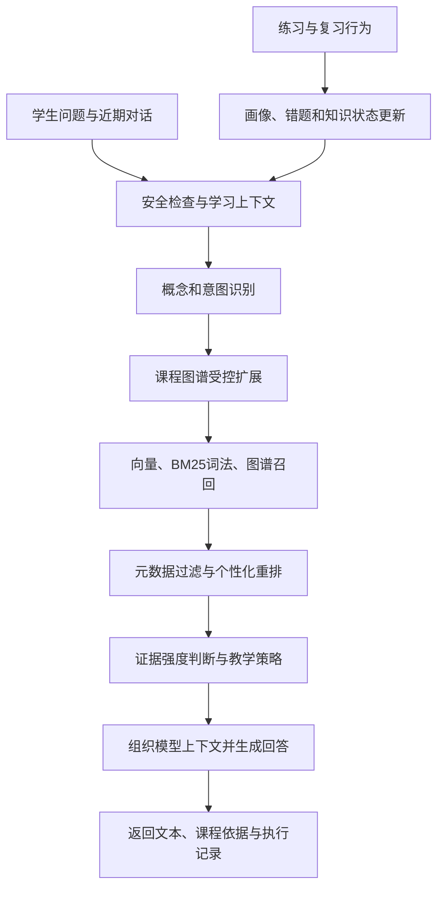

# PLEX 人工智能技术原理与答辩问答

版本：2026-10-12

适用场景：AI 技术专项评审、项目技术答辩

证据范围：当前仓库的实现与配置，以及本次本地启动观察。代码中具备的能力、当前运行状态和经过实验验证的效果分别表述；没有实测证据的指标不写成既有成果。

## 一、两分钟技术介绍

PLEX 是面向编程学习的个性化辅助系统。它把学生画像、课程知识图谱、检索增强生成和多角色任务编排结合起来，形成“收集学习证据—识别问题—提供资源和指导—通过练习更新学习状态”的反馈过程。

大模型主要承担自然语言理解、教学表达和内容生成。课程知识、学生学习记录、任务状态与推荐规则由业务系统管理，系统通过检索和结构化约束向模型提供依据。

在小E答疑链路中，系统先读取学习画像与近期错题，识别问题涉及的概念和意图，再结合知识图谱、向量检索和词法检索寻找课程材料。候选材料经过个性化重排，连同教学策略和对话历史一起提供给模型，最后记录来源、检索依据和执行信息。

在资源生成链路中，画像解释、知识检索、教学设计、资源生成、质量审核和路径规划按顺序协作。每一步都有明确的输入输出和执行记录，能够定位失败发生在哪个环节。不同环节可以采用规则或模型实现，并不意味着每个角色都对应一个独立训练的大模型。

当前的技术特点集中在教学场景的系统设计：把学生状态引入检索与生成，用课程关系组织学习材料，并通过练习、错题和复习记录持续调整建议。相关效果需要通过检索评测、生成质量评测和真实学习实验分别验证。

## 二、关键链路与实现边界

### 2.1 小E答疑



上图是正常链路。独立 RAG 接口和聊天适配层的低证据处理并不完全一致，不能把其中一处拒答策略说成全系统保证。检索过程读取学习画像；画像更新由相应行为和画像服务处理。

当前默认参数：

| 参数 | 默认值 | 含义 |
|---|---:|---|
| 向量候选数 | 20 | 向量召回候选预算 |
| 词法候选数 | 20 | BM25 召回候选预算 |
| 混合权重 alpha | 0.6 | 混合检索中向量归一化分的权重 |
| 最终材料数 | 6 | 重排后用于组织上下文的材料上限 |
| 同文档材料上限 | 3 | 减少同一文档占据全部上下文 |
| 上下文字符预算 | 3200 | 知识层的配置值；调用方还可能进一步压缩 |
| 默认前置扩展 | 1 跳 | 薄弱场景可扩到 2 跳 |
| 最大扩展节点 | 12 | 限制检索扩展规模 |

默认重排公式：

```text
S = 0.40H + 0.25G + 0.20L + 0.10T + 0.05Q

H：归一化混合检索分
G：概念相关性
L：学习者适配度
T：教师审核标记
Q：资源质量分
```

这些是配置驱动的人工权重，不能称为已经训练或证明最优的参数。

### 2.2 学习画像与诊断

当前画像字段共 8 个：专业背景、知识基础、学习目标、讲解偏好、易错模式、学习节奏、兴趣方向、当前学习状态。字段附带证据、来源和置信分，支持人工校准与历史版本。

诊断按语法、规则、逻辑、迁移四层组织错误，再参考尝试次数、历史错因和知识状态给出解释与补救策略。当前采用启发式规则；RAG 所用的掌握度由学习状态映射而来，不能等同于经过训练的知识追踪概率。

“当前学习状态”是教学辅助信号，不是心理或医学诊断。置信分是系统估计，不是已校准的统计概率。

### 2.3 资源生成与路径推荐

资源生成依次执行六个角色：

1. 画像解释：把学习特征转成难度、节奏和表达约束。
2. 知识检索：读取课程正文、概念关系与可用补充材料。
3. 教学设计：确定资源结构、案例与练习安排。
4. 资源生成：生成结构化学习包及相关资源。
5. 质量审核：检查结构、引用及相关风险，生成审核结果。
6. 路径规划：给出推荐理由与后续学习建议。

步骤记录包括角色、依赖、契约版本、状态、耗时、后端和模型。规则回退需要如实标记。现有执行器是进程内线程池，并不是已验证的分布式任务平台。

路径服务综合知识关系、掌握状态、关注点和到期复习项。当前全站自由进入开关已开启，前置知识用于推荐参考，不应介绍为强制逐关解锁。

## 三、18 个方向的预测问题与可口述回答

### 1. 你们有没有自己训练大模型？自主研发体现在哪里？

当前核查到的核心链路调用外部模型接口。自主实现主要是课程知识组织、学习画像管理、图谱增强检索、教学策略、诊断规则和任务编排。我们应通过这些模块的独立效果证明价值，不能把接入模型接口本身当成算法创新。

追问时可以展示：同一学生问题经过哪些处理、使用哪些材料、为什么选择这一类教学策略，而不是只展示聊天结果。

### 2. 实际使用什么模型？为什么材料里还写着讯飞？

当前小E聊天与通用模型调用存在 DeepSeek 优先的配置，资源流水线部分角色采用独立的 OpenAI 兼容配置，讯飞仍保留在部分备用链路中。不同功能的供应商选择并不完全相同，所以应以每次执行记录中的实际后端、模型和状态为准。

本次启动的健康接口显示配置了 deepseek-chat。这只证明配置状态，不能替代真实调用验收，也不能证明所有角色均使用同一个模型。

### 3. 图谱增强 RAG 比普通 RAG 多了什么？

普通检索主要寻找与问题相关的文本。PLEX 还利用前置知识、常见误区和相关概念扩展检索范围。例如学生问循环问题，系统可以结合其薄弱项补充前置概念。

这里使用的是课程图谱驱动的受控扩展，不应宣称完整复现了某个特定 GraphRAG 框架，也不能把图谱可视化本身当成推理效果证据。

### 4. 检索结果怎样排序？

当前实现结合向量、BM25 词法和图谱三类召回，再综合材料相关性与教学适配性重排。默认公式见第二节；其中混合检索分占 40%，概念相关性占 25%，学习者适配度占 20%，教师审核与资源质量分别占 10% 和 5%。

默认最终选取 6 个片段，同一文档最多 3 个。这样既考虑“材料和问题是否相关”，也考虑“这份材料是否适合当前学生”。

### 5. 权重是训练出来的吗？为什么这样设置？

目前是配置驱动的人工权重，属于可解释的工程初始方案，没有证据证明已经最优。后续应建立有相关性标注的课程查询集，比较纯词法、纯向量、混合检索、加入图谱和加入画像后的表现，并在独立测试集上验证调参结果。

不能用调参集上的提升代替泛化能力，也不能只展示一个有利案例。

### 6. Embedding 和聊天大模型有什么区别？离线怎么办？

Embedding 将文本转成用于比较和检索的向量，聊天模型负责生成回答。代码支持外部 Embedding 接口，也支持本地字符与词语特征的哈希向量。

哈希方案适合离线和稳定测试，但不能宣称具有与训练型语义嵌入相同的理解能力；代码也没有把它的绝对相似度当成可靠置信依据。离线回退属于能力边界内的替代机制，不等于模型效果完全不变。

### 7. 个性化体现在哪里？画像有几个维度？

当前代码定义了 8 个维度：专业背景、知识基础、学习目标、讲解偏好、易错模式、学习节奏、兴趣方向和当前学习状态。画像会影响材料难度、内容类型和讲解方式。字段保存证据、来源与置信分，并支持人工校准和版本记录。

旧材料中的“七维画像”需要按当前版本更新。这里的置信分是系统估计值，不是经过统计校准的正确概率。

### 8. 掌握度是不是贝叶斯知识追踪或深度知识追踪？

当前检查到的主链路采用规则判断：依据作答情况、错误次数和复习表现形成学习状态，再映射为检索与路径推荐使用的分值。它是可解释的启发式方法。

不能把这些状态映射分值称为训练得到的 BKT 或 DKT 概率。如果未来引入知识追踪模型，需要说明训练数据、序列划分、预测目标、校准和评测方法。

### 9. 怎样区分“不会”和“会但写错”？

诊断模块将错误分为语法、规则、逻辑和迁移四层，并结合尝试次数、历史错因和已有知识状态，判断是尚未掌握、细节出错还是迁移困难。

例如，已经会求和遍历，却在最大值题目中继续使用累加结构，会触发迁移相关判断。当前主要依据规则，诊断准确率仍需人工标注样本验证；规则判断是教学建议，不是对学生能力的绝对结论。

### 10. 多智能体为什么有必要？是不是换几个提示词？

这里的价值在于明确职责与数据交接。资源流水线的六个角色分别产生教学约束、知识材料、教学设计、学习资源、审核结果和路径建议，并保存依赖、契约版本、耗时和实际后端。

当前属于受控的顺序任务编排；CrewAI 是可选运行机制，不能把整个系统描述为多个模型自由讨论。多角色设计是否优于单次生成，需要用质量、可追溯性、失败定位和成本实验来回答。

### 11. 如何减少幻觉？检索置信度能否代表答案正确率？

系统通过课程材料检索、来源约束、结构校验和低证据处理降低风险。检索置信度综合原始查询的证据强度、概念匹配和支持片段数量，用来判断依据是否充足，不代表答案有多少概率正确。

材料相关也不保证模型解释正确，还需要检查引用是否真正支持结论。需要区分独立 RAG 接口与小E聊天：两者的低证据处理并不完全一致，不能承诺所有入口都严格拒答。

### 12. 会不会直接把作业答案给学生？

练习场景会过滤答案类型材料，并按提示级别控制概念提示、思路和代码片段。输出层还会处理代码块。不过当前配置也存在允许完整讲解的高级别。

准确说法是“按场景和提示策略控制答案开放程度”，不能说“任何情况下都不给完整答案”。还需要测试自然语言泄题和短代码绕过，不能把代码块裁剪当成完整的防泄题保证。

### 13. 学习路径由大模型决定吗？一定要按顺序学吗？

路径服务主要依据知识关系、掌握状态、当前关注点和到期复习项排序，再绑定资源与练习。模型可以补充解释和建议。

当前全站自由进入开关已开启，前置知识用于推荐和补救参考，不能宣称系统强制按掌握度逐关解锁。推荐路径和访问权限是两件不同的事。

### 14. 错题复习为什么使用 SM-2？

SM-2 根据回忆质量调整复习间隔和容易度参数，适合形成可解释的复习计划。PLEX 保存复习轮次、质量和到期时间，并将复习结果纳入学习状态与路径建议。

它是基于反馈的间隔调度方法，不能表述为精确预测每个学生的遗忘曲线。复习调度是否改善长期保持，需要延迟测验来验证。

### 15. 小E的“记忆”如何实现？

目前包含短期对话上下文和持久化学习画像。聊天链路最多取最近 18 条消息，每条有长度限制；较长期的学习特征以结构化画像和行为记录保存。

这个过程更新的是外部状态，没有证据表明每次对话都会更新大模型参数，因此不属于在线训练。也不能承诺模型无限记住所有历史对话。

### 16. 如何证明效果来自图谱和个性化，而不是大模型本来就好？

需要在相同模型、题目和生成参数下做消融实验，分别比较直接问模型、普通 RAG、图谱增强 RAG，以及加入画像的完整方案。

检索看 Recall@K、排序质量；回答看正确性、证据支持度和教学适配性；学习效果还需要匹配难度的前后测和对照组。当前系统已有资源任务创建前后的同知识点作答统计，前后各至少 3 次才给变化量。它只能描述变化，不能单凭此证明因果提升；任务创建时间也不能完全代替真实学习资源的使用时间。

### 17. 模型超时或向量库故障时，系统还能工作吗？

部分链路实现了备用供应商、规则或抽取式回退，并记录后端与失败信息。但不能据此保证所有异常都能被覆盖。

本次启动发现 Chroma 初始化线程报错，而基础健康接口仍返回正常。随后实际聊天成功返回，独立检索也返回了课程证据，但调试数据中的向量通道命中数为 0，词法与图谱通道有命中。这说明当前请求可以由其他检索通道提供材料，不能据此宣布向量库已恢复。该异常尚未修复。

### 18. 延迟、并发和数据安全怎样控制？

性能方面，系统使用 SSE 增量返回、上下文长度限制、超时预算和后台任务，资源执行器当前默认 2 个工作线程。它们是实现机制，不是高并发能力的证明；应测量首字延迟、总耗时、P95 延迟、队列等待与失败率，代码中的目标值不能当成实测值。

安全方面，已有角色权限、画像字段约束、提示注入规则检查和面向学生的精简返回。但正则检查不能完整防御提示注入，外部模型调用也不等于数据完全留在本地。应明确发送的数据范围，并用越权、恶意文档和敏感信息测试验证边界。

## 四、答辩材料的统一表述

| 容易被质疑的表述 | 当前版本应使用的表述 |
|---|---|
| 自研教育大模型 | 基于外部大模型的教学应用系统，自主实现画像、检索、策略和编排 |
| 七维画像 | 当前 8 个画像字段，其中学习状态为教学辅助信号 |
| 全部能力由讯飞提供 | 各功能采用不同模型路由，以实际执行记录为准 |
| 六个角色就是六个独立训练模型 | 六个职责明确的处理角色，可由规则或模型实现 |
| 使用深度知识追踪预测掌握概率 | 当前主链路采用规则状态及分值映射 |
| 检索置信度就是答案正确率 | 检索置信度用于衡量材料依据是否充足 |
| 图谱保证学生按顺序通关 | 当前允许自由进入，图谱用于推荐与补救 |
| AI 能自动消除幻觉 | 通过检索、校验和低证据策略降低风险，仍需评测 |
| 首字固定 1.5 秒、支持高并发 | 配置目标不等于实测结果，应提供测试条件与分位延迟 |
| 生成资源后正确率提升就证明有效 | 现有前后统计属于观察性结果，因果结论需要对照实验 |

历史提交稿可以保留其版本日期；当前演讲、展示和新提交材料统一采用本稿口径，不要将历史测试结果改写成新版本验收。

## 五、演示前证据清单

以下清单区分本轮已核查的记录与仍需完成的验证：

- [ ] 一次真实模型调用：记录日期、用途、模型、实际后端、成功状态和耗时，不保存或展示密钥。
- [x] 一次实际知识检索：2026-10-12 请求成功，已查看课程材料、概念关系、重排分解；向量通道命中为 0，尚不能作为向量检索验收。
- [x] 一次资源流水线执行记录：已读取历史完成任务及六步后端、模型、耗时和状态；这不是本轮重新生成任务的证明。
- [ ] 一次普通学生画像与推荐演示：避免用特殊演示账号的数据代替真实算法表现。
- [ ] 模型不可用或超时场景：确认回退后没有伪装成真实模型成功。
- [ ] 检索无依据场景：区分独立 RAG 与聊天接口的实际行为。
- [ ] 解决并复验本次观察到的向量库初始化异常。
- [ ] 将检索评测、消融实验、压力测试和学习效果实验分开记录；未完成的项目明确标记待验证。

本轮运行补充（2026-10-12）：聊天 SSE 返回 `source=llm_stream`、`rag_used=true`，有增量文本、结束事件和知识来源；一次接口报告首字耗时 2235ms，总请求约 2875ms。这只是单次本地样本，不代表 P95 或稳定性能。响应没有暴露实际供应商与模型名称，因此仍保留上面的完整模型记录验收项。

独立检索日志 ID 为 `16`，通道统计为 `lexical=20`、`graph=12`、`vector=0`，命中「模块四：循环结构 › for 与 range」等材料，并返回重排分解。历史资源任务 `rg_3a943649244d449d8e20` 完成于 2026-08-28；六步均为 `completed`，资源生成步骤记录 `deepseek / deepseek-chat`，其他五步记录 `openai / gpt-4o-mini`。历史记录不能代替当前全流水线可用性测试。

## 六、代码与原理出处

| 主题 | 代码位置 |
|---|---|
| 模型选择、角色独立配置 | [llm_client.py](../backend/agents/llm_client.py) |
| 聊天上下文与流式处理 | [messenger_chat.py](../backend/app/services/messenger_chat.py) |
| 画像字段、证据与更新 | [student_profile.py](../backend/app/services/student_profile.py) |
| 检索默认参数 | [retrieval.json](../backend/app/services/knowledge/config/retrieval.json) |
| 重排实现 | [rerank_service.py](../backend/app/services/knowledge/rerank_service.py) |
| 置信度与答案策略 | [rag_service.py](../backend/app/services/knowledge/rag_service.py) |
| 嵌入与本地哈希方案 | [embedding.py](../backend/app/services/knowledge/providers/embedding.py) |
| 六角色资源流水线 | [personalized_resource.py](../backend/app/services/personalized_resource.py) |
| 错因层级与能力判别 | [诊断结构](../backend/agents/diagnosis/schema.py)、[判别规则](../backend/agents/diagnosis/proficiency.py) |
| 路径推荐与自由进入开关 | [learning_path.py](../backend/app/services/learning_path.py)、[star_path_unlock.py](../backend/app/constants/star_path_unlock.py) |
| SM-2 复习实现 | [mistake.py](../backend/app/services/mistake.py) |
| 学习效果观察性统计 | [evaluation.py](../backend/app/services/evaluation.py) |

原理参考：[RAG 原始论文](https://arxiv.org/abs/2005.11401)、[SM-2 原始算法说明](https://super-memory.org/archive/english/ol/sm2.htm)。引用原理不意味着复现了论文训练流程或取得了论文指标。
