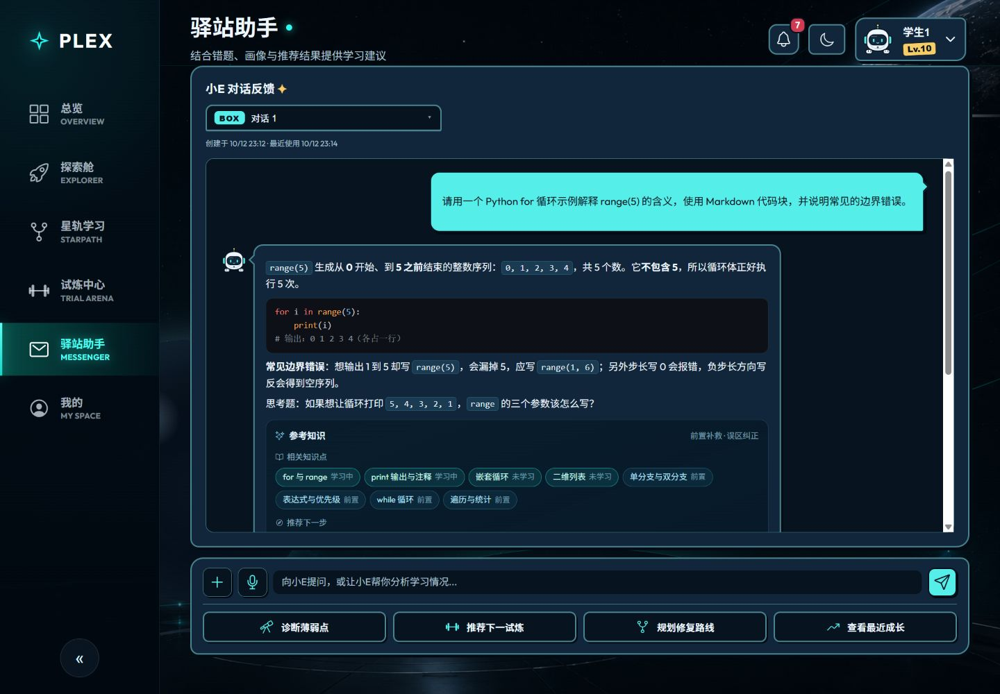

# PLEX 深色太空漫画 UI 设计归档

日期：2026-10-12。这里保存本次改版的输入截图、四张已确认效果图和浏览器验收截图，供 GitHub 查看和后续设计复用。

- [完整 UI 改版提示词包](../../PLEX-深色太空漫画UI改版提示词.md)
- [实施与验收记录](../../2026-10-12-plex-comic-implementation.md)
- [AI 技术原理与答辩问答](../../PLEX-AI技术原理与答辩问答.md)

## 设计参考与已确认效果图

| 区域 | 原始截图 | 已确认效果图 |
|---|---|---|
| 新手导航 | [原图](references/01-navigation-original.png) | [效果图](previews/01-navigation.png) |
| 资源看板 | [原图](references/02-dashboard-original.png) | [效果图](previews/02-dashboard.png) |
| 小E聊天 | [原图](references/03-chat-original.png) | [空态与消息态](previews/03-chat.png) |
| 顶部信息栏 | [原图](references/04-topbar-original.png) | [效果图](previews/04-topbar.png) |

效果图由图像工具生成，其中聊天文字是视觉示例。它们不是应用截图或模型调用记录，也没有作为整张背景接入页面。

## 实际页面

| 截图 | 内容 |
|---|---|
| [01-tour-dark.jpg](screenshots/01-tour-dark.jpg) | 深色学生导览 |
| [02-dashboard-dark.jpg](screenshots/02-dashboard-dark.jpg) | 桌面资源看板和信息栏 |
| [03-chat-empty-dark.jpg](screenshots/03-chat-empty-dark.jpg) | 小E欢迎空态 |
| [04-topbar-menu.jpg](screenshots/04-topbar-menu.jpg) | 用户菜单检查 |
| [05-chat-mobile.jpg](screenshots/05-chat-mobile.jpg) | 手机聊天 |
| [06-chat-light.jpg](screenshots/06-chat-light.jpg) | 浅色主题检查过程中的截图，拍摄后又修正了标题和引用卡片对比度 |
| [07-tour-light.jpg](screenshots/07-tour-light.jpg) | 浅色学生导览 |
| [08-dashboard-mobile.jpg](screenshots/08-dashboard-mobile.jpg) | 手机资源看板 |
| [09-chat-message-dark.jpg](screenshots/09-chat-message-dark.jpg) | 真实聊天回答、代码块和知识来源 |
| [10-tour-mobile.jpg](screenshots/10-tour-mobile.jpg) | 手机导览边界检查 |

页面使用真实业务数据，因此数值或会话时间可能与设计预览不同。最终外观以当前 Vue 组件为准，具体已测项目与未测项目以验收记录为准。

