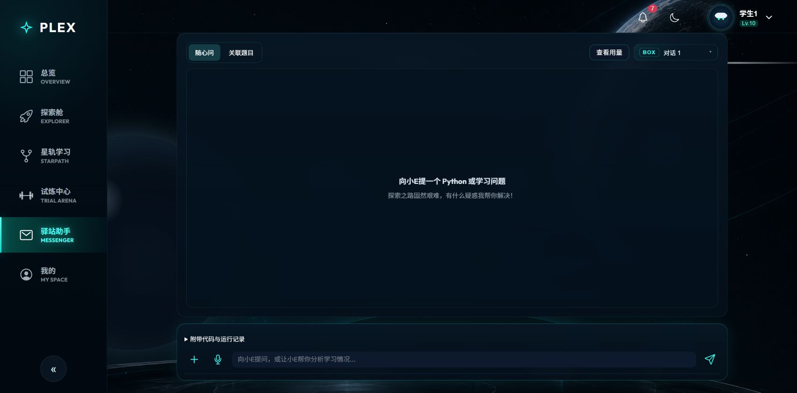

# 公网发布页面抽查（2026-10-22）

`messenger.png` 为 `https://106.15.77.40/student/messenger` 上的演示账号截图，经典太空／黑夜外观。可见随心问和关联题目切换、右侧查看用量与 BOX，以及无重叠的聊天/输入区域；重复大标题不占视觉空间。

抽查还覆盖登录、导览关闭、用量加载、均分明细和资源回收站空态。截图不包含真实用户对话或密钥；全主题/宽度的本地检查见 [UI 修正文档](../../2026-10-22-ui-layout-refinement.md)，公网发布、数据保留与环境限制见 [发布交接](../../2026-10-22-release-and-handoff.md)。

